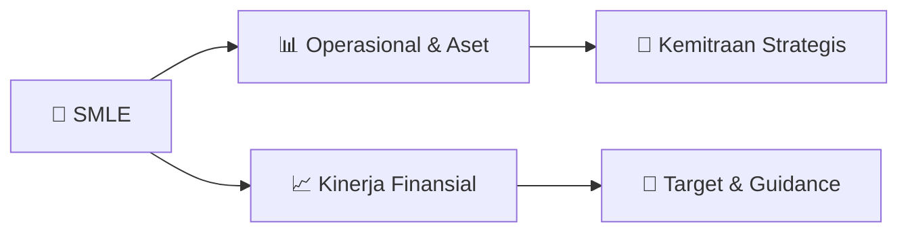

# 📊 Materi Public Expose: [SMLE]

🏢 **Emiten**: `SMLE` | 📅 **Tanggal Pelaksanaan**: `2026-09-08` | 📑 **Total Slide**: `1 Slide`
⬅️ [[knowledge-base/daily-digests/SMLE_20260908|Kembali ke Daily Digest]] | 🎛️ [[Dashboard/SMLE|Ke Dashboard Emiten]]

> [!NOTE]
> Ringkasan materi presentasi resmi Public Expose SMLE yang disampaikan oleh manajemen kepada investor dan bursa. Seluruh poin strategis, matriks operasional, dan angka kinerja diekstrak langsung dari slide deck resmi.

---

## 📅 1. Jadwal & Metadata Penyelenggaraan

| Parameter | Detail Informasi |
|---|---|
| **Nomor Surat Pengantar** | 0092/P-DIR/SMLE/IX/2026 |
| **Perihal Pengumuman** | Penyampaian Materi Public Expose Tahunan |
| **Waktu Pelaksanaan** | 2026-09-08 08-09-2026 14:56 |
| **Lokasi / Media** | Aplikasi Zoom / Daring |
| **Lampiran Resmi** | `2` |

## 📋 2. Agenda Paparan Publik

1. Nomor
2. : 0092/P-DIR/SMLE/IX/2026
3. Lampiran
4. : 1 (satu) file Materi Pubic Expose Tahunan
5. Perihal
6. : Penyampaian Materi Paparan Publik (Public Expose) Tahunan 2026
7. PT Sinergi Multi Lestarindo Tbk.
8. Kepada Yth.
9. Direktur Pencatatan
10. PT Bursa Efek Indonesia
11. Gedung Bursa Efek Indonesia Tower 1
12. Jl. Jendral Sudirman Kav 52-53
13. Jakarta 12190
14. Dengan hormat,
15. Merujuk surat PT Sinergi Multi Lestarindo Tbk dengan nomor 0090/P-DIR/SMLE/VIII/2026 tanggal
16. 28 Agustus 2026 perihal Pemberitahuan Rencana Penyelenggaraan Public Expose Tahunan
17. 2026, dengan ini kami sampaikan materi Public Expose Tahunan (file terlampir), yang akan
18. diselenggarakan pada :
19. Hari/Tanggal
20. : Jumat /11 September 2026
21. Waktu
22. : 09.00 WIB s/d Selesai
23. Tempat Agenda : IDX Public Expose Live 2026 dan pendaftaran peserta di
24. https://pubexlive.idx.co.id/
25. Agenda
26. :  Paparan Kinerja Perseroan, Prospek Bisnis dan Press Conference
27. Demikian disampaikan, terima kasih atas perhatian dan kerjasamanya.
28. Hormat kami,
29. PT Sinergi Multi Lestarindo Tbk
30. Siu Min
31. Direktur Utama
32. PT Sinergi Multi Lestarindo Tbk
33. Business Park Kebon Jeruk, Blok I No. 5-6
34. Jl. Raya Meruya Ilir Kav. 88 Meruya Utara, Kembangan, Jakarta 11620, Indonesia P
35. +62 21 300-679-71 | F +62 21 300-679-93 | Web: www.ptsml.id

## 🏢 3. Profil & Pilar Portofolio Bisnis

## 🏗️ 4. Kinerja Operasional & Portofolio Aset

*Detail aset operasional terlampir pada dokumen slide resmi.*

## 📈 5. Kinerja Keuangan & Posisi Finansial

## 🧭 6. Inisiatif Strategis, Kolaborasi, & Kemitraan

*Strategi usaha difokuskan pada penguatan fundamental dan ekspansi operasional.*

## 🎯 7. Target Pertumbuhan & Guidance Manajemen

*Target pertumbuhan ditetapkan mengacu pada prospek industri dan kondisi makroekonomi terkini.*

## 🗺️ 8. Peta Jalur Strategis & Eksekusi

## 📑 9. Daftar Indeks Slide Presentasi

| Slide # | Judul / Topik Slide | Ringkasan Konten |
|---|---|---|
| Slide 1 | **Jakarta, 8 September 2026** | Nomor : 0092/P-DIR/SMLE/IX/2026 Lampiran |

---

*Dokumen diolah otomatis oleh **Swarm Intelijen Pasar Modal Indonesia** pada 2026-10-12 16:48 WIB.*