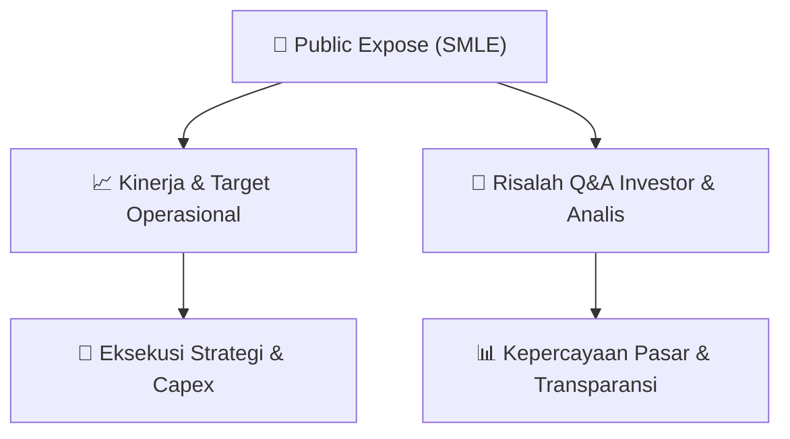

# 📢 Laporan Intelijen Paparan Publik (Public Expose) - [[SMLE]]
🏢 **Emiten**: `[[SMLE]]` | 📅 **Tanggal Pelaksanaan**: `2026-09-08` | 📑 **Dokumen**: `Public Expose`
⬅️ [[knowledge-base/daily-digests/Daily_Digest_20260908|Kembali ke Daily Digest]] | 🎛️ [[Dashboard|Ke Dashboard Utama]]

---

## 📌 1. Ringkasan Eksekutif & Paparan Direksi
> [!NOTE]
> PT Sinergi Multi Lestarindo Tbk (SMLE) menyelenggarakan Public Expose Tahunan pada 11 September 2026. Dokumen ini merupakan surat penyampaian materi Public Expose kepada otoritas bursa, yang merujuk pada pengumuman rencana Public Expose melalui surat No. 0090/P-DIR/SMLE/III/2026 tanggal 28 Agustus 2026. Materi Public Expose disampaikan sebagai lampiran, mencakup presentasi dan surat penyampaian materi. Public Expose ini merupakan agenda tahunan untuk memaparkan kinerja, strategi, dan menjawab pertanyaan pemegang saham serta analis.

#### 🎯 Guidance Operasional & Target Strategis
- Dokumen ini tidak memuat rincian target kinerja, ekspansi, atau capex secara eksplisit. Informasi tersebut kemungkinan besar terdapat dalam materi presentasi Public Expose yang dilampirkan (file 'PUBEX SMLE 11 September 2026.pdf'). Namun, penyelenggaraan Public Expose Tahunan itu sendiri merupakan katalis informasi bagi investor untuk mendapatkan update terbaru mengenai kinerja dan prospek perusahaan.

## 📊 2. Matriks Indikator Operasional & Parameter Kunci
| Parameter Utama | Nilai / Keterangan Resmi |
| :--- | :--- |
| **Tanggal Public Expose** | `11 September 2026` |
| **Nomor Surat Penyampaian Materi** | `0092/P-DIR/SMLE/IX/2026` |
| **Tanggal Surat Penyampaian Materi** | `08 September 2026` |
| **Rujukan Surat Pengumuman Rencana Public Expose** | `No. 0090/P-DIR/SMLE/III/2026, tanggal 28 Agustus 2026` |
| **Corporate Secretary** | `Arry Wahyu Riansyah` |
| **Alamat Kantor** | `Business Park Kebon Jeruk Blok I 5-6` |
| **Kontak** | `Telepon: (021) 3006 7971, Fax: (021) 3006 7993, www.ptsml.id` |

---

## 💬 3. Risalah Tanya Jawab (Q&A Session)
### ❓ Pertanyaan 1 (Tidak tersedia dalam dokumen)
**Pertanyaan**: Dokumen ini hanya berisi surat penyampaian materi Public Expose dan tidak memuat transkrip tanya jawab. Pertanyaan dan jawaban akan disampaikan pada saat acara Public Expose berlangsung.

**Jawaban Manajemen**: Tidak tersedia dalam dokumen. Manajemen akan memberikan jawaban langsung pada sesi tanya jawab saat Public Expose berlangsung.

> [!TIP]
> **Implikasi Bagi Investor**: Investor yang ingin mendapatkan klarifikasi atau informasi lebih lanjut mengenai kinerja dan prospek SMLE diharapkan untuk hadir atau mengikuti siaran langsung Public Expose pada 11 September 2026.

## 📌 4. Peta Jalur Strategis & Roadmap

---

## 🔗 Knowledge Graph
- [[knowledge-base/daily-digests/Daily_Digest_20260908|📄 Daily Digest 2026-09-08]]
- [[knowledge-base/calendars/Action_Calendar|🗓️ Kalender Terpusat Aksi Korporasi]]
- [[Dashboard|🎛️ Kembali ke Dashboard Utama]]