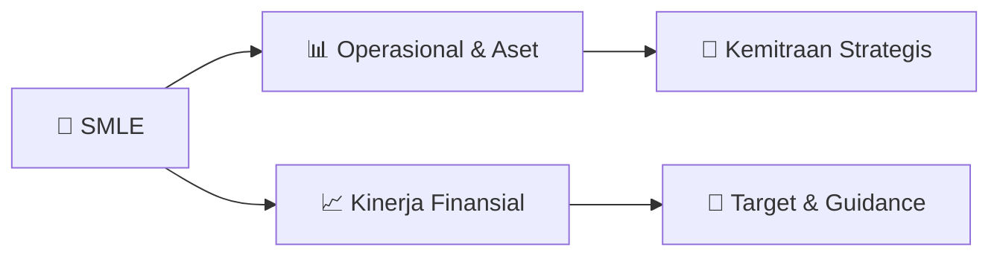

# 📊 Materi Public Expose: [SMLE]

🏢 **Emiten**: `SMLE` | 📅 **Tanggal Pelaksanaan**: `2026-09-10` | 📑 **Total Slide**: `31 Slide`
⬅️ [[knowledge-base/daily-digests/SMLE_20260910|Kembali ke Daily Digest]] | 🎛️ [[Dashboard/SMLE|Ke Dashboard Emiten]]

> [!NOTE]
> Ringkasan materi presentasi resmi Public Expose SMLE yang disampaikan oleh manajemen kepada investor dan bursa. Seluruh poin strategis, matriks operasional, dan angka kinerja diekstrak langsung dari slide deck resmi.

---

## 📅 1. Jadwal & Metadata Penyelenggaraan

| Parameter | Detail Informasi |
|---|---|
| **Nomor Surat Pengantar** | 0094/P-DIR/SMLE/IX/2026 |
| **Perihal Pengumuman** | Penyampaian Materi Public Expose Tahunan |
| **Waktu Pelaksanaan** | 2026-09-10 10-09-2026 16:28 |
| **Lokasi / Media** | Aplikasi Zoom / Daring |
| **Lampiran Resmi** | `2` |

## 📋 2. Agenda Paparan Publik

- Pemaparan Profil & Struktur Bisnis Perseroan
- Kinerja Operasional & Keuangan
- Arah Strategi Usaha & Target Pertumbuhan
- Sesi Tanya Jawab (Q&A)

## 🏢 3. Profil & Pilar Portofolio Bisnis

## 🏗️ 4. Kinerja Operasional & Portofolio Aset

> PORTOFOLIO Pemasok Utama Key Supplier Tenaga Penjualan Sales Person
Tenaga Lab Aplikasi
Lab Application Staff
Laboratorium Aplikasi Application Laboratories Gudang Warehouse Pelanggan Customers
Proyek sedang Berjalan
Ongoing Projects
Formulasi Siap Pakai dan Disesuaikan
Berdasarkan Kebutuhan Pelanggan
Pro-formulated and Customized Formulations
Based on Customer Needs
15+ 15+ 15+ 30+ 30+ 30+ 4K+ 4K+ 4K+ 7K+ 7K+ 7K+ 2K+ 2K+ 2K+
PT Sinergi Multi Lestarindo Tbk

> KEGIATAN PERSEROAN 2026
ICI (Indonesia Cosmetic Ingredients)
Jakarta, 6-8 Mei 2026
Pelanggan Baru Pengunjung Booth SML
Total Proyek Baru
yang Diperoleh Pelanggan Lama 531 260
PT Sinergi Multi Lestarindo Tbk

> Pelanggan Baru Target Pengunjung Booth SML
Total Proyek Baru
yang Diperoleh Pelanggan Lama 150 700 350
PT Sinergi Multi Lestarindo Tbk
KEGIATAN PERSEROAN 2026
Fi Asia (Food Ingredients Asia)
Jakarta, 16-18 September 2026

> Srategi Pengembangan Kemitraan Baru Fokus Pasar
Untuk menjaga pertumbuhan yang
berkelanjutan, Divisi Food memperkuat
strategi melalui kemitraan dengan
beberapa supplier baru untuk
memperluas portofolio bahan baku,
khususnya: Probiotik Postbiotik Susu kambing
Solusi penetral rasa pahit
Peningkatan pertumbuhan bisnis tahun
2026 didorong oleh penjualan bahan baku
baru dari berbagai proyek yang telah
mendapatkan persetujuan pelanggan,
terutama bahan baku spesial yang
memiliki nilai tambah lebih tinggi, seperti:
Protein susu fungsional
Perisa alami
Pelapis untuk permen & coklat
Pewarna alami
Pengembangan portofolio ini diarahkan
untuk membuka peluang baru dan
memperkuat penetrasi di pasar:
Health & Wellness
Functional Food Nutritional Products Arah Pengembangan 2026
“Memperkuat bahan baku bernilai tambah tinggi, membangun kemitraan strategis, dan
memperluas penetrasi pasar Health & Wellness, Functional Food, serta Nutritional Products.”
PENGEMBANGAN BISNIS
DIVISI FOOD INGREDIENTS
PT Sinergi Multi Lestarindo Tbk

> Srategi Pengembangan Kemitraan Baru Fokus Pasar PENGEMBANGAN BISNIS
DIVISI INDUSTRIAL CHEMICAL
Untuk menjaga pertumbuhan yang
berkelanjutan, Divisi Industrial Chemical
memperkuat strategi melalui kemitraan
strategis dengan GK Coating serta beberapa
supplier terkemuka untuk memperluas
portofolio bahan baku industri, khususnya:
Coating Resins & Additives (GK Coating)
Pigments & Functional Fillers
Specialty Emulsions & Performance
Chemicals
Surface Modification Agents
Peningkatan pertumbuhan bisnis tahun
2026 didorong oleh penjualan bahan baku
baru dari berbagai proyek yang telah
mendapatkan persetujuan pelanggan,
terutama specialty chemicals yang
memiliki nilai tambah lebih tinggi, seperti:
Additives & Modifiers
UV Absorbers & Light Stabilizers
Performance Minerals & Fillers
Specialty Fluids & Emulsions
Pengembangan portofolio ini diarahkan
untuk membuka peluang baru dan
memperkuat penetrasi di berbagai
segmen industri utama:
Paint & Coatings Industry (Cat
dekoratif, otomotif, & industri)
Plastics & Polymer Processing (Pipa
PVC, kemasan, & komposit)
Industrial & Specialty Formulations
(Adhesives, sealants, & aplikasi teknis)
Arah Pengembangan 2026
“Memperkuat Specialty Industrial Che

## 📈 5. Kinerja Keuangan & Posisi Finansial

## 🧭 6. Inisiatif Strategis, Kolaborasi, & Kemitraan

- VISI MISI PERUSAHAAN
“Untuk mencapai potensi maksimal dan menjadi berkat bagi
banyak orang” VISI MISI
Menyediakan produk dan solusi inovatif yang memberikan nilai
lebih bagi klien kami.
Menjadi mitra terpercaya bagi klien kami.
Bekerja sama dengan mitra bisnis dan prinsipal guna
mengembangkan produk berkualitas dan bisa dipasarkan oleh
pelanggan kami.
Mengembangkan sumber daya manusia yang kompeten, inovatif,
dan berdedikasi untuk pertumbuhan perusahaan.

- Pengalaman 24 Tahun di
Industri Kimia
Pengalaman 3 Tahun di
Industri Tekstil Tanti Royani
Direktur Keuangan &
Operasional
Pengalaman 27 Tahun di Bidang
Bahan Baku Makanan, Perawatan
Pribadi, dan Industri Nutraceutical
Yulia Rosaline Direktur Pemasaran dan Penjualan
Pengalaman 27 Tahun di
Bidang Bahan Baku
Makanan Dessy Sarendiani Direktur Pengembangan Produk
Pengalaman 13 tahun di
bidang Umum dan
Konstruksi Berat & Industri
Kimia Liawan Yusdianto Direktur Kemitraan
Pengalaman 19 Tahun
di Industri Kimia
Pengalaman 8 Tahun
di Industri FMCG
Siu Min Direktur Utama Direktur Kemitraan
Pengalaman 13 Tahun di
Industri Kimia
Pengalaman 16 Tahun di
Industri FMCG Gunawan Presiden Komisaris
Pengalaman 31 Tahun di Pasar
Modal (Bapepam)
Pengalaman 18 tahun sebagai
Komite Audit dan Komisaris
Independen Basa Sidabutar Komisaris Independen
Pengalaman 33 Tahun di Bisnis
Konstruksi
Pengalaman 13 Tahun di
Industri Kimia Halim Liawan Komisaris

- PENGEMBANGAN BISNIS
DIVISI PERSONAL CARE & COSMETICS
Srategi Pengembangan Kemitraan Baru Fokus Pasar
PT Sinergi Multi Lestarindo Tbk
Strategi ini bertujuan untuk meningkatkan
bisnis dari existing customer sekaligus
mengembangkan customer baru melalui
produk-produk dengan inovasi dan nilai
tambah yang sesuai dengan perkembangan
tren industri personal care.
Surfactant Silicone
Divisi Personal Care mengembangkan
portofolio dengan mengikuti tren & inovasi
global dari Jepang, Korea, China dan Eropa
sekaligus menghadirkan bahan baku inovatif
untuk membuka aplikasi dan peluang pasar.
Jepang — Quality & Precision
Korea — Trendy & Innovative
China — Innovation & Competitive Value
Eropa — Science & Sustainability
Di tahun 2026, SML mengembangkan
bisnis melalui kerja sama dengan supplier
dan project baru dengan fokus pada
surfactant & silicone yang dapat
mendukung pengembangan bisnis baru di
kategori: Makeup Decorative Facial Wash Body Wash Skincare Arah Pengembangan 2026
“Global Beauty Trends, Innovative Ingredients, New Supplier Partnership, New
Applications, dan Business Growth.”

- PENGEMBANGAN BISNIS DIVISI FRAGRANCES Srategi Pengembangan Kemitraan Baru Fokus Pasar
PT Sinergi Multi Lestarindo Tbk
Divisi Fragrance bekerja sama dengan
supplier baru dari Eropa. Produk
fragrance akan dikembangkan dan
dipasarkan melalui brand SMLE, yaitu
GK Fragrance, sebagai bagian dari
penguatan portofolio dan
pengembangan pasar dengan
fleksibilitas yang lebih besar.
Divisi Fragrance memperluas penetrasi
pasar di berbagai wilayah Indonesia
untuk memperkuat jangkauan,
meningkatkan customer base, dan
mendorong pertumbuhan bisnis, dengan
fokus pada pengembangan customer di
segmen: Retail Laundry
Penetrasi dilakukan ke seluruh
Indonesia, didukung oleh keahlian
Eropa dari supplier baru yang
menghadirkan: Premium scents Innovative creations. Arah Pengembangan 2026
“Market Expansion, New Customer Development, New Fragrance Portfolio, dan
SML Brand Development.”

- Emmi Nutritional Solutions (ENS)
Kemitraan SMLE dengan ENS (Emmi Group) untuk penyediaan
bahan baku dairy berbasis susu kambing & domba berkualitas
tinggi untuk berbagai aplikasi nutrisi dan kesehatan.
Bahan baku:
Full Cream Goat Milk Powder, Skimmed Goat Milk Powder, Goat
Milk Protein / MPC, Goat Whey Protein Concentrate 55%
BioGrowing
SMLE berpartner dengan dengan BioGrowing, perusahaan probiotik asal China
dengan pengalaman lebih dari 20 tahun, untuk memperluas portofolio probiotik,
postbiotik & starter cultures dengan dukungan R&D dan solusi aplikasi.
Bahan baku:
Probiotic Strains, Postbiotics, Starter Cultures, ODM/CDMO
KEMITRAAN STRATEGIS 2026
PT Sinergi Multi Lestarindo Tbk
GK Group
SMLE bersama GK Group yang berbasis di China dengan tiga lini bisnis utama yaitu GK Silicones,
GK Spices, dan GK Coatings, membangun kemitraan strategis dengan menciptakan brand baru
bersama, ditandai dengan peluncuran GK Silicones pada ICI 2026, Mei lalu.
Lini bisnis GK Group:
GK Silicones: bahan baku silicone untuk kosmetik, skincare, haircare dan perawatan pribadi
lainnya
GK Spices: bahan baku rempah untuk industri makanan
GK Coatings: bahan kimia industrial untuk coatings

- HASIL MINYAK NILAM
ESSENCE PA 32%+ Kualitas tertinggi dengan aroma tajam dan stabil, cocok untuk industri parfum dan kosmetik premium. PREMIUM PA 28-32% Kualitas unggul untuk kebutuhan kosmetik, aromaterapi, dan farmasi kelas atas STANDAR PA 25-28% Pilihan ekonomis namun tetap murni, cocok untuk produksi massal dan kebutuhan industri.
TENTANG PT KENCANA ALAM SAKTI (PT KAS)
SMLE menjalin kerja sama dengan PT KAS yang menjalankan kegiatan produksi nilam berkualitas tinggi untuk pasar
lokal maupun ekspor dimulai tahun 2027. SMLE juga memperkuat bisnis nilam sebagai komoditas strategis Indonesia dan
menempatkan fragrance & flavors sebagai fokus utama dalam ekspansi bisnis baru, mendukung pertumbuhan
berkelanjutan di kategori bernilai tinggi tersebut.

## 🎯 7. Target Pertumbuhan & Guidance Manajemen

*Target pertumbuhan ditetapkan mengacu pada prospek industri dan kondisi makroekonomi terkini.*

## 🗺️ 8. Peta Jalur Strategis & Eksekusi

## 📑 9. Daftar Indeks Slide Presentasi

| Slide # | Judul / Topik Slide | Ringkasan Konten |
|---|---|---|
| Slide 1 | **PUBLIC EXPOSE** | PUBEX PUBEX PUBEX |
| Slide 2 | **VISI MISI PERUSAHAAN** | “Untuk mencapai potensi maksimal dan menjadi berkat bagi banyak orang” VISI |
| Slide 3 | **PERJALANAN KAMI** | Didirikan di Jakarta untuk Bisnis Personal Care dan Bahan Baku |
| Slide 4 | **PORTOFOLIO** | Pemasok Utama Key Supplier Tenaga Penjualan |
| Slide 5 | **Pengalaman 24 Tahun di** | Industri Kimia Pengalaman 3 Tahun di Industri Tekstil |
| Slide 6 | **Inti Bisnis** | Inti Bisnis Inti Bisnis Inti Bisnis |
| Slide 7 | **BISNIS UTAMA PERSEROAN** | BAHAN BAKU KHUSUS MAKANAN (Food Ingredients) |
| Slide 8 | **Ikhtisar Kinerja** | Keuangan Ikhtisar Kinerja Keuangan |
| Slide 9 | **Dalam Jutaan Rupiah** | Q1-25 Q1-26 53.982 |
| Slide 10 | **TAHUNAN** | 2023 2024 2025 |
| Slide 11 | **Kegiatan** | Perseroan 2026 Kegiatan Perseroan 2026 |
| Slide 12 | **KEGIATAN PERSEROAN 2026** | ICI (Indonesia Cosmetic Ingredients) Jakarta, 6-8 Mei 2026 Pelanggan |
| Slide 13 | **Pelanggan** | Baru Target Pengunjung |
| Slide 14 | **PT Sinergi Multi Lestarindo Tbk** | ESG - COMMUNITY DEVELOPMENT APRIL 2026 Sebagai wujud dukungan |
| Slide 15 | **ESG - COMMUNITY DEVELOPMENT** | AGUSTUS - DESEMBER 2026 PADEPOKAN CILIWUNG CONDET PT Sinergi Multi Lestarindo Tbk |
| Slide 16 | **AKTIVITAS DI TAHUN 2026** | Seminar Mini-Seminar Malang Tanggung Jawab Sosial Perusahaan (CSR) |
| Slide 17 | **Rencana Bisnis** | & Strategi Pertumbuhan Rencana Bisnis |
| Slide 18 | **Srategi Pengembangan** | Kemitraan Baru Fokus Pasar Untuk menjaga pertumbuhan yang |
| Slide 19 | **PENGEMBANGAN BISNIS** | DIVISI PERSONAL CARE & COSMETICS Srategi Pengembangan Kemitraan Baru |
| Slide 20 | **Srategi Pengembangan** | Kemitraan Baru Fokus Pasar PENGEMBANGAN BISNIS |
| Slide 21 | **PENGEMBANGAN BISNIS** | DIVISI FRAGRANCES Srategi Pengembangan Kemitraan Baru |
| Slide 22 | **Emmi Nutritional Solutions (ENS)** | Kemitraan SMLE dengan ENS (Emmi Group) untuk penyediaan bahan baku dairy berbasis susu kambing & domba berkualitas tinggi untuk berbagai aplikasi nutr |
| Slide 23 | **HASIL MINYAK NILAM** | ESSENCE PA 32%+ Kualitas |
| Slide 24 | **KESIAPAN PRODUK PT KAS SEBAGAI** | STRATEGIC PARTNER SMLE UNTUK NILAM PT KAS berkomitmen untuk mempercepat produksi nilam |
| Slide 25 | **Informasi Anak** | Usaha Perseroan Informasi Anak Usaha Perseroan |
| Slide 26 | **Pembuatan Perisa dan Ekstrak** | SINAROM mengembangkan perisa dan ekstrak untuk industri makanan dan minuman lokal dan global. Perusahaan ini menyediakan perisa bubuk dan cair dengan  |
| Slide 27 | **PENGEMBANGAN PRODUK** | PT SINAR AROMA SENTOSA (SINAROM) Perisa Cair Perisa Bubuk |
| Slide 28 | **SINAROM: LEBIH DARI BLENDING** | SINAROM diharapkan tidak hanya berperan sebagai fasilitas blending, tetapi menjadi: Pusat Blending & Application untuk mendukung |
| Slide 29 | **AKTIVITAS 2026** | PT Sinergi Multi Lestarindo Tbk Customer Visit Penyerahan sertifikat dari Kementerian Kelautan dan Perikanan (KKP) |
| Slide 30 | **Penutup** | Penutup Penutup Penutup |
| Slide 31 | **ptsml.id** | ptsml_indonesia PT Sinergi Multi Lestarindo Tbk Kantor Pusat |

---

*Dokumen diolah otomatis oleh **Swarm Intelijen Pasar Modal Indonesia** pada 2026-10-12 16:49 WIB.*