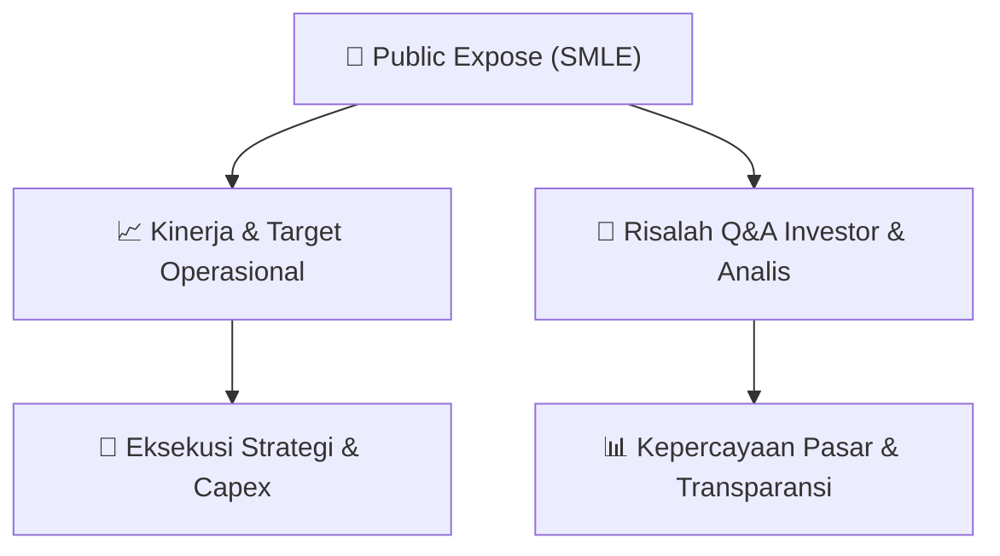

# 📢 Laporan Intelijen Paparan Publik (Public Expose) - [[SMLE]]
🏢 **Emiten**: `[[SMLE]]` | 📅 **Tanggal Pelaksanaan**: `2026-09-10` | 📑 **Dokumen**: `Public Expose`
⬅️ [[knowledge-base/daily-digests/Daily_Digest_20260910|Kembali ke Daily Digest]] | 🎛️ [[Dashboard|Ke Dashboard Utama]]

---

## 📌 1. Ringkasan Eksekutif & Paparan Direksi
> [!NOTE]
> PT Sinergi Multi Lestarindo Tbk (SMLE) menyampaikan koreksi atas materi Public Expose Tahunan yang akan diselenggarakan dalam acara Public Expose Live IDX 2026 pada 11 September 2026. Koreksi ini disampaikan melalui surat nomor 0094/P-DIR/SMLE/IX/2026 tanggal 10 September 2026, menggantikan surat sebelumnya nomor 0092/P-DIR/SMLE/IX/2026 tanggal 08 September 2026. Materi Public Expose terlampir dalam dua dokumen PDF, yaitu surat penyampaian materi dan presentasi Pubex. Dokumen ini merupakan pengumuman resmi yang disampaikan melalui sistem pelaporan elektronik OJK/IDX dan ditandatangani oleh Corporate Secretary, Arry Wahyu Riansyah.

#### 🎯 Guidance Operasional & Target Strategis
- Dokumen ini hanya berisi pemberitahuan administratif mengenai koreksi penyampaian materi Public Expose Tahunan SMLE untuk acara Public Expose Live IDX 2026. Tidak terdapat informasi spesifik mengenai target kinerja, ekspansi, capex, atau guidance operasional dalam dokumen ini. Informasi tersebut kemungkinan besar terdapat dalam lampiran materi Public Expose yang disampaikan, namun tidak tersedia dalam teks yang diberikan.

## 📊 2. Matriks Indikator Operasional & Parameter Kunci
| Parameter Utama | Nilai / Keterangan Resmi |
| :--- | :--- |
| **Nomor Surat** | `0094/P-DIR/SMLE/IX/2026` |
| **Tanggal Surat** | `10 September 2026` |
| **Perihal** | `Koreksi Penyampaian Materi Public Expose Tahunan` |
| **Acara** | `Public Expose Live IDX 2026` |
| **Tanggal Public Expose** | `11 September 2026` |
| **Surat Sebelumnya yang Dikoreksi** | `0092/P-DIR/SMLE/IX/2026 tanggal 08 September 2026` |
| **Pengumuman Awal** | `Surat No 0090/P-DIR/SMLE/IX/2026 tanggal 28 Agustus 2026` |
| **Corporate Secretary** | `Arry Wahyu Riansyah` |
| **Kontak** | `Telepon: (021) 3006 7971, Fax: (021) 30067993, www.ptsml.id` |
| **Alamat** | `Business Park Kebon Jeruk Blok I 5-6` |

---

## 💬 3. Risalah Tanya Jawab (Q&A Session)
`Materi presentasi Public Expose / Risalah Q&A terlampir dalam dokumen resmi bursa.`

## 📌 4. Peta Jalur Strategis & Roadmap

---

## 🔗 Knowledge Graph
- [[knowledge-base/daily-digests/Daily_Digest_20260910|📄 Daily Digest 2026-09-10]]
- [[knowledge-base/calendars/Action_Calendar|🗓️ Kalender Terpusat Aksi Korporasi]]
- [[Dashboard|🎛️ Kembali ke Dashboard Utama]]