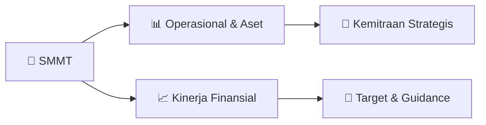

# 📊 Materi Public Expose: [SMMT]

🏢 **Emiten**: `SMMT` | 📅 **Tanggal Pelaksanaan**: `2026-10-05` | 📑 **Total Slide**: `2 Slide`
⬅️ [[knowledge-base/daily-digests/SMMT_20261005|Kembali ke Daily Digest]] | 🎛️ [[Dashboard/SMMT|Ke Dashboard Emiten]]

> [!NOTE]
> Ringkasan materi presentasi resmi Public Expose SMMT yang disampaikan oleh manajemen kepada investor dan bursa. Seluruh poin strategis, matriks operasional, dan angka kinerja diekstrak langsung dari slide deck resmi.

---

## 📅 1. Jadwal & Metadata Penyelenggaraan

| Parameter | Detail Informasi |
|---|---|
| **Nomor Surat Pengantar** | 041/SMMT-CS/2026 |
| **Perihal Pengumuman** | Rencana Penyelenggaraan Public Expose Insidentil |
| **Waktu Pelaksanaan** | 20 Oktober 2026 15:30 |
| **Lokasi / Media** | Dilakukan secara online |
| **Lampiran Resmi** | `0` |

## 📋 2. Agenda Paparan Publik

1. Nama Perusahaan
2. Kode Emiten
3. Lampiran
4. Perihal
5. 041/SMMT-CS/2026
6. GOLDEN EAGLE ENERGY Tbk
7. Rencana Penyelenggaraan Public Expose Insidentil
8. Go To English Page
9. Perseroan melaporkan rencana Public Expose Insidentil sebagai berikut:
10. Rencana Penyelenggaraan Public Expose
11. Latar Belakang Pelaksanaan
12. Sukarela
13. Permintaan Bursa
14. Permintaan Otoritas Jasa Keuangan ( OJK)
15. Tempat
16. : Dilakukan secara online
17. Hari/Tanggal
18. : 20 Oktober 2026
19. Waktu
20. 15:30
21. Agenda
22. : 1. Kinerja Keuangan dan kondisi bisnis terkini Perseroan
23. 2. Rencana bisnis ke depan Perseroan
24. 3. Analisa manajemen terkait pergerakan harga saham Perseroan
25. Hormat Kami,
26. Demikian untuk diketahui.
27. The Suites Tower Lt. 17, Jl. Boulevard Pantai Indah Kapuk No. 1 Kav OFS, Jakarta
28. Corporate Secretary
29. Nama Pengirim
30. Telepon : 021 - 22511055, Fax : 021 - 22511057, www.go-eagle.co.id
31. GOLDEN EAGLE ENERGY Tbk
32. Susanti Nilam
33. GOLDEN EAGLE ENERGY Tbk
34. Susanti Nilam
35. Jabatan
36. Corporate Secretary
37. Tanggal dan Waktu
38. 05-10-2026 16:11
39. Dokumen ini merupakan dokumen resmi GOLDEN EAGLE ENERGY Tbk yang tidak memerlukan tanda tangan
40. karena dihasilkan secara elektronik oleh sistem pelaporan elektronik. GOLDEN EAGLE ENERGY Tbk bertanggung
41. jawab penuh atas informasi yang tertera didalam dokumen ini.
42. Issuer Name
43. Issuer Code
44. Attachment
45. Subject
46. 041/SMMT-CS/2026
47. GOLDEN EAGLE ENERGY Tbk
48. General Announcement Public Expose
49. Go To Indonesian Page
50. Company announces public expose plan Incidental as follows:
51. Public Expose Announcement
52. Background
53. Voluntary
54. Requested by IDX
55. Requested by OJK
56. Place
57. : Dilakukan secara online
58. : 20 October 2026
59. 15:30
60. Agenda
61. : 1. The Company's financial performance and current business
62. condition
63. 2. The Company's future business plans
64. 3. Management's analysis regarding the movement of the
65. Company's share price
66. Respectfully,
67. Thus to be informed accordingly.
68. GOLDEN EAGLE ENERGY Tbk
69. Susanti Nilam
70. Corporate Secretary
71. Susanti Nilam
72. Sender Name
73. GOLDEN EAGLE ENERGY Tbk
74. The Suites Tower Lt. 17, Jl. Boulevard Pantai Indah Kapuk No. 1 Kav OFS, Jakarta
75. Phone : 021 - 22511055, Fax : 021 - 22511057, www.go-eagle.co.id
76. Corporate Secretary
77. Function
78. Date and Time
79. 05-10-2026 16:11
80. This is an official document of GOLDEN EAGLE ENERGY Tbk that does not require a signature as it was
81. generated electronically by the electronic reporting system. GOLDEN EAGLE ENERGY Tbk is fully responsible for

## 🏢 3. Profil & Pilar Portofolio Bisnis

## 🏗️ 4. Kinerja Operasional & Portofolio Aset

*Detail aset operasional terlampir pada dokumen slide resmi.*

## 📈 5. Kinerja Keuangan & Posisi Finansial

## 🧭 6. Inisiatif Strategis, Kolaborasi, & Kemitraan

*Strategi usaha difokuskan pada penguatan fundamental dan ekspansi operasional.*

## 🎯 7. Target Pertumbuhan & Guidance Manajemen

*Target pertumbuhan ditetapkan mengacu pada prospek industri dan kondisi makroekonomi terkini.*

## 🗺️ 8. Peta Jalur Strategis & Eksekusi

## 📑 9. Daftar Indeks Slide Presentasi

| Slide # | Judul / Topik Slide | Ringkasan Konten |
|---|---|---|
| Slide 1 | **Nomor Surat** | Nama Perusahaan Kode Emiten Lampiran |
| Slide 2 | **Letter / Announcement No.** | Issuer Name Issuer Code Attachment |

---

*Dokumen diolah otomatis oleh **Swarm Intelijen Pasar Modal Indonesia** pada 2026-10-12 16:49 WIB.*