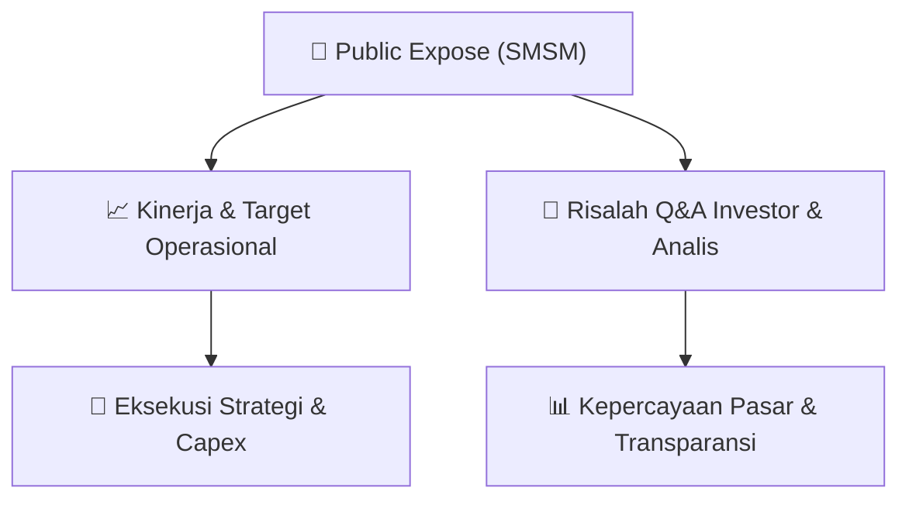

# 📢 Laporan Intelijen Paparan Publik (Public Expose) - [[SMSM]]
🏢 **Emiten**: `[[SMSM]]` | 📅 **Tanggal Pelaksanaan**: `2026-09-03` | 📑 **Dokumen**: `Public Expose`
⬅️ [[knowledge-base/daily-digests/Daily_Digest_20260903|Kembali ke Daily Digest]] | 🎛️ [[Dashboard|Ke Dashboard Utama]]

---

## 📌 1. Ringkasan Eksekutif & Paparan Direksi
> [!NOTE]
> Selamat Sempurna Tbk (SMSM) menyampaikan materi Public Expose Tahunan melalui surat No. 0280/SS/IX/26 tanggal 3 September 2026. Penyampaian ini merujuk pada surat pengumuman Public Expose Tahunan sebelumnya No. 0275/SS/VIII/26 tanggal 21 Agustus 2026. Perseroan melampirkan 4 dokumen: Penyampaian Materi Public Expose 2026.pdf, Press Release Public Expose 2026.pdf, Materi Public Expose SMSM (English).pdf, dan Materi Public Expose SMSM (Bahasa).pdf. Dokumen merupakan dokumen resmi elektronik yang tidak memerlukan tanda tangan dan Perseroan bertanggung jawab penuh atas informasi di dalamnya.

#### 🎯 Guidance Operasional & Target Strategis
- Tidak tersedia dalam dokumen yang diberikan. Dokumen hanya berisi surat penyampaian materi public expose tanpa rincian target kinerja, ekspansi, atau capex.

## 📊 2. Matriks Indikator Operasional & Parameter Kunci
| Parameter Utama | Nilai / Keterangan Resmi |
| :--- | :--- |
| **Nomor Surat** | `0280/SS/IX/26` |
| **Tanggal Surat** | `03-09-2026 09:27` |
| **Perihal** | `Penyampaian Materi Public Expose Tahunan` |
| **Lampiran** | `4 dokumen: Penyampaian Materi Public Expose 2026.pdf, Press Release Public Expose 2026.pdf, Materi Public Expose SMSM (English).pdf, Materi Public Expose SMSM (Bahasa).pdf` |
| **Nama Pengirim** | `Ang Andri Pribadi, Wakil Direktur Utama` |
| **Alamat dan Kontak** | `ADR Tower, Lantai 20, Jl. Pantai Indah Kapuk Boulevard Kamal Muara, Penjaringan; Telepon (62-21) 3951 8888, Fax (62-21) 3951 8880, http://www.smsm.co.id` |

---

## 💬 3. Risalah Tanya Jawab (Q&A Session)
`Materi presentasi Public Expose / Risalah Q&A terlampir dalam dokumen resmi bursa.`

## 📌 4. Peta Jalur Strategis & Roadmap

---

## 🔗 Knowledge Graph
- [[knowledge-base/daily-digests/Daily_Digest_20260903|📄 Daily Digest 2026-09-03]]
- [[knowledge-base/calendars/Action_Calendar|🗓️ Kalender Terpusat Aksi Korporasi]]
- [[Dashboard|🎛️ Kembali ke Dashboard Utama]]