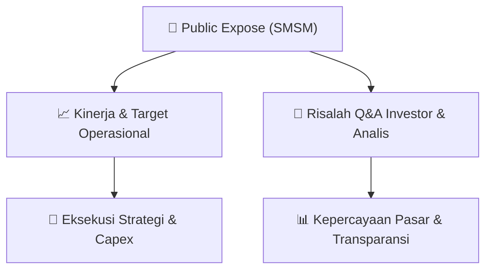

# 📢 Laporan Intelijen Paparan Publik (Public Expose) - [[SMSM]]
🏢 **Emiten**: `[[SMSM]]` | 📅 **Tanggal Pelaksanaan**: `2026-09-14` | 📑 **Dokumen**: `Public Expose`
⬅️ [[knowledge-base/daily-digests/Daily_Digest_20260914|Kembali ke Daily Digest]] | 🎛️ [[Dashboard|Ke Dashboard Utama]]

---

## 📌 1. Ringkasan Eksekutif & Paparan Direksi
> [!NOTE]
> PT Selamat Sempurna Tbk (SMSM) menyelenggarakan Public Expose Tahunan pada 03 September 2026, dengan laporan hasil disampaikan pada 14 September 2026. Acara dihadiri oleh 122 peserta (tidak termasuk manajemen dan karyawan). Paparan ini merupakan agenda tahunan untuk mengkomunikasikan kinerja, strategi, dan rencana perusahaan kepada investor dan analis. Dokumen yang disampaikan hanya berisi laporan administratif penyelenggaraan, sedangkan detail materi paparan dan Q&A terdapat pada lampiran terpisah (Hasil Pubex Live 2026 SMSM.pdf).

#### 🎯 Guidance Operasional & Target Strategis
- Informasi rinci mengenai target kinerja, ekspansi, dan capex tidak tersedia dalam dokumen utama karena hanya berisi laporan administratif penyelenggaraan Public Expose. Data tersebut diperkirakan terdapat pada lampiran 'Hasil Pubex Live 2026 SMSM.pdf' yang tidak disertakan dalam teks mentah. Investor disarankan untuk mengakses lampiran tersebut melalui website BEI atau perusahaan untuk mendapatkan guidance operasional dan katalis potensial.

## 📊 2. Matriks Indikator Operasional & Parameter Kunci
| Parameter Utama | Nilai / Keterangan Resmi |
| :--- | :--- |
| **Tanggal Penyelenggaraan Public Expose** | `03 September 2026` |
| **Tanggal Pelaporan Hasil Public Expose** | `14 September 2026` |
| **Jumlah Peserta Hadir (tidak termasuk manajemen/karyawan)** | `122 orang` |
| **Nomor Surat Pengantar Materi Public Expose** | `0280/SS/IX/26` |
| **Nomor Surat Penyampaian Hasil Public Expose** | `0289/SS/IX/26` |
| **Nama Pelapor** | `Ang Andri Pribadi (Wakil Direktur Utama)` |

---

## 💬 3. Risalah Tanya Jawab (Q&A Session)
### ❓ Pertanyaan 1 (Tidak tersedia dalam dokumen)
**Pertanyaan**: Tidak tersedia dalam dokumen utama. Seluruh sesi tanya jawab diperkirakan tercantum dalam lampiran 'Hasil Pubex Live 2026 SMSM.pdf'.

**Jawaban Manajemen**: Tidak tersedia dalam dokumen utama. Jawaban manajemen atas pertanyaan investor/analis diperkirakan tercantum dalam lampiran 'Hasil Pubex Live 2026 SMSM.pdf'.

> [!TIP]
> **Implikasi Bagi Investor**: Investor perlu mengakses lampiran resmi untuk mendapatkan wawasan mengenai strategi, kinerja, dan prospek perusahaan. Dokumen utama hanya mengonfirmasi bahwa acara telah diselenggarakan dengan partisipasi 122 peserta.

## 📌 4. Peta Jalur Strategis & Roadmap

---

## 🔗 Knowledge Graph
- [[knowledge-base/daily-digests/Daily_Digest_20260914|📄 Daily Digest 2026-09-14]]
- [[knowledge-base/calendars/Action_Calendar|🗓️ Kalender Terpusat Aksi Korporasi]]
- [[Dashboard|🎛️ Kembali ke Dashboard Utama]]