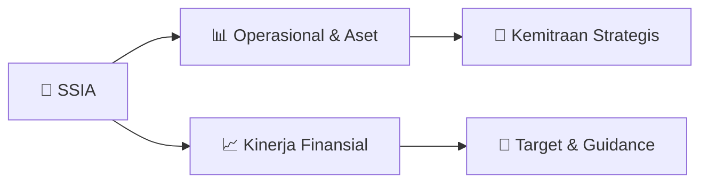

# 📊 Materi Public Expose: [SSIA]

🏢 **Emiten**: `SSIA` | 📅 **Tanggal Pelaksanaan**: `2026-08-21` | 📑 **Total Slide**: `2 Slide`
⬅️ [[knowledge-base/daily-digests/SSIA_20260821|Kembali ke Daily Digest]] | 🎛️ [[Dashboard/SSIA|Ke Dashboard Emiten]]

> [!NOTE]
> Ringkasan materi presentasi resmi Public Expose SSIA yang disampaikan oleh manajemen kepada investor dan bursa. Seluruh poin strategis, matriks operasional, dan angka kinerja diekstrak langsung dari slide deck resmi.

---

## 📅 1. Jadwal & Metadata Penyelenggaraan

| Parameter | Detail Informasi |
|---|---|
| **Nomor Surat Pengantar** | 038L/CS/VIII/2026 |
| **Perihal Pengumuman** | Rencana Penyelenggaraan Public Expose Tahunan |
| **Waktu Pelaksanaan** | 07 September 2026 15:00 |
| **Lokasi / Media** | Public Expose Live 2026 yang tercantum pada website idx.co.id |
| **Lampiran Resmi** | `0` |

## 📋 2. Agenda Paparan Publik

1. Nama Perusahaan
2. Kode Emiten
3. Lampiran
4. Perihal
5. 038L/CS/VIII/2026
6. PT Surya Semesta Internusa Tbk
7. Rencana Penyelenggaraan Public Expose Tahunan
8. Go To English Page
9. Perseroan melaporkan rencana Public Expose Tahunan sebagai berikut:
10. Rencana Penyelenggaraan Public Expose
11. Tahun Buku yang Berakhir pada
12. Tempat
13. : Public Expose Live 2026 yang tercantum pada website idx.co.id
14. Hari/Tanggal
15. : 07 September 2026
16. Waktu
17. 15:00
18. Agenda
19. : 1. Laporan Kinerja Semester I 2026
20. 2. Prospek dan Strategi Usaha
21. 3. Lain-lain
22. Hormat Kami,
23. Demikian untuk diketahui.
24. Tempo Scan Tower Lantai 20
25. Corporate Secretary
26. Nama Pengirim
27. Telepon : (62-21) 526 2121, 527 2121, Fax : (62-21) 526 7878, www.suryainternusa.
28. PT Surya Semesta Internusa Tbk
29. Yulean
30. PT Surya Semesta Internusa Tbk
31. Yulean
32. Jabatan
33. Corporate Secretary
34. Tanggal dan Waktu
35. 21-08-2026 14:09
36. Dokumen ini merupakan dokumen resmi PT Surya Semesta Internusa Tbk yang tidak memerlukan tanda tangan
37. karena dihasilkan secara elektronik oleh sistem pelaporan elektronik. PT Surya Semesta Internusa Tbk bertanggung
38. jawab penuh atas informasi yang tertera didalam dokumen ini.
39. Issuer Name
40. Issuer Code
41. Attachment
42. Subject
43. 038L/CS/VIII/2026
44. PT Surya Semesta Internusa Tbk
45. General Announcement Public Expose
46. Go To Indonesian Page
47. Company announces public expose plan Annual as follows:
48. Public Expose Announcement
49. Fiscal Year
50. Place
51. : Public Expose Live 2026 yang tercantum pada website idx.co.id
52. : 07 September 2026
53. 15:00
54. Agenda
55. : 1. First Half 2026 Performance Report
56. 2. Business Prospects and Strategy
57. 3. Others
58. Respectfully,
59. Thus to be informed accordingly.
60. PT Surya Semesta Internusa Tbk
61. Yulean
62. Corporate Secretary
63. Yulean
64. Sender Name
65. PT Surya Semesta Internusa Tbk
66. Tempo Scan Tower Lantai 20
67. Phone : (62-21) 526 2121, 527 2121, Fax : (62-21) 526 7878, www.suryainternusa.
68. Corporate Secretary
69. Function
70. Date and Time
71. 21-08-2026 14:09
72. This is an official document of PT Surya Semesta Internusa Tbk that does not require a signature as it was
73. generated electronically by the electronic reporting system. PT Surya Semesta Internusa Tbk is fully responsible for

## 🏢 3. Profil & Pilar Portofolio Bisnis

## 🏗️ 4. Kinerja Operasional & Portofolio Aset

*Detail aset operasional terlampir pada dokumen slide resmi.*

## 📈 5. Kinerja Keuangan & Posisi Finansial

## 🧭 6. Inisiatif Strategis, Kolaborasi, & Kemitraan

*Strategi usaha difokuskan pada penguatan fundamental dan ekspansi operasional.*

## 🎯 7. Target Pertumbuhan & Guidance Manajemen

*Target pertumbuhan ditetapkan mengacu pada prospek industri dan kondisi makroekonomi terkini.*

## 🗺️ 8. Peta Jalur Strategis & Eksekusi

## 📑 9. Daftar Indeks Slide Presentasi

| Slide # | Judul / Topik Slide | Ringkasan Konten |
|---|---|---|
| Slide 1 | **Nomor Surat** | Nama Perusahaan Kode Emiten Lampiran |
| Slide 2 | **Letter / Announcement No.** | Issuer Name Issuer Code Attachment |

---

*Dokumen diolah otomatis oleh **Swarm Intelijen Pasar Modal Indonesia** pada 2026-10-12 16:49 WIB.*