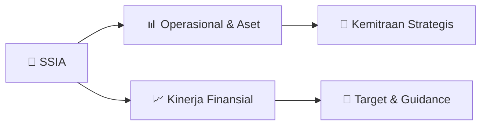

# 📊 Materi Public Expose: [SSIA]

🏢 **Emiten**: `SSIA` | 📅 **Tanggal Pelaksanaan**: `2026-09-02` | 📑 **Total Slide**: `47 Slide`
⬅️ [[knowledge-base/daily-digests/SSIA_20260902|Kembali ke Daily Digest]] | 🎛️ [[Dashboard/SSIA|Ke Dashboard Emiten]]

> [!NOTE]
> Ringkasan materi presentasi resmi Public Expose SSIA yang disampaikan oleh manajemen kepada investor dan bursa. Seluruh poin strategis, matriks operasional, dan angka kinerja diekstrak langsung dari slide deck resmi.

---

## 📅 1. Jadwal & Metadata Penyelenggaraan

| Parameter | Detail Informasi |
|---|---|
| **Nomor Surat Pengantar** | 039L/CS/IX/2026 |
| **Perihal Pengumuman** | Penyampaian Materi Public Expose Tahunan |
| **Waktu Pelaksanaan** | 2026-09-02 02-09-2026 15:33 |
| **Lokasi / Media** | Aplikasi Zoom / Daring |
| **Lampiran Resmi** | `1` |

## 📋 2. Agenda Paparan Publik

1. in Summary
2. SSIA In Summary
3. Significant Events
4. SSIA’s Sustainability
5. 1H26 Financial Highlights
6. • Consolidated Profit & Loss
7. • Consolidated Balance Sheet
8. Table of Contents
9. 1H26 of Business Segments
10. PROPERTY
11. • Development & management of industrial
12. estates, real estate, buildings and
13. commercial centers
14. • SUBANG SMARTPOLITAN
15. CONSTRUCTION
16. • General contractor services for
17. commercial buildings, mining and
18. infrastructure
19. HOSPITALITY
20. • Development and management of hotels
21. and resorts
22. SSIA AGMS & EGMS – Dividend Distribution & MESOP Approval
23. On 19 June 2026 , SSIA has successfully
24. conducted an AGMS and EGMS . In this
25. event, SSIA announced a dividend distribution
26. amounting of Rp 23.5 billion. During the
27. AGMS SSIA also appointed a new Board of
28. Commissioner Mr. Fentony Sudjono .
29. In EGMS, SSIA’s shareholders approved the
30. MESOP agenda with new shares issuance
31. more less than 5% from currently issued
32. shares .

## 🏢 3. Profil & Pilar Portofolio Bisnis

## 🏗️ 4. Kinerja Operasional & Portofolio Aset

*Detail aset operasional terlampir pada dokumen slide resmi.*

## 📈 5. Kinerja Keuangan & Posisi Finansial

### 🧮 Rasio Keuangan Utama
```text
building a better indonesia
Financial Highlights
Key Performance Ratios
In billion IDR
2021 2022 2023 2024 2025 1H26
Bank/Third parties Loan
IDR denominated in billion IDR
1,245 1,514 2,526 796 2,189 2,269
US$ denominated in billion IDR
1,059 (1) 1,034 (1)
-
-
-
-
Total Debt in billion IDR
2,304 2,548 2,526 796 2,189 2,269
Debt to Equity Ratio
56.9% 59.8% 56.9% 10.0% 27.1% 26.8% ROE
-5.6%
4.6%
4.4%
4.2%
-1.6%
9.1% ROA
-2.6%
2.1%
2.1%
2.3%
-0.7%
4.0%
Current Ratio 207.2% 181.5% 212.7% 301.7% 168.5% 155.6%
Total Liabilities to Equity
103.3% 104.9% 99.2% 42.4% 83.2% 78.6%
Total Liabilities to Asset
47.7% 48.6% 47.2% 22.9% 36.4% 34.9%
Book Value/share (Rp) -
par value : 2007 - June 2011 :
Rp 500 per share, Jul 2011
-
current :
Rp 125 per share
788 844 881 1,212 1,194 1,229
Equity Growth (YoY)
-4.4%
7.1%
4.3%
39.9%
-0.7%
3.9%
Note: * In July 2011, SSIA splits its stock 4
-for-1, then outstanding shares become 4,705 million shares with par value Rp 125 p
er share - ROE and ROA are annualized
```

## 🧭 6. Inisiatif Strategis, Kolaborasi, & Kemitraan

*Strategi usaha difokuskan pada penguatan fundamental dan ekspansi operasional.*

## 🎯 7. Target Pertumbuhan & Guidance Manajemen

*Target pertumbuhan ditetapkan mengacu pada prospek industri dan kondisi makroekonomi terkini.*

## 🗺️ 8. Peta Jalur Strategis & Eksekusi



## 📑 9. Daftar Indeks Slide Presentasi

| Slide # | Judul / Topik Slide | Ringkasan Konten |
|---|---|---|
| Slide 1 | **PT Surya Semesta Internusa Tbk (“SSIA”)** | Review First Semester 2026 |
| Slide 2 | **Surya Semesta Internusa** | in Summary SSIA In Summary Significant Events |
| Slide 3 | **Surya Semesta Internusa** | In Summary |
| Slide 4 | **building a better indonesia** | 4 • Note: 1) Currently not in operations, |
| Slide 5 | **building a better indonesia** | 05 SSIA Management - Strong Operating Record |
| Slide 6 | **building a better indonesia** | 06 Surya Semesta Internusa in Summary Company Highlights » |
| Slide 7 | **building a better indonesia** | 08 Geographical Presence Across Indonesia Medan |
| Slide 8 | **building a better indonesia** | 09 Strategic Roadmap Continued focus on the construction and development |
| Slide 9 | **Significant** | Events 4Q25 -1H26 |
| Slide 10 | **building a better indonesia** | 11 Nusa Raya Cipta –  Secured Contract for the First section of Patimban Toll Road On 10 December 2025 , NRCA was appointed, together with |
| Slide 11 | **building a better indonesia** | ➢National Strategic Project ➢The construction is a JO by the Government and PT Jasamarga Akses Patimban (consortium of PT Jasa Marga Tbk, PT Nusa |
| Slide 12 | **building a better indonesia** | 13 Paradisus by Melia Bali – A New Paradise Has Emerged in Nusa Dua On 1 February 2026 , Paradisus by Melia Bali |
| Slide 13 | **building a better indonesia** | 14 SSIA AGMS & EGMS – Dividend Distribution & MESOP Approval On 19 June 2026 , SSIA has successfully |
| Slide 14 | **building a better indonesia** | 15 Temporary On/Off Ramp KM 87+950 Has Opened Effective 21 August 2026 , the temporary |
| Slide 15 | **building a better indonesia** | D B A |
| Slide 16 | **Temporary Toll Exit** | KM 88 Cipali Toll Road 17 Toll Gate |
| Slide 17 | **building a better indonesia** | 18 Edenhaus Serpong – New Garden Home Resort in Serpong 22 Aug 2026 , TCP Internusa launched its first residential landed |
| Slide 18 | **SSIA’s** | Sustainability |
| Slide 19 | **building a better indonesia** | 20 SSIA’s Sustainability: 4 -pillar ESG strategy lays the foundation to create |
| Slide 20 | **Review of Business Segments** |  |
| Slide 21 | **Property** | SSIA’s main driver More than 50 years track record • PT Suryacipta Swadaya (“SCS”) |
| Slide 22 | **building a better indonesia** | 23 PT Suryacipta Swadaya offers vast land to develop various industries. It is the home of 175 prestigious global |
| Slide 23 | **building a better indonesia** | 25 PT Suryacipta Swadaya Automotive & Machinery Manufacturing Corridor |
| Slide 24 | **building a better indonesia** | 27 High Quality Projects in |
| Slide 25 | **Project Timeline** | Subang Smartpolitan Subang Smartpolitan, the pioneer of smart and sustainable city development, Leverages |
| Slide 26 | **building a better indonesia** | 29 Business Segment Property: Industrial Estate Review |
| Slide 27 | **building a better indonesia** | 30 Business Segment Property: Industrial Estate Review |
| Slide 28 | **building a better indonesia** | 31 Business Segment Property: Revenue Breakdown |
| Slide 29 | **Construction** | Source of SSIA steady revenue More than 50 years track record • |
| Slide 30 | **building a better indonesia** | 33 Excellent Work Quality Across Sectors Oakwood Jimbaran Villas & Residence |
| Slide 31 | **building a better indonesia** | 34 Business Segment Construction : PT Nusa Raya Cipta |
| Slide 32 | **building a better indonesia** | 35 NRCA Dividend History Financial year |
| Slide 33 | **2.3 Hospitality** | Hospitality Main driver of SSIA recurring income More than 40 years track record |
| Slide 34 | **building a better indonesia** | 37 Hospitality 3 Hotels |
| Slide 35 | **building a better indonesia** | 38 Travelio’s 1H -26 Achievements & FY -26 Targets |
| Slide 36 | **building a better indonesia** | 39 Hospitality Business 237 |
| Slide 37 | **Review** | 1H26 |
| Slide 38 | **building a better indonesia** | 41 Overview of Key Business Segment 14% |
| Slide 39 | **building a better indonesia** | 42 Property Segment Revenue (1H25 vs 1H26, in billion IDR) |
| Slide 40 | **building a better indonesia** | 43 1H26 Financial Highlights 2,117 |
| Slide 41 | **building a better indonesia** | 44 Established Track Record as a Group 520 |
| Slide 42 | **building a better indonesia** | 45 Attractive Gross Margins 49.0% |
| Slide 43 | **building a better indonesia** | 46 Financial Highlights Consolidated Balance Sheet |
| Slide 44 | **building a better indonesia** | 47 Financial Highlights Key Performance Ratios |
| Slide 45 | **building a better indonesia** | 48 Summary Subang is SSIA’s |
| Slide 46 | **building a better indonesia** | 49 SSIA Dividend History Financial year |
| Slide 47 | **WWW.SURYAINTERNUSA.COM** | WWW.SURYAINTERNUSA.COM PT SURYA SEMESTA INTERNUSA TBK TEMPO SCAN TOWER 20TH FLOOR |

---

*Dokumen diolah otomatis oleh **Swarm Intelijen Pasar Modal Indonesia** pada 2026-10-12 16:49 WIB.*