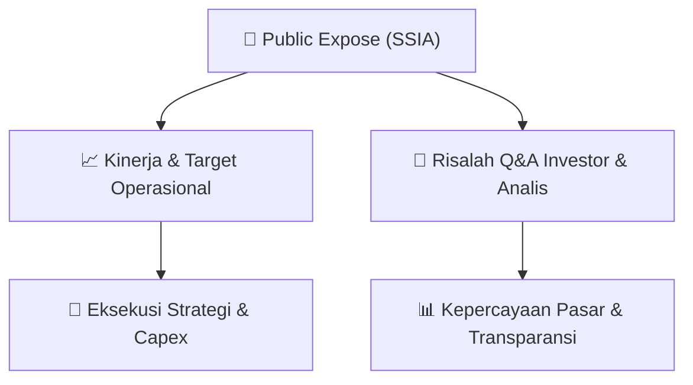

# 📢 Laporan Intelijen Paparan Publik (Public Expose) - [[SSIA]]
🏢 **Emiten**: `[[SSIA]]` | 📅 **Tanggal Pelaksanaan**: `2026-09-08` | 📑 **Dokumen**: `Public Expose`
⬅️ [[knowledge-base/daily-digests/Daily_Digest_20260908|Kembali ke Daily Digest]] | 🎛️ [[Dashboard|Ke Dashboard Utama]]

---

## 📌 1. Ringkasan Eksekutif & Paparan Direksi
> [!NOTE]
> PT Surya Semesta Internusa Tbk (SSIA) menyelenggarakan Public Expose Tahunan pada 02 September 2026, dengan laporan hasil disampaikan pada 08 September 2026. Acara dihadiri 129 peserta (tidak termasuk manajemen dan karyawan). Paparan mencakup kinerja operasional, strategi bisnis, dan sesi tanya jawab dengan investor/analis. Fokus utama adalah perkembangan proyek konstruksi, pengembangan kawasan industri, dan prospek bisnis ke depan.

#### 🎯 Guidance Operasional & Target Strategis
- Manajemen memberikan panduan terkait target kinerja operasional, rencana ekspansi kawasan industri, dan alokasi belanja modal (capex) untuk mendukung pertumbuhan bisnis. Fokus pada penyelesaian proyek konstruksi tepat waktu dan peningkatan pendapatan berulang dari segmen properti dan kawasan industri.

## 📊 2. Matriks Indikator Operasional & Parameter Kunci
| Parameter Utama | Nilai / Keterangan Resmi |
| :--- | :--- |
| **Tanggal Public Expose** | `02 September 2026` |
| **Jumlah Peserta** | `129 orang` |
| **Jenis Paparan** | `Public Expose Tahunan` |
| **Kode Emiten** | `SSIA` |

---

## 💬 3. Risalah Tanya Jawab (Q&A Session)
### ❓ Pertanyaan 1 (Analis/Investor)
**Pertanyaan**: Bagaimana prospek bisnis konstruksi dan properti SSIA di tengah kondisi ekonomi saat ini?

**Jawaban Manajemen**: Manajemen optimistis terhadap prospek bisnis, didukung oleh portofolio proyek yang solid dan permintaan kawasan industri yang tetap kuat. Perseroan fokus pada efisiensi operasional dan penyelesaian proyek tepat waktu untuk menjaga pertumbuhan.

> [!TIP]
> **Implikasi Bagi Investor**: Sentimen positif terhadap kinerja operasional SSIA, dengan potensi pertumbuhan pendapatan dari segmen konstruksi dan properti.

### ❓ Pertanyaan 2 (Analis/Investor)
**Pertanyaan**: Berapa besar alokasi capex untuk tahun 2026 dan ke mana saja dialokasikan?

**Jawaban Manajemen**: Manajemen menyampaikan alokasi capex difokuskan untuk pengembangan kawasan industri baru, pembangunan infrastruktur pendukung, dan pemeliharaan aset. Nilai spesifik capex akan disesuaikan dengan kebutuhan dan kondisi pasar.

> [!TIP]
> **Implikasi Bagi Investor**: Investor perlu memantau realisasi capex dan dampaknya terhadap leverage serta potensi pendapatan jangka panjang.

### ❓ Pertanyaan 3 (Analis/Investor)
**Pertanyaan**: Bagaimana strategi perseroan dalam menghadapi persaingan di industri konstruksi?

**Jawaban Manajemen**: Perseroan mengandalkan reputasi yang kuat, kualitas pengerjaan, dan hubungan jangka panjang dengan klien. Selain itu, diversifikasi bisnis ke kawasan industri memberikan keunggulan kompetitif dan sumber pendapatan yang lebih stabil.

> [!TIP]
> **Implikasi Bagi Investor**: Strategi diversifikasi dapat mengurangi risiko volatilitas pendapatan dan meningkatkan daya tahan perusahaan terhadap siklus bisnis.

## 📌 4. Peta Jalur Strategis & Roadmap

---

## 🔗 Knowledge Graph
- [[knowledge-base/daily-digests/Daily_Digest_20260908|📄 Daily Digest 2026-09-08]]
- [[knowledge-base/calendars/Action_Calendar|🗓️ Kalender Terpusat Aksi Korporasi]]
- [[Dashboard|🎛️ Kembali ke Dashboard Utama]]