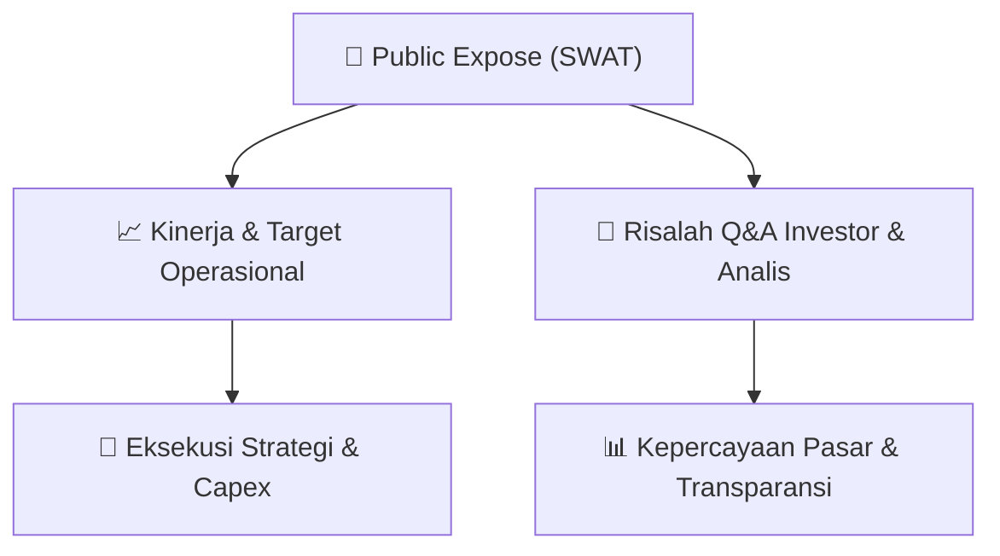

# 📢 Laporan Intelijen Paparan Publik (Public Expose) - [[SWAT]]
🏢 **Emiten**: `[[SWAT]]` | 📅 **Tanggal Pelaksanaan**: `2026-08-31` | 📑 **Dokumen**: `Public Expose`
⬅️ [[knowledge-base/daily-digests/Daily_Digest_20260831|Kembali ke Daily Digest]] | 🎛️ [[Dashboard|Ke Dashboard Utama]]

---

## 📌 1. Ringkasan Eksekutif & Paparan Direksi
> [!NOTE]
> PT Sriwahana Adityakarta Tbk. (SWAT) menyampaikan pemberitahuan rencana penyelenggaraan Public Expose Tahunan untuk Tahun Buku yang berakhir pada 2025. Acara akan diselenggarakan pada 11 September 2026 pukul 11:00 di Hotel ASTON Solo, Jl. Slamet Riyadi No.373, Sondakan, Laweyan, Surakarta, Jawa Tengah. Dokumen ini hanya berisi informasi jadwal dan tidak memuat pemaparan kinerja, data keuangan, atau materi presentasi.

#### 🎯 Guidance Operasional & Target Strategis
- Tidak terdapat rincian target kinerja, ekspansi, belanja modal (capex), atau guidance operasional dalam dokumen ini. Dokumen hanya merupakan pengumuman jadwal Public Expose Tahunan.

## 📊 2. Matriks Indikator Operasional & Parameter Kunci
| Parameter Utama | Nilai / Keterangan Resmi |
| :--- | :--- |
| **Nama Perusahaan** | `PT Sriwahana Adityakarta Tbk.` |
| **Kode Emiten** | `SWAT` |
| **Tahun Buku Public Expose** | `2025` |
| **Tempat** | `Hotel ASTON Solo, Jl. Slamet Riyadi No.373, Sondakan, Laweyan, Surakarta, Jawa Tengah` |
| **Hari/Tanggal** | `11 September 2026` |
| **Waktu** | `11:00` |
| **Agenda** | `Rencana Penyelenggaraan Pemaparan Public Expose` |
| **Corporate Secretary** | `Yudi Artanto` |
| **Alamat Perseroan** | `Jl. Raya Solo - Yogya Km. 16, Bendosari, Sawit, Boyolali, Jawa Tengah` |

---

## 💬 3. Risalah Tanya Jawab (Q&A Session)
`Materi presentasi Public Expose / Risalah Q&A terlampir dalam dokumen resmi bursa.`

## 📌 4. Peta Jalur Strategis & Roadmap

---

## 🔗 Knowledge Graph
- [[knowledge-base/daily-digests/Daily_Digest_20260831|📄 Daily Digest 2026-08-31]]
- [[knowledge-base/calendars/Action_Calendar|🗓️ Kalender Terpusat Aksi Korporasi]]
- [[Dashboard|🎛️ Kembali ke Dashboard Utama]]