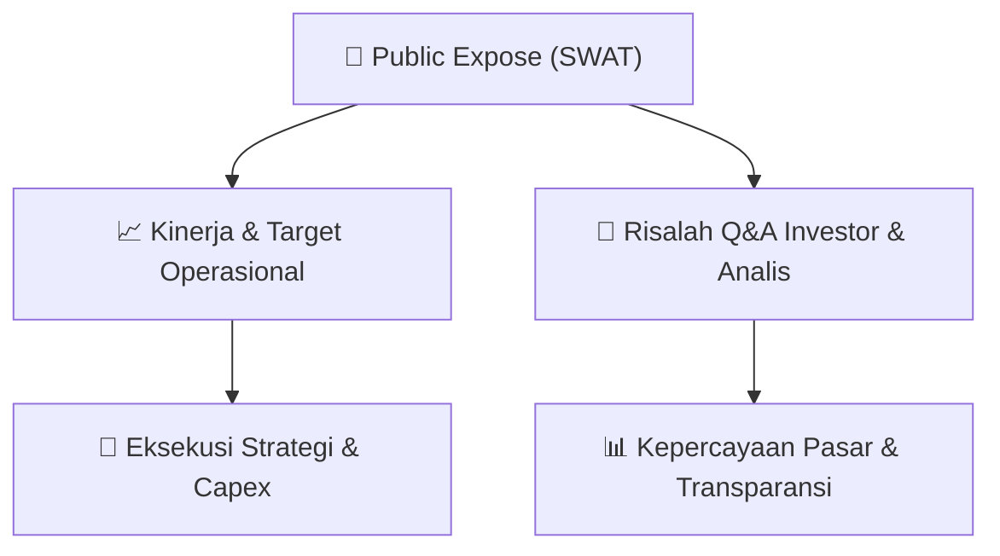

# 📢 Laporan Intelijen Paparan Publik (Public Expose) - [[SWAT]]
🏢 **Emiten**: `[[SWAT]]` | 📅 **Tanggal Pelaksanaan**: `2026-09-13` | 📑 **Dokumen**: `Public Expose`
⬅️ [[knowledge-base/daily-digests/Daily_Digest_20260913|Kembali ke Daily Digest]] | 🎛️ [[Dashboard|Ke Dashboard Utama]]

---

## 📌 1. Ringkasan Eksekutif & Paparan Direksi
> [!NOTE]
> PT Sriwahana Adityakarta Tbk. (SWAT) menyelenggarakan Public Expose Tahunan pada tanggal 08 September 2026, dengan hasil laporan disampaikan pada 13 September 2026. Acara dihadiri oleh 10 peserta (tidak termasuk manajemen dan karyawan). Paparan ini merupakan agenda tahunan untuk memenuhi ketentuan keterbukaan informasi Bursa Efek Indonesia, di mana manajemen memaparkan kinerja, strategi, dan menjawab pertanyaan dari investor dan analis. Dokumen yang disampaikan mencakup surat pengantar dan risalah public expose.

#### 🎯 Guidance Operasional & Target Strategis
- Dokumen yang tersedia hanya berisi informasi administratif penyelenggaraan Public Expose (surat pengantar dan lampiran). Rincian spesifik mengenai target kinerja, ekspansi, capex, atau isu pasar tidak tercantum secara eksplisit dalam teks yang diberikan. Informasi tersebut diperkirakan terdapat dalam lampiran 'Risalah Public Expose.pdf' yang tidak disertakan dalam teks mentah ini.

## 📊 2. Matriks Indikator Operasional & Parameter Kunci
| Parameter Utama | Nilai / Keterangan Resmi |
| :--- | :--- |
| **Tanggal Penyelenggaraan Public Expose** | `08 September 2026` |
| **Tanggal Pelaporan Hasil Public Expose** | `13 September 2026` |
| **Jumlah Peserta Hadir (di luar manajemen/karyawan)** | `10 orang` |
| **Nomor Surat Pengantar** | `0006/FIN/SWAT/IX/2026` |
| **Jenis Paparan** | `Public Expose Tahunan` |

---

## 💬 3. Risalah Tanya Jawab (Q&A Session)
### ❓ Pertanyaan 1 (Tidak tercantum dalam dokumen)
**Pertanyaan**: Tidak ada pertanyaan yang tercantum dalam teks dokumen yang disediakan. Seluruh rincian tanya jawab diperkirakan berada pada lampiran 'Risalah Public Expose.pdf'.

**Jawaban Manajemen**: Tidak ada jawaban yang tercantum dalam teks dokumen yang disediakan.

> [!TIP]
> **Implikasi Bagi Investor**: Investor perlu merujuk pada lampiran risalah Public Expose untuk mendapatkan informasi detail mengenai tanya jawab dan panduan manajemen.

## 📌 4. Peta Jalur Strategis & Roadmap

---

## 🔗 Knowledge Graph
- [[knowledge-base/daily-digests/Daily_Digest_20260913|📄 Daily Digest 2026-09-13]]
- [[knowledge-base/calendars/Action_Calendar|🗓️ Kalender Terpusat Aksi Korporasi]]
- [[Dashboard|🎛️ Kembali ke Dashboard Utama]]