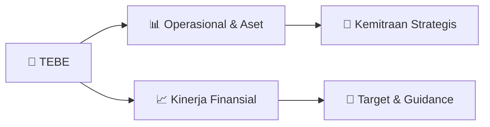

# 📊 Materi Public Expose: [TEBE]

🏢 **Emiten**: `TEBE` | 📅 **Tanggal Pelaksanaan**: `2026-09-25` | 📑 **Total Slide**: `1 Slide`
⬅️ [[knowledge-base/daily-digests/TEBE_20260925|Kembali ke Daily Digest]] | 🎛️ [[Dashboard/TEBE|Ke Dashboard Emiten]]

> [!NOTE]
> Ringkasan materi presentasi resmi Public Expose TEBE yang disampaikan oleh manajemen kepada investor dan bursa. Seluruh poin strategis, matriks operasional, dan angka kinerja diekstrak langsung dari slide deck resmi.

---

## 📅 1. Jadwal & Metadata Penyelenggaraan

| Parameter | Detail Informasi |
|---|---|
| **Nomor Surat Pengantar** | NO.044/DBL-IDX/IX/2026 |
| **Perihal Pengumuman** | Rencana Penyelenggaraan Public Expose Insidentil |
| **Waktu Pelaksanaan** | 01 Oktober 2026 14:00 |
| **Lokasi / Media** | Online Zoom Meetings |
| **Lampiran Resmi** | `1` |

## 📋 2. Agenda Paparan Publik

1. Jl. Jendral Sudirman, Kav. 52-53 Lot.28, Kebayoran Baru, Jakarta 12190 – Indonesia
2. Ph: 021-50106300
3. Jakarta, 25 September 2026
4. No.044/DBL-IDX/IX/2026
5. Kepada Yth,
6. PT. Bursa Efek Indonesia (“Bursa”)
7. Indonesia Stock Exchange Building Tower I
8. Jl. Jend Sudirman Kav.52-53, Jakarta 12190
9. :  Bpk. Saidu Solihin, Direktur Penilaian Perusahaan
10. Perihal
11. :  Pemberitahuan Rencana Public Expose Insidentil 2026 (“Public Expose”)
12. PT. Dana Brata Luhur Tbk
13. Dengan Homat,
14. Sesuai dengan ketentuan butir V.1 jo V.4.1 Keputusan Bursa No.306/BEJ/07-2004 tentang Kewajiban
15. Penyampaian informasi (Peraturan No.1-E) dan Surat Edaran PT. Bursa Efek Indonesia No.SE-
16. 00003/BEI/05-2020 tertanggal 29 Mei 2020 perihal Tata Cara Pelaksanaan Public Expose Secara
17. Elektronik, bersama ini PT. Dana Brata Luhur Tbk (“Perseroan”) menyampaikan pemberitahuan
18. rencana Public Expose yang akan diselenggarakan pada:
19. Hari/Tanggal
20. :  Kamis, 1 Oktober 2026
21. Waktu
22. :  14.00 WIB – selesai
23. Tempat
24. :  Online Zoom Meetings
25. https://us06web.zoom.us/meeting/register/xVd_RfSfQf-
26. oLBFHSaNnRA
27. Manajemen Yang Akan Hadir
28. :  Direksi Perseroan
29. Agenda Acara
30. :  1. Kinerja Operasional dan Keuangan Perseroan
31. 2. Rencana bisnis Perseroan; dan
32. 3. Analisa manajemen terkait dengan pergerakan harga
33. saham Perseroan
34. Sesuai dengan ketentuan butir V.4.2 Peraturan I-E bahwa Perseroan wajib menyampaikan materi
35. Public Expose kepada Bursa selambat-lambatnya 3 (tiga) Hari Bursa sebelum tanggal
36. penyelenggaraan Public Expose atau akan Perseroan sampaikan pada hari Senin, 28 September
37. 2026.
38. Demikian kami sampaikan, atas perhatiannya kami ucapkan terima kasih.
39. Hormat Kami,
40. PT. Dana Brata Luhur Tbk

## 🏢 3. Profil & Pilar Portofolio Bisnis

## 🏗️ 4. Kinerja Operasional & Portofolio Aset

*Detail aset operasional terlampir pada dokumen slide resmi.*

## 📈 5. Kinerja Keuangan & Posisi Finansial

## 🧭 6. Inisiatif Strategis, Kolaborasi, & Kemitraan

*Strategi usaha difokuskan pada penguatan fundamental dan ekspansi operasional.*

## 🎯 7. Target Pertumbuhan & Guidance Manajemen

*Target pertumbuhan ditetapkan mengacu pada prospek industri dan kondisi makroekonomi terkini.*

## 🗺️ 8. Peta Jalur Strategis & Eksekusi

## 📑 9. Daftar Indeks Slide Presentasi

| Slide # | Judul / Topik Slide | Ringkasan Konten |
|---|---|---|
| Slide 1 | **Equity Tower Lt. 26F , SCBD Lot 9** | Jl. Jendral Sudirman, Kav. 52-53 Lot.28, Kebayoran Baru, Jakarta 12190 – Indonesia Ph: 021-50106300 Jakarta, 25 September 2026 |

---

*Dokumen diolah otomatis oleh **Swarm Intelijen Pasar Modal Indonesia** pada 2026-10-12 16:49 WIB.*