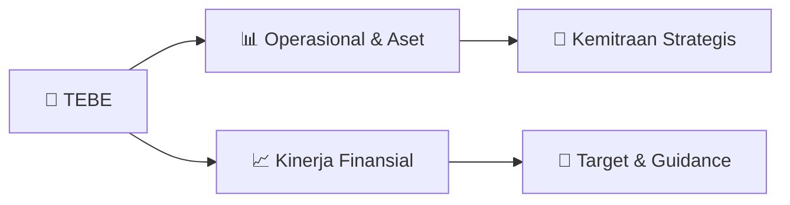

# 📊 Materi Public Expose: [TEBE]

🏢 **Emiten**: `TEBE` | 📅 **Tanggal Pelaksanaan**: `2026-09-29` | 📑 **Total Slide**: `20 Slide`
⬅️ [[knowledge-base/daily-digests/TEBE_20260929|Kembali ke Daily Digest]] | 🎛️ [[Dashboard/TEBE|Ke Dashboard Emiten]]

> [!NOTE]
> Ringkasan materi presentasi resmi Public Expose TEBE yang disampaikan oleh manajemen kepada investor dan bursa. Seluruh poin strategis, matriks operasional, dan angka kinerja diekstrak langsung dari slide deck resmi.

---

## 📅 1. Jadwal & Metadata Penyelenggaraan

| Parameter | Detail Informasi |
|---|---|
| **Nomor Surat Pengantar** | NO.046/DBL-IDX/IX/2026 |
| **Perihal Pengumuman** | Penyampaian Materi Public Expose Insidentil |
| **Waktu Pelaksanaan** | 2026-09-29 29-09-2026 11:47 |
| **Lokasi / Media** | Aplikasi Zoom / Daring |
| **Lampiran Resmi** | `1` |

## 📋 2. Agenda Paparan Publik

1. KINERJA KEUANGAN & OPERASIONAL
2. PROYEKSI RENCANA BISNIS
3. ANALISIS HARGA SAHAM
4. KINERJA KEUANGAN &
5. OPERASIONAL
6. KINERJA PER 30 JUNI 2026
7. REALISASI 31 AGUSTUS 2026
8. (UNAUDITED)
9. PROYEKSI RENCANA
10. BISNIS
11. ANALISIS HARGA
12. SAHAM

## 🏢 3. Profil & Pilar Portofolio Bisnis

## 🏗️ 4. Kinerja Operasional & Portofolio Aset

> Ringkasan Eksekutif
Kinerja konsolidasi PT DBL Group Periode Semester I 2026 (dalam Rp juta kecuali dinyatakan lain)
Laporan Keuangan Semester I 2026 — PT Dana Brata Luhur Tbk dan Entitas Anak
TOTAL ASET
+3,5% YoY  •  S1 2025: Rp 170.932
TOTAL EKUITAS Rp 1.043.893
-27,6% YoY  •  S1 2025: Rp 27.737
VOLUME HAULING Rp 1.094.844
vs Des-25: Rp 1.288.783
DER 4,9%  •  posisi kas Rp 433.413
PENDAPATAN USAHA
2,08 jt ton
rata-rata 346 rb ton/bulan
VOLUME LOADING
2,03 jt ton
rata-rata 339 rb ton/bulan
LABA BERSIH Rp 15.955
-43,5% YoY  •  S1 2025: Rp 28.233
MARJIN LABA BERSIH
11,3%
GPM 15,1%  •  OPM 9,0%
•
Pendapatan konsolidasian tumbuh 3,5% YoY menjadi Rp176,9 miliar (S1 2025 sebesar Rp170,9 miliar).  Kondisi tersebut mencerminkan strategi
diversifikasi jasa logistic Batubara yang dilakukan oleh Perseroan di Tengah penurunan produksi Batubara.
•
Laba bersih tercatat Rp20,1 miliar dengan marjin laba bersih 11,3%. Penurunan laba bersih 27,6% YoY disebabkan peningkatan harga bahan bakar dan
penurunan produksi Batubara yang berdampak pada struktur biaya pokok.
•
Posisi keuangan per 30 Juni 2026 sangat solid yang diindikasikan dengan saldo kas dan setara kas Rp433,4 miliar, rasio lancar 12,8x, da

> Neraca Konsolidasian
Posisi 30 Juni 2026 vs 31 Desember 2025 (dalam Rp juta)
Laporan Keuangan Semester I 2026 — PT Dana Brata Luhur Tbk dan Entitas Anak
Uraian
30 Jun 2026
31 Des 2025
Δ%
Kas dan setara kas
433.413 651.557
-33,5%
Piutang usaha - neto
27.465 25.070 9,6% Persediaan 10.638 9.186 15,8%
Total Aset Lancar
507.467 688.675
-26,3%
Aset tetap - neto
527.130 553.243
-4,7%
Total Aset Tidak Lancar
587.378 600.109
-2,1%
TOTAL ASET
1.094.844
1.288.783
-15,0%
Liabilitas jangka pendek
39.564 54.190
-27,0%
Liabilitas jangka panjang
11.387 9.555 19,2% TOTAL LIABILITAS 50.952 63.744
-20,1%
TOTAL EKUITAS
1.043.893
1.225.039
-14,8%
1.095
1.044
1.289
1.225
200 400 600 800
1.000
1.200
1.400
Total Aset Liabilitas Ekuitas
Ringkasan Posisi Keuangan (Rp miliar)
30 Jun 2026
31 Des 2025
• Penurunan Total Aset dan Ekuitas per 30 Juni 2026 dari posisi per 31
Desember 2025 terutama mencerminkan pembayaran dividen tunai
tahunan sesuai keputusan RUPS di periode S1 2026.
• Saldo Kas dan Setara Kas tetap kuat di level Rp433,4 miliar untuk
membiayai seluruh liabilitas operasional.
Sumber: Laporan Posisi Keuangan Konsolidasian per 30 Juni 2026 (tidak diaudit) dan 31 Desember 2025 (diaudit)

> Ringkasan Proyeksi Kinerja (Periode s.d. Agustus 2026)
Konsolidasian YTD Januari–Agustus 2026, tidak diaudit (dalam Rp juta kecuali dinyatakan lain)
Perkembangan Terkini Agustus 2026 — PT Dana Brata Luhur Tbk dan Entitas Anak
PENDAPATAN USAHA Rp 256.056
Jul–Agu: Rp79,2 miliar — tren menguat
LABA BERSIH Rp 47.229
Jul–Agu: Rp27,2 miliar, melampaui laba S1
TOTAL ASET Rp 1.133.136
vs Des-25: Rp 1.288.783
TOTAL EKUITAS Rp 1.071.051
DER 5,8%  •  posisi kas Rp 437.527
VOLUME HAULING
3,10 jt ton
Agustus 585 rb ton — tertinggi tahun ini
VOLUME LOADING
2,98 jt ton
Agustus 572 rb ton — tertinggi tahun ini
LABA USAHA Rp 41.717
OPM 16,3% (S1 2026: 9,0%)
MARJIN LABA BERSIH
18,4%
GPM 21,6% (S1 2026: 15,1%)
•
Pendapatan konsolidasian YTD Agustus 2026 sebesar Rp256,1 miliar. Total pendapatan usaha periode Juli–Agustus menyumbang Rp79,2 miliar seiring
dengan peningkatan volume hauling dan loading di periode tersebut.
•
Laba bersih YTD Agustus 2026 sebesar Rp47,2 miliar. Total laba bersih periode Juli–Agustus sebesar Rp27,2 miliar sehingga mendorong marjin laba
bersih ke level 18,4%.
•
Posisi saldo kas dan setara kas meningkat sebesar Rp4,1 Miliar di periode Juli – Agustus berdampak pada penutupan sa

> Realisasi Neraca Konsolidasian
Posisi 31 Agustus 2026 vs 31 Desember 2025 — laporan manajemen, belum diaudit (dalam Rp juta)
Perkembangan Terkini Agustus 2026 — PT Dana Brata Luhur Tbk dan Entitas Anak
Uraian
31 Agu 2026
31 Des 2025
Δ%
Kas dan setara kas
437.527 651.557
-32,8%
Piutang usaha - neto
48.091 25.070 91,8% Persediaan 10.606 9.186 15,5%
Total Aset Lancar
549.394 688.675
-20,2%
Aset tetap - neto
519.367 553.243
-6,1%
Total Aset Tidak Lancar
583.742 600.109
-2,7%
TOTAL ASET
1.133.136
1.288.783
-12,1%
Liabilitas jangka pendek
50.698 54.190
-6,4%
Liabilitas jangka panjang
11.387 9.555 19,2% TOTAL LIABILITAS 62.085 63.744
-2,6%
TOTAL EKUITAS
1.071.051
1.225.039
-12,6%
1.133
1.071
1.289
1.225
200 400 600 800
1.000
1.200
1.400
Total Aset Liabilitas Ekuitas
Ringkasan Posisi Keuangan (Rp miliar)
31 Agu 2026
31 Des 2025
• Kas meningkat menjadi Rp437,5 miliar dan Ekuitas menjadi
Rp1.071,1 miliar seiring akumulasi laba Juli–Agustus Rp27,2 miliar.
• Kenaikan saldo Piutang Usaha per 31 Agustus 2026 sejalan dengan
kenaikan Pendapatan Usaha atas jasa loading Pelabuhan dan hauling
di periode Juli – Agustus 2026 sebesar 0,95 juta ton.
Sumber: Laporan Keuangan Konsolidasian Manajemen YTD Ag

## 📈 5. Kinerja Keuangan & Posisi Finansial

### 🧮 Rasio Keuangan Utama
```text
Rasio Keuangan
Konsolidasian per 30 Juni 2026 dibandingkan 31 Desember 2025 (diaudit) dan 30 Juni 2025
Laporan Keuangan Semester I 2026 — PT Dana Brata Luhur Tbk dan Entitas Anak
Rasio
30 Jun 2026
31 Des 2025
30 Jun 2025
Rasio Lancar (x)
12,83x 12,71x 12,51x
Debt to Equity
4,9% 5,2% 11,0%
Debt to Asset
4,7% 4,9% 9,9%
Marjin Laba Kotor (GPM)
15,1% 41,1% 30,4%
Marjin Laba Usaha (OPM)
9,0% 31,8% 17,4%
Marjin Laba Bersih (NPM)
11,3% 27,6% 21,4%
• Struktur keuangan Perseroan konservatif dan sangat likuid yang diindikasikan dengan rasio lancar di S1 2026 sebesar 12,83x (meningkat dalam 1 tahun terakhir)
• Struktur liabilitas bersifat operasional sehingga terbuka fleksibilitas bagi Perseroan ke depan untuk meningkatkan sumber pembiayaan dalam rangka pengembangan usaha
strategis (diindikasikan dengan rasio Debt to Equity Ratio dan Debt to Asset Ratio di Q2 2026 masing-masing sebesar 4,9% dan 4,7%, menurun dalam 1 tahun terakhir).
• Marjin profitabilitas di S1 2026 melandai dibandingkan S1 2025
```

## 🧭 6. Inisiatif Strategis, Kolaborasi, & Kemitraan

*Strategi usaha difokuskan pada penguatan fundamental dan ekspansi operasional.*

## 🎯 7. Target Pertumbuhan & Guidance Manajemen

*Target pertumbuhan ditetapkan mengacu pada prospek industri dan kondisi makroekonomi terkini.*

## 🗺️ 8. Peta Jalur Strategis & Eksekusi



## 📑 9. Daftar Indeks Slide Presentasi

| Slide # | Judul / Topik Slide | Ringkasan Konten |
|---|---|---|
| Slide 1 | **PUBLIC EXPOSE** | INSIDENTIL PT DANA BRATA LUHUR Tbk 1 Oktober 2026 |
| Slide 2 | **AGENDA PUBEX** | KINERJA KEUANGAN & OPERASIONAL PROYEKSI RENCANA BISNIS ANALISIS HARGA SAHAM |
| Slide 3 | **AGENDA PUBEX** | KINERJA KEUANGAN & OPERASIONAL 1 |
| Slide 4 | **AGENDA PUBEX** | KINERJA PER 30 JUNI 2026 |
| Slide 5 | **Ringkasan Eksekutif** | Kinerja konsolidasi PT DBL Group Periode Semester I 2026 (dalam Rp juta kecuali dinyatakan lain) Laporan Keuangan Semester I 2026 — PT Dana Brata Luhu |
| Slide 6 | **Neraca Konsolidasian** | Posisi 30 Juni 2026 vs 31 Desember 2025 (dalam Rp juta) Laporan Keuangan Semester I 2026 — PT Dana Brata Luhur Tbk dan Entitas Anak Uraian |
| Slide 7 | **Laba Rugi Konsolidasian — S1 2026 vs S1 2025** | Semester I 2026 vs Semester I 2025 dan tren triwulanan (dalam Rp juta) Laporan Keuangan Semester I 2026 — PT Dana Brata Luhur Tbk dan Entitas Anak Ura |
| Slide 8 | **Rasio Keuangan** | Konsolidasian per 30 Juni 2026 dibandingkan 31 Desember 2025 (diaudit) dan 30 Juni 2025 Laporan Keuangan Semester I 2026 — PT Dana Brata Luhur Tbk dan |
| Slide 9 | **Ringkasan Proyeksi Kinerja (Periode s.d. Agustus 2026)** | Konsolidasian YTD Januari–Agustus 2026, tidak diaudit (dalam Rp juta kecuali dinyatakan lain) Perkembangan Terkini Agustus 2026 — PT Dana Brata Luhur  |
| Slide 10 | **Laporan Segmen Usaha** | Pendapatan konsolidasi per segmen — Semester I 2026 (dalam Rp juta, setelah eliminasi management fee) Laporan Keuangan Semester I 2026 — PT Dana Brata |
| Slide 11 | **AGENDA PUBEX** | REALISASI 31 AGUSTUS 2026 (UNAUDITED) |
| Slide 12 | **ANALISIS OPERASIONAL & PASAR** | Korelasi Indikator LCI & Volume Operasional: Stabilitas LCI pada kisaran $ 121,29 – $ 136,77 per ton memberikan kepastian tarif jasa logistik, yang me |
| Slide 13 | **Realisasi Neraca Konsolidasian** | Posisi 31 Agustus 2026 vs 31 Desember 2025 — laporan manajemen, belum diaudit (dalam Rp juta) Perkembangan Terkini Agustus 2026 — PT Dana Brata Luhur  |
| Slide 14 | **Realisasi Laba Rugi Konsolidasian** | Kumulatif Januari–Agustus 2026 vs Semester I 2026, belum diaudit (dalam Rp juta) Perkembangan Terkini Agustus 2026 — PT Dana Brata Luhur Tbk dan Entit |
| Slide 15 | **AGENDA PUBEX** | PROYEKSI RENCANA BISNIS 2 |
| Slide 16 | **PT Dana Brata Luhur Tbk** | Pengembangan Bisnis Baru Entitas Anak Struktur Entitas: PT DBL → PT Talenta Bumi → PT TBE / PT SKAT |
| Slide 17 | **AGENDA PUBEX** | ANALISIS HARGA SAHAM 3 |
| Slide 18 | **1.660** | 1.540 1.275 1.260 |
| Slide 19 | **ANALISIS HARGA SAHAM** | Peningkatan harga saham terjadi disebabkan beberapa faktor eksternal dan internal antara lain: Faktor Eksternal • |
| Slide 20 | **TERIMA KASIH** |  |

---

*Dokumen diolah otomatis oleh **Swarm Intelijen Pasar Modal Indonesia** pada 2026-10-12 16:50 WIB.*