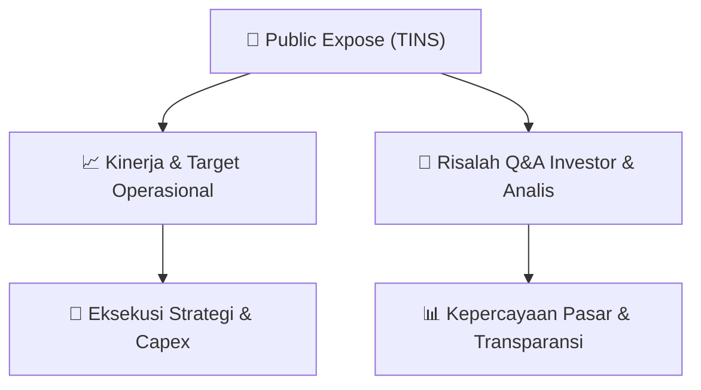

# 📢 Laporan Intelijen Paparan Publik (Public Expose) - [[TINS]]
🏢 **Emiten**: `[[TINS]]` | 📅 **Tanggal Pelaksanaan**: `2026-08-27` | 📑 **Dokumen**: `Public Expose`
⬅️ [[knowledge-base/daily-digests/Daily_Digest_20260827|Kembali ke Daily Digest]] | 🎛️ [[Dashboard|Ke Dashboard Utama]]

---

## 📌 1. Ringkasan Eksekutif & Paparan Direksi
> [!NOTE]
> PT TIMAH (Persero) Tbk (kode emiten TINS) mengumumkan rencana penyelenggaraan Public Expose Tahunan untuk tahun buku yang berakhir pada 2026. Acara akan diselenggarakan pada tanggal 10 September 2026 pukul 10:00 melalui platform Public Expose Live 2026 yang tercantum di website idx.co.id. Agenda utama meliputi pemaparan kinerja perseroan periode semester 1-2026 dan lain-lain. Pengumuman disampaikan oleh Corporate Secretary Ruddy Nursalam pada 27 Agustus 2026.

#### 🎯 Guidance Operasional & Target Strategis
- Dokumen ini hanya merupakan pengumuman rencana Public Expose dan tidak memuat rincian target kinerja, ekspansi, belanja modal (capex), atau guidance operasional. Informasi tersebut diharapkan akan disampaikan pada saat pelaksanaan Public Expose.

## 📊 2. Matriks Indikator Operasional & Parameter Kunci
| Parameter Utama | Nilai / Keterangan Resmi |
| :--- | :--- |
| **Nama Perusahaan** | `PT TIMAH (Persero) Tbk` |
| **Kode Emiten** | `TINS` |
| **Jenis Acara** | `Public Expose Tahunan` |
| **Tahun Buku** | `2026` |
| **Tanggal Pelaksanaan** | `10 September 2026` |
| **Waktu** | `10:00` |
| **Tempat** | `Public Expose Live 2026 (idx.co.id)` |
| **Agenda** | `1. Kinerja Perseroan Periode Semester 1-2026; 2. Lain-lain` |
| **Corporate Secretary** | `Ruddy Nursalam` |
| **Tanggal Pengumuman** | `27-08-2026 14:23` |

---

## 💬 3. Risalah Tanya Jawab (Q&A Session)
`Materi presentasi Public Expose / Risalah Q&A terlampir dalam dokumen resmi bursa.`

## 📌 4. Peta Jalur Strategis & Roadmap

---

## 🔗 Knowledge Graph
- [[knowledge-base/daily-digests/Daily_Digest_20260827|📄 Daily Digest 2026-08-27]]
- [[knowledge-base/calendars/Action_Calendar|🗓️ Kalender Terpusat Aksi Korporasi]]
- [[Dashboard|🎛️ Kembali ke Dashboard Utama]]