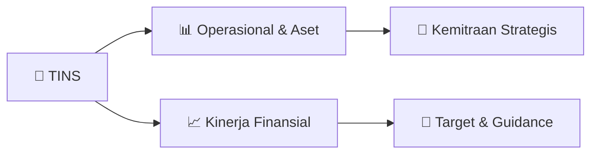

# 📊 Materi Public Expose: [TINS]

🏢 **Emiten**: `TINS` | 📅 **Tanggal Pelaksanaan**: `2026-09-07` | 📑 **Total Slide**: `30 Slide`
⬅️ [[knowledge-base/daily-digests/TINS_20260907|Kembali ke Daily Digest]] | 🎛️ [[Dashboard/TINS|Ke Dashboard Emiten]]

> [!NOTE]
> Ringkasan materi presentasi resmi Public Expose TINS yang disampaikan oleh manajemen kepada investor dan bursa. Seluruh poin strategis, matriks operasional, dan angka kinerja diekstrak langsung dari slide deck resmi.

---

## 📅 1. Jadwal & Metadata Penyelenggaraan

| Parameter | Detail Informasi |
|---|---|
| **Nomor Surat Pengantar** | 4789/Tbk/UM-0010/26-S19.1 |
| **Perihal Pengumuman** | Penyampaian Materi Public Expose Tahunan |
| **Waktu Pelaksanaan** | 2026-09-07 07-09-2026 18:37 |
| **Lokasi / Media** | Aplikasi Zoom / Daring |
| **Lampiran Resmi** | `2` |

## 📋 2. Agenda Paparan Publik

1. Sekilas Perseroan
2. Kinerja Operasi dan Keuangan
3. Komitmen terhadap ESG
4. Strategi Peningkatan Operasi dan Produksi
5. Agenda

## 🏢 3. Profil & Pilar Portofolio Bisnis

> Sekilas Perseroan

> Tentang Perseroan
Menjadi Perusahaan pertambangan
terkemuka di dunia yang ramah
lingkungan
1. Membangun sumber daya manusia
yang tangguh, unggul dan
bermartabat
2. Melaksanakan tata kelola
penambangan yang baik dan benar
3. Mengoptimalkan nilai Perusahaan
dan kontribusi terhadap pemegang
saham serta tanggung jawab sosial
Visi Misi 1709
Penemuan bijih timah
di Pulau Bangka
Tahun 1700-an 1856
Belanda mendirikan Banka
Tin Winning Bedrijf (BTW)
1858 Belanda mendirikan Gemeenschappelijke Mijnbouw
Maatschappij Billiton (GMB)
1878
Belanda mendirikan NV Singkep
Tin Exploitatie Maatschappij (NV
SITEM) Tahun 1800-an 1953
Nasionalisasi BTW, menjadi
Perusahaan Negara Tambang
Timah (PN TT) Bangka
1958
Nasionalisasi GMB, menjadi PN
Tambang Timah (PNTT) Belitung
1959
Nasionalisasi NV SITEM, menjadi
PN Tambang Timah (PNTT) Singkep
1961
Pemerintah Indonesia mendirikan
Badan Pimpinan Umum Perusahaan
Tambang Timah Negara (BPU Timah)
1968
Merger BPU, PN TT Bangka, PN TT
Belitung dan PN TT Singkep, menjadi
PN Tambang Timah
1976
Menjadi PT Tambang Timah (Persero)
Tahun 1900-an Tahun 2000-an 2007
Masuk ke bisnis hilir timah
(Tin Solder dan Tin Chemical)
2014 - 2015
Membentuk beberapa anak perusahaan
yang berbasis kompetensi
2017
• Menjadi anggota Grup MIND ID
• Penerbitan obligasi dan sukuk
2019
Penerapan teknologi fuming furnace
untuk melebur tin slag
2020
Divestasi Indometal Corporation (Asia
Pacific) Pte Ltd kepada MIND ID dan
PT RSBT kepada PT Pertamina Bina
Medika IHC 2021
Pembelian kembali (b

## 🏗️ 4. Kinerja Operasional & Portofolio Aset

> Harga Timah Global
Harga Timah LME, 2024 – Juli 2026
Proyeksi Harga Timah 2026
Berdasarkan data Bloomberg, perkiraan harga timah pada tahun 2026
berkisar antara USD37.932/Ton - USD55.000/Ton. Pergerakan harga
dipengaruhi oleh beberapa faktor diantaranya peningkatan penggunaan
peralatan elektronik, semikonduktor, chip serta digitalisasi dan Artificial
Intelligence (AI). Prospek ekonomi makro juga akan tetap mempengaruhi
pergerakan harga logam timah seperti ketidakpastian seputar rencana
stimulus fiskal China dan reaksi terhadap kebijakan Federal Reserve.
Selain itu faktor kondisi geopolitik juga mempengaruhi, ketegangan yang
terjadi di Timur Tengah, menyebabkan dampak kenaikan harga energi,
gangguan logistik dan volatilitas harga yang tinggi.
Sampai dengan Juli 2026, harga rata-rata logam timah CSP di LME naik
38,13% dibandingkan periode yang sama tahun sebelumnya menjadi
US$43.857,78 per ton. Sedangkan harga 3-month naik 37,92% menjadi
$43.912,56 per ton.

> Posisi Neraca 7.587 8.409 9.225 FY 2024 FY 2025 RKAP 2026
Ekuitas (Miliar Rupiah)
12.780 13.643 14.540 FY 2024 FY 2025 RKAP 2026
Aset (Miliar Rupiah)
Liabilitas (Miliar Rupiah)
5.193
5.235
5.295
FY 2024 FY 2025 RKAP 2026 H1 2026 16.449 21% yoy H1 2026
5.901
13% yoy H1 2026 10.548 25% yoy

## 📈 5. Kinerja Keuangan & Posisi Finansial

### 📊 Ringkasan Finansial
```text
Kinerja Keuangan 10.85611.553
2.098
5.465
2.122
4.955 4.220
15.353
FY24 FY25 1Q25 1Q26 2Q25 2Q26 1H25 RKAP
2026
Pendapatan (Miliar Rupiah)
H1 2026 10.420 147% yoy
2.707 2.764
385
2.117
456
1.779
841
2.980
FY24 FY25 1Q25 1Q26 2Q25 2Q26 1H25 RKAP
2026 H1 2026
3.896
363% yoy
EBITDA (Miliar Rupiah)
1.249 1.314
117
1.501
183
1.214
300
1.605
FY24 FY25 1Q25 1Q26 2Q25 2Q26 1H25 RKAP
2026 H1 2026
2.715
805% yoy
Laba Bersih (Miliar Rupiah)
(QoQ) (YoY) (QoQ) (YoY) (QoQ) (YoY)
```

## 🧭 6. Inisiatif Strategis, Kolaborasi, & Kemitraan

- Strategi Peningkatan Operasi dan Produksi
3 Anak Perusahaan
dengan laba bersih tertinggi
Peningkatan Sumberdaya dan Cadangan Timah secara organik/anorganik
Survey Geologi
3.216 Ha
Survey Geofisika 76 Km Survei Topografi 17.638 Ha Bor Eksplorasi 41.104 m Bor Pandu 12.971 m Optimalisasi Pengolahan Timah Primer
Perbaikan Tata Kelola
Kemitraan Penambangan Optimalisasi Produksi
melalui penambahan alat kerja penambangan,
peningkatan produktivitas alat kerja, dan percepatan
pembukaan lokasi baru
Pengembangan Monasite-REE Diversifikasi bisnis mineral strategis Peningkatan Pendapatan Konsolidasi
melalui peningkatan kinerja Anak
Perusahaan
PT Indometal London
PT Timah Industri
(Profit Turnaround)
PT Timah Karya Persada Properti
(Profit Turnaround)
Peningkatan Volume Produksi & Penjualan
Tin Solder, Tin Chemical, Nikel, Batubara dan  Pasir Kuarsa

## 🎯 7. Target Pertumbuhan & Guidance Manajemen

*Target pertumbuhan ditetapkan mengacu pada prospek industri dan kondisi makroekonomi terkini.*

## 🗺️ 8. Peta Jalur Strategis & Eksekusi



## 📑 9. Daftar Indeks Slide Presentasi

| Slide # | Judul / Topik Slide | Ringkasan Konten |
|---|---|---|
| Slide 1 | **@official_TIMAH** | @officialtimah PT TIMAH Tbk @officialtimah |
| Slide 2 | **2 Disclaimer** | Disclaimer Pemaparan ini memuat berbagai pernyataan yang dapat dianggap sebagai pernyataan berwawasan ke depan sehingga hasil, pelaksanaan atau pencap |
| Slide 3 | **Public Expose 2024** | 3 Sekilas Perseroan Kinerja Operasi dan Keuangan |
| Slide 4 | **4 Sekilas Perseroan** | Sekilas Perseroan |
| Slide 5 | **5 Tentang Perseroan** | Tentang Perseroan Menjadi Perusahaan pertambangan terkemuka di dunia yang ramah |
| Slide 6 | **6 Struktur Kepemilikan Saham** | Struktur Kepemilikan Saham Negara Republik Indonesia Badan Pengelola Investasi |
| Slide 7 | **7 Struktur Grup Perseroan** | Struktur Grup Perseroan Lini Bisnis Penambangan Timah |
| Slide 8 | **8 Manajemen Perseroan** | Manajemen Perseroan Dewan Komisaris Agus Rohman |
| Slide 9 | **9 Manajemen Perseroan** | Manajemen Perseroan Fina Eliani Direktur Keuangan & Manajemen Risiko |
| Slide 10 | **10 Proses Bisnis Perseroan** | Proses Bisnis Perseroan Eksplorasi untuk menemukan sumberdaya dan cadangan baru |
| Slide 11 | **11 Wilayah Operasi & Sumberdaya** | Wilayah Operasi & Sumberdaya 300 334 |
| Slide 12 | **12 Wilayah Pemasaran Logam Timah Perseroan** | Wilayah Pemasaran Logam Timah Perseroan Sumber : Berdasarkan Laporan Penjualan Internal PT TIMAH Tbk Report (Jan-Jun 2026) Ekspor |
| Slide 13 | **13 Harga Timah Global** | Harga Timah Global Harga Timah LME, 2024 – Juli 2026 Proyeksi Harga Timah 2026 |
| Slide 14 | **14 Produksi dan Konsumsi Logam Timah Global** | Produksi dan Konsumsi Logam Timah Global 2002 2003 |
| Slide 15 | **15 Aplikasi Penggunaan Logam Timah Global** | Aplikasi Penggunaan Logam Timah Global 53% 16% |
| Slide 16 | **16 Kinerja Operasi** | Kinerja Operasi dan Keuangan |
| Slide 17 | **17 Kinerja Operasi (1/2)** | Kinerja Operasi (1/2) 19.43718.635 3.225 |
| Slide 18 | **18 17.884** | 17.884 19.664 20.148 |
| Slide 19 | **19 Kinerja Keuangan** | Kinerja Keuangan 10.85611.553 2.098 |
| Slide 20 | **20 Posisi Neraca** | Posisi Neraca 7.587 8.409 |
| Slide 21 | **21 Arus Kas dari Aktivitas Operasi dan Interest Bearing Debt** | Arus Kas dari Aktivitas Operasi dan Interest Bearing Debt 2.495 966 |
| Slide 22 | **22 Komitmen** | Komitmen Terhadap ESG |
| Slide 23 | **23 ESG Risk Rating** | ESG Risk Rating PT TIMAH (Persero) Tbk Diversified Metals Mining   |   Indonesia   |   JKT:TINS |
| Slide 24 | **24 Environmental** | Environmental Reklamasi Darat dan Laut Reduksi Emisi GRK |
| Slide 25 | **25 Social** | Social Occupational Health & Safety Community Investment |
| Slide 26 | **26 Governance** | Governance Manajemen Risiko Keberlanjutan PT TIMAH (Persero) Tbk mengintegrasikan risiko keberlanjutan ke dalam |
| Slide 27 | **27 Kontribusi Tanggung Jawab Sosial dan Lingkungan Perseroan** | Kontribusi Tanggung Jawab Sosial dan Lingkungan Perseroan No. Program CSR |
| Slide 28 | **28 Strategi Peningkatan** | Strategi Peningkatan Operasi dan Produksi |
| Slide 29 | **29 Strategi Peningkatan Operasi dan Produksi** | Strategi Peningkatan Operasi dan Produksi 3 Anak Perusahaan dengan laba bersih tertinggi |
| Slide 30 | **Public Expose 2024** | 30 Terima Kasih PT TIMAH (Persero) Tbk |

---

*Dokumen diolah otomatis oleh **Swarm Intelijen Pasar Modal Indonesia** pada 2026-10-12 16:50 WIB.*