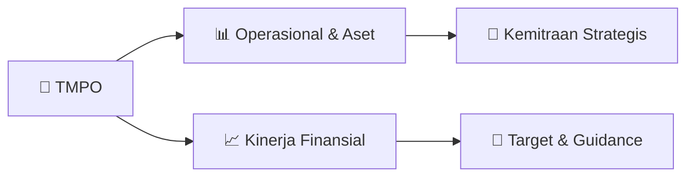

# 📊 Materi Public Expose: [TMPO]

🏢 **Emiten**: `TMPO` | 📅 **Tanggal Pelaksanaan**: `2026-08-31` | 📑 **Total Slide**: `2 Slide`
⬅️ [[knowledge-base/daily-digests/TMPO_20260831|Kembali ke Daily Digest]] | 🎛️ [[Dashboard/TMPO|Ke Dashboard Emiten]]

> [!NOTE]
> Ringkasan materi presentasi resmi Public Expose TMPO yang disampaikan oleh manajemen kepada investor dan bursa. Seluruh poin strategis, matriks operasional, dan angka kinerja diekstrak langsung dari slide deck resmi.

---

## 📅 1. Jadwal & Metadata Penyelenggaraan

| Parameter | Detail Informasi |
|---|---|
| **Nomor Surat Pengantar** | 045/EXT-Corsec/E/TIM/VIII/26 |
| **Perihal Pengumuman** | Rencana Penyelenggaraan Public Expose Insidentil |
| **Waktu Pelaksanaan** | 02 September 2026 14:00 |
| **Lokasi / Media** | Gedung Tempo, Jl. Palmerah Barat No.8 Jakarta 12210 |
| **Lampiran Resmi** | `0` |

## 📋 2. Agenda Paparan Publik

1. Nama Perusahaan
2. Kode Emiten
3. Lampiran
4. Perihal
5. 045/EXT-Corsec/E/TIM/VIII/26
6. Tempo Inti Media Tbk
7. Rencana Penyelenggaraan Public Expose Insidentil
8. Go To English Page
9. Perseroan melaporkan rencana Public Expose Insidentil sebagai berikut:
10. Rencana Penyelenggaraan Public Expose
11. Latar Belakang Pelaksanaan
12. Sukarela
13. Permintaan Bursa
14. Permintaan Otoritas Jasa Keuangan ( OJK)
15. Referensi Surat
16. Peng-SPT-00155/BEI.WAS/08-2026
17. Tempat
18. : Gedung Tempo, Jl. Palmerah Barat No.8 Jakarta 12210
19. Hari/Tanggal
20. : 02 September 2026
21. Waktu
22. 14:00
23. Agenda
24. Pembukaan
25. Paparan
26. Tanya Jawab
27. Penutup
28. Hormat Kami,
29. Demikian untuk diketahui.
30. Gedung Tempo, Lantai 5 Jl. palmerah Barat No. 8 Jakarta 12210
31. Corporate Legal
32. Nama Pengirim
33. Telepon : 021-536-3790/530 6392, Fax : (021) 536 - 2025/7206995, tempo.id
34. Tempo Inti Media Tbk
35. Yudianto Sri Wicaksono
36. Tempo Inti Media Tbk
37. Yudianto Sri Wicaksono
38. Jabatan
39. Corporate Legal
40. Tanggal dan Waktu
41. 31-08-2026 15:09
42. Dokumen ini merupakan dokumen resmi Tempo Inti Media Tbk yang tidak memerlukan tanda tangan karena
43. dihasilkan secara elektronik oleh sistem pelaporan elektronik. Tempo Inti Media Tbk bertanggung jawab penuh atas
44. informasi yang tertera didalam dokumen ini.
45. Issuer Name
46. Issuer Code
47. Attachment
48. Subject
49. 045/EXT-Corsec/E/TIM/VIII/26
50. Tempo Inti Media Tbk
51. General Announcement Public Expose
52. Go To Indonesian Page
53. Company announces public expose plan Incidental as follows:
54. Public Expose Announcement
55. Background
56. Voluntary
57. Requested by IDX
58. Requested by OJK
59. Reference Letter
60. Peng-SPT-00155/BEI.WAS/08-2026
61. Place
62. : Gedung Tempo, Jl. Palmerah Barat No.8 Jakarta 12210
63. : 02 September 2026
64. 14:00
65. Agenda
66. Opening
67. Presenation
68. Q & A session
69. Closing
70. Respectfully,
71. Thus to be informed accordingly.
72. Tempo Inti Media Tbk
73. Yudianto Sri Wicaksono
74. Corporate Legal
75. Yudianto Sri Wicaksono
76. Sender Name
77. Tempo Inti Media Tbk
78. Gedung Tempo, Lantai 5 Jl. palmerah Barat No. 8 Jakarta 12210
79. Phone : 021-536-3790/530 6392, Fax : (021) 536 - 2025/7206995, tempo.id
80. Corporate Legal
81. Function
82. Date and Time
83. 31-08-2026 15:09
84. This is an official document of Tempo Inti Media Tbk that does not require a signature as it was generated
85. electronically by the electronic reporting system. Tempo Inti Media Tbk is fully responsible for the information

## 🏢 3. Profil & Pilar Portofolio Bisnis

## 🏗️ 4. Kinerja Operasional & Portofolio Aset

*Detail aset operasional terlampir pada dokumen slide resmi.*

## 📈 5. Kinerja Keuangan & Posisi Finansial

## 🧭 6. Inisiatif Strategis, Kolaborasi, & Kemitraan

*Strategi usaha difokuskan pada penguatan fundamental dan ekspansi operasional.*

## 🎯 7. Target Pertumbuhan & Guidance Manajemen

*Target pertumbuhan ditetapkan mengacu pada prospek industri dan kondisi makroekonomi terkini.*

## 🗺️ 8. Peta Jalur Strategis & Eksekusi

## 📑 9. Daftar Indeks Slide Presentasi

| Slide # | Judul / Topik Slide | Ringkasan Konten |
|---|---|---|
| Slide 1 | **Nomor Surat** | Nama Perusahaan Kode Emiten Lampiran |
| Slide 2 | **Letter / Announcement No.** | Issuer Name Issuer Code Attachment |

---

*Dokumen diolah otomatis oleh **Swarm Intelijen Pasar Modal Indonesia** pada 2026-10-12 16:50 WIB.*