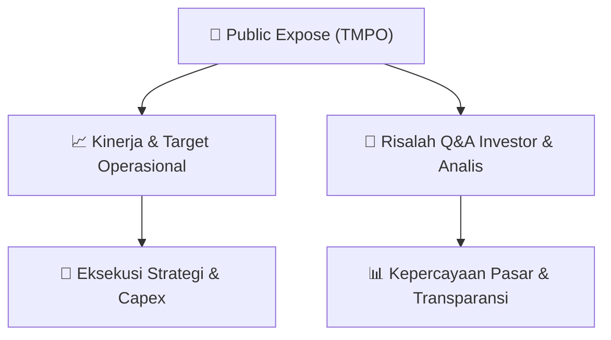

# 📢 Laporan Intelijen Paparan Publik (Public Expose) - [[TMPO]]
🏢 **Emiten**: `[[TMPO]]` | 📅 **Tanggal Pelaksanaan**: `2026-09-01` | 📑 **Dokumen**: `Public Expose`
⬅️ [[knowledge-base/daily-digests/Daily_Digest_20260901|Kembali ke Daily Digest]] | 🎛️ [[Dashboard|Ke Dashboard Utama]]

---

## 📌 1. Ringkasan Eksekutif & Paparan Direksi
> [!NOTE]
> Dokumen yang diberikan merupakan surat resmi dari Tempo Inti Media Tbk (TMPO) bernomor 046/Ext-Corsec/E/TIM/IX/26 tertanggal 01 September 2026, yang menyampaikan materi Public Expose Insidentil kepada otoritas terkait. Surat ini hanya berisi pengantar administratif dan tidak memuat isi materi paparan publik, data kinerja, proyeksi, atau tanya jawab. Materi Public Expose Insidentil disampaikan merujuk pada surat sebelumnya No. 045/EXT-Corsec/E/TIM/VIII/26 tanggal 02 September 2026. Tidak terdapat informasi operasional, keuangan, atau strategis emiten dalam teks yang diberikan.

#### 🎯 Guidance Operasional & Target Strategis
- Tidak tersedia dalam teks yang diberikan. Dokumen hanya berupa surat penyampaian materi public expose tanpa rincian target kinerja, ekspansi, belanja modal, atau panduan manajemen.

## 💬 3. Risalah Tanya Jawab (Q&A Session)
`Materi presentasi Public Expose / Risalah Q&A terlampir dalam dokumen resmi bursa.`

## 📌 4. Peta Jalur Strategis & Roadmap

---

## 🔗 Knowledge Graph
- [[knowledge-base/daily-digests/Daily_Digest_20260901|📄 Daily Digest 2026-09-01]]
- [[knowledge-base/calendars/Action_Calendar|🗓️ Kalender Terpusat Aksi Korporasi]]
- [[Dashboard|🎛️ Kembali ke Dashboard Utama]]