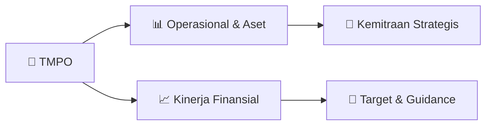

# 📊 Materi Public Expose: [TMPO]

🏢 **Emiten**: `TMPO` | 📅 **Tanggal Pelaksanaan**: `2026-09-01` | 📑 **Total Slide**: `7 Slide`
⬅️ [[knowledge-base/daily-digests/TMPO_20260901|Kembali ke Daily Digest]] | 🎛️ [[Dashboard/TMPO|Ke Dashboard Emiten]]

> [!NOTE]
> Ringkasan materi presentasi resmi Public Expose TMPO yang disampaikan oleh manajemen kepada investor dan bursa. Seluruh poin strategis, matriks operasional, dan angka kinerja diekstrak langsung dari slide deck resmi.

---

## 📅 1. Jadwal & Metadata Penyelenggaraan

| Parameter | Detail Informasi |
|---|---|
| **Nomor Surat Pengantar** | 046/Ext-Corsec/E/TIM/IX/26 |
| **Perihal Pengumuman** | Penyampaian Materi Public Expose Insidentil |
| **Waktu Pelaksanaan** | 2026-09-01 01-09-2026 11:40 |
| **Lokasi / Media** | Aplikasi Zoom / Daring |
| **Lampiran Resmi** | `1` |

## 📋 2. Agenda Paparan Publik

1. menyelesaikan proses penyuntingan film Laut Bercerita.
2. Film tersebut merupakan adaptasi dari novel karya Leila S. Chudori.
3. Film Laut Bercerita direncanakan tayang di bioskop pada 29 Oktober 2026 dan
4. selanjutnya juga direncanakan untuk ditayangkan melalui platform over-the-top (OTT).
5. Produksi film Laut Bercerita merupakan bagian dari pengembangan Perseroan dari
6. media berbasis teks dan video pendek menuju medium film panjang.
7. Perseroan melihat pengembangan film sebagai bagian dari upaya membangun dan
8. mengembangkan nilai ekonomi dari intellectual property yang dapat dikembangkan
9. dan didistribusikan melalui berbagai platform.
10. Dengan demikian, satu aset konten dapat memiliki beberapa jalur distribusi dan potensi
11. monetisasi.
12. VIII.
13. PERKEMBANGAN HARGA SAHAM DAN PAPARAN PUBLIK INSIDENTAL
14. Pada tanggal 26 Agustus 2026, Bursa Efek Indonesia menerbitkan Pengumuman Bursa
15. Nomor Peng-SPT-00155/BEI.WAS/08-2026 mengenai Penghentian Sementara
16. Perdagangan Saham PT Tempo Inti Media Tbk.
17. Penghentian sementara perdagangan saham Perseroan dilakukan sehubungan dengan
18. peningkatan harga kumulatif yang signifikan pada saham Perseroan.
19. Perdagangan saham Perseroan kemudian dibuka kembali pada tanggal 27 Agustus
20. 2026.
21. Sehubungan dengan perkembangan tersebut, Bursa Efek Indonesia meminta Perseroan
22. untuk menyelenggarakan Paparan Publik Insidental sebagai bagian dari upaya
23. memberikan penjelasan dan keterbukaan informasi kepada pemegang saham serta
24. pemangku kepentingan Perseroan.
25. Perseroan menghargai perhatian dan kepercayaan publik maupun investor terhadap
26. Perseroan.
27. Perseroan memandang bahwa kepercayaan terhadap independensi, kredibilitas, dan
28. kualitas jurnalistik Tempo, serta perhatian terhadap agenda transformasi dan
29. pengembangan bisnis Perseroan, merupakan bagian dari faktor yang dapat membentuk
30. persepsi positif investor terhadap Perseroan.
31. Namun demikian, Perseroan menegaskan bahwa pergerakan harga saham
32. dipengaruhi oleh berbagai faktor, baik faktor fundamental Perseroan maupun kondisi
33. pasar secara keseluruhan.
34. Oleh karena itu, Perseroan tidak menyatakan bahwa peningkatan harga saham tersebut
35. disebabkan oleh satu faktor tertentu.
36. Perseroan akan terus menjaga:
37. independensi;
38. kredibilitas;
39. transparansi;
40. kualitas tata kelola; dan
41. konsistensi pelaksanaan transformasi bisnis.
42. Perseroan memandang kepercayaan publik sebagai salah satu aset penting yang
43. harus dijaga melalui kinerja, integritas, dan keterbukaan informasi yang
44. berkesinambungan.
45. OUTLOOK DAN FOKUS SEMESTER II 2026
46. Memasuki Semester II 2026, Perseroan akan berfokus pada beberapa agenda utama:
47. 1. Perseroan akan berupaya menangkap peluang pemulihan pendapatan, termasuk
48. dengan mempertimbangkan pola historis belanja pemerintah pada Semester II.
49. 2. Perseroan akan melanjutkan implementasi login wall dan pengembangan
50. registered-user base untuk meningkatkan konversi menjadi pelanggan digital.
51. 3. Perseroan akan melanjutkan pengembangan Data Asset Management untuk
52. mengubah aset informasi menjadi produk dan layanan yang memiliki nilai
53. komersial.
54. 4. Perseroan akan mengembangkan SBU baru dengan memanfaatkan kapabilitas
55. informasi dan analisis yang dimiliki Tempo.
56. 5. Perseroan akan mengoptimalkan potensi distribusi dan monetisasi konten,
57. termasuk melalui film Laut Bercerita yang direncanakan tayang pada 29 Oktober
58. 2026.
59. 6. Perseroan akan mempertahankan disiplin biaya dan meningkatkan produktivitas
60. agar pertumbuhan pendapatan dapat memberikan kontribusi optimal terhadap
61. kinerja Perseroan.
62. PENUTUP
63. Semester I 2026 merupakan periode yang masih menghadapi tantangan dari sisi
64. pendapatan. Pendapatan usaha Perseroan mengalami penurunan dibandingkan periode
65. yang sama tahun sebelumnya, namun melalui efisiensi operasional Perseroan berhasil
66. menurunkan rugi bersih sebesar 7,47%.
67. Di sisi transformasi digital, implementasi login wall merupakan langkah penting untuk
68. membangun hubungan langsung dengan pembaca, memperbesar basis registered
69. users, serta meningkatkan peluang digital subscription dan reader revenue.
70. Selain itu, Perseroan sedang membangun sumber pertumbuhan baru melalui:
71. 1. Data Asset Management;
72. 2. Business and Political Intelligence; dan
73. 3. Pengembangan Intellectual Property.
74. Dengan demikian, transformasi Perseroan tidak hanya merupakan transformasi platform
75. media, tetapi mencakup pengembangan kekuatan pada jurnalisme independen,
76. digital audience, data, intelligence, dan intellectual property.

## 🏢 3. Profil & Pilar Portofolio Bisnis

## 🏗️ 4. Kinerja Operasional & Portofolio Aset

> Melalui kebijakan tersebut, Perseroan secara bertahap mengubah audiens anonim
menjadi registered users.
•
Basis registered users selanjutnya dapat digunakan Perseroan untuk:
•
memahami karakteristik pembaca dengan lebih baik;
•
melakukan segmentasi audiens;
•
meningkatkan engagement;
•
menyampaikan komunikasi dan penawaran yang lebih relevan; dan
•
mengembangkan basis pelanggan berbayar atau digital subscribers.
IV.
STRATEGI DIGITAL SUBSCRIPTION
Perseroan menargetkan conversion rate hingga 25% dalam pengembangan bisnis
digital subscription.
Upaya untuk mencapai target tersebut antara lain dilakukan melalui:
•
program promosi khusus;
•
payday promotion;
•
program promosi akhir tahun;
•
peningkatan engagement;
•
personalisasi komunikasi; dan
•
peningkatan kualitas produk digital.
Pada akhir tahun 2025, jumlah pelanggan digital Tempo telah mencapai 46.345
pelanggan.
Perseroan menargetkan jumlah pelanggan digital tersebut dapat berkembang menjadi
100.000 pelanggan pada atau sebelum tahun 2028.
Pengembangan digital subscription merupakan bagian dari transformasi model bisnis
Perseroan untuk memperkuat basis pendapatan yang berasal dari pembaca atau reader
revenue.
Penguatan reader reven

> •
data;
•
arsip;
•
konten;
•
kredibilitas;
•
pengetahuan; dan
•
kapabilitas analisis yang telah dibangun Perseroan selama bertahun-tahun.
Dalam pengembangan DAM, teknologi Artificial Intelligence (AI) akan menjadi salah
satu enabler untuk membantu mengelola, mengolah, menganalisis, dan pada tahap
berikutnya memonetisasi aset-aset informasi tersebut.
Pendekatan yang dikembangkan tidak hanya berfokus pada penyimpanan data dan
arsip, tetapi juga pada pengolahan aset informasi menjadi produk dan layanan yang
memberikan nilai tambah bagi pelanggan.
Inisiatif Data Asset Management tersebut masih berada dalam tahap pengembangan
dan akan dijalankan secara bertahap dengan memperhatikan kebutuhan pasar,
kesiapan produk, serta potensi komersialisasinya.
VI.
BUSINESS AND POLITICAL INTELLIGENCE
Kapabilitas Data Asset Management selanjutnya akan diintegrasikan dengan
pengembangan Strategic Business Unit (SBU) di bidang Business and Political
Intelligence.
Perseroan melihat pengalaman dalam:
•
mengumpulkan informasi;
•
melakukan verifikasi;
•
memahami konteks; dan
•
menghasilkan analisis
sebagai kapabilitas yang dapat dikembangkan menjadi produk dan layanan baru.
Melalui SBU tersebut, Perseroan a

## 📈 5. Kinerja Keuangan & Posisi Finansial

### 📊 Ringkasan Finansial
```text
MATERI
PAPARAN PUBLIK INSIDENTAL
PT TEMPO INTI MEDIA Tbk
2 SEPTEMBER 2026
I. LATAR BELAKANG
PT Tempo Inti Media Tbk (“Perseroan”) menyelenggarakan Paparan Publik Insidental
sehubungan dengan Pengumuman Bursa Nomor Peng-SPT-00155/BEI.WAS/08-2026
tanggal 26 Agustus 2026 mengenai penghentian sementara perdagangan saham
Perseroan dengan kode saham TMPO.
Penghentian sementara perdagangan saham Perseroan dilakukan mulai tanggal 26
Agustus 2026 sehubungan dengan peningkatan harga kumulatif yang signifikan pada
saham Perseroan. Perdagangan saham Perseroan kemudian dibuka kembali pada
tanggal 27 Agustus 2026.
Paparan Publik Insidental ini diselenggarakan sebagai bagian dari pemenuhan
keterbukaan informasi kepada pemegang saham, investor, analis, dan pemangku
kepentingan Perseroan. II.
KINERJA KEUANGAN SEMESTER I 2026
1.
Pendapatan Usaha
Pada Semester I 2026, Perseroan membukukan pendapatan usaha sebesar
Rp79,73 miliar, dibandingkan dengan Rp83,01 miliar pada Semester I 2025.
Dengan demikian, pendapatan usaha mengalami penurunan sebesar sekitar
Rp3,28 miliar atau 3,96% dibandingkan periode yang sama tahun sebelumnya.
Penurunan pendapatan terutama berasal dari beberapa sumber pendapatan,
anta
```

## 🧭 6. Inisiatif Strategis, Kolaborasi, & Kemitraan

*Strategi usaha difokuskan pada penguatan fundamental dan ekspansi operasional.*

## 🎯 7. Target Pertumbuhan & Guidance Manajemen

> Namun demikian, hal tersebut merupakan outlook dan bukan suatu kepastian,
karena realisasi pendapatan tetap bergantung pada kondisi pasar, waktu
pekerjaan, kebijakan anggaran, serta faktor eksternal lainnya.
2.
Profitabilitas
Pada Semester I 2026, Perseroan membukukan:
Indikator
Semester I 2026
Semester I 2025
Pendapatan Usaha Rp79,73 miliar Rp83,01 miliar Laba Kotor Rp27,69 miliar Rp31,50 miliar Rugi Usaha Rp6,36 miliar Rp6,33 miliar Rugi Bersih Rp6,58 miliar Rp7,11 miliar
Laba kotor Perseroan pada Semester I 2026 tercatat sebesar Rp27,69 miliar,
dibandingkan dengan Rp31,50 miliar pada Semester I 2025.
Rugi usaha tercatat sebesar Rp6,36 miliar, relatif stabil dibandingkan dengan rugi
usaha sebesar Rp6,33 miliar pada periode yang sama tahun sebelumnya.
Sementara itu, rugi bersih Perseroan tercatat sebesar Rp6,58 miliar, membaik
dibandingkan rugi bersih Semester I 2025 sebesar Rp7,11 miliar.
Dengan demikian, Perseroan berhasil menurunkan rugi bersih sebesar 7,47% secara
tahunan.
Perbaik

## 🗺️ 8. Peta Jalur Strategis & Eksekusi



## 📑 9. Daftar Indeks Slide Presentasi

| Slide # | Judul / Topik Slide | Ringkasan Konten |
|---|---|---|
| Slide 1 | **MATERI** | PAPARAN PUBLIK INSIDENTAL PT TEMPO INTI MEDIA Tbk 2 SEPTEMBER 2026 |
| Slide 2 | **Namun demikian, hal tersebut merupakan outlook dan bukan suatu kepastian,** | karena realisasi pendapatan tetap bergantung pada kondisi pasar, waktu pekerjaan, kebijakan anggaran, serta faktor eksternal lainnya. 2. |
| Slide 3 | **Melalui kebijakan tersebut, Perseroan secara bertahap mengubah audiens anonim** | menjadi registered users. • Basis registered users selanjutnya dapat digunakan Perseroan untuk: |
| Slide 4 | **• data;** | data; • arsip; |
| Slide 5 | **Anak usaha Perseroan, PT Layar Berkembang Senantiasa (Pal8 Pictures), telah** | menyelesaikan proses penyuntingan film Laut Bercerita. Film tersebut merupakan adaptasi dari novel karya Leila S. Chudori. Film Laut Bercerita direnca |
| Slide 6 | **• independensi;** | independensi; • kredibilitas; |
| Slide 7 | **Manajemen akan tetap berfokus pada penguatan fundamental, disiplin operasional,** | kualitas produk, serta penciptaan nilai jangka panjang bagi pemegang saham. Jakarta, 1 September 2026 PT TEMPO INTI MEDIA Tbk |

---

*Dokumen diolah otomatis oleh **Swarm Intelijen Pasar Modal Indonesia** pada 2026-10-12 16:50 WIB.*