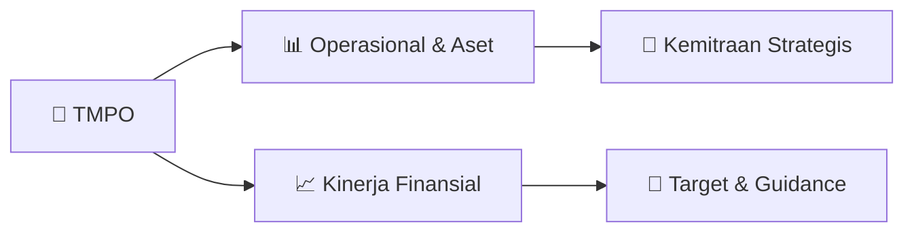

# 📊 Materi Public Expose: [TMPO]

🏢 **Emiten**: `TMPO` | 📅 **Tanggal Pelaksanaan**: `2026-09-02` | 📑 **Total Slide**: `4 Slide`
⬅️ [[knowledge-base/daily-digests/TMPO_20260902|Kembali ke Daily Digest]] | 🎛️ [[Dashboard/TMPO|Ke Dashboard Emiten]]

> [!NOTE]
> Ringkasan materi presentasi resmi Public Expose TMPO yang disampaikan oleh manajemen kepada investor dan bursa. Seluruh poin strategis, matriks operasional, dan angka kinerja diekstrak langsung dari slide deck resmi.

---

## 📅 1. Jadwal & Metadata Penyelenggaraan

| Parameter | Detail Informasi |
|---|---|
| **Nomor Surat Pengantar** | 045/EXT-Corsec/E/R1/TIM/VIII/26 |
| **Perihal Pengumuman** | Rencana Penyelenggaraan Public Expose Insidentil |
| **Waktu Pelaksanaan** | 02 September 2026 14:00 |
| **Lokasi / Media** | Gedung Tempo, Jl. Palmerah Barat No.8 Jakarta 12210 |
| **Lampiran Resmi** | `0` |

## 📋 2. Agenda Paparan Publik

1. Nama Perusahaan
2. Kode Emiten
3. Lampiran
4. Perihal
5. 045/EXT-Corsec/E/R1/TIM/VIII/26
6. Tempo Inti Media Tbk
7. Rencana Penyelenggaraan Public Expose Insidentil
8. Go To English Page
9. Mengoreksi surat kami nomor : 045/EXT-Corsec/E/TIM/VIII/26 tanggal 31 Agustus 2026 perihal Rencana
10. Penyelenggaraan Public Expose - Insidentil, dengan ini perseroan menyampaikan hal sebagai berikut:
11. Perseroan melaporkan rencana Public Expose Insidentil sebagai berikut:
12. Rencana Penyelenggaraan Public Expose
13. Latar Belakang Pelaksanaan
14. Sukarela
15. Permintaan Bursa
16. Permintaan Otoritas Jasa Keuangan ( OJK)
17. Referensi Surat
18. Peng-SPT-00155/BEI.WAS/08-2026
19. Tempat
20. : Gedung Tempo, Jl. Palmerah Barat No.8 Jakarta 12210
21. Hari/Tanggal
22. : 02 September 2026
23. Waktu
24. 14:00
25. Agenda
26. Pembukaan
27. Paparan
28. Tanya Jawab
29. Penutup
30. Informasi Lain
31. link siaran Public Expose Isidentil: https://www.youtube.com/watch?v=s4xOamKeIwA
32. Hormat Kami,
33. Demikian untuk diketahui.
34. Gedung Tempo, Lantai 5 Jl. palmerah Barat No. 8 Jakarta 12210
35. Corporate Legal
36. Telepon : 021-536-3790/530 6392, Fax : (021) 536 - 2025/7206995, tempo.id
37. Tempo Inti Media Tbk
38. Tempo Inti Media Tbk
39. Yudianto Sri Wicaksono
40. Issuer Name
41. Issuer Code
42. Attachment
43. Subject
44. 045/EXT-Corsec/E/R1/TIM/VIII/26
45. Tempo Inti Media Tbk
46. General Announcement Public Expose
47. Go To Indonesian Page
48. Mengoreksi surat kami nomor : 045/EXT-Corsec/E/TIM/VIII/26 tanggal 31 Agustus 2026 perihal Rencana
49. Penyelenggaraan Public Expose - Insidentil, dengan ini perseroan menyampaikan hal sebagai berikut:
50. Company announces public expose plan Incidental as follows:
51. Public Expose Announcement
52. Background
53. Voluntary
54. Requested by IDX
55. Requested by OJK
56. Reference Letter
57. Peng-SPT-00155/BEI.WAS/08-2026
58. Place
59. : Gedung Tempo, Jl. Palmerah Barat No.8 Jakarta 12210
60. : 02 September 2026
61. 14:00
62. Agenda
63. Opening
64. Presenation
65. Q & A session
66. Closing
67. Other Information:
68. Public Expose broadcast link: https://www.youtube.com/watch?v=s4xOamKeIwA
69. Respectfully,
70. Thus to be informed accordingly.
71. Tempo Inti Media Tbk
72. Yudianto Sri Wicaksono
73. Corporate Legal
74. Yudianto Sri Wicaksono
75. Sender Name
76. Tempo Inti Media Tbk
77. Gedung Tempo, Lantai 5 Jl. palmerah Barat No. 8 Jakarta 12210
78. Phone : 021-536-3790/530 6392, Fax : (021) 536 - 2025/7206995, tempo.id

## 🏢 3. Profil & Pilar Portofolio Bisnis

## 🏗️ 4. Kinerja Operasional & Portofolio Aset

*Detail aset operasional terlampir pada dokumen slide resmi.*

## 📈 5. Kinerja Keuangan & Posisi Finansial

## 🧭 6. Inisiatif Strategis, Kolaborasi, & Kemitraan

*Strategi usaha difokuskan pada penguatan fundamental dan ekspansi operasional.*

## 🎯 7. Target Pertumbuhan & Guidance Manajemen

*Target pertumbuhan ditetapkan mengacu pada prospek industri dan kondisi makroekonomi terkini.*

## 🗺️ 8. Peta Jalur Strategis & Eksekusi

## 📑 9. Daftar Indeks Slide Presentasi

| Slide # | Judul / Topik Slide | Ringkasan Konten |
|---|---|---|
| Slide 1 | **Nomor Surat** | Nama Perusahaan Kode Emiten Lampiran |
| Slide 2 | **Nama Pengirim** | Yudianto Sri Wicaksono Jabatan Corporate Legal |
| Slide 3 | **Letter / Announcement No.** | Issuer Name Issuer Code Attachment |
| Slide 4 | **Corporate Legal** | Function Date and Time 02-09-2026 10:44 |

---

*Dokumen diolah otomatis oleh **Swarm Intelijen Pasar Modal Indonesia** pada 2026-10-12 16:50 WIB.*