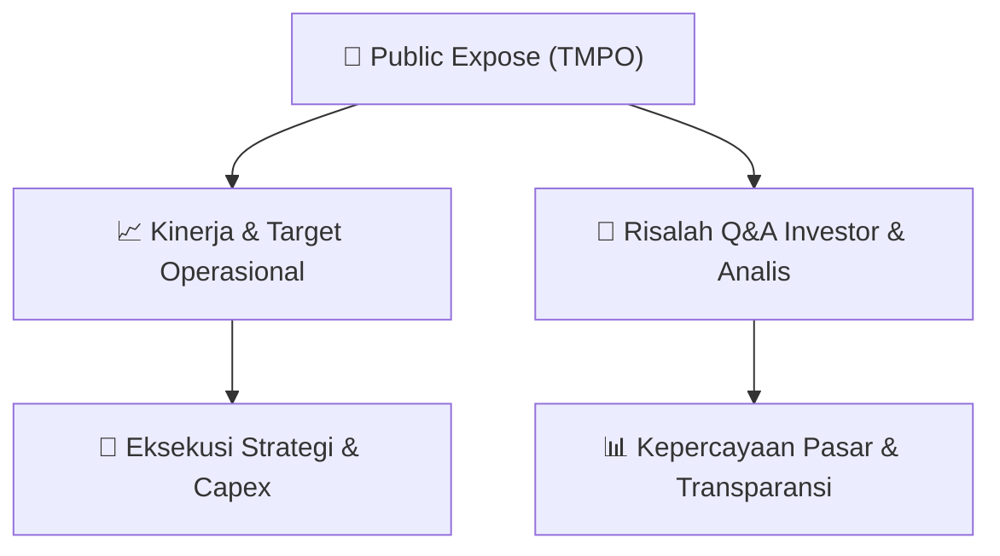

# 📢 Laporan Intelijen Paparan Publik (Public Expose) - [[TMPO]]
🏢 **Emiten**: `[[TMPO]]` | 📅 **Tanggal Pelaksanaan**: `2026-09-02` | 📑 **Dokumen**: `Public Expose`
⬅️ [[knowledge-base/daily-digests/Daily_Digest_20260902|Kembali ke Daily Digest]] | 🎛️ [[Dashboard|Ke Dashboard Utama]]

---

## 📌 1. Ringkasan Eksekutif & Paparan Direksi
> [!NOTE]
> Dokumen ini merupakan surat pengumuman resmi dari Tempo Inti Media Tbk (TMPO) mengenai rencana penyelenggaraan Public Expose Insidentil yang akan dilaksanakan pada tanggal 2 September 2026 pukul 14:00 WIB di Gedung Tempo, Jl. Palmerah Barat No.8 Jakarta 12210. Public Expose ini diselenggarakan atas permintaan Otoritas Jasa Keuangan (OJK) dengan referensi surat Peng-SPT-00155/BEI.WAS/08-2026. Agenda acara meliputi pembukaan, paparan, tanya jawab, dan penutup. Dokumen tidak memuat materi paparan, data kinerja, atau transkrip tanya jawab.

#### 🎯 Guidance Operasional & Target Strategis
- Tidak tersedia dalam dokumen ini. Dokumen hanya berisi pengumuman rencana Public Expose, tanpa rincian target kinerja, ekspansi, atau belanja modal.

## 📊 2. Matriks Indikator Operasional & Parameter Kunci
| Parameter Utama | Nilai / Keterangan Resmi |
| :--- | :--- |
| **Nama Perusahaan** | `Tempo Inti Media Tbk` |
| **Kode Emiten** | `TMPO` |
| **Tanggal Public Expose** | `02 September 2026` |
| **Waktu Public Expose** | `14:00 WIB` |
| **Tempat Public Expose** | `Gedung Tempo, Jl. Palmerah Barat No.8 Jakarta 12210` |
| **Latar Belakang Pelaksanaan** | `Permintaan Otoritas Jasa Keuangan (OJK)` |
| **Referensi Surat Permintaan** | `Peng-SPT-00155/BEI.WAS/08-2026` |
| **Agenda** | `1. Pembukaan, 2. Paparan, 3. Tanya Jawab, 4. Penutup` |
| **Link Siaran Public Expose** | `https://www.youtube.com/watch?v=s4xOamKeIwA` |

---

## 💬 3. Risalah Tanya Jawab (Q&A Session)
`Materi presentasi Public Expose / Risalah Q&A terlampir dalam dokumen resmi bursa.`

## 📌 4. Peta Jalur Strategis & Roadmap

---

## 🔗 Knowledge Graph
- [[knowledge-base/daily-digests/Daily_Digest_20260902|📄 Daily Digest 2026-09-02]]
- [[knowledge-base/calendars/Action_Calendar|🗓️ Kalender Terpusat Aksi Korporasi]]
- [[Dashboard|🎛️ Kembali ke Dashboard Utama]]