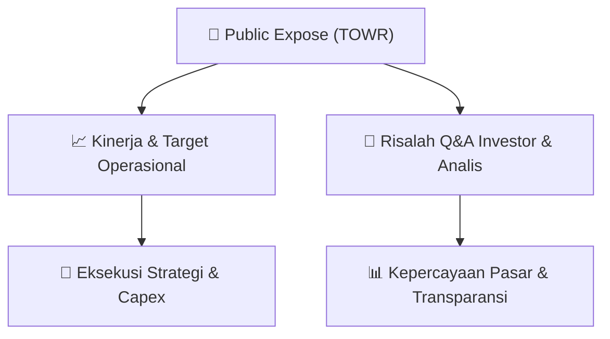

# 📢 Laporan Intelijen Paparan Publik (Public Expose) - [[TOWR]]
🏢 **Emiten**: `[[TOWR]]` | 📅 **Tanggal Pelaksanaan**: `2026-08-24` | 📑 **Dokumen**: `Public Expose`
⬅️ [[knowledge-base/daily-digests/Daily_Digest_20260824|Kembali ke Daily Digest]] | 🎛️ [[Dashboard|Ke Dashboard Utama]]

---

## 📌 1. Ringkasan Eksekutif & Paparan Direksi
> [!NOTE]
> Manajemen [[TOWR]] menyelenggarakan Paparan Publik (Public Expose) untuk menyampaikan laporan kinerja operasional, posisi keuangan, dan arah strategi pertumbuhan perusahaan kepada publik.

## 💬 3. Risalah Tanya Jawab (Q&A Session)
`Materi presentasi Public Expose / Risalah Q&A terlampir dalam dokumen resmi bursa.`

## 📌 4. Peta Jalur Strategis & Roadmap

---

## 🔗 Knowledge Graph
- [[knowledge-base/daily-digests/Daily_Digest_20260824|📄 Daily Digest 2026-08-24]]
- [[knowledge-base/calendars/Action_Calendar|🗓️ Kalender Terpusat Aksi Korporasi]]
- [[Dashboard|🎛️ Kembali ke Dashboard Utama]]