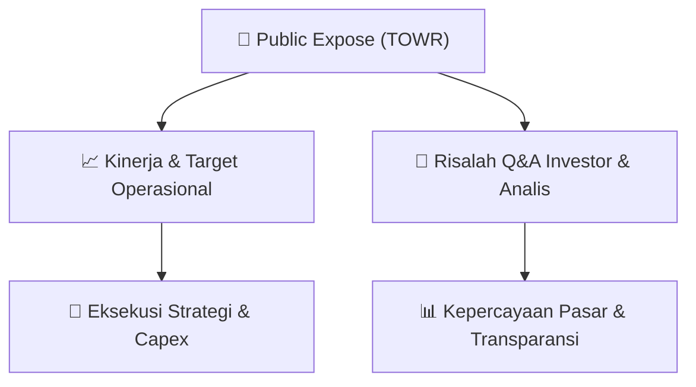

# 📢 Laporan Intelijen Paparan Publik (Public Expose) - [[TOWR]]
🏢 **Emiten**: `[[TOWR]]` | 📅 **Tanggal Pelaksanaan**: `2026-09-11` | 📑 **Dokumen**: `Public Expose`
⬅️ [[knowledge-base/daily-digests/Daily_Digest_20260911|Kembali ke Daily Digest]] | 🎛️ [[Dashboard|Ke Dashboard Utama]]

---

## 📌 1. Ringkasan Eksekutif & Paparan Direksi
> [!NOTE]
> PT Sarana Menara Nusantara Tbk (TOWR) menyelenggarakan Public Expose Tahunan pada tanggal 03 September 2026, sesuai dengan surat pemberitahuan No. 129/CS-BEI/SMN/IX/26. Acara ini dihadiri oleh 117 peserta (tidak termasuk manajemen dan karyawan). Laporan hasil Public Expose disampaikan kepada Bursa Efek Indonesia pada tanggal 11 September 2026 oleh Corporate Secretary, Monalisa Irawan. Dokumen ini merupakan laporan resmi penyampaian hasil kegiatan, dengan rincian materi dan tanya jawab terlampir dalam dokumen pendukung.

#### 🎯 Guidance Operasional & Target Strategis
- Dokumen laporan ini tidak memuat rincian spesifik mengenai target kinerja, ekspansi, atau belanja modal (capex) secara eksplisit. Informasi tersebut kemungkinan besar terdapat dalam lampiran materi Public Expose (TOWR_Laporan Pubex 2026.pdf) yang tidak disertakan dalam teks mentah. Namun, penyelenggaraan Public Expose Tahunan ini sendiri merupakan katalis informasi bagi investor untuk mendapatkan pemutakhiran strategi dan kinerja perseroan secara langsung dari manajemen.

## 📊 2. Matriks Indikator Operasional & Parameter Kunci
| Parameter Utama | Nilai / Keterangan Resmi |
| :--- | :--- |
| **Tanggal Penyelenggaraan Public Expose** | `03 September 2026` |
| **Jumlah Peserta Hadir** | `117 orang (tidak termasuk manajemen dan karyawan)` |
| **Nomor Surat Pemberitahuan** | `129/CS-BEI/SMN/IX/26` |
| **Nomor Surat Laporan Hasil** | `131/CS-BEI/SMN/IX/26` |
| **Tanggal Penyampaian Laporan ke BEI** | `11 September 2026` |
| **Corporate Secretary** | `Monalisa Irawan` |
| **Lampiran Dokumen** | `TOWR_Laporan Pubex 2026.pdf` |

---

## 💬 3. Risalah Tanya Jawab (Q&A Session)
### ❓ Pertanyaan 1 (Tidak tercantum dalam dokumen)
**Pertanyaan**: Tidak ada pertanyaan yang tercantum secara eksplisit dalam teks dokumen laporan ini. Seluruh rincian tanya jawab diperkirakan terdapat pada lampiran materi Public Expose.

**Jawaban Manajemen**: Tidak ada jawaban yang tercantum secara eksplisit dalam teks dokumen laporan ini. Seluruh rincian jawaban manajemen diperkirakan terdapat pada lampiran materi Public Expose.

> [!TIP]
> **Implikasi Bagi Investor**: Investor perlu merujuk pada lampiran dokumen Public Expose (TOWR_Laporan Pubex 2026.pdf) untuk mendapatkan informasi detail mengenai sesi tanya jawab, termasuk kebijakan dividen, strategi pertumbuhan, dan prospek bisnis ke depan.

## 📌 4. Peta Jalur Strategis & Roadmap

---

## 🔗 Knowledge Graph
- [[knowledge-base/daily-digests/Daily_Digest_20260911|📄 Daily Digest 2026-09-11]]
- [[knowledge-base/calendars/Action_Calendar|🗓️ Kalender Terpusat Aksi Korporasi]]
- [[Dashboard|🎛️ Kembali ke Dashboard Utama]]