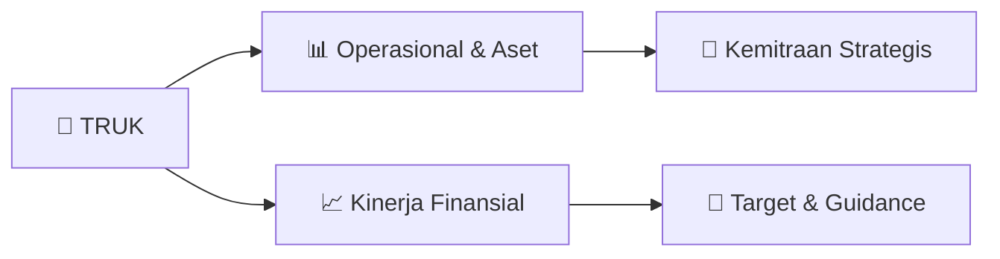

# 📊 Materi Public Expose: [TRUK]

🏢 **Emiten**: `TRUK` | 📅 **Tanggal Pelaksanaan**: `2026-08-14` | 📑 **Total Slide**: `11 Slide`
⬅️ [[knowledge-base/daily-digests/TRUK_20260814|Kembali ke Daily Digest]] | 🎛️ [[Dashboard/TRUK|Ke Dashboard Emiten]]

> [!NOTE]
> Ringkasan materi presentasi resmi Public Expose TRUK yang disampaikan oleh manajemen kepada investor dan bursa. Seluruh poin strategis, matriks operasional, dan angka kinerja diekstrak langsung dari slide deck resmi.

---

## 📅 1. Jadwal & Metadata Penyelenggaraan

| Parameter | Detail Informasi |
|---|---|
| **Nomor Surat Pengantar** | 039/GTR-DIR/VIII/2026 |
| **Perihal Pengumuman** | Penyampaian Materi Public Expose Insidentil |
| **Waktu Pelaksanaan** | 2026-08-14 14-08-2026 10:40 |
| **Lokasi / Media** | Aplikasi Zoom / Daring |
| **Lampiran Resmi** | `1` |

## 📋 2. Agenda Paparan Publik

- Pemaparan Profil & Struktur Bisnis Perseroan
- Kinerja Operasional & Keuangan
- Arah Strategi Usaha & Target Pertumbuhan
- Sesi Tanya Jawab (Q&A)

## 🏢 3. Profil & Pilar Portofolio Bisnis

## 🏗️ 4. Kinerja Operasional & Portofolio Aset

*Detail aset operasional terlampir pada dokumen slide resmi.*

## 📈 5. Kinerja Keuangan & Posisi Finansial

### 📊 Ringkasan Finansial
```text
Kinerja Keuangan
```

## 🧭 6. Inisiatif Strategis, Kolaborasi, & Kemitraan

*Strategi usaha difokuskan pada penguatan fundamental dan ekspansi operasional.*

## 🎯 7. Target Pertumbuhan & Guidance Manajemen

*Target pertumbuhan ditetapkan mengacu pada prospek industri dan kondisi makroekonomi terkini.*

## 🗺️ 8. Peta Jalur Strategis & Eksekusi



## 📑 9. Daftar Indeks Slide Presentasi

| Slide # | Judul / Topik Slide | Ringkasan Konten |
|---|---|---|
| Slide 1 | **PUBLIC EXPOSE** | INSIDENTIL Jakarta, 18 Agustus 2026 PT GUNA TIMUR RAYA Tbk |
| Slide 2 | **Ketentuan Pelaksanaan** | Public Expose Insidentil 1. Peserta agar dapat mengisi daftar hadir terlebih dahulu pada barcode di atas link berikut : |
| Slide 3 | **Latar Belakang Pelaksanaan** | Public Expose INSIDENTIL 1. Pengumuman Bursa |
| Slide 6 | **Komposisi Dewan Komisaris dan Direksi per 30 Juni 2026** | Direktur Utama : Budi Gunawan Direktur |
| Slide 7 | **Wilayah Operasional** |  |
| Slide 8 | **Kinerja Keuangan** |  |
| Slide 9 | **Pergerakan Harga Saham** | Pada tanggal 3 Agustus 2026 telah terjadi peningkatan aktivitas dan harga saham PT Guna Timur Raya Tbk (TRUK) sebagai berikut : 1. Aktivitas transaksi |
| Slide 10 | **Rencana Usaha Perseroan** | ❖ Terus beradaptasi dengan perkembangan tehnologi terkini ❖ |
| Slide 11 | **TERIMA KASIH** | Link Daftar Hadir : https://forms.gle/FcnxbZPTNFuBZ6WN7 Link Zoom Pubex : |

---

*Dokumen diolah otomatis oleh **Swarm Intelijen Pasar Modal Indonesia** pada 2026-10-12 16:50 WIB.*