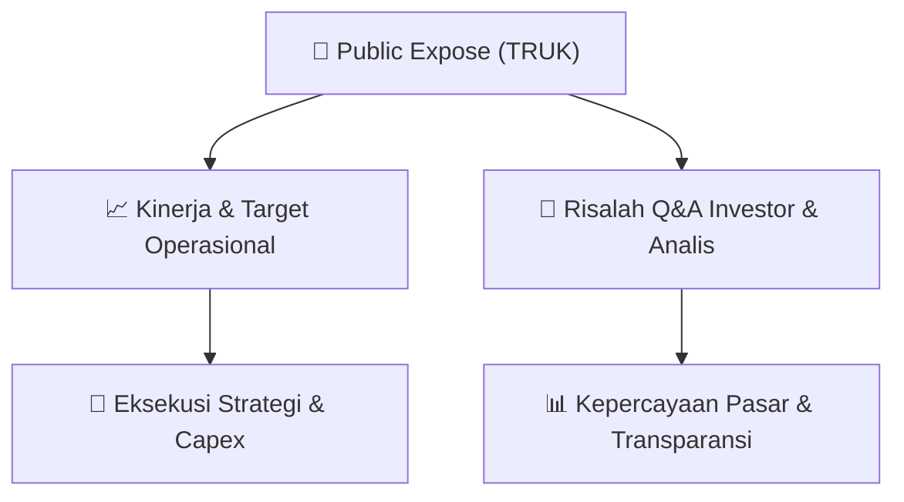

# 📢 Laporan Intelijen Paparan Publik (Public Expose) - [[TRUK]]
🏢 **Emiten**: `[[TRUK]]` | 📅 **Tanggal Pelaksanaan**: `2026-08-19` | 📑 **Dokumen**: `Public Expose`
⬅️ [[knowledge-base/daily-digests/Daily_Digest_20260819|Kembali ke Daily Digest]] | 🎛️ [[Dashboard|Ke Dashboard Utama]]

---

## 📌 1. Ringkasan Eksekutif & Paparan Direksi
> [!NOTE]
> PT Guna Timur Raya Tbk. (kode emiten TRUK) menyampaikan Laporan Hasil Public Expose Insidentil melalui surat No. 041/GTR-DIR/VIII/2026 tertanggal 19 Agustus 2026. Public expose dilaksanakan secara insidentil merujuk pada surat penyampaian materi Public Expose No. 039/GTR-DIR/VIII/2026 tanggal 14 Agustus 2026. Peserta yang hadir dalam acara public expose (tidak termasuk manajemen dan karyawan Perseroan) sebanyak 5 orang. Laporan ini disampaikan oleh Corporate Secretary, Budi Gunawan, dan merupakan dokumen resmi yang dihasilkan secara elektronik oleh sistem pelaporan elektronik.

#### 🎯 Guidance Operasional & Target Strategis
- Tidak tersedia informasi mengenai target kinerja, ekspansi, belanja modal (capex), atau guidance operasional dalam dokumen yang diberikan. Dokumen hanya memuat informasi administratif pelaksanaan public expose insidentil.

## 📊 2. Matriks Indikator Operasional & Parameter Kunci
| Parameter Utama | Nilai / Keterangan Resmi |
| :--- | :--- |
| **Nama Perusahaan** | `PT Guna Timur Raya Tbk.` |
| **Kode Emiten** | `TRUK` |
| **Nomor Surat Laporan Public Expose** | `041/GTR-DIR/VIII/2026` |
| **Tanggal Penyampaian Laporan** | `19 Agustus 2026` |
| **Tanggal Rujukan Surat Materi Public Expose** | `14 Agustus 2026` |
| **Jumlah Peserta Public Expose (di luar manajemen dan karyawan)** | `5 orang` |
| **Corporate Secretary** | `Budi Gunawan` |
| **Alamat Perseroan** | `Jl. R.E. Martadinata No.8, Blok A1, Ancol – Jakarta 14430` |
| **Sifat Public Expose** | `Insidentil` |

---

## 💬 3. Risalah Tanya Jawab (Q&A Session)
`Materi presentasi Public Expose / Risalah Q&A terlampir dalam dokumen resmi bursa.`

## 📌 4. Peta Jalur Strategis & Roadmap

---

## 🔗 Knowledge Graph
- [[knowledge-base/daily-digests/Daily_Digest_20260819|📄 Daily Digest 2026-08-19]]
- [[knowledge-base/calendars/Action_Calendar|🗓️ Kalender Terpusat Aksi Korporasi]]
- [[Dashboard|🎛️ Kembali ke Dashboard Utama]]