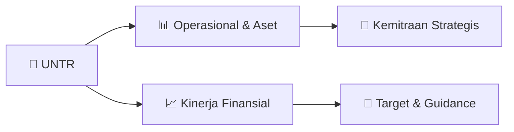

# 📊 Materi Public Expose: [UNTR]

🏢 **Emiten**: `UNTR` | 📅 **Tanggal Pelaksanaan**: `2026-08-21` | 📑 **Total Slide**: `1 Slide`
⬅️ [[knowledge-base/daily-digests/UNTR_20260821|Kembali ke Daily Digest]] | 🎛️ [[Dashboard/UNTR|Ke Dashboard Emiten]]

> [!NOTE]
> Ringkasan materi presentasi resmi Public Expose UNTR yang disampaikan oleh manajemen kepada investor dan bursa. Seluruh poin strategis, matriks operasional, dan angka kinerja diekstrak langsung dari slide deck resmi.

---

## 📅 1. Jadwal & Metadata Penyelenggaraan

| Parameter | Detail Informasi |
|---|---|
| **Nomor Surat Pengantar** | 291/CORP/9981/VIII/26 |
| **Perihal Pengumuman** | Rencana Penyelenggaraan Public Expose Tahunan |
| **Waktu Pelaksanaan** | 07 September 2026 14:00 |
| **Lokasi / Media** | Public Expose Live 2026 |
| **Lampiran Resmi** | `1` |

## 📋 2. Agenda Paparan Publik

1. Document for INTERNAL used only
2. No.: 291/CORP/9981/VIII/26
3. Jakarta, 21 Agustus 2026
4. Kepada Yth.
5. PT Bursa Efek Indonesia
6. Gedung Bursa Efek Indonesia
7. Jl. Jend. Sudirman Kav. 52-53
8. Jakarta 12190
9. : Direktur Penilaian Perusahaan, Bapak Saidu Solihin
10. : Rencana Public Expose 2026 PT United Tractors Tbk
11. Dengan hormat,
12. Dalam rangka memenuhi ketentuan Surat Keputusan Direksi PT Bursa Efek Indonesia No: Kep-
13. 00087/BEI/12-2025 tentang Peraturan Nomor I-E tentang Kewajiban Penyampaian Informasi, berikut
14. kami sampaikan rencana  pelaksanaan pemaparan umum kepada publik (“Public Expose”) PT United
15. Tractors Tbk sebagai bagian dari Public Expose Live 2026 dalam Rangka 49 Tahun Diaktifkannya
16. Kembali Pasar Modal Indonesia, yang diselenggarakan oleh PT Bursa Efek Indonesia, yaitu pada:
17. Hari/ Tanggal
18. : Senin, 7 September 2026
19. Waktu
20. : 14.00 – 15.00 WIB
21. Tempat
22. : Public Expose Live 2026
23. yang tercantum pada website idx.co.id
24. Agenda
25. : Pemaparan Kinerja dan Press Conference
26. Anggota Direksi yang akan hadir dalam Public Expose ini adalah:
27. - Bapak Iwan Hadiantoro
28. : Presiden Direktur
29. - Bapak Idot Supriadi
30. : Direktur
31. - Bapak Widjaja Kartika
32. : Direktur
33. - Ibu Vilihati Surya
34. : Direktur
35. - Bapak Ari Sutrisno
36. : Direktur
37. - Bapak Hendra Hutahean
38. : Direktur
39. - Bapak Andreas
40. : Direktur
41. Sehubungan dengan hal tersebut, materi presentasi akan kami sampaikan pada tanggal 2 September
42. 2026.
43. Demikian informasi ini kami sampaikan. Atas perhatiannya, kami ucapkan terima kasih.
44. Hormat Kami,
45. PT United Tractors Tbk
46. Ari Setiyawan
47. Corporate Secretary

## 🏢 3. Profil & Pilar Portofolio Bisnis

## 🏗️ 4. Kinerja Operasional & Portofolio Aset

*Detail aset operasional terlampir pada dokumen slide resmi.*

## 📈 5. Kinerja Keuangan & Posisi Finansial

## 🧭 6. Inisiatif Strategis, Kolaborasi, & Kemitraan

*Strategi usaha difokuskan pada penguatan fundamental dan ekspansi operasional.*

## 🎯 7. Target Pertumbuhan & Guidance Manajemen

*Target pertumbuhan ditetapkan mengacu pada prospek industri dan kondisi makroekonomi terkini.*

## 🗺️ 8. Peta Jalur Strategis & Eksekusi

## 📑 9. Daftar Indeks Slide Presentasi

| Slide # | Judul / Topik Slide | Ringkasan Konten |
|---|---|---|
| Slide 1 | **Document for INTERNAL used only** | Document for INTERNAL used only No.: 291/CORP/9981/VIII/26 Jakarta, 21 Agustus 2026 |

---

*Dokumen diolah otomatis oleh **Swarm Intelijen Pasar Modal Indonesia** pada 2026-10-12 16:50 WIB.*