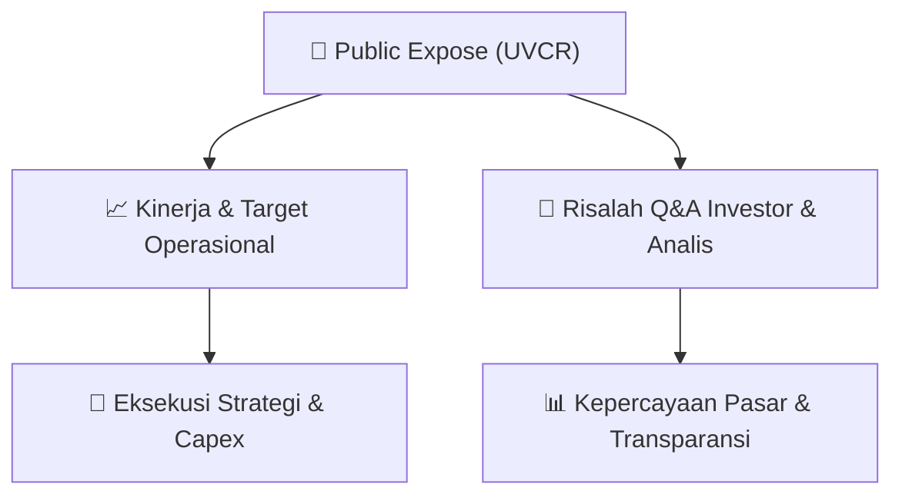

# 📢 Laporan Intelijen Paparan Publik (Public Expose) - [[UVCR]]
🏢 **Emiten**: `[[UVCR]]` | 📅 **Tanggal Pelaksanaan**: `2026-08-27` | 📑 **Dokumen**: `Public Expose`
⬅️ [[knowledge-base/daily-digests/Daily_Digest_20260827|Kembali ke Daily Digest]] | 🎛️ [[Dashboard|Ke Dashboard Utama]]

---

## 📌 1. Ringkasan Eksekutif & Paparan Direksi
> [!NOTE]
> Dokumen merupakan pengumuman resmi PT Trimegah Karya Pratama Tbk (UVCR) tentang rencana penyelenggaraan Public Expose Tahunan untuk Tahun Buku 2026. Acara akan diselenggarakan secara live melalui platform IDX Public Expose Live 2026 pada 10 September 2026 pukul 15:00 WIB. Agenda yang direncanakan mencakup: (1) Update Perseroan, (2) Informasi fitur dan pengembangan inovasi, serta (3) Kerjasama yang telah dilakukan Perseroan. Dokumen ini tidak memuat rincian kinerja keuangan, target operasional, atau materi paparan publik.

#### 🎯 Guidance Operasional & Target Strategis
- Tidak tersedia dalam dokumen. Pengumuman hanya menyampaikan rencana acara Public Expose tanpa memberikan guidance kinerja, target ekspansi, atau alokasi belanja modal (capex).

## 📊 2. Matriks Indikator Operasional & Parameter Kunci
| Parameter Utama | Nilai / Keterangan Resmi |
| :--- | :--- |
| **Nama Perusahaan** | `PT Trimegah Karya Pratama Tbk.` |
| **Kode Emiten** | `UVCR` |
| **Jenis Acara** | `Public Expose Tahunan` |
| **Tahun Buku** | `2026` |
| **Tanggal Penyelenggaraan** | `10 September 2026` |
| **Waktu** | `15:00 WIB` |
| **Tempat** | `IDX Public Expose Live 2026 (https://pubexlive.idx.co.id/)` |
| **Agenda 1** | `Update Perseroan` |
| **Agenda 2** | `Informasi fitur, pengembangan inovasi` |
| **Agenda 3** | `Kerjasama yang telah dilakukan Perseroan` |
| **Nama Pengirim** | `Hady Kuswanto` |
| **Jabatan Pengirim** | `Direktur Utama` |
| **Tanggal Pengumuman** | `27 Agustus 2026` |

---

## 💬 3. Risalah Tanya Jawab (Q&A Session)
`Materi presentasi Public Expose / Risalah Q&A terlampir dalam dokumen resmi bursa.`

## 📌 4. Peta Jalur Strategis & Roadmap

---

## 🔗 Knowledge Graph
- [[knowledge-base/daily-digests/Daily_Digest_20260827|📄 Daily Digest 2026-08-27]]
- [[knowledge-base/calendars/Action_Calendar|🗓️ Kalender Terpusat Aksi Korporasi]]
- [[Dashboard|🎛️ Kembali ke Dashboard Utama]]