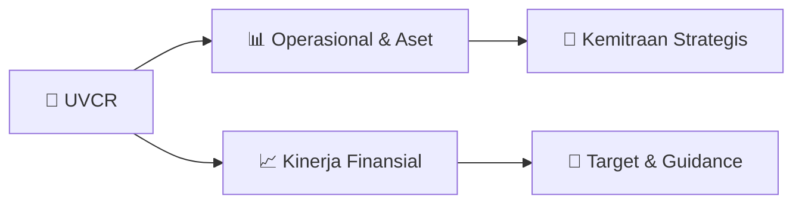

# 📊 Materi Public Expose: [UVCR]

🏢 **Emiten**: `UVCR` | 📅 **Tanggal Pelaksanaan**: `2026-08-27` | 📑 **Total Slide**: `1 Slide`
⬅️ [[knowledge-base/daily-digests/UVCR_20260827|Kembali ke Daily Digest]] | 🎛️ [[Dashboard/UVCR|Ke Dashboard Emiten]]

> [!NOTE]
> Ringkasan materi presentasi resmi Public Expose UVCR yang disampaikan oleh manajemen kepada investor dan bursa. Seluruh poin strategis, matriks operasional, dan angka kinerja diekstrak langsung dari slide deck resmi.

---

## 📅 1. Jadwal & Metadata Penyelenggaraan

| Parameter | Detail Informasi |
|---|---|
| **Nomor Surat Pengantar** | 047/SK/COE/TKP-REG/VIII/2026 |
| **Perihal Pengumuman** | Rencana Penyelenggaraan Public Expose Tahunan |
| **Waktu Pelaksanaan** | 10 September 2026 15:00 |
| **Lokasi / Media** | IDX Public Expose Live 2026 dengan link |
| **Lampiran Resmi** | `1` |

## 📋 2. Agenda Paparan Publik

1. Nomor​ ​
2. : 047/SK/COE/TKP-REG/VIII/2026
3. Perihal​ ​
4. : Rencana Pelaksanaan Public Expose Tahunan PT Trimegah Karya Pratama Tbk
5. “UVCR” 2026
6. Kepada Yth.
7. PT Bursa Efek Indonesia
8. Indonesia Stock Exchange Building
9. Jl. Jend. Sudirman Kav. 52-53
10. Up. : Yth. Kepala Divisi Penilaian Perusahaan Grup 2
11. Dengan Hormat,
12. Dalam rangka memenuhi ketentuan Peraturan Nomor I-E tentang Kewajiban Penyampaian Informasi
13. sebagaimana
14. ditetapkan
15. berdasarkan
16. Keputusan
17. Direksi
18. Bursa
19. Indonesia
20. Kep-00066/BEI/09-2022 tanggal 30 September 2022, serta untuk memenuhi dan mengikuti ketentuan
21. dalam Surat Edaran Direksi PT Bursa Efek Indonesia No. SE-00003/BEI/05-2020 tanggal 29 Mei 2020
22. tentang Tata Cara Pelaksanaan Public Expose Secara Elektronik, dengan ini kami menyampaikan
23. rencana pelaksanaan Public Expose Tahunan PT Trimegah Karya Pratama Tbk (“Perseroan”) yang akan
24. diselenggarakan secara elektronik (online), pada:
25. Hari, tanggal
26. Kamis, 10 September 2026
27. Waktu
28. Pukul 15.00-16.00 WIB
29. Tempat
30. IDX Public Expose Live 2026 dan pendaftaran peserta di  https://pubexlive.idx.co.id/
31. Pembicara
32. Hady Kuswanto (Direktur Utama)
33. Riky Boy H. Permata (Direktur)
34. Agenda
35. Update Perseroan, informasi fitur, pengembangan inovasi dan kerjasama yang telah
36. dilakukan Perseroan
37. Demikian informasi ini kami sampaikan, atas perhatiannya terima kasih.
38. Hormat kami,
39. Sekretaris Perusahaan

## 🏢 3. Profil & Pilar Portofolio Bisnis

## 🏗️ 4. Kinerja Operasional & Portofolio Aset

*Detail aset operasional terlampir pada dokumen slide resmi.*

## 📈 5. Kinerja Keuangan & Posisi Finansial

## 🧭 6. Inisiatif Strategis, Kolaborasi, & Kemitraan

*Strategi usaha difokuskan pada penguatan fundamental dan ekspansi operasional.*

## 🎯 7. Target Pertumbuhan & Guidance Manajemen

*Target pertumbuhan ditetapkan mengacu pada prospek industri dan kondisi makroekonomi terkini.*

## 🗺️ 8. Peta Jalur Strategis & Eksekusi

## 📑 9. Daftar Indeks Slide Presentasi

| Slide # | Judul / Topik Slide | Ringkasan Konten |
|---|---|---|
| Slide 1 | **Jakarta, 27 Agustus 2026** | Nomor​ ​ : 047/SK/COE/TKP-REG/VIII/2026 Perihal​ ​ |

---

*Dokumen diolah otomatis oleh **Swarm Intelijen Pasar Modal Indonesia** pada 2026-10-12 16:50 WIB.*