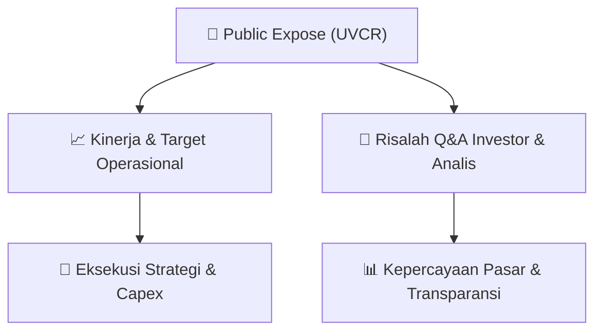

# 📢 Laporan Intelijen Paparan Publik (Public Expose) - [[UVCR]]
🏢 **Emiten**: `[[UVCR]]` | 📅 **Tanggal Pelaksanaan**: `2026-09-07` | 📑 **Dokumen**: `Public Expose`
⬅️ [[knowledge-base/daily-digests/Daily_Digest_20260907|Kembali ke Daily Digest]] | 🎛️ [[Dashboard|Ke Dashboard Utama]]

---

## 📌 1. Ringkasan Eksekutif & Paparan Direksi
> [!NOTE]
> PT Trimegah Karya Pratama Tbk. (UVCR) menyelenggarakan Public Expose Tahunan pada 7 September 2026, merujuk pada surat pengumuman No. 047/SK/COE/TKP-REG/VIII/2026 tanggal 27 Agustus 2026. Paparan ini disampaikan oleh Direktur Utama, Hady Kuswanto, dan ditujukan untuk memenuhi ketentuan bursa serta memberikan transparansi kepada pemegang saham dan publik mengenai kinerja, strategi, dan prospek perusahaan. Materi paparan disampaikan dalam dokumen lampiran 'Materi Public Expose 2026_External.pdf' yang menjadi acuan utama diskusi. Perusahaan berkomitmen untuk menjaga komunikasi yang terbuka dengan para pemangku kepentingan melalui forum ini.

#### 🎯 Guidance Operasional & Target Strategis
- Dokumen yang disampaikan merupakan materi paparan publik tahunan yang berisi informasi kinerja keuangan, pencapaian operasional, strategi bisnis, serta rencana pengembangan perusahaan ke depan. Sayangnya, detail spesifik mengenai target kinerja kuantitatif, rencana belanja modal (capex), ekspansi, atau isu pasar tidak dapat diekstraksi dari teks mentah yang tersedia karena dokumen lampiran (PDF) tidak disertakan dalam teks. Informasi tersebut diharapkan menjadi bagian dari materi paparan yang dibahas dalam forum Public Expose.

## 📊 2. Matriks Indikator Operasional & Parameter Kunci
| Parameter Utama | Nilai / Keterangan Resmi |
| :--- | :--- |
| **Nama Emiten** | `PT Trimegah Karya Pratama Tbk.` |
| **Kode Emiten** | `UVCR` |
| **Jenis Paparan** | `Public Expose Tahunan` |
| **Tanggal Pengumuman** | `27 Agustus 2026 (Surat No. 047/SK/COE/TKP-REG/VIII/2026)` |
| **Tanggal Penyampaian Materi** | `7 September 2026` |
| **Direktur Utama** | `Hady Kuswanto` |
| **Alamat Kantor** | `Jl. Tebet Barat IX, No.35BB, Tebet Barat, Jakarta Selatan 12810` |
| **Telepon** | `021-22008385` |
| **Website** | `https://company.ultravoucher.co.id/` |
| **Nomor Surat Penyampaian Materi** | `005/SK/COE/TKP-IDX/IX/2026` |

---

## 💬 3. Risalah Tanya Jawab (Q&A Session)
### ❓ Pertanyaan 1 (Tidak tersedia dalam dokumen)
**Pertanyaan**: Tidak tersedia dalam dokumen. Teks mentah hanya berisi surat pengantar penyampaian materi Public Expose, tanpa memuat sesi tanya jawab.

**Jawaban Manajemen**: Tidak tersedia dalam dokumen. Jawaban manajemen atas pertanyaan investor/analis tidak tercantum dalam teks yang diberikan.

> [!TIP]
> **Implikasi Bagi Investor**: Investor perlu menunggu atau mengakses materi paparan lengkap (lampiran PDF) untuk mendapatkan informasi mengenai sesi tanya jawab dan panduan manajemen.

## 📌 4. Peta Jalur Strategis & Roadmap

---

## 🔗 Knowledge Graph
- [[knowledge-base/daily-digests/Daily_Digest_20260907|📄 Daily Digest 2026-09-07]]
- [[knowledge-base/calendars/Action_Calendar|🗓️ Kalender Terpusat Aksi Korporasi]]
- [[Dashboard|🎛️ Kembali ke Dashboard Utama]]