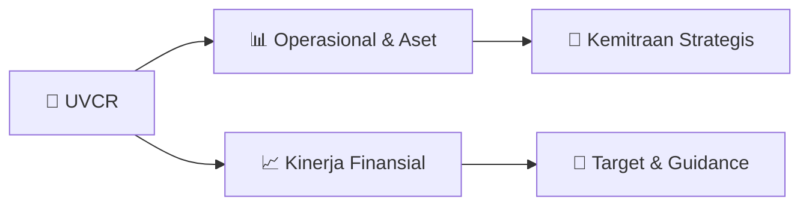

# 📊 Materi Public Expose: [UVCR]

🏢 **Emiten**: `UVCR` | 📅 **Tanggal Pelaksanaan**: `2026-09-07` | 📑 **Total Slide**: `13 Slide`
⬅️ [[knowledge-base/daily-digests/UVCR_20260907|Kembali ke Daily Digest]] | 🎛️ [[Dashboard/UVCR|Ke Dashboard Emiten]]

> [!NOTE]
> Ringkasan materi presentasi resmi Public Expose UVCR yang disampaikan oleh manajemen kepada investor dan bursa. Seluruh poin strategis, matriks operasional, dan angka kinerja diekstrak langsung dari slide deck resmi.

---

## 📅 1. Jadwal & Metadata Penyelenggaraan

| Parameter | Detail Informasi |
|---|---|
| **Nomor Surat Pengantar** | 005/SK/COE/TKP-IDX/IX/2026 |
| **Perihal Pengumuman** | Penyampaian Materi Public Expose Tahunan |
| **Waktu Pelaksanaan** | 2026-09-07 07-09-2026 18:10 |
| **Lokasi / Media** | Aplikasi Zoom / Daring |
| **Lampiran Resmi** | `1` |

## 📋 2. Agenda Paparan Publik

- Pemaparan Profil & Struktur Bisnis Perseroan
- Kinerja Operasional & Keuangan
- Arah Strategi Usaha & Target Pertumbuhan
- Sesi Tanya Jawab (Q&A)

## 🏢 3. Profil & Pilar Portofolio Bisnis

## 🏗️ 4. Kinerja Operasional & Portofolio Aset

*Detail aset operasional terlampir pada dokumen slide resmi.*

## 📈 5. Kinerja Keuangan & Posisi Finansial

## 🧭 6. Inisiatif Strategis, Kolaborasi, & Kemitraan

- PT Trimegah Karya Pratama Tbk (IDX: UVCR), atau Ultra Voucher, merupakan perusahaan teknologi yang berfokus pada pengembangan ekosistem voucher,
rewards, dan solusi loyalitas di Indonesia. Sejak berdiri pada tahun 2016, Ultra Voucher terus membangun kapabilitas teknologi dan jaringan kemitraan untuk
menghadirkan solusi yang menghubungkan brand, konsumen, dan mitra bisnis dalam satu ekosistem.
Ultra Voucher saat ini memiliki dua produk utama, yaitu Ultra Voucher Mobile Application dan Ultra Voucher Gift Card (UVGC). Keduanya menjadi bagian dari
ekosistem Ultra Voucher dalam menghadirkan solusi voucher dan rewards yang relevan bagi kebutuhan konsumen dan korporasi.
Dengan ekosistem yang terus berkembang dan inovasi produk yang berkelanjutan, Ultra Voucher berkomitmen untuk memperkuat posisinya sebagai salah satu
pemain di industri digital voucher, rewards, dan loyalty di Indonesia.
MENGENAI PERUSAHAAN Hady Kuswanto Direktur Utama
Riky Boy H Permata
Direktur
Danny Eugene D
Komisaris Utama dan
Komisaris Independen Rangga Ananta Komisaris
Adi Kiswoyo Joe
Komisaris
A LEADING COMPANY IN VOUCHERS, REWARDS, AND LOYALTY
DON'T SHARE UNLESS APPROVED BY ULTRA VOUCHER
MANAJEMEN PERUSAHAAN

## 🎯 7. Target Pertumbuhan & Guidance Manajemen

*Target pertumbuhan ditetapkan mengacu pada prospek industri dan kondisi makroekonomi terkini.*

## 🗺️ 8. Peta Jalur Strategis & Eksekusi

## 📑 9. Daftar Indeks Slide Presentasi

| Slide # | Judul / Topik Slide | Ringkasan Konten |
|---|---|---|
| Slide 1 | **UVCR PUBLIC** | EXPOSE 2026 DON'T SHARE UNLESS APPROVED BY ULTRA VOUCHER |
| Slide 2 | **STRUKTUR DAN** | MANAJEMEN PERUSAHAAN DON'T SHARE UNLESS APPROVED BY ULTRA VOUCHER |
| Slide 3 | **PT Trimegah Karya Pratama Tbk (IDX: UVCR), atau Ultra Voucher, merupakan perusahaan teknologi yang berfokus pada pengembangan ekosistem voucher,** | rewards, dan solusi loyalitas di Indonesia. Sejak berdiri pada tahun 2016, Ultra Voucher terus membangun kapabilitas teknologi dan jaringan kemitraan  |
| Slide 4 | **STRUKTUR DAN BRAND DI BAWAH PERUSAHAAN** | A LEADING COMPANY IN VOUCHERS, REWARDS, AND LOYALTY DON'T SHARE UNLESS APPROVED BY ULTRA VOUCHER PT TRIMEGAH KARYA PRATAMA TBK |
| Slide 5 | **JEJAK LANGKAH PERUSAHAAN** | A LEADING COMPANY IN VOUCHERS, REWARDS, AND LOYALTY DON'T SHARE UNLESS APPROVED BY ULTRA VOUCHER 2016 |
| Slide 6 | **PRODUK, LAYANAN,** | DAN EKOSISTEM PERUSAHAAN DON'T SHARE UNLESS APPROVED BY ULTRA VOUCHER |
| Slide 7 | **EKOSISTEM SOLUSI TERLENGKAP** | DI INDUSTRI VOUCHER, REWARDS, DAN LOYALITAS ULTRA VOUCHER MOBILE APP |
| Slide 8 | **INOVASI PERUSAHAAN DI 2026** |  |
| Slide 9 | **PERFORMA DAN** | KONDISI UMUM PERUSAHAAN DON'T SHARE UNLESS APPROVED BY ULTRA VOUCHER |
| Slide 10 | **IKHTISAR KINERJA PERUSAHAAN** |  |
| Slide 11 | **MITRA PERUSAHAAN** | DON'T SHARE UNLESS APPROVED BY ULTRA VOUCHER |
| Slide 12 | **DAN MASIH BANYAK LAGI DARI BERBAGAI INDUSTRI** | MITRA PERUSAHAAN A LEADING COMPANY IN VOUCHERS, REWARDS, AND LOYALTY DON'T SHARE UNLESS APPROVED BY ULTRA VOUCHER |
| Slide 13 | **TERIMA KASIH** | DON'T SHARE UNLESS APPROVED BY ULTRA VOUCHER |

---

*Dokumen diolah otomatis oleh **Swarm Intelijen Pasar Modal Indonesia** pada 2026-10-12 16:50 WIB.*