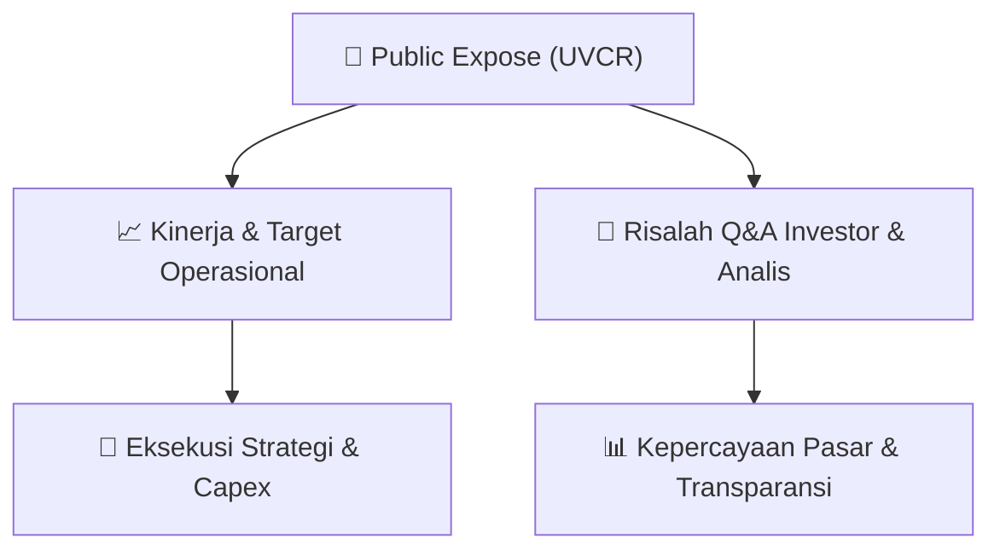

# 📢 Laporan Intelijen Paparan Publik (Public Expose) - [[UVCR]]
🏢 **Emiten**: `[[UVCR]]` | 📅 **Tanggal Pelaksanaan**: `2026-09-11` | 📑 **Dokumen**: `Public Expose`
⬅️ [[knowledge-base/daily-digests/Daily_Digest_20260911|Kembali ke Daily Digest]] | 🎛️ [[Dashboard|Ke Dashboard Utama]]

---

## 📌 1. Ringkasan Eksekutif & Paparan Direksi
> [!NOTE]
> PT Trimegah Karya Pratama Tbk. (UVCR) menyelenggarakan Public Expose Tahunan pada 07 September 2026, dengan laporan hasil disampaikan ke Bursa Efek Indonesia pada 11 September 2026. Acara dihadiri oleh 53 peserta (tidak termasuk manajemen dan karyawan). Paparan ini merupakan agenda tahunan perusahaan untuk mengkomunikasikan kinerja, strategi, dan rencana ke depan kepada pemegang saham dan publik. Dokumen yang tersedia hanya berisi pengumuman administratif penyampaian laporan hasil Public Expose, tanpa detail materi paparan atau Q&A yang disertakan dalam lampiran terpisah.

#### 🎯 Guidance Operasional & Target Strategis
- Dokumen ini tidak memuat rincian target kinerja, ekspansi, atau capex secara eksplisit. Informasi tersebut kemungkinan terdapat dalam lampiran laporan hasil Public Expose (file '2026_Hasil Laporan Pubex UVCR 10 September 2026.pdf') yang tidak disertakan dalam teks yang diberikan. Investor disarankan merujuk pada lampiran resmi untuk mendapatkan detail guidance operasional dan strategi perusahaan.

## 📊 2. Matriks Indikator Operasional & Parameter Kunci
| Parameter Utama | Nilai / Keterangan Resmi |
| :--- | :--- |
| **Tanggal Penyelenggaraan Public Expose** | `07 September 2026` |
| **Tanggal Penyampaian Laporan Hasil** | `11 September 2026` |
| **Jumlah Peserta Hadir** | `53 orang (tidak termasuk manajemen dan karyawan)` |
| **Nomor Surat Pengumuman** | `017/SK/LGL/TKP-IDX/IX/2026` |
| **Nomor Surat Penyampaian Materi** | `005/SK/COE/TKP-IDX/IX/2026` |
| **Direktur Utama** | `Hady Kuswanto` |
| **Alamat Perusahaan** | `Jl. Tebet Barat IX, No.35BB, Tebet Barat, Jakarta Selatan 12810` |

---

## 💬 3. Risalah Tanya Jawab (Q&A Session)
### ❓ Pertanyaan 1 (Tidak tersedia dalam dokumen)
**Pertanyaan**: Dokumen yang diberikan hanya berisi pengumuman administratif penyampaian laporan hasil Public Expose. Tidak ada rincian sesi tanya jawab (Q&A) yang disertakan dalam teks.

**Jawaban Manajemen**: Tidak tersedia dalam dokumen. Manajemen hanya menyatakan bahwa laporan hasil Public Expose disampaikan sebagai lampiran.

> [!TIP]
> **Implikasi Bagi Investor**: Investor perlu mengakses lampiran resmi laporan hasil Public Expose untuk mendapatkan informasi detail mengenai sesi tanya jawab dan jawaban manajemen.

## 📌 4. Peta Jalur Strategis & Roadmap

---

## 🔗 Knowledge Graph
- [[knowledge-base/daily-digests/Daily_Digest_20260911|📄 Daily Digest 2026-09-11]]
- [[knowledge-base/calendars/Action_Calendar|🗓️ Kalender Terpusat Aksi Korporasi]]
- [[Dashboard|🎛️ Kembali ke Dashboard Utama]]