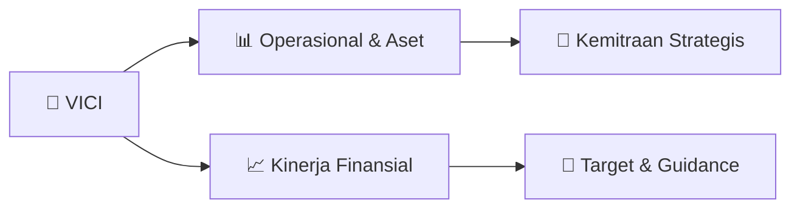

# 📊 Materi Public Expose: [VICI]

🏢 **Emiten**: `VICI` | 📅 **Tanggal Pelaksanaan**: `2026-09-17` | 📑 **Total Slide**: `19 Slide`
⬅️ [[knowledge-base/daily-digests/VICI_20260917|Kembali ke Daily Digest]] | 🎛️ [[Dashboard/VICI|Ke Dashboard Emiten]]

> [!NOTE]
> Ringkasan materi presentasi resmi Public Expose VICI yang disampaikan oleh manajemen kepada investor dan bursa. Seluruh poin strategis, matriks operasional, dan angka kinerja diekstrak langsung dari slide deck resmi.

---

## 📅 1. Jadwal & Metadata Penyelenggaraan

| Parameter | Detail Informasi |
|---|---|
| **Nomor Surat Pengantar** | 030/VICI-CORSEC/IX/2026 |
| **Perihal Pengumuman** | Penyampaian Materi Public Expose Insidentil |
| **Waktu Pelaksanaan** | 2026-09-17 17-09-2026 20:45 |
| **Lokasi / Media** | Aplikasi Zoom / Daring |
| **Lampiran Resmi** | `2` |

## 📋 2. Agenda Paparan Publik

1. Paparan Publik Insidental akan diselenggarakan dalam Bahasa Indonesia.
2. Peserta diwajibkan untuk melakukan registrasi melalui tautan/link registrasi yang telah disampaikan
3. dalam Rencana Penyelenggaraan Paparan Publik Insidental.
4. Tautan/link unik untuk memasuki ruang rapat di aplikasi Zoom Meeting akan dikirimkan ke email yang
5. telah terdaftar.
6. Peserta yang dapat hadir dalam Paparan Publik Insidental adalah yang telah mengisi daftar hadir dan
7. mengganti identitas berdasarkan format “Nama - Institusi/Individual” selama acara berlangsung.
8. Selama acara Paparan Publik Insidental, microphone peserta dan kolom chat akan dinon-aktifkan untuk
9. menjaga kelancaran acara.
10. Jalannya Paparan Publik Insidental akan dipandu oleh Moderator dan Penyaji yang mewakili
11. Perusahaan.
12. Paparan Publik Insidental akan dimulai dengan sesi presentasi, dan dilanjutkan dengan sesi tanya jawab
13. (Q&A).
14. Pertanyaan seputar materi paparan harap disampaikan melalui fitur Chat yang terdapat pada aplikasi
15. Zoom Meeting dengan format Nama (sesuai nama yang digunakan di zoom) – pertanyaannya.
16. Karena keterbatasan waktu, kami akan membuka pertanyaan untuk maksimal 5 (lima) orang Peserta.
17. Perseroan berhak untuk tidak menjawab atau menanggapi pertanyaan yang tidak relevan atau tidak
18. berhubungan dengan agenda Paparan Publik Insidental.
19. Bagi Peserta yang tidak mematuhi tata tertib Paparan Publik Insidental ini, operator dapat
20. mengeluarkan Peserta dari conference room.

## 🏢 3. Profil & Pilar Portofolio Bisnis

## 🏗️ 4. Kinerja Operasional & Portofolio Aset

> Ringkasan Kinerja 1H 2026
1H 2025 1H 2026 200,000 400,000 600,000 800,000 676,669 745,301 PENDAPATAN
dalam juta Rupiah
10,14% 1H 2025 1H 2026 20,000 40,000 60,000 80,000 100,000 80,740 45,090 LABA BERSIH
dalam juta Rupiah
1H 2025 1H 2026 100,000 200,000 300,000 400,000 377,285 394,791 LABA KOTOR
dalam juta Rupiah
4,64% 1H 2025 1H 2026 200,000 400,000 600,000 800,000 1,000,000 1,200,000 1,400,000 1,315,398 1,358,396 TOTAL ASET
dalam juta Rupiah
3.27%
1H 2025 1H 2026 20,000 40,000 60,000 80,000 100,000 120,000 140,000 123,508 76,473 EBITDA
dalam juta Rupiah
38,08% 1H 2025 1H 2026 100 150 200 250 300 257.909 255.563 TOTAL LIABILITAS
dalam juta Rupiah
0,91% 44,15% 1H 2025 1H 2026 200,000 400,000 600,000 800,000 1,000,000 1,200,000 1,057,489 1,102,833 TOTAL EKUITAS
dalam juta Rupiah
4.28%

> Kinerja Operasional

## 📈 5. Kinerja Keuangan & Posisi Finansial

### 📊 Ringkasan Finansial
```text
Kinerja Keuangan
```

## 🧭 6. Inisiatif Strategis, Kolaborasi, & Kemitraan

*Strategi usaha difokuskan pada penguatan fundamental dan ekspansi operasional.*

## 🎯 7. Target Pertumbuhan & Guidance Manajemen

*Target pertumbuhan ditetapkan mengacu pada prospek industri dan kondisi makroekonomi terkini.*

## 🗺️ 8. Peta Jalur Strategis & Eksekusi



## 📑 9. Daftar Indeks Slide Presentasi

| Slide # | Judul / Topik Slide | Ringkasan Konten |
|---|---|---|
| Slide 1 | **Public** | Public Expose Expose |
| Slide 2 | **Tata Tertib Paparan Publik** | Paparan Publik Insidental akan diselenggarakan dalam Bahasa Indonesia. Peserta diwajibkan untuk melakukan registrasi melalui tautan/link registrasi ya |
| Slide 3 | **Latar Belakang Paparan Publik** | Berdasarkan pengumuman PT Bursa Efek Indonesia (“Bursa”) Nomor Peng-SPT- 00175/BEI.WAS/09-2026 tanggal 11 September 2026, Bursa melakukan penghentian  |
| Slide 4 | **Sekilas tentang VICI** |  |
| Slide 5 | **Informasi Pemegang Saham Utama & Pengendali** | PT Gemilang Tunggal Prakarsa (99,95%) Luhur Dino Herlambang |
| Slide 6 | **Cat rambut Miranda** | memenangkan ‘Top Brand Award’. Herborist Minyak Zaitun |
| Slide 7 | **2022 2026** | 2026 Perseroan merambah produk kesehatan dengan mengakuisisi merek Secret Clean. |
| Slide 8 | **Penghargaan** | Selama 2026, PT Victoria Care Indonesia Tbk mendapatkan beberapa penghargaan |
| Slide 9 | **Kinerja Keuangan** |  |
| Slide 10 | **Ringkasan Kinerja 1H 2026** | 1H 2025 1H 2026 0 |
| Slide 11 | **Kinerja Operasional** |  |
| Slide 12 | **Jaringan Penjualan** | KONTRIBUSI SIGNIFIKAN KANAL DIGITAL Kehadiran Perseroan di berbagai |
| Slide 13 | **Produk dan Jasa** | PT Victoria Care Indonesia Tbk saat ini memproduksi beberapa merek yang menghasilkan produk- produk perawatan dan kecantikan yang disesuaikan dengan k |
| Slide 14 | **Rencana ke Depan** |  |
| Slide 15 | **Rencana ke Depan** | FOKUS PERTUMBUHAN PASAR |
| Slide 16 | **Aksi Korporasi** | Perseroan sedang dalam tahap penjajakan akuisisi dengan beberapa brand yang dapat berkontribusi dalam peningkatan kinerja Perseroan melalui perluasan  |
| Slide 17 | **Informasi Material** | yang Belum Disampaikan kepada Publik Sepanjang pengetahuan Perseroan, selain informasi sebagaimana yang telah diungkapkan |
| Slide 18 | **Sesi Tanya Jawab** |  |
| Slide 19 | **TERIMA** | KASIH Kantor Pusat Lokasi Pabrik |

---

*Dokumen diolah otomatis oleh **Swarm Intelijen Pasar Modal Indonesia** pada 2026-10-12 16:50 WIB.*