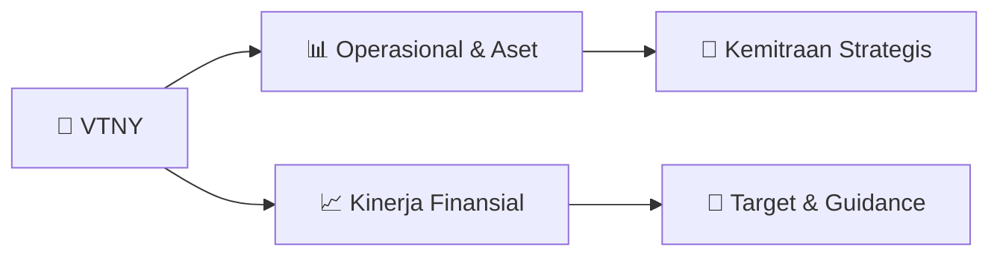

# 📊 Materi Public Expose: [VTNY]

🏢 **Emiten**: `VTNY` | 📅 **Tanggal Pelaksanaan**: `2026-09-16` | 📑 **Total Slide**: `4 Slide`
⬅️ [[knowledge-base/daily-digests/VTNY_20260916|Kembali ke Daily Digest]] | 🎛️ [[Dashboard/VTNY|Ke Dashboard Emiten]]

> [!NOTE]
> Ringkasan materi presentasi resmi Public Expose VTNY yang disampaikan oleh manajemen kepada investor dan bursa. Seluruh poin strategis, matriks operasional, dan angka kinerja diekstrak langsung dari slide deck resmi.

---

## 📅 1. Jadwal & Metadata Penyelenggaraan

| Parameter | Detail Informasi |
|---|---|
| **Nomor Surat Pengantar** | - |
| **Perihal Pengumuman** | Materi Public Expose |
| **Waktu Pelaksanaan** | 2026-09-16  |
| **Lokasi / Media** | Online |
| **Lampiran Resmi** | `Materi Presentasi Slide Deck` |

## 📋 2. Agenda Paparan Publik

- Pemaparan Profil & Struktur Bisnis Perseroan
- Kinerja Operasional & Keuangan
- Arah Strategi Usaha & Target Pertumbuhan
- Sesi Tanya Jawab (Q&A)

## 🏢 3. Profil & Pilar Portofolio Bisnis

## 🏗️ 4. Kinerja Operasional & Portofolio Aset

*Detail aset operasional terlampir pada dokumen slide resmi.*

## 📈 5. Kinerja Keuangan & Posisi Finansial

## 🧭 6. Inisiatif Strategis, Kolaborasi, & Kemitraan

- LAPORAN HASIL PELAKSANAAN PUBLIC EXPOSE LIVE 2026
PT VENTENY FORTUNA INTERNATIONAL Tbk
Peserta Rapat yang Hadir:
42 peserta Public Expose dan 58 peserta Press Conference
(Daftar kehadiran disampaikan terpisah dari laporan ini)
Sesi Tanya Jawab Public Expose:
1. Rizky Novita
− Apa target utama perusahaan hingga akhir 2026 khususnya untuk produk baru? dan apakah
ada rencana untuk aksi korporasi yang akan datang?
Bapak Tri Ismardiko Widyawan:
Di tengah industri pembiayaan yang terus berkembang, VENTENY secara konsisten menerapkan
beberapa hal pendekatan pertumbuhan yang prudent, dengan tetap memperhatikan kualitas
portofolio dan keberlanjutan bisnis. Perseroan juga terus mengeksplorasi peluang untuk memperluas
pasar, memperkuat partnership strategis, serta mengembangkan produk-produk yang semakin sesuai
dengan kebutuhan pelaku usaha.
Salah satunya yang kita lakukan satu tahun terakhir adalah payroll service. Strategi ini menjadi bagian
dari upaya VENTENY membangun lini bisnis Perseroan yang tidak hanya bertumbuh dari sisi volume,
tetapi juga memiliki fundamental yang sehat dan mampu menciptakan nilai jangka panjang, baik bagi
Perseroan maupun mitra bisnisnya. Jadi tidak hanya memikirkan kami, tapi juga mitra bisnis.
Dari sisi B2B, VENTENY akan terus memperluas kerja sama dengan asosiasi dan komunitas bisnis
sebagai salah satu strategi akuisisi mitra baru, sekaligus memperkuat penetrasi di segmen korporasi
yang sudah ada. Perseroan juga berkomitmen untuk terus mengembangkan produ

## 🎯 7. Target Pertumbuhan & Guidance Manajemen

> 2. William Adriel
− Target pertumbuhan laba perseroan di kuartal III 2026?
Bapak Kaleb Solaiman:
Bila kita melihat kondisi makro ekonomi kita tetap optimis untuk bertumbuh namun tidak besar-
besaran, kami menargetkan pertumbuhan di angka 5-8% untuk kuartal III tahun 2026.
3. Dimas Yoga
− Bagaimana kinerja Perseroan di Semester I dan apa saja faktor yang menopang kenaikan
pendapatan di semester I tahun 2026?
Bapak Kaleb Solaiman:
Sepanjang semester I 2026, Perseroan berhasil mempertahankan momentum pertumbuhan yang
positif, sejalan dengan strategi penguatan bisnis dan optimalisasi kinerja untuk menciptakan
pertumbuhan yang berkelanjutan. Beberapa capaian utama Perseroan di Semester I 2026, di
antaranya:
Pertama, pendapatan bersih sebesar Rp105,8 miliar pada Semester I 2026, meningkat dibandingkan
periode yang sama tahun sebelumnya sebesar Rp104,0 miliar, atau tumbuh 1,77% YoY. Peningkatan
ini salah satunya didorong oleh peluncuran produk baru yang menyebabkan permintaan terhadap
layanan

> Sesi Tanya Jawab Press Conference:
1. Nadia K. Putri
− Apa yang membuat laba bersih VTNY turun di semester I/2026? Bagaimana guidance
perseroan untuk semester II/2026?
− Setelah IPO sejak 2022, adakah rencana VTNY untuk membagikan dividen?
Bapak Kaleb Solaiman:
Dengan kondisi ekonomi secara global, maupun adanya demo juga yang ada di Indonesia, yang
menyebabkan ekonomi global menurun dan sehingga kami kena impactnya sehingga menyebabkan
laba turun, disebabkan inflasi, yang mana kami tetap mempertahankan laba, namun kami juga tetap
menambah beberapa SDM sehingga biaya operasional kami meningkat yang mengakibatkan
menggerus laba bersih sehingga turun.
Bapak Tri Ismardiko Widyawan:
Untuk saat ini, VENTENY belum memiliki rencana pembagian dividen dalam waktu dekat. Prioritas
kami di 2026 adalah memperkuat struktur permodalan dan modal kerja, membiayai ekspansi
ekosistem bisnis produktif di segmen B2B dan B2B2E, serta mendukung investasi berkelanjutan pada
infrastruktur teknologi, termasuk 

## 🗺️ 8. Peta Jalur Strategis & Eksekusi

## 📑 9. Daftar Indeks Slide Presentasi

| Slide # | Judul / Topik Slide | Ringkasan Konten |
|---|---|---|
| Slide 1 | **LAPORAN HASIL PELAKSANAAN PUBLIC EXPOSE LIVE 2026** | PT VENTENY FORTUNA INTERNATIONAL Tbk Peserta Rapat yang Hadir: 42 peserta Public Expose dan 58 peserta Press Conference |
| Slide 2 | **2. William Adriel** | − Target pertumbuhan laba perseroan di kuartal III 2026? Bapak Kaleb Solaiman: Bila kita melihat kondisi makro ekonomi kita tetap optimis untuk bertum |
| Slide 3 | **Sesi Tanya Jawab Press Conference:** | 1. Nadia K. Putri − Apa yang membuat laba bersih VTNY turun di semester I/2026? Bagaimana guidance perseroan untuk semester II/2026? |
| Slide 4 | **3. Maya Nisa Nurjannah** | − Perseroan menyediakan produk berupa employee super app yang dapat digunakan perusahaan, saat ini ada berapa perusahaan yang telah menggunakan employ |

---

*Dokumen diolah otomatis oleh **Swarm Intelijen Pasar Modal Indonesia** pada 2026-10-12 16:50 WIB.*