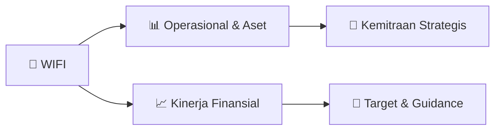

# 📊 Materi Public Expose: [WIFI]

🏢 **Emiten**: `WIFI` | 📅 **Tanggal Pelaksanaan**: `2026-08-21` | 📑 **Total Slide**: `1 Slide`
⬅️ [[knowledge-base/daily-digests/WIFI_20260821|Kembali ke Daily Digest]] | 🎛️ [[Dashboard/WIFI|Ke Dashboard Emiten]]

> [!NOTE]
> Ringkasan materi presentasi resmi Public Expose WIFI yang disampaikan oleh manajemen kepada investor dan bursa. Seluruh poin strategis, matriks operasional, dan angka kinerja diekstrak langsung dari slide deck resmi.

---

## 📅 1. Jadwal & Metadata Penyelenggaraan

| Parameter | Detail Informasi |
|---|---|
| **Nomor Surat Pengantar** | 107/CORSEC/SSD/VIII/2026 |
| **Perihal Pengumuman** | Rencana Penyelenggaraan Public Expose Tahunan |
| **Waktu Pelaksanaan** | 07 September 2026 11:00 |
| **Lokasi / Media** | Public Expose Live 2026 |
| **Lampiran Resmi** | `1` |

## 📋 2. Agenda Paparan Publik

1. 107/CORSEC/SSD/VIII/2026
2. Perihal
3. Rencana Penyelenggaraan Public Expose Tahunan 2026 PT Solusi Sinergi Digital Tbk
4. (“Perseroan”)
5. Lampiran
6. Kepada Yth.
7. Otoritas Jasa Keuangan (OJK)
8. Gedung Sumitro Djojohadikusumo
9. Jl. Lapangan Banteng Timur No. 2 - 4
10. Jakarta 10710
11. Dengan Hormat,
12. Dalam rangka memenuhi ketentuan berdasarkan Surat Keputusan Direksi PT Bursa Efek Indonesia (“BEI”)
13. No. Kep-00087/BEI/12-2025 tanggal 12 Desember 2025 tentang Peraturan Nomor I-E mengenai
14. Kewajiban Penyampaian Informasi, serta Surat Edaran BEI No. SE-00003/BEI/05-2020 tanggal 29 Mei
15. 2020 mengenai Tata Cara Pelaksanaan Public Expose Secara Elektronik, dengan ini Perseroan
16. menyampaikan rencana penyelenggaraan Public Expose sebagai berikut:
17. Hari dan Tanggal
18. Senin, 7 September 2026
19. Waktu
20. 11.00 WIB s/d Selesai
21. Agenda
22. Penyampaian Informasi Perkembangan Usaha Perseroan dan Entitas Anak
23. Tempat
24. Public Expose Live 2026
25. yang tercantum pada website idx.co.id
26. Dapat kami informasikan bahwa pelaksanaan Public Expose Tahunan ini akan dihadiri oleh Direksi
27. Perseroan atau paling sedikit 1 (satu) Direktur Perseroan.
28. Materi Public Expose Tahunan akan kami sampaikan selambat-lambatnya 3 (tiga) hari Bursa sebelum tanggal
29. penyelenggaraan Public Expose Tahunan ini oleh Perseroan, yaitu hari Rabu, tanggal 2 September 2026.
30. Demikian kami sampaikan. Atas perhatiannya, kami sampaikan terima kasih.
31. Hormat kami,
32. PT Solusi Sinergi Digital Tbk
33. _____________________________________
34. Nama    : Shannedy Ong
35. Jabatan : Direktur

## 🏢 3. Profil & Pilar Portofolio Bisnis

## 🏗️ 4. Kinerja Operasional & Portofolio Aset

*Detail aset operasional terlampir pada dokumen slide resmi.*

## 📈 5. Kinerja Keuangan & Posisi Finansial

## 🧭 6. Inisiatif Strategis, Kolaborasi, & Kemitraan

*Strategi usaha difokuskan pada penguatan fundamental dan ekspansi operasional.*

## 🎯 7. Target Pertumbuhan & Guidance Manajemen

*Target pertumbuhan ditetapkan mengacu pada prospek industri dan kondisi makroekonomi terkini.*

## 🗺️ 8. Peta Jalur Strategis & Eksekusi

## 📑 9. Daftar Indeks Slide Presentasi

| Slide # | Judul / Topik Slide | Ringkasan Konten |
|---|---|---|
| Slide 1 | **Jakarta, 21 Agustus 2026** | No : 107/CORSEC/SSD/VIII/2026 |

---

*Dokumen diolah otomatis oleh **Swarm Intelijen Pasar Modal Indonesia** pada 2026-10-12 16:50 WIB.*