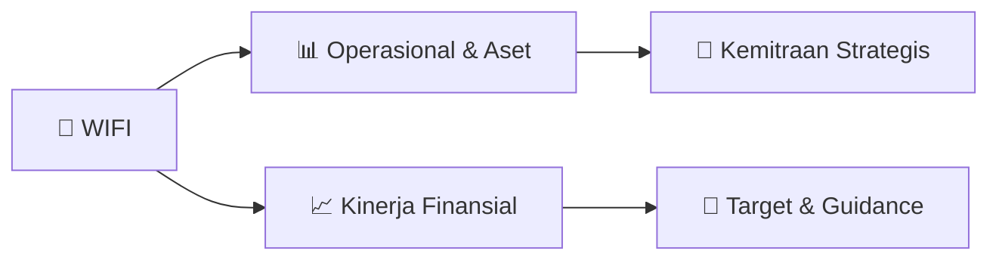

# 📊 Materi Public Expose: [WIFI]

🏢 **Emiten**: `WIFI` | 📅 **Tanggal Pelaksanaan**: `2026-09-02` | 📑 **Total Slide**: `17 Slide`
⬅️ [[knowledge-base/daily-digests/WIFI_20260902|Kembali ke Daily Digest]] | 🎛️ [[Dashboard/WIFI|Ke Dashboard Emiten]]

> [!NOTE]
> Ringkasan materi presentasi resmi Public Expose WIFI yang disampaikan oleh manajemen kepada investor dan bursa. Seluruh poin strategis, matriks operasional, dan angka kinerja diekstrak langsung dari slide deck resmi.

---

## 📅 1. Jadwal & Metadata Penyelenggaraan

| Parameter | Detail Informasi |
|---|---|
| **Nomor Surat Pengantar** | 109/CORSEC/SSD/IX/2026 |
| **Perihal Pengumuman** | Penyampaian Materi Public Expose Tahunan |
| **Waktu Pelaksanaan** | 2026-09-02 02-09-2026 10:41 |
| **Lokasi / Media** | Aplikasi Zoom / Daring |
| **Lampiran Resmi** | `1` |

## 📋 2. Agenda Paparan Publik

- Pemaparan Profil & Struktur Bisnis Perseroan
- Kinerja Operasional & Keuangan
- Arah Strategi Usaha & Target Pertumbuhan
- Sesi Tanya Jawab (Q&A)

## 🏢 3. Profil & Pilar Portofolio Bisnis

## 🏗️ 4. Kinerja Operasional & Portofolio Aset

*Detail aset operasional terlampir pada dokumen slide resmi.*

## 📈 5. Kinerja Keuangan & Posisi Finansial

## 🧭 6. Inisiatif Strategis, Kolaborasi, & Kemitraan

*Strategi usaha difokuskan pada penguatan fundamental dan ekspansi operasional.*

## 🎯 7. Target Pertumbuhan & Guidance Manajemen

> A G E N D A
Four topics for today
Company performance update & strategic direction
1H26 financial highlights, the twin growth-engine business model, and competitive positioning
Network expansion progress — IRA (5G FWA) & Starlite (FTTH)
Site & home-pass deployment, subscriber growth and the community acquisition engine
Outlook & corporate plans ahead
Upcoming catalysts and Roadmap towards Connected Intelligence
Live Q&A with the Board of Directors
Open discussion with SURGE’s Board of Directors
PT Solusi Sinergi Digital Tbk (IDX: WIFI)   ·   Public Expose Live 2026 — September 7, 2026

> S E C T I O N 0 3
Outlook & Corporate Plans Ahead
PT Solusi Sinergi Digital Tbk (IDX: WIFI)   ·   Public Expose Live 2026 — September 7, 2026
Upcoming catalysts and Roadmap towards Connected Intelligence

> C O R P O R A T E P L A N S
FY2026 outlook & upcoming catalysts
>3mn FY26 SUBSCRIBERS
combined FWA + FTTH
5,500 FWA SITES
year-end 2026 target
3.5mn
FTTH HOME PASSES
year-end 2026 target
50–60% EBITDA MARGIN FY26 range 2H26 Execution ramp-up
FWA site & community-channel acceleration;
monetization of the subscriber base; completion of
the funding pipeline.
1H27
Scale & efficiency
Continued coverage expansion; operating leverage
drives margins; premium & SME service launches.
2027–2030 National footprint
Toward a 20,000+ km national network; deeper
penetration of 45mn addressable households.
Management focus: disciplined execution of the 2026 program, service quality commitments, and strengthening the long-term funding structure.
PT Solusi Sinergi Digital Tbk (IDX: WIFI)   ·   Public Expose Live 2026 — September 7, 2026

## 🗺️ 8. Peta Jalur Strategis & Eksekusi

## 📑 9. Daftar Indeks Slide Presentasi

| Slide # | Judul / Topik Slide | Ringkasan Konten |
|---|---|---|
| Slide 1 | **PT Solusi Sinergi Digital Tbk  ·  IDX: WIFI** | Public Expose Live 2026 Monday, September 7, 2026 Public Expose Live 2026  ·  Public Expose Participation |
| Slide 2 | **A G E N D A** | Four topics for today 1 Company performance update & strategic direction |
| Slide 3 | **S E C T I O N 0 1** | Company Performance Update & Strategic Direction Triple-digit growth with profitability — powered by two mutually reinforcing growth engines: |
| Slide 4 | **F I N A N C I A L H I G H L I G H T S — 1 H 2 0 2 6 ( U N A U D I T E D )** | Triple-digit growth, delivered with conservative leverage Rp1.57Tn +206% YoY Revenue  ·  ≈US$96M |
| Slide 5 | **F I N A N C I A L S T A T E M E N T S — 1 H 2 0 2 6 S U M M A R Y ( U N A U D I T E D )** | Income statement, balance sheet and cash flow at a glance Rp1.57Tn REVENUE |
| Slide 6 | **G R O U P S T R U C T U R E — T H E D U A L - E N G I N E M O D E L** | Two companies, two technologies, one mission PT Solusi Sinergi Digital Tbk (SURGE) IDX: WIFI PT Telemedia Komunikasi Pratama (“TKP”) |
| Slide 7 | **P R O D U C T P O R T F O L I O** | Five products, one deliberate ladder IRA 5G FWA |
| Slide 8 | **T H I R D - P A R T Y V A L I D A T I O N — O O K L A S P E E D T E S T I N T E L L I G E N C E** | Measured, not claimed: Starlite delivers Indonesia's fastest real-world experience Median user download by ISP and in-home Wi-Fi generation — real-use |
| Slide 9 | **S E C T I O N 0 2** | Network Expansion Progress — IRA (5G FWA) & Starlite (FTTH) From 1,500+ FWA sites on-air toward 5,500 — plus the fiber depth engine building toward 3. |
| Slide 10 | **D E P LOY M E N T P R O G R E S S** | 1,500+ FWA sites on-air as of August 31, 2026 1,500+ SITES ON-AIR |
| Slide 11 | **T H E D E P L O Y M E N T E N G I N E** | Community-powered infrastructure: how 1,500 sites become 5,500 T H E S I T E E N G I N E Rumah Sahabat IRA   community-hosted rooftop sites |
| Slide 12 | **S T A R L I T E ( F T T H ) E X P A N S I O N P R O G R E S S** | The depth engine — 1.85M subscribers on world-class build standards 1.85M FTTH SUBSCRIBERS |
| Slide 13 | **S E C T I O N 0 3** | Outlook & Corporate Plans Ahead PT Solusi Sinergi Digital Tbk (IDX: WIFI)   ·   Public Expose Live 2026 — September 7, 2026 13 |
| Slide 14 | **C O R P O R A T E P L A N S** | FY2026 outlook & upcoming catalysts >3mn FY26 SUBSCRIBERS |
| Slide 15 | **T H E A I L A Y E R** | Connectivity is the fabric of AI — and SURGE already runs on it L I V E I N O P E R A T I O N S Agentic AI across the network |
| Slide 16 | **S E C T I O N 0 4** | Q&A with the Board of Directors Disclaimer: This document has been prepared by PT Solusi Sinergi Digital Tbk for information purposes only and does no |
| Slide 17 | **PT Solusi Sinergi Digital Tbk  ·  IDX: WIFI** | Thank You Monday, September 7, 2026 Public Expose Live 2026 |

---

*Dokumen diolah otomatis oleh **Swarm Intelijen Pasar Modal Indonesia** pada 2026-10-12 16:50 WIB.*