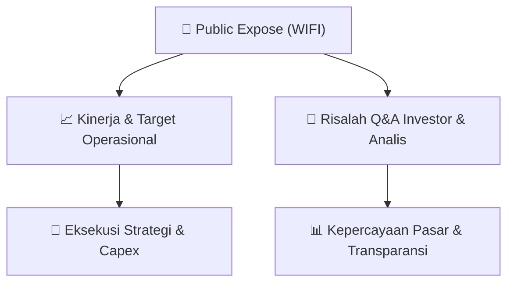

# 📢 Laporan Intelijen Paparan Publik (Public Expose) - [[WIFI]]
🏢 **Emiten**: `[[WIFI]]` | 📅 **Tanggal Pelaksanaan**: `2026-09-02` | 📑 **Dokumen**: `Public Expose`
⬅️ [[knowledge-base/daily-digests/Daily_Digest_20260902|Kembali ke Daily Digest]] | 🎛️ [[Dashboard|Ke Dashboard Utama]]

---

## 📌 1. Ringkasan Eksekutif & Paparan Direksi
> [!NOTE]
> Dokumen yang diberikan adalah surat pengantar resmi PT Solusi Sinergi Digital Tbk (kode emiten WIFI) perihal penyampaian materi Public Expose Tahunan. Surat bernomor 109/CORSEC/SSD/IX/2026 tanggal 2 September 2026 ini merujuk pada surat sebelumnya No. 107/CORSEC/SSD/VIII/2026 tanggal 21 Agustus 2026. Dokumen hanya berisi informasi administratif penyampaian lampiran materi public expose, tanpa memuat isi presentasi, data kinerja, atau tanya jawab.

#### 🎯 Guidance Operasional & Target Strategis
- Tidak tersedia dalam dokumen yang diberikan. Dokumen hanya berupa surat pengantar dan tidak memuat rincian target kinerja, ekspansi, atau belanja modal.

## 💬 3. Risalah Tanya Jawab (Q&A Session)
`Materi presentasi Public Expose / Risalah Q&A terlampir dalam dokumen resmi bursa.`

## 📌 4. Peta Jalur Strategis & Roadmap

---

## 🔗 Knowledge Graph
- [[knowledge-base/daily-digests/Daily_Digest_20260902|📄 Daily Digest 2026-09-02]]
- [[knowledge-base/calendars/Action_Calendar|🗓️ Kalender Terpusat Aksi Korporasi]]
- [[Dashboard|🎛️ Kembali ke Dashboard Utama]]