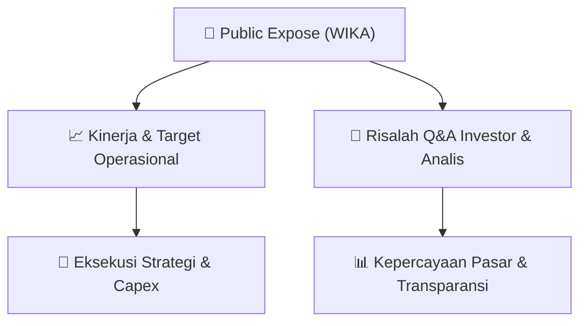

# 📢 Laporan Intelijen Paparan Publik (Public Expose) - [[WIKA]]
🏢 **Emiten**: `[[WIKA]]` | 📅 **Tanggal Pelaksanaan**: `2026-09-17` | 📑 **Dokumen**: `Public Expose`
⬅️ [[knowledge-base/daily-digests/Daily_Digest_20260917|Kembali ke Daily Digest]] | 🎛️ [[Dashboard|Ke Dashboard Utama]]

---

## 📌 1. Ringkasan Eksekutif & Paparan Direksi
> [!NOTE]
> PT Wijaya Karya (Persero) Tbk (WIKA) mengumumkan rencana penyelenggaraan Public Expose Tahunan untuk Tahun Buku 2026. Acara akan dilaksanakan secara daring pada 01 Oktober 2026 pukul 10:00 melalui tautan https://bit.ly/PubexWIKA2026, Zoom Meeting ID 806 358 0453, dan Passcode pubexwika. Agenda acara adalah Corporate Update. Pengumuman disampaikan oleh Corporate Secretary, Mahendra Vijaya, pada 17-09-2026 17:07. Dokumen ini merupakan pemberitahuan rencana Public Expose, bukan transkrip pelaksanaan Public Expose, sehingga tidak memuat rincian kinerja, tanya jawab investor, maupun guidance operasional.

#### 🎯 Guidance Operasional & Target Strategis
- Tidak terdapat target kinerja, capex, ekspansi, atau guidance operasional dalam dokumen ini. Dokumen hanya memuat rencana penyelenggaraan Public Expose Tahunan Tahun Buku 2026 dengan agenda Corporate Update. Informasi material lebih lanjut diharapkan disampaikan pada pelaksanaan Public Expose tanggal 01 Oktober 2026.

## 📊 2. Matriks Indikator Operasional & Parameter Kunci
| Parameter Utama | Nilai / Keterangan Resmi |
| :--- | :--- |
| **Nama Perusahaan** | `PT Wijaya Karya (Persero) Tbk` |
| **Kode Emiten** | `WIKA` |
| **Nomor Surat** | `SE.01.00/A.CORSEC.00307/2026` |
| **Perihal** | `Rencana Penyelenggaraan Public Expose Tahunan` |
| **Tahun Buku** | `2026` |
| **Tempat** | `Secara daring pada tautan https://bit.ly/PubexWIKA2026` |
| **Zoom Meeting ID** | `806 358 0453` |
| **Passcode** | `pubexwika` |
| **Hari/Tanggal** | `01 Oktober 2026` |
| **Waktu** | `10:00` |
| **Agenda** | `Corporate Update` |
| **Pengirim** | `Mahendra Vijaya` |
| **Jabatan Pengirim** | `Corporate Secretary` |
| **Tanggal dan Waktu Pengumuman** | `17-09-2026 17:07` |
| **Lampiran** | `Surat Pemberitahuan PUBEX - Bursa_signed.pdf` |

---

## 💬 3. Risalah Tanya Jawab (Q&A Session)
`Materi presentasi Public Expose / Risalah Q&A terlampir dalam dokumen resmi bursa.`

## 📌 4. Peta Jalur Strategis & Roadmap

---

## 🔗 Knowledge Graph
- [[knowledge-base/daily-digests/Daily_Digest_20260917|📄 Daily Digest 2026-09-17]]
- [[knowledge-base/calendars/Action_Calendar|🗓️ Kalender Terpusat Aksi Korporasi]]
- [[Dashboard|🎛️ Kembali ke Dashboard Utama]]