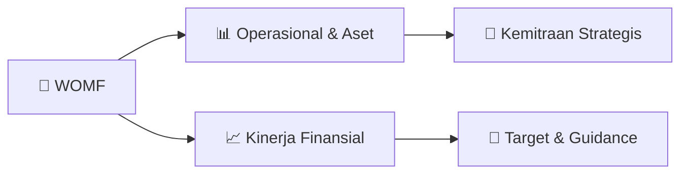

# 📊 Materi Public Expose: [WOMF]

🏢 **Emiten**: `WOMF` | 📅 **Tanggal Pelaksanaan**: `2026-08-04` | 📑 **Total Slide**: `25 Slide`
⬅️ [[knowledge-base/daily-digests/WOMF_20260804|Kembali ke Daily Digest]] | 🎛️ [[Dashboard/WOMF|Ke Dashboard Emiten]]

> [!NOTE]
> Ringkasan materi presentasi resmi Public Expose WOMF yang disampaikan oleh manajemen kepada investor dan bursa. Seluruh poin strategis, matriks operasional, dan angka kinerja diekstrak langsung dari slide deck resmi.

---

## 📅 1. Jadwal & Metadata Penyelenggaraan

| Parameter | Detail Informasi |
|---|---|
| **Nomor Surat Pengantar** | 570VIIICS2026 |
| **Perihal Pengumuman** | Penyampaian Materi Public Expose Tahunan |
| **Waktu Pelaksanaan** | 2026-08-04 04-08-2026 10:58 |
| **Lokasi / Media** | Aplikasi Zoom / Daring |
| **Lampiran Resmi** | `1` |

## 📋 2. Agenda Paparan Publik

1. Sekilas
2. Perusahaan
3. Strategi dan
4. Kondisi
5. Perusahaan
6. Kinerja
7. Keuangan
8. Perusahaan
9. Informasi Lainnya

## 🏢 3. Profil & Pilar Portofolio Bisnis

> Sekilas Perusahaan Profil Perusahaan
PT Bank Maybank
Indonesia, Tbk
PT Wahana Makmur
Sejati Publik 67,49% 25,01% 7,50% Berdiri
: 23 Maret 1982
Total Aset
: Rp 8.380 miliar
Total Ekuitas
: Rp 2.037 miliar
Daftar Pemegang Saham
Jaringan Cabang
: 189 Kantor Jaringan
Jumlah Karyawan
: ± 2.141 Karyawan
Jumlah Konsumen
: > 266 ribu Konsumen
Pemegang Saham
:  PT Bank Maybank Indonesia Tbk
Pengendali
PT Wahana Makmur Sejati
Pemeringkatan
: idAAA/Stable dari PEFINDO
*) Cut Off data: 30 Juni 2026

### 🏛️ Pilar Usaha & Aset Utama
- Corporate Social Responsibility (“CSR”)
SAFETY RIDING Program edukasi dan pelatihan
keselamatan berkendara yang diikuti
oleh karyawan dan pelajar sebanyak
100 orang di wilayah Tangerang.
Kegiatan ini bertujuan meningkatkan
pengetahuan dan kesadaran peserta
mengenai praktik berkendara yang
aman dan bertanggung jawab.
Pilar Pendidikan
LITERASI & INKLUSI KEUANGAN
Perseroan secara konsisten
menyelenggarakan program literasi dan
inklusi keuangan setiap bulannya
sebagai upaya meningkatkan tingkat
pemahaman masyarakat serta
memperluas akses terhadap layanan
keuangan.
Program dilaksanakan melalui metode
sosialisasi langsung dan digital dengan
jumlah peserta mencapai 10.202 orang.
Pilar Pendidikan Pilar Pendidikan LITERASI HIJAU
Program inisiatif kolaborasi bersama
Maybank Group dan komunitas taman
baca yang mengintegrasikan edukasi
lingkungan dengan praktik pengelolaan
sampah organik rumah tangga.
Program ini dilaksanakan di wilayah
Kelurahan Depok untuk meningkatkan
kesadaran dan partisipasi 

- Corporate Social Responsibility (“CSR”)
WOM KAWAN DISABILITAS
Program dukungan bagi kawan disabilitas
dengan memberikan bantuan kaki, tangan
palsu serta brace di Wilayah Banjarbaru
dan sekitarnya. Program bertujuan mendukung
peningkatan mobilitas, kemandirian, dan
kualitas hidup penerima manfaat.
Pilar Kesehatan DONOR DARAH Perseroan konsisten menyelenggarakan kegiatan donor darah bekerja sama
dengan Palang Merah Indonesia (PMI)
yang dilaksanakan di Kantor Pusat, wilayah
regional, dan cabang.
Sepanjang periode pelaporan, kegiatan ini
berhasil menghimpun 471 kantong darah
yang diharapkan dapat mendukung ketersediaan pasokan darah bagi
masyarakat yang membutuhkan.
Pilar Kesehatan
HARI RAYA KEAGAMAAN
Perseroan secara rutin melaksanakan
kegiatan sosial dan bantuan dalam
rangka hari besar keagamaan, seperti
Nyepi, Waisak, Ramadan, dan Idul Adha
1447 H. Kegiatan tersebut sebagai wujud komitmen dalam memperkuat nilai-nilai toleransi, keharmonisan sosial, serta kepedulian terhadap sesama. Pila

## 🏗️ 4. Kinerja Operasional & Portofolio Aset

> Target Tahun 2026
Total Penyaluran Pembiayaan
Rp 6,3 triliun
Laba Bersih
Rp 175 miliar
Total Aset
Rp 7,8 triliun
Total Ekuitas
Rp 2,1 triliun
NPF-gross 2,3% NPF-net 0.9% ROA 2,9% ROE 8,7%

## 📈 5. Kinerja Keuangan & Posisi Finansial

### 📊 Ringkasan Finansial
```text
Ringkasan Kinerja Keuangan
*) Cut Off data:  30 Juni 2026
Laba Bersih
Rp 96,7 miliar, meningkat 14,1%
dibandingkan Juni 2025 Rp 84,8 miliar.
Non Performing Financing
NPF Gross 2,53% atau menurun 0,05%
dibandingkan Juni 2025 2,58%.
NPF Net  1,13% atau menurun 0,08%
dibandingkan Juni 2025 1,21%.
Piutang Pembiayaan Neto
Rp 6,4  triliun, meningkat 5,2%
dibandingkan Juni 2025 Rp 6,1 triliun
Total Ekuitas
Rp 2,0 triliun, meningkat 7,3%
dibandingkan Juni 2025  Rp 1,9 triliun.
ROA dan ROE
ROA sebesar 3,2% dengan ROE
sebesar 9,8%, masing-masing
meningkat sebesar 0,2% dan 0,7%
Total Pendapatan
Rp 1,12 triliun, meningkat 5,2%
dibandingkan Juni 2025 Rp 1,06
triliun.
```

### 📊 Ringkasan Finansial
```text
Ringkasan Kinerja Keuangan
NB: Ikhtisar data keuangan penting Perseroan untuk periode yang berakhir Jun 2025 dan Jun 2026 adalah laporan keuangan interim
Piutang Pembiayaan Neto (Rp miliar)
Laba Bersih (Rp miliar)
Total Pendapatan (Rp miliar)
Total Ekuitas (Rp miliar)
ROA (%)
NPF Gross & NPF Neto (%)
BOPO (%) ROE (%)
5.2%
7.3%
5.2%
14.1%
*) Cut Off data: 30 Juni 2026
0.2% 0.3% 0.7%
```

## 🧭 6. Inisiatif Strategis, Kolaborasi, & Kemitraan

- Strategi Perusahaan
Memperluas jangkauan bisnis ke wilayah Indonesia Timur
yang memiliki potensi ekonomi tinggi untuk memperkuat
posisi Perusahaan sebagai Perusahaan Pembiayaan yang
adaptif terhadap kebutuhan masyarakat di berbagai
wilayah Indonesia.
Terus meningkatkan kerja sama dengan mitra strategis
Perusahaan melalui berbagai program serta skema insentif
yang menarik untuk meningkatkan pertumbuhan bisnis
melalui pendekatan kolaboratif dan segmentasi pasar yang
tepat sasaran.
Fokus untuk terus memperkuat sinergi dengan ekosistem
Maybank Group di Indonesia dalam rangka mendorong
pertumbuhan bisnis yang berkesinambungan, serta
meningkatkan pembiayaan bagi sektor Usaha Mikro, Kecil, dan
Menengah (“UMKM”) dengan tetap berfokus pada kualitas
portofolio yang sehat.
Penetrasi pasar syariah dengan berfokus pada produk
HajiKu melalui kerja sama dengan mitra strategis serta
ekosistem syariah untuk mendorong pertumbuhan
bisnis syariah Perusahaan di berbagai segmen.
Fokus pada penguatan ekosistem digital melalui pengembangan aplikasi KAWAN dan aplikasi
pembiayaan dengan mitra bisnis untuk meningkatkan
efisiensi proses akuisisi, serta meningkatkan customer
experience, baik untuk konsumen maupun mitra bisnis
Perusahaan. Terus melakukan evaluasi dan perbaikan secara
berkesinambungan terhadap proses inisiasi kredit dengan
terus melakukan evaluasi kebijakan dan prosedur kredit, serta
terus melakukan pengembangan credit scoring system untuk
meningkatkan akurasi analisa risiko kredit agar da

- Inisiatif yang Telah Dilakukan
Melanjutkan transformasi digital
yang tidak hanya
berfokus pada customer
experience, tapi juga
menyasar kebutuhan bisnis
dari partner strategis
Perusahaan. Meningkatkan efektivitas operasional melalui pengendalian biaya, optimalisasi
sumber daya, serta
penguatan strategi pemasaran dan kemitraan bisnis. Meningkatkan kualitas pembiayaan melalui penerapan prinsip kehati-hatian, penguatan manajemen risiko, tata kelola perusahaan, serta kepatuhan terhadap ketentuan regulator. Diversifikasi sumber pendanaan untuk memperoleh pendanaan baru
yang optimal melalui
PUB V Tahap III
sebesar Rp 1,5 triliun
pada Maret 2026
dan PUB VI Tahap I
sebesar Rp 784 miliar
pada Juni 2026.
Mengembangkan kompetensi sumber
daya manusia melalui
pendidikan dan pelatihan yang berkelanjutan, baik
secara tatap muka
maupun platform digital untuk mendukung tercapainya tujuan Perusahaan.

## 🎯 7. Target Pertumbuhan & Guidance Manajemen

*Target pertumbuhan ditetapkan mengacu pada prospek industri dan kondisi makroekonomi terkini.*

## 🗺️ 8. Peta Jalur Strategis & Eksekusi



## 📑 9. Daftar Indeks Slide Presentasi

| Slide # | Judul / Topik Slide | Ringkasan Konten |
|---|---|---|
| Slide 3 | **Agenda Paparan Publik** | 2 01 04 |
| Slide 4 | **3 01** | 01 04 03 |
| Slide 5 | **Sekilas Perusahaan** | 4 Profil Perusahaan PT Bank Maybank |
| Slide 6 | **Dewan Komisaris** | 5 Rallyati Arianto Wibowo, S.E. Komisaris Independen |
| Slide 7 | **Direksi** | 6 Hendrik Progo Direktur |
| Slide 8 | **Dewan Pengawas Syariah** | 7 Dr. H. Abdul Jabar Majid, M.A Ketua Dewan Pengawas Syariah |
| Slide 9 | **Jaringan Perusahaan** | 8 SUMATERA BAGIAN UTARA 21 Kantor Layanan |
| Slide 10 | **Produk Perusahaan** | 9 Pembiayaan Motor Baru Pembiayaan Logam Mulia |
| Slide 11 | **10 01** | 01 04 03 |
| Slide 12 | **Strategi Perusahaan** | 11 Memperluas jangkauan bisnis ke wilayah Indonesia Timur yang memiliki potensi ekonomi tinggi untuk memperkuat |
| Slide 13 | **Kendala yang Dihadapi** | 12 Ketatnya Persaingan Bisnis Multifinance |
| Slide 14 | **Inisiatif yang Telah Dilakukan** | 13 Melanjutkan transformasi digital |
| Slide 15 | **Target Tahun 2026** | 14 Total Penyaluran Pembiayaan |
| Slide 16 | **15 01** | 01 04 03 |
| Slide 17 | **Ringkasan Kinerja Keuangan** | 16 *) Cut Off data:  30 Juni 2026 Laba Bersih |
| Slide 18 | **Ringkasan Kinerja Keuangan** | 17 NB: Ikhtisar data keuangan penting Perseroan untuk periode yang berakhir Jun 2025 dan Jun 2026 adalah laporan keuangan interim Piutang Pembiayaan N |
| Slide 19 | **18 01** | 01 04 03 |
| Slide 20 | **Program Promo** | 19 Content  Here Content  Here |
| Slide 21 | **Peristiwa Penting** | 20 Mei Fasilitas Installment Loan dari Bank Digital BCA sebesar Rp 500 miliar. |
| Slide 22 | **Penghargaan** | 21 01 02 |
| Slide 23 | **Corporate Social Responsibility (“CSR”)** | 22 SAFETY RIDING Program |
| Slide 24 | **Corporate Social Responsibility (“CSR”)** | 23 WOM KAWAN DISABILITAS Program dukungan bagi kawan disabilitas |

---

*Dokumen diolah otomatis oleh **Swarm Intelijen Pasar Modal Indonesia** pada 2026-10-12 16:50 WIB.*