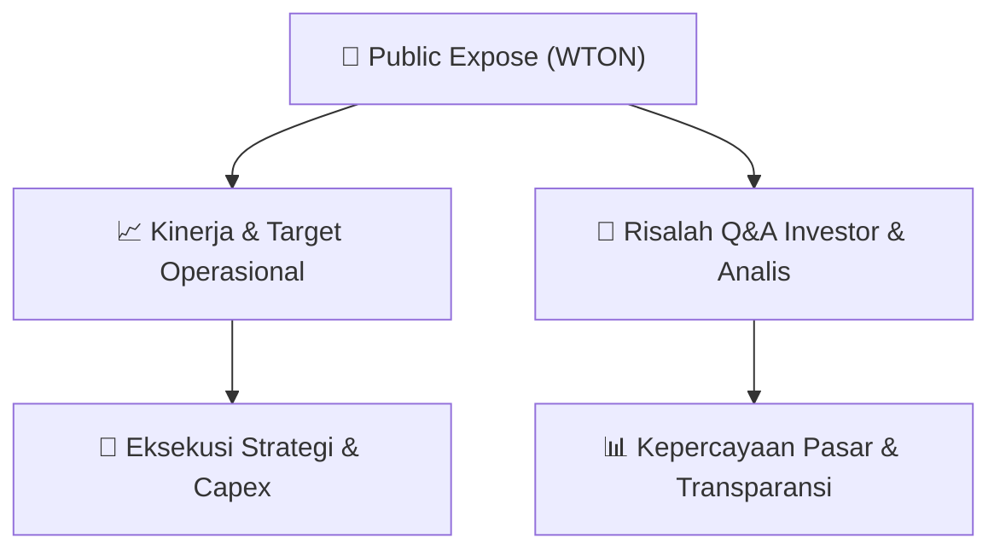

# 📢 Laporan Intelijen Paparan Publik (Public Expose) - [[WTON]]
🏢 **Emiten**: `[[WTON]]` | 📅 **Tanggal Pelaksanaan**: `2026-08-20` | 📑 **Dokumen**: `Public Expose`
⬅️ [[knowledge-base/daily-digests/Daily_Digest_20260820|Kembali ke Daily Digest]] | 🎛️ [[Dashboard|Ke Dashboard Utama]]

---

## 📌 1. Ringkasan Eksekutif & Paparan Direksi
> [!NOTE]
> Wijaya Karya Beton Tbk (WTON) menyampaikan pengumuman resmi rencana penyelenggaraan Public Expose Tahunan untuk tahun buku 2026. Acara akan dilaksanakan secara live melalui platform Public Expose Live 2026 di website pubexlive.idx.co.id pada tanggal 09 September 2026 pukul 15:00 WIB. Agenda utama adalah pemaparan kinerja perseroan untuk Kuartal II Tahun 2026. Pengumuman disampaikan oleh Sekretaris Perusahaan Ignatius Harry Sumartono pada 20 Agustus 2026. Dokumen tidak memuat rincian kinerja keuangan, target, atau proyeksi.

#### 🎯 Guidance Operasional & Target Strategis
- Dokumen hanya berisi pemberitahuan rencana Public Expose dan tidak memberikan guidance keuangan, target kinerja, rencana ekspansi, alokasi belanja modal, atau proyeksi operasional secara spesifik. Katalis potensial baru dapat diperoleh dari materi pemaparan kinerja Kuartal II 2026 yang akan disampaikan pada saat Public Expose 9 September 2026.

## 📊 2. Matriks Indikator Operasional & Parameter Kunci
| Parameter Utama | Nilai / Keterangan Resmi |
| :--- | :--- |
| **Nama Perusahaan** | `Wijaya Karya Beton Tbk` |
| **Kode Emiten** | `WTON` |
| **Jenis Acara** | `Public Expose Tahunan` |
| **Tahun Buku** | `2026` |
| **Tanggal Pelaksanaan** | `09 September 2026` |
| **Waktu Pelaksanaan** | `15:00 WIB` |
| **Tempat** | `Public Expose Live 2026 melalui website pubexlive.idx.co.id` |
| **Agenda** | `Pemaparan Kinerja Perseroan Kuartal II Tahun 2026` |
| **Nama Pengirim/Penanggung Jawab** | `Ignatius Harry Sumartono, Sekretaris Perusahaan` |
| **Tanggal Pengumuman** | `20 Agustus 2026 pukul 14:40 WIB` |
| **Alamat Perseroan** | `Tamansari Hive Office Lt. 3-5, Jl. D.I. Panjaitan Kav. 2, Jakarta Timur 13340` |
| **Kontak Perseroan** | `Telepon 0218192802, Fax 02185903872, www.wikabeton.co.id` |

---

## 💬 3. Risalah Tanya Jawab (Q&A Session)
`Materi presentasi Public Expose / Risalah Q&A terlampir dalam dokumen resmi bursa.`

## 📌 4. Peta Jalur Strategis & Roadmap

---

## 🔗 Knowledge Graph
- [[knowledge-base/daily-digests/Daily_Digest_20260820|📄 Daily Digest 2026-08-20]]
- [[knowledge-base/calendars/Action_Calendar|🗓️ Kalender Terpusat Aksi Korporasi]]
- [[Dashboard|🎛️ Kembali ke Dashboard Utama]]