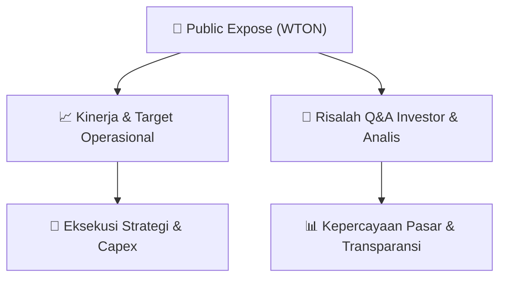

# 📢 Laporan Intelijen Paparan Publik (Public Expose) - [[WTON]]
🏢 **Emiten**: `[[WTON]]` | 📅 **Tanggal Pelaksanaan**: `2026-09-11` | 📑 **Dokumen**: `Public Expose`
⬅️ [[knowledge-base/daily-digests/Daily_Digest_20260911|Kembali ke Daily Digest]] | 🎛️ [[Dashboard|Ke Dashboard Utama]]

---

## 📌 1. Ringkasan Eksekutif & Paparan Direksi
> [!NOTE]
> PT Wijaya Karya Beton Tbk (WTON) menyelenggarakan Public Expose Tahunan pada tanggal 04 September 2026, dengan laporan hasil disampaikan pada 11 September 2026. Acara dihadiri oleh 110 peserta (tidak termasuk manajemen dan karyawan). Paparan ini merupakan agenda tahunan untuk memaparkan kinerja, strategi, dan rencana perseroan kepada investor dan analis. Dokumen yang diterima hanya berisi pengumuman administratif pelaksanaan public expose, tanpa detail materi presentasi atau transkrip tanya jawab yang disertakan dalam lampiran terpisah.

#### 🎯 Guidance Operasional & Target Strategis
- Dokumen yang tersedia tidak memuat rincian target kinerja, ekspansi, atau capex secara eksplisit. Namun, penyelenggaraan Public Expose Tahunan ini sendiri merupakan katalis informasi bagi investor untuk mendapatkan pembaruan terkini mengenai strategi dan prospek WTON. Informasi detail mengenai guidance operasional diperkirakan terdapat dalam lampiran 'Hasil Public Expose WTON 2026 Final.pdf' yang tidak disertakan dalam teks yang diberikan.

## 📊 2. Matriks Indikator Operasional & Parameter Kunci
| Parameter Utama | Nilai / Keterangan Resmi |
| :--- | :--- |
| **Tanggal Penyelenggaraan Public Expose** | `04 September 2026` |
| **Tanggal Pelaporan Hasil Public Expose** | `11 September 2026` |
| **Jumlah Peserta Hadir** | `110 orang` |
| **Jenis Paparan** | `Public Expose Tahunan` |
| **Sekretaris Perusahaan** | `Ignatius Harry Sumartono` |

---

## 💬 3. Risalah Tanya Jawab (Q&A Session)
### ❓ Pertanyaan 1 (Tidak tersedia dalam dokumen)
**Pertanyaan**: Tidak tersedia dalam dokumen. Teks yang diberikan hanya berisi pengumuman administratif dan tidak mencakup transkrip sesi tanya jawab.

**Jawaban Manajemen**: Tidak tersedia dalam dokumen. Jawaban manajemen diperkirakan terdapat dalam lampiran 'Hasil Public Expose WTON 2026 Final.pdf'.

> [!TIP]
> **Implikasi Bagi Investor**: Investor perlu merujuk pada lampiran resmi hasil public expose untuk mendapatkan informasi detail mengenai sesi tanya jawab dan panduan manajemen.

## 📌 4. Peta Jalur Strategis & Roadmap

---

## 🔗 Knowledge Graph
- [[knowledge-base/daily-digests/Daily_Digest_20260911|📄 Daily Digest 2026-09-11]]
- [[knowledge-base/calendars/Action_Calendar|🗓️ Kalender Terpusat Aksi Korporasi]]
- [[Dashboard|🎛️ Kembali ke Dashboard Utama]]