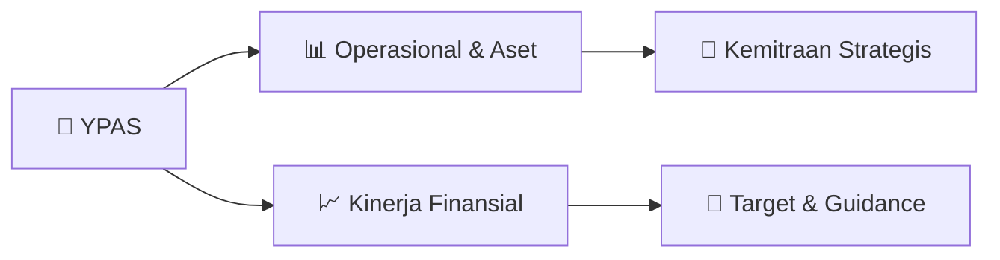

# 📊 Materi Public Expose: [YPAS]

🏢 **Emiten**: `YPAS` | 📅 **Tanggal Pelaksanaan**: `2026-08-26` | 📑 **Total Slide**: `3 Slide`
⬅️ [[knowledge-base/daily-digests/YPAS_20260826|Kembali ke Daily Digest]] | 🎛️ [[Dashboard/YPAS|Ke Dashboard Emiten]]

> [!NOTE]
> Ringkasan materi presentasi resmi Public Expose YPAS yang disampaikan oleh manajemen kepada investor dan bursa. Seluruh poin strategis, matriks operasional, dan angka kinerja diekstrak langsung dari slide deck resmi.

---

## 📅 1. Jadwal & Metadata Penyelenggaraan

| Parameter | Detail Informasi |
|---|---|
| **Nomor Surat Pengantar** | 03.E/CS/08-2026 |
| **Perihal Pengumuman** | Rencana Penyelenggaraan Public Expose Insidentil |
| **Waktu Pelaksanaan** | 28 Agustus 2026 10:00 |
| **Lokasi / Media** | Daring |
| **Lampiran Resmi** | `0` |

## 📋 2. Agenda Paparan Publik

1. Nama Perusahaan
2. Kode Emiten
3. Lampiran
4. Perihal
5. 03.E/CS/08-2026
6. Yanaprima Hastapersada Tbk
7. Rencana Penyelenggaraan Public Expose Insidentil
8. Go To English Page
9. Perseroan melaporkan rencana Public Expose Insidentil sebagai berikut:
10. Rencana Penyelenggaraan Public Expose
11. Latar Belakang Pelaksanaan
12. Sukarela
13. Permintaan Bursa
14. Permintaan Otoritas Jasa Keuangan ( OJK)
15. Referensi Surat
16. Peng-SPT-00148/BEI.WAS/08-2026
17. Tempat
18. : Daring
19. Link:   meet.google.com/xzh-nwgb-ufm
20. Hari/Tanggal
21. : 28 Agustus 2026
22. Waktu
23. 10:00
24. Agenda
25. : - Informasi terkait Perkembangan Kinerja dan Operasional Terkini
26. Perseroan
27. - Summary Laporan Keuangan Terakhir (Q2 - 30 Juni 2026)
28. - Rencana Usaha Perseroan
29. - Informasi Material Lainnya yang Belum Disampaikan kepada
30. Publik
31. Hormat Kami,
32. Demikian untuk diketahui.
33. Gedung Graha Irama Lt. 2E Jl. H.R. Rasuna Said Blok X-1 Kav.1-2 RT.006 RW.004
34. Direktur Keuangan
35. Nama Pengirim
36. Telepon : (021) 5261172, 5261173, Fax : -, www.yanaprima.com
37. Yanaprima Hastapersada Tbk
38. Rinawati
39. Yanaprima Hastapersada Tbk
40. Rinawati
41. Jabatan
42. Direktur Keuangan
43. Tanggal dan Waktu
44. 26-08-2026 13:55
45. Issuer Name
46. Issuer Code
47. Attachment
48. Subject
49. 03.E/CS/08-2026
50. Yanaprima Hastapersada Tbk
51. General Announcement Public Expose
52. Go To Indonesian Page
53. Company announces public expose plan Incidental as follows:
54. Public Expose Announcement
55. Background
56. Voluntary
57. Requested by IDX
58. Requested by OJK
59. Reference Letter
60. Peng-SPT-00148/BEI.WAS/08-2026
61. Place
62. : Daring
63. Link:   meet.google.com/xzh-nwgb-ufm
64. : 28 August 2026
65. 10:00
66. Agenda
67. : - Information regarding the Company's latest performance and
68. operational developments
69. - Summary of the latest financial statements (Q2 - June 30, 2026)
70. - The Company's business plan
71. - Other material information not yet disclosed to the public
72. Respectfully,
73. Thus to be informed accordingly.
74. Yanaprima Hastapersada Tbk
75. Rinawati
76. Direktur Keuangan
77. Rinawati
78. Sender Name
79. Yanaprima Hastapersada Tbk
80. Gedung Graha Irama Lt. 2E Jl. H.R. Rasuna Said Blok X-1 Kav.1-2 RT.006 RW.004
81. Phone : (021) 5261172, 5261173, Fax : -, www.yanaprima.com
82. Direktur Keuangan
83. Function
84. Date and Time
85. 26-08-2026 13:55
86. This is an official document of Yanaprima Hastapersada Tbk that does not require a signature as it was generated
87. electronically by the electronic reporting system. Yanaprima Hastapersada Tbk is fully responsible for the

## 🏢 3. Profil & Pilar Portofolio Bisnis

## 🏗️ 4. Kinerja Operasional & Portofolio Aset

*Detail aset operasional terlampir pada dokumen slide resmi.*

## 📈 5. Kinerja Keuangan & Posisi Finansial

## 🧭 6. Inisiatif Strategis, Kolaborasi, & Kemitraan

*Strategi usaha difokuskan pada penguatan fundamental dan ekspansi operasional.*

## 🎯 7. Target Pertumbuhan & Guidance Manajemen

*Target pertumbuhan ditetapkan mengacu pada prospek industri dan kondisi makroekonomi terkini.*

## 🗺️ 8. Peta Jalur Strategis & Eksekusi

## 📑 9. Daftar Indeks Slide Presentasi

| Slide # | Judul / Topik Slide | Ringkasan Konten |
|---|---|---|
| Slide 1 | **Nomor Surat** | Nama Perusahaan Kode Emiten Lampiran |
| Slide 2 | **Dokumen ini merupakan dokumen resmi Yanaprima Hastapersada Tbk yang tidak memerlukan tanda tangan karena** | dihasilkan secara elektronik oleh sistem pelaporan elektronik. Yanaprima Hastapersada Tbk bertanggung jawab penuh atas informasi yang tertera didalam  |
| Slide 3 | **Letter / Announcement No.** | Issuer Name Issuer Code Attachment |

---

*Dokumen diolah otomatis oleh **Swarm Intelijen Pasar Modal Indonesia** pada 2026-10-12 16:50 WIB.*