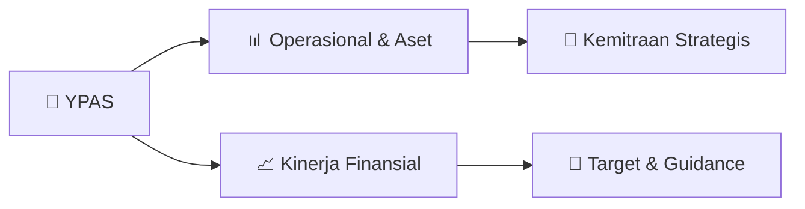

# 📊 Materi Public Expose: [YPAS]

🏢 **Emiten**: `YPAS` | 📅 **Tanggal Pelaksanaan**: `2026-08-27` | 📑 **Total Slide**: `17 Slide`
⬅️ [[knowledge-base/daily-digests/YPAS_20260827|Kembali ke Daily Digest]] | 🎛️ [[Dashboard/YPAS|Ke Dashboard Emiten]]

> [!NOTE]
> Ringkasan materi presentasi resmi Public Expose YPAS yang disampaikan oleh manajemen kepada investor dan bursa. Seluruh poin strategis, matriks operasional, dan angka kinerja diekstrak langsung dari slide deck resmi.

---

## 📅 1. Jadwal & Metadata Penyelenggaraan

| Parameter | Detail Informasi |
|---|---|
| **Nomor Surat Pengantar** | 04.E/CS/08-2026 |
| **Perihal Pengumuman** | Penyampaian Materi Public Expose Insidentil |
| **Waktu Pelaksanaan** | 2026-08-27 27-08-2026 16:33 |
| **Lokasi / Media** | Aplikasi Zoom / Daring |
| **Lampiran Resmi** | `1` |

## 📋 2. Agenda Paparan Publik

1. Kinerja Operasional
2. Kinerja Keuangan
3. Rencana & Strategi
4. Informasi Material

## 🏢 3. Profil & Pilar Portofolio Bisnis

## 🏗️ 4. Kinerja Operasional & Portofolio Aset

> ASET JUNI 2026
● ASET LANCAR  27,4% ●
ASET TIDAK LANCAR
 6,9% 50,000 100,000 150,000 200,000 250,000 Aset Lancar Aset Tidak Lancar Juni 2026 202,004 97,225 Des 2025 158,545 104,478
Dalam jutaan Rupiah

## 📈 5. Kinerja Keuangan & Posisi Finansial

## 🧭 6. Inisiatif Strategis, Kolaborasi, & Kemitraan

*Strategi usaha difokuskan pada penguatan fundamental dan ekspansi operasional.*

## 🎯 7. Target Pertumbuhan & Guidance Manajemen

*Target pertumbuhan ditetapkan mengacu pada prospek industri dan kondisi makroekonomi terkini.*

## 🗺️ 8. Peta Jalur Strategis & Eksekusi

## 📑 9. Daftar Indeks Slide Presentasi

| Slide # | Judul / Topik Slide | Ringkasan Konten |
|---|---|---|
| Slide 1 | **PUBLIC EXPOSE INSIDENTIL** | PT. YANAPRIMA HASTAPERSADA Tbk Sidoarjo, 28 Agustus 2026 |
| Slide 2 | **AGENDA** | 01 04 02 |
| Slide 3 | **KINERJA** | OPERASIONAL JUNI 2026 01 |
| Slide 4 | **PRODUKTIVITAS** | TARGET REALISASI PENCAPAIAN |
| Slide 5 | **PENCAPAIAN** | PENDAPATAN JUNI 2026 380 MILYAR 196 MILYAR |
| Slide 6 | **SEGMEN PENJUALAN** | 0 20,000 40,000 |
| Slide 7 | **PROFITABILITAS** | 283% TARGET          : Rp. 5,5 MILYAR REALISASI      : Rp. 15,5 MILYAR |
| Slide 8 | **KINERJA** | KEUANGAN JUNI 2026 02 |
| Slide 9 | **ASET JUNI 2026** | ● ASET LANCAR  27,4% |
| Slide 10 | **LIABILITAS  JUNI 2026** | LIABILITAS JK PENDEK  25,9% |
| Slide 11 | **PERTUMBUHAN LABA  JUNI 2026** | LABA TAHUN BERJALAN 530 % LABA BRUTO |
| Slide 12 | **KONDISI &** | STRATEGI 2026 03 |
| Slide 13 | **KONDISI SAAT INI** | BAHAN BAKU - Semester 1 2026 terjadi kenaikan harga minyak dunia |
| Slide 14 | **STRATEGI PERSEROAN** | 4 3 2 |
| Slide 15 | **INFORMASI** | MATERIAL 04 |
| Slide 16 | **INFORMASI YANG BELUM** | DISAMPAIKAN KE PUBLIK Sampai dengan saat ini belum ada rencana aksi korporasi yang akan dilakukan |
| Slide 17 | **CREDITS: This presentation template was created by Slidesgo, and includes icons by** | Flaticon, and infographics & images by Freepik Thanks! |

---

*Dokumen diolah otomatis oleh **Swarm Intelijen Pasar Modal Indonesia** pada 2026-10-12 16:50 WIB.*