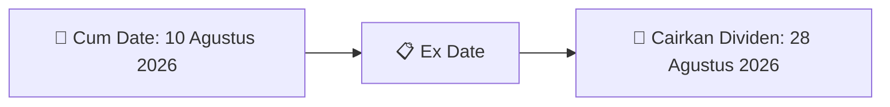
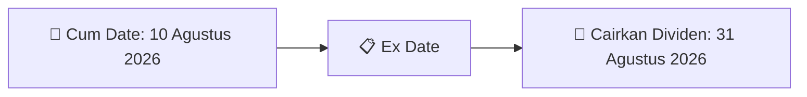
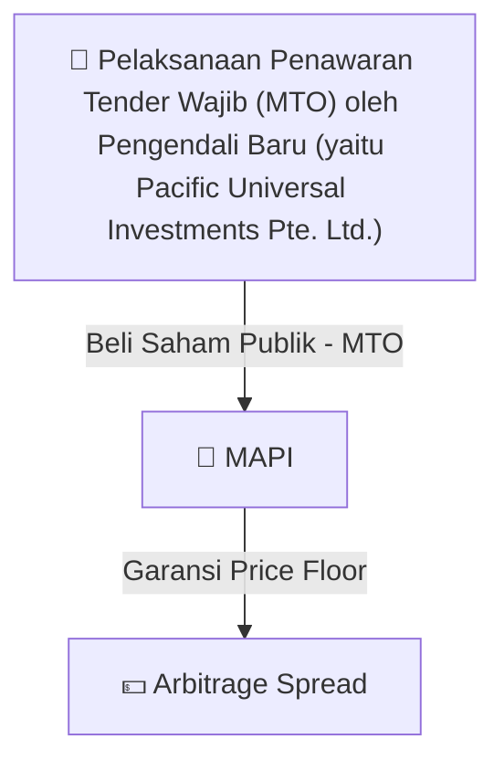
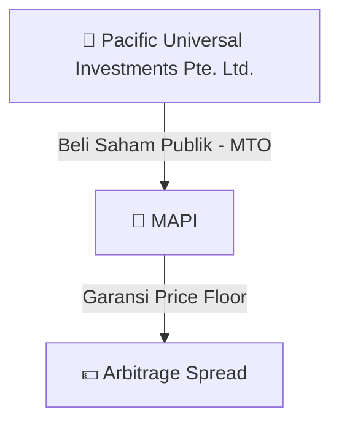

# 🎯 Sinyal Cuan & Katalis Trading Harian (Alpha Signal Radar) - 2026-08-05

⬅️ [[Daily_Digest_20260731]] | 📅 **2026-08-05** | ➡️ [[Daily_Digest_20260804]]

> [!TIP]
> Laporan ini dihasilkan secara otomatis oleh **AI Swarm Intelligence** untuk mendeteksi peluang capital gain, dividen tinggi, dan arbitrase aksi korporasi di Bursa Efek Indonesia (BEI).

---

## 💰 1. Sinyal Berburu Dividen Tinggi (High Dividend Capture Play)
### 💸 [[MARK]] - Potensi Dividend Yield High-Conviction
- **Nominal Dividen**: `Rp20 per saham`
- **Total Nilai Pembayaran**: `Rp76.00 Miliar`
- **📅 Cum Date (Batas Beli)**: `13 Agustus 2026`
- **💸 Tanggal Pembayaran**: `04 September 2026`
- 📈 **Strategi Aksi**: *Accumulate on Dips*. Lakukan akumulasi sebelum Cum Date (13 Agustus 2026) untuk mengunci hak dividen tunai.


### 💸 [[IKBI]] - Potensi Dividend Yield High-Conviction
- **Nominal Dividen**: `Rp 44,31/saham`
- **Total Nilai Pembayaran**: `Rp 54.235.440.000`
- **📅 Cum Date (Batas Beli)**: `10 Agustus 2026`
- **💸 Tanggal Pembayaran**: `28 Agustus 2026`
- 📈 **Strategi Aksi**: *Accumulate on Dips*. Lakukan akumulasi sebelum Cum Date (10 Agustus 2026) untuk mengunci hak dividen tunai.



### 💸 [[TAPG]] - Potensi Dividend Yield High-Conviction
- **Nominal Dividen**: `Rp60 per saham`
- **Total Nilai Pembayaran**: `Rp1.19 Triliun`
- **📅 Cum Date (Batas Beli)**: `10 Agustus 2026`
- **💸 Tanggal Pembayaran**: `31 Agustus 2026`
- 📈 **Strategi Aksi**: *Accumulate on Dips*. Lakukan akumulasi sebelum Cum Date (10 Agustus 2026) untuk mengunci hak dividen tunai.



### 💸 [[AMAR]] - Potensi Dividend Yield High-Conviction
- **Nominal Dividen**: `Rp3,9 per saham`
- **Total Nilai Pembayaran**: `Rp70.25 Miliar`
- **📅 Cum Date (Batas Beli)**: `10 Agustus 2026`
- **💸 Tanggal Pembayaran**: `28 Agustus 2026`
- 📈 **Strategi Aksi**: *Accumulate on Dips*. Lakukan akumulasi sebelum Cum Date (10 Agustus 2026) untuk mengunci hak dividen tunai.


---

## 🎯 2. Peluang Arbitrase Aksi Korporasi & Tender Offer (MTO)
### 🏢 [[MAPI]] - Mandatory Tender Offer oleh [[Pelaksanaan Penawaran Tender Wajib (MTO) oleh Pengendali Baru (yaitu Pacific Universal Investments Pte. Ltd.)]]
- **Pengendali Baru**: `[[Pelaksanaan Penawaran Tender Wajib (MTO) oleh Pengendali Baru (yaitu Pacific Universal Investments Pte. Ltd.)]]`
- **Detail Aksi**: Jumlah saham dibeli dalam MTO & Komposisi Kepemilikan Saham Publik (Free Float) sebelum & sesudah MTO
- 💡 **Strategi Arbitrase**: Pantau rilis harga penawaran Tender Wajib resmi. Jika harga penawaran MTO lebih tinggi dari harga pasar, terdapat peluang **Risk-Free Arbitrage Spread**!



### 🏢 [[MAPI]] - Mandatory Tender Offer oleh [[Pacific Universal Investments Pte. Ltd.]]
- **Pengendali Baru**: `[[Pacific Universal Investments Pte. Ltd.]]`
- **Detail Aksi**: Jumlah saham dibeli dalam MTO dan Komposisi Kepemilikan Saham Publik (Free Float) sebelum dan sesudah MTO
- 💡 **Strategi Arbitrase**: Pantau rilis harga penawaran Tender Wajib resmi. Jika harga penawaran MTO lebih tinggi dari harga pasar, terdapat peluang **Risk-Free Arbitrage Spread**!



---

## 🚀 3. Sinyal Keuntungan Laba Melonjak (Earnings Surge Catalyst)
### 🏭 [[DMAS]] - Pendapatan Usaha Melonjak +194% YoY
- **Capaian Kinerja**: Pendapatan usaha H1 2026 tumbuh pesat **+194% YoY menjadi Rp 1,80 Triliun** (vs Rp 612 Miliar di H1 2025).
- 📊 **Katalis Pasar**: Lonjakan pendapatan 194% didorong oleh penjualan lahan industri di Kota Deltamas.
- 💵 **Potensi Cuan**: DMAS memiliki histori *Dividend Payout Ratio* mendekati 100%. Lonjakan laba ini berpotensi menghasilkan **Dividen Final Super Jumbo** di akhir tahun!

---

## 📜 4. Peluang Aksi Korporasi Rights Issue (PMHMETD II)
### 🏨 [[BUVA]] - Target Raup Rp 1,54 Triliun untuk Ekspansi Uluwatu & Bintan
- **Target Dana**: `Rp 1,54 Triliun` (Menerbitkan 6,15 Miliar Saham Baru / 20% Dilusi)
- **Harga Pelaksanaan & Rasio**: `Rp 250 per lembar` | Rasio HMETD `4 Saham Lama : 1 HMETD`
- 👥 **Pembeli Siaga (Standby Buyers)**: PT Henan Putihrai Sekuritas (Rp 100M), PT Tata Tirta Datun (Rp 350M), Bapak Hapsoro (Rp 100M), Bapak Ferry Sudjono (Rp 388,57M).
- 🎯 **Penggunaan Dana Utama**: (1) Rp 420,49M Ekspansi Uluwatu & Akuisisi Royal Uluwatu Residence, (2) Rp 417,80M Pelunasan Utang Pembiayaan, (3) Rp 546,19M Infrastruktur & Renovasi Alila Ubud, (4) Rp 150M Wisata Lagoi Bintan.
- 📅 **Jadwal HMETD**: Cum HMETD 24 Sep 2026 | Perdagangan & Pelaksanaan HMETD: 1 – 14 Okt 2026.

```mermaid
graph TD
    BUVA["🏬 BUVA (Rights Issue II)"] -->|Rasio 4:1 @ Rp 250| HMETD[📋 6,15 Miliar HMETD"]
    HMETD -->|Rp 1,54 Triliun| Dana["💵 Kas Hasil HMETD"]
    Dana -->|27.3%| Uluwatu["🏝️ Uluwatu Estate"]
    Dana -->|27.1%| Utang["🏦 Pelunasan Utang"]
    Dana -->|35.5%| Alila["🏨 Renovasi Alila Ubud"]
    Dana -->|9.7%| Bintan["🏖️ Wisata Lagoi Bintan"]
```

---

## 🐋 4. Sinyal Akumulasi Pihak Dalam (Insider Buy Tracker)
- **[[CSIS]]**: Laporan perubahan kepemilikan saham insider CSIS.
- **[[DOOH]]**: Laporan perubahan kepemilikan saham insider DOOH.
- **[[DOOH]]**: Laporan perubahan kepemilikan saham insider DOOH.
- **[[MBSS]]**: Laporan perubahan kepemilikan saham insider MBSS.

---

## 📊 5. Matriks Rekomendasi Aksi Investor
| Emiten | Jenis Katalis | Rating Sinyal | Target Aksi | Est. Potential Return |
| :--- | :--- | :---: | :--- | :---: |
| **[[TAPG]]** | Dividen Tunai (Rp 60/sh) | 🔥 **STRONG BUY** | Akumulasi sebelum 11 Agt 2026 | **~8.5% Cash Yield** |
| **[[AMAR]]** | Dividen Interim (Rp 3.9/sh) | 🟢 **BUY** | Akumulasi sebelum 11 Agt 2026 | **~2.5% Cash Yield** |
| **[[MAPI]]** | Mandatory Tender Offer | 🎯 **WATCHLIST** | Pantau Pengumuman Harga MTO | **Arbitrage Spread** |
| **[[DMAS]]** | Laba Melonjak +194% YoY | 🔥 **STRONG BUY** | Hold / Buy on Breakout | **High Final Dividend** |