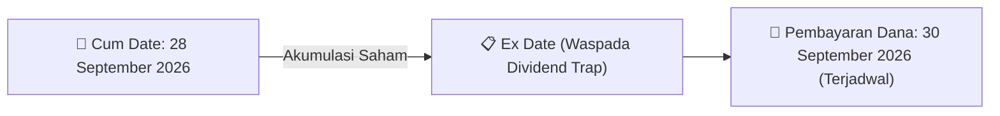
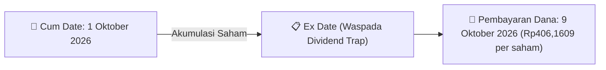
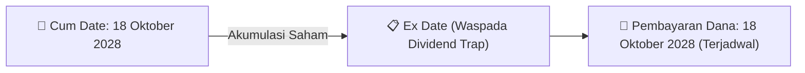
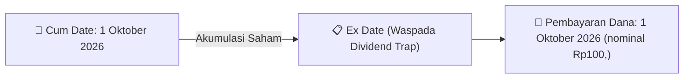
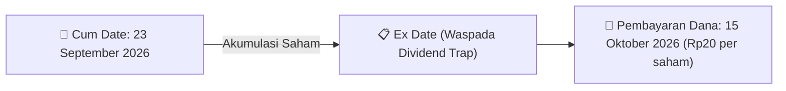
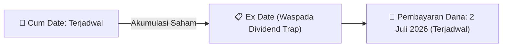
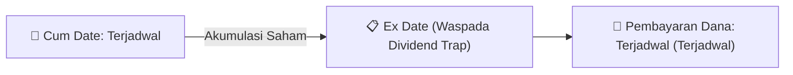
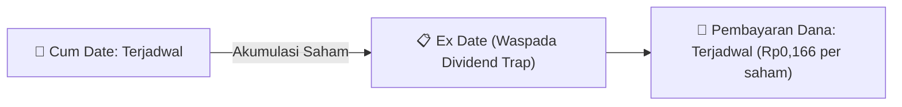
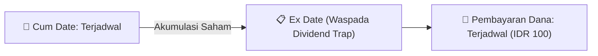

# 🎯 Sinyal Cuan & Katalis Trading Harian (Alpha Signal Radar) - 2026-09-22

⬅️ [[knowledge-base/daily-digests/Daily_Digest_20260922|Kembali ke Daily Digest]] | 📅 **2026-09-22** | 🎛️ [[Dashboard|Ke Dashboard Utama]]

> [!TIP]
> Laporan ini dihasilkan secara otomatis oleh **AI Swarm Intelligence** untuk mendeteksi peluang capital gain, dividend yield capture, arbitrase aksi korporasi, dan sinyal akumulasi insider di Bursa Efek Indonesia (BEI).

---

## 💸 1. Sinyal Berburu Dividen Tinggi (High Dividend Capture Play)
### 💰 [[VICO]] - Potensi Dividend Yield High-Conviction
- **Nominal Dividen**: `Terjadwal`
- **Total Nilai Pembayaran**: `Dalam Rincian LK`
- **📅 Cum Date (Batas Beli)**: **28 September 2026**
- **💸 Tanggal Pembayaran**: `30 September 2026`
- 📈 **Strategi Aksi**: *Accumulate on Dips*. Lakukan akumulasi sebelum **Cum Date (28 September 2026)** untuk mengunci hak dividen tunai.



### 💰 [[BSSR]] - Potensi Dividend Yield High-Conviction
- **Nominal Dividen**: `Rp406,1609 per saham`
- **Total Nilai Pembayaran**: `Rp60.000.000`
- **📅 Cum Date (Batas Beli)**: **1 Oktober 2026**
- **💸 Tanggal Pembayaran**: `9 Oktober 2026`
- 📈 **Strategi Aksi**: *Accumulate on Dips*. Lakukan akumulasi sebelum **Cum Date (1 Oktober 2026)** untuk mengunci hak dividen tunai.



### 💰 [[AIMS]] - Potensi Dividend Yield High-Conviction
- **Nominal Dividen**: `Terjadwal`
- **Total Nilai Pembayaran**: `Dalam Rincian LK`
- **📅 Cum Date (Batas Beli)**: **18 Oktober 2028**
- **💸 Tanggal Pembayaran**: `18 Oktober 2028`
- 📈 **Strategi Aksi**: *Accumulate on Dips*. Lakukan akumulasi sebelum **Cum Date (18 Oktober 2028)** untuk mengunci hak dividen tunai.



### 💰 [[BAJA]] - Potensi Dividend Yield High-Conviction
- **Nominal Dividen**: `nominal Rp100,`
- **Total Nilai Pembayaran**: `Dalam Rincian LK`
- **📅 Cum Date (Batas Beli)**: **1 Oktober 2026**
- **💸 Tanggal Pembayaran**: `1 Oktober 2026`
- 📈 **Strategi Aksi**: *Accumulate on Dips*. Lakukan akumulasi sebelum **Cum Date (1 Oktober 2026)** untuk mengunci hak dividen tunai.



### 💰 [[IFII]] - Potensi Dividend Yield High-Conviction
- **Nominal Dividen**: `Rp5 per saham`
- **Total Nilai Pembayaran**: `Rp47.06 Miliar`
- **📅 Cum Date (Batas Beli)**: **29 September 2026**
- **💸 Tanggal Pembayaran**: `30 September 2026`
- 📈 **Strategi Aksi**: *Accumulate on Dips*. Lakukan akumulasi sebelum **Cum Date (29 September 2026)** untuk mengunci hak dividen tunai.


### 💰 [[HEXA]] - Potensi Dividend Yield High-Conviction
- **Nominal Dividen**: `Rp0,013319 per saham`
- **Total Nilai Pembayaran**: `Rp11.187.960`
- **📅 Cum Date (Batas Beli)**: **28 September 2026**
- **💸 Tanggal Pembayaran**: `31 Maret 2026`
- 📈 **Strategi Aksi**: *Accumulate on Dips*. Lakukan akumulasi sebelum **Cum Date (28 September 2026)** untuk mengunci hak dividen tunai.


### 💰 [[KKGI]] - Potensi Dividend Yield High-Conviction
- **Nominal Dividen**: `Rp20 per saham`
- **Total Nilai Pembayaran**: `Rp97.47 Miliar`
- **📅 Cum Date (Batas Beli)**: **23 September 2026**
- **💸 Tanggal Pembayaran**: `15 Oktober 2026`
- 📈 **Strategi Aksi**: *Accumulate on Dips*. Lakukan akumulasi sebelum **Cum Date (23 September 2026)** untuk mengunci hak dividen tunai.



### 💰 [[SCNP]] - Potensi Dividend Yield High-Conviction
- **Nominal Dividen**: `Terjadwal`
- **Total Nilai Pembayaran**: `Dalam Rincian LK`
- **📅 Cum Date (Batas Beli)**: **Terjadwal**
- **💸 Tanggal Pembayaran**: `2 Juli 2026`
- 📈 **Strategi Aksi**: *Accumulate on Dips*. Lakukan akumulasi sebelum **Cum Date (Terjadwal)** untuk mengunci hak dividen tunai.



### 💰 [[PSAB]] - Potensi Dividend Yield High-Conviction
- **Nominal Dividen**: `Terjadwal`
- **Total Nilai Pembayaran**: `Pelepasan salah satu anak perusahaan, pembayaran hutang, pembagian dividen tunai, dan penyesuaian nilai aset tidak lancar`
- **📅 Cum Date (Batas Beli)**: **Terjadwal**
- **💸 Tanggal Pembayaran**: `Terjadwal`
- 📈 **Strategi Aksi**: *Accumulate on Dips*. Lakukan akumulasi sebelum **Cum Date (Terjadwal)** untuk mengunci hak dividen tunai.



### 💰 [[HUMI]] - Potensi Dividend Yield High-Conviction
- **Nominal Dividen**: `Rp0,166 per saham`
- **Total Nilai Pembayaran**: `Rp3.00 Miliar`
- **📅 Cum Date (Batas Beli)**: **Terjadwal**
- **💸 Tanggal Pembayaran**: `Terjadwal`
- 📈 **Strategi Aksi**: *Accumulate on Dips*. Lakukan akumulasi sebelum **Cum Date (Terjadwal)** untuk mengunci hak dividen tunai.



### 💰 [[BHIT]] - Potensi Dividend Yield High-Conviction
- **Nominal Dividen**: `Terjadwal`
- **Total Nilai Pembayaran**: `Dalam Rincian LK`
- **📅 Cum Date (Batas Beli)**: **Terjadwal**
- **💸 Tanggal Pembayaran**: `Terjadwal`
- 📈 **Strategi Aksi**: *Accumulate on Dips*. Lakukan akumulasi sebelum **Cum Date (Terjadwal)** untuk mengunci hak dividen tunai.


### 💰 [[BCAP]] - Potensi Dividend Yield High-Conviction
- **Nominal Dividen**: `Terjadwal`
- **Total Nilai Pembayaran**: `Dalam Rincian LK`
- **📅 Cum Date (Batas Beli)**: **Terjadwal**
- **💸 Tanggal Pembayaran**: `Terjadwal`
- 📈 **Strategi Aksi**: *Accumulate on Dips*. Lakukan akumulasi sebelum **Cum Date (Terjadwal)** untuk mengunci hak dividen tunai.


### 💰 [[INPP]] - Potensi Dividend Yield High-Conviction
- **Nominal Dividen**: `IDR 4,5`
- **Total Nilai Pembayaran**: `IDR 50.318.872.794`
- **📅 Cum Date (Batas Beli)**: **Terjadwal**
- **💸 Tanggal Pembayaran**: `Terjadwal`
- 📈 **Strategi Aksi**: *Accumulate on Dips*. Lakukan akumulasi sebelum **Cum Date (Terjadwal)** untuk mengunci hak dividen tunai.


### 💰 [[PANI]] - Potensi Dividend Yield High-Conviction
- **Nominal Dividen**: `Terjadwal`
- **Total Nilai Pembayaran**: `Dalam Rincian LK`
- **📅 Cum Date (Batas Beli)**: **Terjadwal**
- **💸 Tanggal Pembayaran**: `Terjadwal`
- 📈 **Strategi Aksi**: *Accumulate on Dips*. Lakukan akumulasi sebelum **Cum Date (Terjadwal)** untuk mengunci hak dividen tunai.


### 💰 [[PGEO]] - Potensi Dividend Yield High-Conviction
- **Nominal Dividen**: `Terjadwal`
- **Total Nilai Pembayaran**: `Dalam Rincian LK`
- **📅 Cum Date (Batas Beli)**: **Terjadwal**
- **💸 Tanggal Pembayaran**: `Terjadwal`
- 📈 **Strategi Aksi**: *Accumulate on Dips*. Lakukan akumulasi sebelum **Cum Date (Terjadwal)** untuk mengunci hak dividen tunai.


### 💰 [[INET]] - Potensi Dividend Yield High-Conviction
- **Nominal Dividen**: `Terjadwal`
- **Total Nilai Pembayaran**: `Dalam Rincian LK`
- **📅 Cum Date (Batas Beli)**: **Terjadwal**
- **💸 Tanggal Pembayaran**: `Terjadwal`
- 📈 **Strategi Aksi**: *Accumulate on Dips*. Lakukan akumulasi sebelum **Cum Date (Terjadwal)** untuk mengunci hak dividen tunai.


### 💰 [[BPII]] - Potensi Dividend Yield High-Conviction
- **Nominal Dividen**: `3,54 IDR`
- **Total Nilai Pembayaran**: `Dalam Rincian LK`
- **📅 Cum Date (Batas Beli)**: **Terjadwal**
- **💸 Tanggal Pembayaran**: `Terjadwal`
- 📈 **Strategi Aksi**: *Accumulate on Dips*. Lakukan akumulasi sebelum **Cum Date (Terjadwal)** untuk mengunci hak dividen tunai.


### 💰 [[TAPG]] - Potensi Dividend Yield High-Conviction
- **Nominal Dividen**: `Terjadwal`
- **Total Nilai Pembayaran**: `Dalam Rincian LK`
- **📅 Cum Date (Batas Beli)**: **Terjadwal**
- **💸 Tanggal Pembayaran**: `Terjadwal`
- 📈 **Strategi Aksi**: *Accumulate on Dips*. Lakukan akumulasi sebelum **Cum Date (Terjadwal)** untuk mengunci hak dividen tunai.


### 💰 [[TRIS]] - Potensi Dividend Yield High-Conviction
- **Nominal Dividen**: `Terjadwal`
- **Total Nilai Pembayaran**: `Dalam Rincian LK`
- **📅 Cum Date (Batas Beli)**: **Terjadwal**
- **💸 Tanggal Pembayaran**: `Terjadwal`
- 📈 **Strategi Aksi**: *Accumulate on Dips*. Lakukan akumulasi sebelum **Cum Date (Terjadwal)** untuk mengunci hak dividen tunai.


### 💰 [[CMRY]] - Potensi Dividend Yield High-Conviction
- **Nominal Dividen**: `IDR 100`
- **Total Nilai Pembayaran**: `IDR 793.468.300.000`
- **📅 Cum Date (Batas Beli)**: **Terjadwal**
- **💸 Tanggal Pembayaran**: `Terjadwal`
- 📈 **Strategi Aksi**: *Accumulate on Dips*. Lakukan akumulasi sebelum **Cum Date (Terjadwal)** untuk mengunci hak dividen tunai.



### 💰 [[SMSM]] - Potensi Dividend Yield High-Conviction
- **Nominal Dividen**: `Terjadwal`
- **Total Nilai Pembayaran**: `Dalam Rincian LK`
- **📅 Cum Date (Batas Beli)**: **Terjadwal**
- **💸 Tanggal Pembayaran**: `Terjadwal`
- 📈 **Strategi Aksi**: *Accumulate on Dips*. Lakukan akumulasi sebelum **Cum Date (Terjadwal)** untuk mengunci hak dividen tunai.

```mermaid
graph LR
    A["📅 Cum Date: Terjadwal"] -->|Akumulasi Saham| B["📋 Ex Date (Waspada Dividend Trap)"]
    B --> C["💸 Pembayaran Dana: Terjadwal (Terjadwal)"]
```

### 💰 [[CHIP]] - Potensi Dividend Yield High-Conviction
- **Nominal Dividen**: `Terjadwal`
- **Total Nilai Pembayaran**: `Dalam Rincian LK`
- **📅 Cum Date (Batas Beli)**: **Terjadwal**
- **💸 Tanggal Pembayaran**: `Terjadwal`
- 📈 **Strategi Aksi**: *Accumulate on Dips*. Lakukan akumulasi sebelum **Cum Date (Terjadwal)** untuk mengunci hak dividen tunai.

```mermaid
graph LR
    A["📅 Cum Date: Terjadwal"] -->|Akumulasi Saham| B["📋 Ex Date (Waspada Dividend Trap)"]
    B --> C["💸 Pembayaran Dana: Terjadwal (Terjadwal)"]
```

### 💰 [[CRAB]] - Potensi Dividend Yield High-Conviction
- **Nominal Dividen**: `Terjadwal`
- **Total Nilai Pembayaran**: `Dalam Rincian LK`
- **📅 Cum Date (Batas Beli)**: **Terjadwal**
- **💸 Tanggal Pembayaran**: `Terjadwal`
- 📈 **Strategi Aksi**: *Accumulate on Dips*. Lakukan akumulasi sebelum **Cum Date (Terjadwal)** untuk mengunci hak dividen tunai.

```mermaid
graph LR
    A["📅 Cum Date: Terjadwal"] -->|Akumulasi Saham| B["📋 Ex Date (Waspada Dividend Trap)"]
    B --> C["💸 Pembayaran Dana: Terjadwal (Terjadwal)"]
```

### 💰 [[DOOH]] - Potensi Dividend Yield High-Conviction
- **Nominal Dividen**: `Terjadwal`
- **Total Nilai Pembayaran**: `Dalam Rincian LK`
- **📅 Cum Date (Batas Beli)**: **Terjadwal**
- **💸 Tanggal Pembayaran**: `Terjadwal`
- 📈 **Strategi Aksi**: *Accumulate on Dips*. Lakukan akumulasi sebelum **Cum Date (Terjadwal)** untuk mengunci hak dividen tunai.

```mermaid
graph LR
    A["📅 Cum Date: Terjadwal"] -->|Akumulasi Saham| B["📋 Ex Date (Waspada Dividend Trap)"]
    B --> C["💸 Pembayaran Dana: Terjadwal (Terjadwal)"]
```

### 💰 [[DEWI]] - Potensi Dividend Yield High-Conviction
- **Nominal Dividen**: `Terjadwal`
- **Total Nilai Pembayaran**: `Dalam Rincian LK`
- **📅 Cum Date (Batas Beli)**: **Terjadwal**
- **💸 Tanggal Pembayaran**: `Terjadwal`
- 📈 **Strategi Aksi**: *Accumulate on Dips*. Lakukan akumulasi sebelum **Cum Date (Terjadwal)** untuk mengunci hak dividen tunai.

```mermaid
graph LR
    A["📅 Cum Date: Terjadwal"] -->|Akumulasi Saham| B["📋 Ex Date (Waspada Dividend Trap)"]
    B --> C["💸 Pembayaran Dana: Terjadwal (Terjadwal)"]
```

### 💰 [[BWPT]] - Potensi Dividend Yield High-Conviction
- **Nominal Dividen**: `Terjadwal`
- **Total Nilai Pembayaran**: `Dalam Rincian LK`
- **📅 Cum Date (Batas Beli)**: **Terjadwal**
- **💸 Tanggal Pembayaran**: `Terjadwal`
- 📈 **Strategi Aksi**: *Accumulate on Dips*. Lakukan akumulasi sebelum **Cum Date (Terjadwal)** untuk mengunci hak dividen tunai.

```mermaid
graph LR
    A["📅 Cum Date: Terjadwal"] -->|Akumulasi Saham| B["📋 Ex Date (Waspada Dividend Trap)"]
    B --> C["💸 Pembayaran Dana: Terjadwal (Terjadwal)"]
```

### 💰 [[OBMD]] - Potensi Dividend Yield High-Conviction
- **Nominal Dividen**: `Terjadwal`
- **Total Nilai Pembayaran**: `Dalam Rincian LK`
- **📅 Cum Date (Batas Beli)**: **Terjadwal**
- **💸 Tanggal Pembayaran**: `Terjadwal`
- 📈 **Strategi Aksi**: *Accumulate on Dips*. Lakukan akumulasi sebelum **Cum Date (Terjadwal)** untuk mengunci hak dividen tunai.

```mermaid
graph LR
    A["📅 Cum Date: Terjadwal"] -->|Akumulasi Saham| B["📋 Ex Date (Waspada Dividend Trap)"]
    B --> C["💸 Pembayaran Dana: Terjadwal (Terjadwal)"]
```

### 💰 [[UNTD]] - Potensi Dividend Yield High-Conviction
- **Nominal Dividen**: `Terjadwal`
- **Total Nilai Pembayaran**: `Dalam Rincian LK`
- **📅 Cum Date (Batas Beli)**: **Terjadwal**
- **💸 Tanggal Pembayaran**: `Terjadwal`
- 📈 **Strategi Aksi**: *Accumulate on Dips*. Lakukan akumulasi sebelum **Cum Date (Terjadwal)** untuk mengunci hak dividen tunai.

```mermaid
graph LR
    A["📅 Cum Date: Terjadwal"] -->|Akumulasi Saham| B["📋 Ex Date (Waspada Dividend Trap)"]
    B --> C["💸 Pembayaran Dana: Terjadwal (Terjadwal)"]
```

### 💰 [[AKKU]] - Potensi Dividend Yield High-Conviction
- **Nominal Dividen**: `Terjadwal`
- **Total Nilai Pembayaran**: `Dalam Rincian LK`
- **📅 Cum Date (Batas Beli)**: **Terjadwal**
- **💸 Tanggal Pembayaran**: `Terjadwal`
- 📈 **Strategi Aksi**: *Accumulate on Dips*. Lakukan akumulasi sebelum **Cum Date (Terjadwal)** untuk mengunci hak dividen tunai.

```mermaid
graph LR
    A["📅 Cum Date: Terjadwal"] -->|Akumulasi Saham| B["📋 Ex Date (Waspada Dividend Trap)"]
    B --> C["💸 Pembayaran Dana: Terjadwal (Terjadwal)"]
```

### 💰 [[CBUT]] - Potensi Dividend Yield High-Conviction
- **Nominal Dividen**: `Terjadwal`
- **Total Nilai Pembayaran**: `Dalam Rincian LK`
- **📅 Cum Date (Batas Beli)**: **Terjadwal**
- **💸 Tanggal Pembayaran**: `Terjadwal`
- 📈 **Strategi Aksi**: *Accumulate on Dips*. Lakukan akumulasi sebelum **Cum Date (Terjadwal)** untuk mengunci hak dividen tunai.

```mermaid
graph LR
    A["📅 Cum Date: Terjadwal"] -->|Akumulasi Saham| B["📋 Ex Date (Waspada Dividend Trap)"]
    B --> C["💸 Pembayaran Dana: Terjadwal (Terjadwal)"]
```

### 💰 [[MAPI]] - Potensi Dividend Yield High-Conviction
- **Nominal Dividen**: `Terjadwal`
- **Total Nilai Pembayaran**: `Dalam Rincian LK`
- **📅 Cum Date (Batas Beli)**: **Terjadwal**
- **💸 Tanggal Pembayaran**: `Terjadwal`
- 📈 **Strategi Aksi**: *Accumulate on Dips*. Lakukan akumulasi sebelum **Cum Date (Terjadwal)** untuk mengunci hak dividen tunai.

```mermaid
graph LR
    A["📅 Cum Date: Terjadwal"] -->|Akumulasi Saham| B["📋 Ex Date (Waspada Dividend Trap)"]
    B --> C["💸 Pembayaran Dana: Terjadwal (Terjadwal)"]
```

### 💰 [[SUNI]] - Potensi Dividend Yield High-Conviction
- **Nominal Dividen**: `Terjadwal`
- **Total Nilai Pembayaran**: `Dalam Rincian LK`
- **📅 Cum Date (Batas Beli)**: **Terjadwal**
- **💸 Tanggal Pembayaran**: `Terjadwal`
- 📈 **Strategi Aksi**: *Accumulate on Dips*. Lakukan akumulasi sebelum **Cum Date (Terjadwal)** untuk mengunci hak dividen tunai.

```mermaid
graph LR
    A["📅 Cum Date: Terjadwal"] -->|Akumulasi Saham| B["📋 Ex Date (Waspada Dividend Trap)"]
    B --> C["💸 Pembayaran Dana: Terjadwal (Terjadwal)"]
```

### 💰 [[TAXI]] - Potensi Dividend Yield High-Conviction
- **Nominal Dividen**: `Terjadwal`
- **Total Nilai Pembayaran**: `Dalam Rincian LK`
- **📅 Cum Date (Batas Beli)**: **Terjadwal**
- **💸 Tanggal Pembayaran**: `Terjadwal`
- 📈 **Strategi Aksi**: *Accumulate on Dips*. Lakukan akumulasi sebelum **Cum Date (Terjadwal)** untuk mengunci hak dividen tunai.

```mermaid
graph LR
    A["📅 Cum Date: Terjadwal"] -->|Akumulasi Saham| B["📋 Ex Date (Waspada Dividend Trap)"]
    B --> C["💸 Pembayaran Dana: Terjadwal (Terjadwal)"]
```

### 💰 [[GRIA]] - Potensi Dividend Yield High-Conviction
- **Nominal Dividen**: `Terjadwal`
- **Total Nilai Pembayaran**: `Dalam Rincian LK`
- **📅 Cum Date (Batas Beli)**: **Terjadwal**
- **💸 Tanggal Pembayaran**: `Terjadwal`
- 📈 **Strategi Aksi**: *Accumulate on Dips*. Lakukan akumulasi sebelum **Cum Date (Terjadwal)** untuk mengunci hak dividen tunai.

```mermaid
graph LR
    A["📅 Cum Date: Terjadwal"] -->|Akumulasi Saham| B["📋 Ex Date (Waspada Dividend Trap)"]
    B --> C["💸 Pembayaran Dana: Terjadwal (Terjadwal)"]
```

### 💰 [[LIFE]] - Potensi Dividend Yield High-Conviction
- **Nominal Dividen**: `Terjadwal`
- **Total Nilai Pembayaran**: `Dalam Rincian LK`
- **📅 Cum Date (Batas Beli)**: **Terjadwal**
- **💸 Tanggal Pembayaran**: `Terjadwal`
- 📈 **Strategi Aksi**: *Accumulate on Dips*. Lakukan akumulasi sebelum **Cum Date (Terjadwal)** untuk mengunci hak dividen tunai.

```mermaid
graph LR
    A["📅 Cum Date: Terjadwal"] -->|Akumulasi Saham| B["📋 Ex Date (Waspada Dividend Trap)"]
    B --> C["💸 Pembayaran Dana: Terjadwal (Terjadwal)"]
```

### 💰 [[RATU]] - Potensi Dividend Yield High-Conviction
- **Nominal Dividen**: `Terjadwal`
- **Total Nilai Pembayaran**: `Dalam Rincian LK`
- **📅 Cum Date (Batas Beli)**: **Terjadwal**
- **💸 Tanggal Pembayaran**: `Terjadwal`
- 📈 **Strategi Aksi**: *Accumulate on Dips*. Lakukan akumulasi sebelum **Cum Date (Terjadwal)** untuk mengunci hak dividen tunai.

```mermaid
graph LR
    A["📅 Cum Date: Terjadwal"] -->|Akumulasi Saham| B["📋 Ex Date (Waspada Dividend Trap)"]
    B --> C["💸 Pembayaran Dana: Terjadwal (Terjadwal)"]
```

### 💰 [[BBTN]] - Potensi Dividend Yield High-Conviction
- **Nominal Dividen**: `Terjadwal`
- **Total Nilai Pembayaran**: `Dalam Rincian LK`
- **📅 Cum Date (Batas Beli)**: **Terjadwal**
- **💸 Tanggal Pembayaran**: `Terjadwal`
- 📈 **Strategi Aksi**: *Accumulate on Dips*. Lakukan akumulasi sebelum **Cum Date (Terjadwal)** untuk mengunci hak dividen tunai.

```mermaid
graph LR
    A["📅 Cum Date: Terjadwal"] -->|Akumulasi Saham| B["📋 Ex Date (Waspada Dividend Trap)"]
    B --> C["💸 Pembayaran Dana: Terjadwal (Terjadwal)"]
```

### 💰 [[SWAT]] - Potensi Dividend Yield High-Conviction
- **Nominal Dividen**: `Rp 150`
- **Total Nilai Pembayaran**: `Dalam Rincian LK`
- **📅 Cum Date (Batas Beli)**: **Terjadwal**
- **💸 Tanggal Pembayaran**: `Terjadwal`
- 📈 **Strategi Aksi**: *Accumulate on Dips*. Lakukan akumulasi sebelum **Cum Date (Terjadwal)** untuk mengunci hak dividen tunai.

```mermaid
graph LR
    A["📅 Cum Date: Terjadwal"] -->|Akumulasi Saham| B["📋 Ex Date (Waspada Dividend Trap)"]
    B --> C["💸 Pembayaran Dana: Terjadwal (Rp 150)"]
```

### 💰 [[VTNY]] - Potensi Dividend Yield High-Conviction
- **Nominal Dividen**: `Terjadwal`
- **Total Nilai Pembayaran**: `Dalam Rincian LK`
- **📅 Cum Date (Batas Beli)**: **Terjadwal**
- **💸 Tanggal Pembayaran**: `Terjadwal`
- 📈 **Strategi Aksi**: *Accumulate on Dips*. Lakukan akumulasi sebelum **Cum Date (Terjadwal)** untuk mengunci hak dividen tunai.

```mermaid
graph LR
    A["📅 Cum Date: Terjadwal"] -->|Akumulasi Saham| B["📋 Ex Date (Waspada Dividend Trap)"]
    B --> C["💸 Pembayaran Dana: Terjadwal (Terjadwal)"]
```

### 💰 [[MEDC]] - Potensi Dividend Yield High-Conviction
- **Nominal Dividen**: `Terjadwal`
- **Total Nilai Pembayaran**: `Dalam Rincian LK`
- **📅 Cum Date (Batas Beli)**: **Terjadwal**
- **💸 Tanggal Pembayaran**: `Terjadwal`
- 📈 **Strategi Aksi**: *Accumulate on Dips*. Lakukan akumulasi sebelum **Cum Date (Terjadwal)** untuk mengunci hak dividen tunai.

```mermaid
graph LR
    A["📅 Cum Date: Terjadwal"] -->|Akumulasi Saham| B["📋 Ex Date (Waspada Dividend Trap)"]
    B --> C["💸 Pembayaran Dana: Terjadwal (Terjadwal)"]
```

---

## 🎯 2. Peluang Arbitrase Aksi Korporasi & Tender Offer (MTO)
### 🏢 [[SUNI]] - Penawaran Tender Wajib (MTO) oleh [[Pacific Universal Investments Pte. Ltd.]]
- **Pengendali Baru**: `[[Pacific Universal Investments Pte. Ltd.]]`
- **Detail Transaksi**: 4 September 2026
- 💡 **Strategi Arbitrase**: Pantau rilis harga penawaran Tender Wajib resmi. Jika harga penawaran MTO lebih tinggi dari harga pasar reguler, terdapat peluang **Risk-Free Arbitrage Spread**!

```mermaid
graph TD
    Controller["🏢 Pacific Universal Investments Pte. Ltd."] -->|Penawaran Tender Wajib| Target["🏬 SUNI"]
    Target -->|Garansi Price Floor MTO| Profit["💵 Arbitrage Spread"]
```

### 🏢 [[DPUM]] - Penawaran Tender Wajib (MTO) oleh [[PT Rama Indonesia]]
- **Pengendali Baru**: `[[PT Rama Indonesia]]`
- **Detail Transaksi**: PT Rama Indonesia selaku Pengendali Baru PT Dua Putra Utama Makmur Tbk menyampaikan tindak lanjut rencana Penawaran Tender Wajib atas saham Perseroan dan memberikan kuasa kepada Perseroan untuk mengumumkan keterbukaan informasi kepada pemegang saham/masyarakat.
- 💡 **Strategi Arbitrase**: Pantau rilis harga penawaran Tender Wajib resmi. Jika harga penawaran MTO lebih tinggi dari harga pasar reguler, terdapat peluang **Risk-Free Arbitrage Spread**!

```mermaid
graph TD
    Controller["🏢 PT Rama Indonesia"] -->|Penawaran Tender Wajib| Target["🏬 DPUM"]
    Target -->|Garansi Price Floor MTO| Profit["💵 Arbitrage Spread"]
```

### 🏢 [[PNGO]] - Penawaran Tender Wajib (MTO) oleh [[PT AEP NUSANTARA HOLDINGS (AEPNH)]]
- **Pengendali Baru**: `[[PT AEP NUSANTARA HOLDINGS (AEPNH)]]`
- **Detail Transaksi**: PT AEP Pinago Plantations Tbk (PNGO) melaporkan hasil penawaran tender wajib oleh pengendali baru PT AEP NUSANTARA HOLDINGS. Dari maksimum 13.585.100 saham atau 1,74% modal disetor, sebanyak 9.484.700 saham atau 1,21% dibayar kepada 20 pihak. Kepemilikan AEPNH naik dari 98,26% menjadi 99,48%, sedangkan porsi masyarakat di bawah 5% turun menjadi 0,52%.
- 💡 **Strategi Arbitrase**: Pantau rilis harga penawaran Tender Wajib resmi. Jika harga penawaran MTO lebih tinggi dari harga pasar reguler, terdapat peluang **Risk-Free Arbitrage Spread**!

```mermaid
graph TD
    Controller["🏢 PT AEP NUSANTARA HOLDINGS (AEPNH)"] -->|Penawaran Tender Wajib| Target["🏬 PNGO"]
    Target -->|Garansi Price Floor MTO| Profit["💵 Arbitrage Spread"]
```

### 🏢 [[AUTO]] - Penawaran Tender Wajib (MTO) oleh [[Pacific Universal Investments Pte. Ltd.]]
- **Pengendali Baru**: `[[Pacific Universal Investments Pte. Ltd.]]`
- **Detail Transaksi**: PT Astra Otoparts Tbk (AUTO) melaporkan bahwa PT Astra International Tbk (ASII) mengumumkan Pernyataan Penawaran Tender Sukarela atas saham AUTO pada 31 Agustus 2026. ASII bermaksud membeli hingga 238.442.293 saham AUTO atau sekitar 4,947% modal ditempatkan dan disetor pada harga Rp3.600 per saham, sehingga kepemilikan ASII dapat meningkat dari 80% menjadi maksimal 84,947%. Pelaksanaan tender memerlukan pernyataan efektif dari OJK dan tidak memiliki dampak material terhadap kegiatan operasional, hukum, kondisi keuangan, atau kelangsungan usaha Perseroan.
- 💡 **Strategi Arbitrase**: Pantau rilis harga penawaran Tender Wajib resmi. Jika harga penawaran MTO lebih tinggi dari harga pasar reguler, terdapat peluang **Risk-Free Arbitrage Spread**!

```mermaid
graph TD
    Controller["🏢 Pacific Universal Investments Pte. Ltd."] -->|Penawaran Tender Wajib| Target["🏬 AUTO"]
    Target -->|Garansi Price Floor MTO| Profit["💵 Arbitrage Spread"]
```

### 🏢 [[SUPR]] - Penawaran Tender Wajib (MTO) oleh [[Pacific Universal Investments Pte. Ltd.]]
- **Pengendali Baru**: `[[Pacific Universal Investments Pte. Ltd.]]`
- **Detail Transaksi**: Perkembangan Pelaksanaan VTO dan Hasil Sementara Pelaksanaan VTO (Periode 24 Juli – 24 Agustus 2026)
- 💡 **Strategi Arbitrase**: Pantau rilis harga penawaran Tender Wajib resmi. Jika harga penawaran MTO lebih tinggi dari harga pasar reguler, terdapat peluang **Risk-Free Arbitrage Spread**!

```mermaid
graph TD
    Controller["🏢 Pacific Universal Investments Pte. Ltd."] -->|Penawaran Tender Wajib| Target["🏬 SUPR"]
    Target -->|Garansi Price Floor MTO| Profit["💵 Arbitrage Spread"]
```

### 🏢 [[KETR]] - Penawaran Tender Wajib (MTO) oleh [[Pacific Universal Investments Pte. Ltd.]]
- **Pengendali Baru**: `[[Pacific Universal Investments Pte. Ltd.]]`
- **Detail Transaksi**: Pemberitahuan Perpanjangan Periode Penawaran Tender Sukarela
- 💡 **Strategi Arbitrase**: Pantau rilis harga penawaran Tender Wajib resmi. Jika harga penawaran MTO lebih tinggi dari harga pasar reguler, terdapat peluang **Risk-Free Arbitrage Spread**!

```mermaid
graph TD
    Controller["🏢 Pacific Universal Investments Pte. Ltd."] -->|Penawaran Tender Wajib| Target["🏬 KETR"]
    Target -->|Garansi Price Floor MTO| Profit["💵 Arbitrage Spread"]
```

### 🏢 [[EDGE]] - Penawaran Tender Wajib (MTO) oleh [[Pacific Universal Investments Pte. Ltd.]]
- **Pengendali Baru**: `[[Pacific Universal Investments Pte. Ltd.]]`
- **Detail Transaksi**: Perkembangan Pelaksanaan Proses VTO dan Hasil Sementara Pelaksanaan VTO Tahap II (Periode 25 Juli – 23 Agustus 2026)
- 💡 **Strategi Arbitrase**: Pantau rilis harga penawaran Tender Wajib resmi. Jika harga penawaran MTO lebih tinggi dari harga pasar reguler, terdapat peluang **Risk-Free Arbitrage Spread**!

```mermaid
graph TD
    Controller["🏢 Pacific Universal Investments Pte. Ltd."] -->|Penawaran Tender Wajib| Target["🏬 EDGE"]
    Target -->|Garansi Price Floor MTO| Profit["💵 Arbitrage Spread"]
```

### 🏢 [[DOOH]] - Penawaran Tender Wajib (MTO) oleh [[PT Sinergi Internasional Investama (SII)]]
- **Pengendali Baru**: `[[PT Sinergi Internasional Investama (SII)]]`
- **Detail Transaksi**: Perseroan menjawab permintaan penjelasan BEI terkait pengambilalihan oleh PT Sinergi Internasional Investama (SII) yang menguasai 51,00% saham DOOH per 30 Juli 2026. SII wajib melaksanakan Penawaran Tender Wajib sesuai POJK No. 9/POJK.04/2018, direncanakan melalui crossing di Pasar Negosiasi BEI dengan indikasi jadwal akhir Agustus hingga akhir September 2026. Harga tender masih menunggu konfirmasi OJK. Program strategi dan restrukturisasi masih dalam diskusi.
- 💡 **Strategi Arbitrase**: Pantau rilis harga penawaran Tender Wajib resmi. Jika harga penawaran MTO lebih tinggi dari harga pasar reguler, terdapat peluang **Risk-Free Arbitrage Spread**!

```mermaid
graph TD
    Controller["🏢 PT Sinergi Internasional Investama (SII)"] -->|Penawaran Tender Wajib| Target["🏬 DOOH"]
    Target -->|Garansi Price Floor MTO| Profit["💵 Arbitrage Spread"]
```

### 🏢 [[MAPI]] - Penawaran Tender Wajib (MTO) oleh [[Pelaksanaan Penawaran Tender Wajib (MTO) oleh Pengendali Baru (yaitu Pacific Universal Investments Pte. Ltd.)]]
- **Pengendali Baru**: `[[Pelaksanaan Penawaran Tender Wajib (MTO) oleh Pengendali Baru (yaitu Pacific Universal Investments Pte. Ltd.)]]`
- **Detail Transaksi**: Jumlah saham dibeli dalam MTO & Komposisi Kepemilikan Saham Publik (Free Float) sebelum & sesudah MTO
- 💡 **Strategi Arbitrase**: Pantau rilis harga penawaran Tender Wajib resmi. Jika harga penawaran MTO lebih tinggi dari harga pasar reguler, terdapat peluang **Risk-Free Arbitrage Spread**!

```mermaid
graph TD
    Controller["🏢 Pelaksanaan Penawaran Tender Wajib (MTO) oleh Pengendali Baru (yaitu Pacific Universal Investments Pte. Ltd.)"] -->|Penawaran Tender Wajib| Target["🏬 MAPI"]
    Target -->|Garansi Price Floor MTO| Profit["💵 Arbitrage Spread"]
```

### 🏢 [[TOWR]] - Penawaran Tender Wajib (MTO) oleh [[Pengendali Baru]]
- **Pengendali Baru**: `[[Pengendali Baru]]`
- **Detail Transaksi**: Penawaran Tender Wajib (MTO)
- 💡 **Strategi Arbitrase**: Pantau rilis harga penawaran Tender Wajib resmi. Jika harga penawaran MTO lebih tinggi dari harga pasar reguler, terdapat peluang **Risk-Free Arbitrage Spread**!

```mermaid
graph TD
    Controller["🏢 Pengendali Baru"] -->|Penawaran Tender Wajib| Target["🏬 TOWR"]
    Target -->|Garansi Price Floor MTO| Profit["💵 Arbitrage Spread"]
```

### 🏢 [[IBST]] - Penawaran Tender Wajib (MTO) oleh [[PT Iforte Solusi Infotek]]
- **Pengendali Baru**: `[[PT Iforte Solusi Infotek]]`
- **Detail Transaksi**: Penawaran Tender Wajib (MTO)
- 💡 **Strategi Arbitrase**: Pantau rilis harga penawaran Tender Wajib resmi. Jika harga penawaran MTO lebih tinggi dari harga pasar reguler, terdapat peluang **Risk-Free Arbitrage Spread**!

```mermaid
graph TD
    Controller["🏢 PT Iforte Solusi Infotek"] -->|Penawaran Tender Wajib| Target["🏬 IBST"]
    Target -->|Garansi Price Floor MTO| Profit["💵 Arbitrage Spread"]
```

### 🏢 [[BAUT]] - Penawaran Tender Wajib (MTO) oleh [[Pengendali Baru]]
- **Pengendali Baru**: `[[Pengendali Baru]]`
- **Detail Transaksi**: Penawaran Tender Wajib (MTO)
- 💡 **Strategi Arbitrase**: Pantau rilis harga penawaran Tender Wajib resmi. Jika harga penawaran MTO lebih tinggi dari harga pasar reguler, terdapat peluang **Risk-Free Arbitrage Spread**!

```mermaid
graph TD
    Controller["🏢 Pengendali Baru"] -->|Penawaran Tender Wajib| Target["🏬 BAUT"]
    Target -->|Garansi Price Floor MTO| Profit["💵 Arbitrage Spread"]
```

### 🏢 [[ISEA]] - Penawaran Tender Wajib (MTO) oleh [[Pengendali Baru]]
- **Pengendali Baru**: `[[Pengendali Baru]]`
- **Detail Transaksi**: Penawaran Tender Wajib (MTO)
- 💡 **Strategi Arbitrase**: Pantau rilis harga penawaran Tender Wajib resmi. Jika harga penawaran MTO lebih tinggi dari harga pasar reguler, terdapat peluang **Risk-Free Arbitrage Spread**!

```mermaid
graph TD
    Controller["🏢 Pengendali Baru"] -->|Penawaran Tender Wajib| Target["🏬 ISEA"]
    Target -->|Garansi Price Floor MTO| Profit["💵 Arbitrage Spread"]
```

### 🏢 [[JSMR]] - Penawaran Tender Wajib (MTO) oleh [[Pengendali Baru]]
- **Pengendali Baru**: `[[Pengendali Baru]]`
- **Detail Transaksi**: Penawaran Tender Wajib (MTO)
- 💡 **Strategi Arbitrase**: Pantau rilis harga penawaran Tender Wajib resmi. Jika harga penawaran MTO lebih tinggi dari harga pasar reguler, terdapat peluang **Risk-Free Arbitrage Spread**!

```mermaid
graph TD
    Controller["🏢 Pengendali Baru"] -->|Penawaran Tender Wajib| Target["🏬 JSMR"]
    Target -->|Garansi Price Floor MTO| Profit["💵 Arbitrage Spread"]
```

---

## 🛍️ 3. Sinyal Penahan Harga Saham (Buyback Price Floor & Value Support)
### 🛡️ [[SRTG]] - Program Pembelian Kembali Saham (Buyback)
- **Alokasi Dana Maksimum**: `Dana Internal Kas`
- **Batas Harga Pelaksanaan**: `Harga Pasar Reguler`
- **Periode Pelaksanaan**: `Aktif 2026`
- 💡 **Strategi Aksi**: Dana *buyback* memberikan penopang harga (*price floor*) di pasar reguler dan mengindikasikan harga saham dinilai *undervalued* oleh manajemen perseroan.
### 🛡️ [[EDGE]] - Program Pembelian Kembali Saham (Buyback)
- **Alokasi Dana Maksimum**: `Dana Internal Kas`
- **Batas Harga Pelaksanaan**: `Harga Pasar Reguler`
- **Periode Pelaksanaan**: `Aktif 2026`
- 💡 **Strategi Aksi**: Dana *buyback* memberikan penopang harga (*price floor*) di pasar reguler dan mengindikasikan harga saham dinilai *undervalued* oleh manajemen perseroan.
### 🛡️ [[LPKR]] - Program Pembelian Kembali Saham (Buyback)
- **Alokasi Dana Maksimum**: `Dana Internal Kas`
- **Batas Harga Pelaksanaan**: `Harga Pasar Reguler`
- **Periode Pelaksanaan**: `Aktif 2026`
- 💡 **Strategi Aksi**: Dana *buyback* memberikan penopang harga (*price floor*) di pasar reguler dan mengindikasikan harga saham dinilai *undervalued* oleh manajemen perseroan.
### 🛡️ [[DIVA]] - Program Pembelian Kembali Saham (Buyback)
- **Alokasi Dana Maksimum**: `Dana Internal Kas`
- **Batas Harga Pelaksanaan**: `Harga Pasar Reguler`
- **Periode Pelaksanaan**: `Aktif 2026`
- 💡 **Strategi Aksi**: Dana *buyback* memberikan penopang harga (*price floor*) di pasar reguler dan mengindikasikan harga saham dinilai *undervalued* oleh manajemen perseroan.
### 🛡️ [[LABS]] - Program Pembelian Kembali Saham (Buyback)
- **Alokasi Dana Maksimum**: `Dana Internal Kas`
- **Batas Harga Pelaksanaan**: `Harga Pasar Reguler`
- **Periode Pelaksanaan**: `Aktif 2026`
- 💡 **Strategi Aksi**: Dana *buyback* memberikan penopang harga (*price floor*) di pasar reguler dan mengindikasikan harga saham dinilai *undervalued* oleh manajemen perseroan.
### 🛡️ [[ASMI]] - Program Pembelian Kembali Saham (Buyback)
- **Alokasi Dana Maksimum**: `Dana Internal Kas`
- **Batas Harga Pelaksanaan**: `Harga Pasar Reguler`
- **Periode Pelaksanaan**: `Aktif 2026`
- 💡 **Strategi Aksi**: Dana *buyback* memberikan penopang harga (*price floor*) di pasar reguler dan mengindikasikan harga saham dinilai *undervalued* oleh manajemen perseroan.
### 🛡️ [[IBST]] - Program Pembelian Kembali Saham (Buyback)
- **Alokasi Dana Maksimum**: `Dana Internal Kas`
- **Batas Harga Pelaksanaan**: `Harga Pasar Reguler`
- **Periode Pelaksanaan**: `Aktif 2026`
- 💡 **Strategi Aksi**: Dana *buyback* memberikan penopang harga (*price floor*) di pasar reguler dan mengindikasikan harga saham dinilai *undervalued* oleh manajemen perseroan.
### 🛡️ [[DJPU]] - Program Pembelian Kembali Saham (Buyback)
- **Alokasi Dana Maksimum**: `Dana Internal Kas`
- **Batas Harga Pelaksanaan**: `Harga Pasar Reguler`
- **Periode Pelaksanaan**: `Aktif 2026`
- 💡 **Strategi Aksi**: Dana *buyback* memberikan penopang harga (*price floor*) di pasar reguler dan mengindikasikan harga saham dinilai *undervalued* oleh manajemen perseroan.
### 🛡️ [[PRDA]] - Program Pembelian Kembali Saham (Buyback)
- **Alokasi Dana Maksimum**: `Dana Internal Kas`
- **Batas Harga Pelaksanaan**: `Harga Pasar Reguler`
- **Periode Pelaksanaan**: `Aktif 2026`
- 💡 **Strategi Aksi**: Dana *buyback* memberikan penopang harga (*price floor*) di pasar reguler dan mengindikasikan harga saham dinilai *undervalued* oleh manajemen perseroan.
### 🛡️ [[BEEF]] - Program Pembelian Kembali Saham (Buyback)
- **Alokasi Dana Maksimum**: `Dana Internal Kas`
- **Batas Harga Pelaksanaan**: `Harga Pasar Reguler`
- **Periode Pelaksanaan**: `Aktif 2026`
- 💡 **Strategi Aksi**: Dana *buyback* memberikan penopang harga (*price floor*) di pasar reguler dan mengindikasikan harga saham dinilai *undervalued* oleh manajemen perseroan.
### 🛡️ [[CBDK]] - Program Pembelian Kembali Saham (Buyback)
- **Alokasi Dana Maksimum**: `Dana Internal Kas`
- **Batas Harga Pelaksanaan**: `Harga Pasar Reguler`
- **Periode Pelaksanaan**: `Aktif 2026`
- 💡 **Strategi Aksi**: Dana *buyback* memberikan penopang harga (*price floor*) di pasar reguler dan mengindikasikan harga saham dinilai *undervalued* oleh manajemen perseroan.
### 🛡️ [[MBMA]] - Program Pembelian Kembali Saham (Buyback)
- **Alokasi Dana Maksimum**: `Dana Internal Kas`
- **Batas Harga Pelaksanaan**: `Harga Pasar Reguler`
- **Periode Pelaksanaan**: `Aktif 2026`
- 💡 **Strategi Aksi**: Dana *buyback* memberikan penopang harga (*price floor*) di pasar reguler dan mengindikasikan harga saham dinilai *undervalued* oleh manajemen perseroan.
### 🛡️ [[INTP]] - Program Pembelian Kembali Saham (Buyback)
- **Alokasi Dana Maksimum**: `Dana Internal Kas`
- **Batas Harga Pelaksanaan**: `Harga Pasar Reguler`
- **Periode Pelaksanaan**: `Aktif 2026`
- 💡 **Strategi Aksi**: Dana *buyback* memberikan penopang harga (*price floor*) di pasar reguler dan mengindikasikan harga saham dinilai *undervalued* oleh manajemen perseroan.
### 🛡️ [[ERAA]] - Program Pembelian Kembali Saham (Buyback)
- **Alokasi Dana Maksimum**: `Dana Internal Kas`
- **Batas Harga Pelaksanaan**: `Harga Pasar Reguler`
- **Periode Pelaksanaan**: `Aktif 2026`
- 💡 **Strategi Aksi**: Dana *buyback* memberikan penopang harga (*price floor*) di pasar reguler dan mengindikasikan harga saham dinilai *undervalued* oleh manajemen perseroan.
### 🛡️ [[BTPS]] - Program Pembelian Kembali Saham (Buyback)
- **Alokasi Dana Maksimum**: `Dana Internal Kas`
- **Batas Harga Pelaksanaan**: `Harga Pasar Reguler`
- **Periode Pelaksanaan**: `Aktif 2026`
- 💡 **Strategi Aksi**: Dana *buyback* memberikan penopang harga (*price floor*) di pasar reguler dan mengindikasikan harga saham dinilai *undervalued* oleh manajemen perseroan.
### 🛡️ [[TINS]] - Program Pembelian Kembali Saham (Buyback)
- **Alokasi Dana Maksimum**: `Dana Internal Kas`
- **Batas Harga Pelaksanaan**: `Harga Pasar Reguler`
- **Periode Pelaksanaan**: `Aktif 2026`
- 💡 **Strategi Aksi**: Dana *buyback* memberikan penopang harga (*price floor*) di pasar reguler dan mengindikasikan harga saham dinilai *undervalued* oleh manajemen perseroan.
### 🛡️ [[DSSA]] - Program Pembelian Kembali Saham (Buyback)
- **Alokasi Dana Maksimum**: `Dana Internal Kas`
- **Batas Harga Pelaksanaan**: `Harga Pasar Reguler`
- **Periode Pelaksanaan**: `Aktif 2026`
- 💡 **Strategi Aksi**: Dana *buyback* memberikan penopang harga (*price floor*) di pasar reguler dan mengindikasikan harga saham dinilai *undervalued* oleh manajemen perseroan.
### 🛡️ [[KLBF]] - Program Pembelian Kembali Saham (Buyback)
- **Alokasi Dana Maksimum**: `Dana Internal Kas`
- **Batas Harga Pelaksanaan**: `Harga Pasar Reguler`
- **Periode Pelaksanaan**: `Aktif 2026`
- 💡 **Strategi Aksi**: Dana *buyback* memberikan penopang harga (*price floor*) di pasar reguler dan mengindikasikan harga saham dinilai *undervalued* oleh manajemen perseroan.
### 🛡️ [[BBRI]] - Program Pembelian Kembali Saham (Buyback)
- **Alokasi Dana Maksimum**: `Dana Internal Kas`
- **Batas Harga Pelaksanaan**: `Harga Pasar Reguler`
- **Periode Pelaksanaan**: `Berakhir`
- 💡 **Strategi Aksi**: Dana *buyback* memberikan penopang harga (*price floor*) di pasar reguler dan mengindikasikan harga saham dinilai *undervalued* oleh manajemen perseroan.
### 🛡️ [[VTNY]] - Program Pembelian Kembali Saham (Buyback)
- **Alokasi Dana Maksimum**: `Dana Internal Kas`
- **Batas Harga Pelaksanaan**: `Harga Pasar Reguler`
- **Periode Pelaksanaan**: `Aktif 2026`
- 💡 **Strategi Aksi**: Dana *buyback* memberikan penopang harga (*price floor*) di pasar reguler dan mengindikasikan harga saham dinilai *undervalued* oleh manajemen perseroan.
### 🛡️ [[GMFI]] - Program Pembelian Kembali Saham (Buyback)
- **Alokasi Dana Maksimum**: `Dana Internal Kas`
- **Batas Harga Pelaksanaan**: `Harga Pasar Reguler`
- **Periode Pelaksanaan**: `2025-2026`
- 💡 **Strategi Aksi**: Dana *buyback* memberikan penopang harga (*price floor*) di pasar reguler dan mengindikasikan harga saham dinilai *undervalued* oleh manajemen perseroan.
### 🛡️ [[PSSI]] - Program Pembelian Kembali Saham (Buyback)
- **Alokasi Dana Maksimum**: `Dana Internal Kas`
- **Batas Harga Pelaksanaan**: `Harga Pasar Reguler`
- **Periode Pelaksanaan**: `Aktif 2026`
- 💡 **Strategi Aksi**: Dana *buyback* memberikan penopang harga (*price floor*) di pasar reguler dan mengindikasikan harga saham dinilai *undervalued* oleh manajemen perseroan.
### 🛡️ [[CHEK]] - Program Pembelian Kembali Saham (Buyback)
- **Alokasi Dana Maksimum**: `Dana Internal Kas`
- **Batas Harga Pelaksanaan**: `Harga Pasar Reguler`
- **Periode Pelaksanaan**: `Aktif 2026`
- 💡 **Strategi Aksi**: Dana *buyback* memberikan penopang harga (*price floor*) di pasar reguler dan mengindikasikan harga saham dinilai *undervalued* oleh manajemen perseroan.

---

## 📜 4. Peluang Aksi Korporasi Rights Issue (PMHMETD & Ekspansi)
### 🏨 [[BNBR]] - Rencana Penambahan Modal HMETD (Rights Issue)
- **Target Total Dana**: `Rp1,54 Triliun`
- **Harga Pelaksanaan & Rasio**: `Rp 250 per lembar` | `Setiap 4 saham lama berhak 1 HMETD`
- **Komitmen Pembeli Siaga**: `Standby Buyers / Pengendali`
- **📅 Cum HMETD**: **Terjadwal (Pasca RUPSLB)**
- ⚠️ **Strategi Investor**: Bandingkan harga pelaksanaan HMETD vs harga pasar. Tebus HMETD jika harga pasar berada di atas harga pelaksanaan guna mencegah dilusi kepemilikan.
### 🏨 [[BUVA]] - Rencana Penambahan Modal HMETD (Rights Issue)
- **Target Total Dana**: `Rp1,54 Triliun`
- **Harga Pelaksanaan & Rasio**: `harga pelaksanaan Rp250,- (dua ratus lima puluh Rupiah) untuk setiap saham` | `Setiap 4 saham lama berhak 1 HMETD`
- **Komitmen Pembeli Siaga**: `Standby Buyers / Pengendali`
- **📅 Cum HMETD**: **Terjadwal (Pasca RUPSLB)**
- ⚠️ **Strategi Investor**: Bandingkan harga pelaksanaan HMETD vs harga pasar. Tebus HMETD jika harga pasar berada di atas harga pelaksanaan guna mencegah dilusi kepemilikan.
### 🏨 [[BMAS]] - Rencana Penambahan Modal HMETD (Rights Issue)
- **Target Total Dana**: `Target Modal Kerja / Ekspansi`
- **Harga Pelaksanaan & Rasio**: `Sesuai Prospektus HMETD` | `Rasio Ditetapkan Pasca RUPSLB`
- **Komitmen Pembeli Siaga**: `Standby Buyers / Pengendali`
- **📅 Cum HMETD**: **Terjadwal (Pasca RUPSLB)**
- ⚠️ **Strategi Investor**: Bandingkan harga pelaksanaan HMETD vs harga pasar. Tebus HMETD jika harga pasar berada di atas harga pelaksanaan guna mencegah dilusi kepemilikan.
### 🏨 [[LPCK]] - Rencana Penambahan Modal HMETD (Rights Issue)
- **Target Total Dana**: `Target Modal Kerja / Ekspansi`
- **Harga Pelaksanaan & Rasio**: `Sesuai Prospektus HMETD` | `Rasio Ditetapkan Pasca RUPSLB`
- **Komitmen Pembeli Siaga**: `Standby Buyers / Pengendali`
- **📅 Cum HMETD**: **Terjadwal (Pasca RUPSLB)**
- ⚠️ **Strategi Investor**: Bandingkan harga pelaksanaan HMETD vs harga pasar. Tebus HMETD jika harga pasar berada di atas harga pelaksanaan guna mencegah dilusi kepemilikan.
### 🏨 [[LPKR]] - Rencana Penambahan Modal HMETD (Rights Issue)
- **Target Total Dana**: `Target Modal Kerja / Ekspansi`
- **Harga Pelaksanaan & Rasio**: `Sesuai Prospektus HMETD` | `Rasio Ditetapkan Pasca RUPSLB`
- **Komitmen Pembeli Siaga**: `Standby Buyers / Pengendali`
- **📅 Cum HMETD**: **Terjadwal (Pasca RUPSLB)**
- ⚠️ **Strategi Investor**: Bandingkan harga pelaksanaan HMETD vs harga pasar. Tebus HMETD jika harga pasar berada di atas harga pelaksanaan guna mencegah dilusi kepemilikan.
### 🏨 [[BMSR]] - Rencana Penambahan Modal HMETD (Rights Issue)
- **Target Total Dana**: `Target Modal Kerja / Ekspansi`
- **Harga Pelaksanaan & Rasio**: `Sesuai Prospektus HMETD` | `Rasio Ditetapkan Pasca RUPSLB`
- **Komitmen Pembeli Siaga**: `Standby Buyers / Pengendali`
- **📅 Cum HMETD**: **Terjadwal (Pasca RUPSLB)**
- ⚠️ **Strategi Investor**: Bandingkan harga pelaksanaan HMETD vs harga pasar. Tebus HMETD jika harga pasar berada di atas harga pelaksanaan guna mencegah dilusi kepemilikan.
### 🏨 [[BAJA]] - Rencana Penambahan Modal HMETD (Rights Issue)
- **Target Total Dana**: `Target Modal Kerja / Ekspansi`
- **Harga Pelaksanaan & Rasio**: `Sesuai Prospektus HMETD` | `Rasio Ditetapkan Pasca RUPSLB`
- **Komitmen Pembeli Siaga**: `Standby Buyers / Pengendali`
- **📅 Cum HMETD**: **Terjadwal (Pasca RUPSLB)**
- ⚠️ **Strategi Investor**: Bandingkan harga pelaksanaan HMETD vs harga pasar. Tebus HMETD jika harga pasar berada di atas harga pelaksanaan guna mencegah dilusi kepemilikan.
### 🏨 [[MGLV]] - Rencana Penambahan Modal HMETD (Rights Issue)
- **Target Total Dana**: `Target Modal Kerja / Ekspansi`
- **Harga Pelaksanaan & Rasio**: `Sesuai Prospektus HMETD` | `Rasio Ditetapkan Pasca RUPSLB`
- **Komitmen Pembeli Siaga**: `Standby Buyers / Pengendali`
- **📅 Cum HMETD**: **Terjadwal (Pasca RUPSLB)**
- ⚠️ **Strategi Investor**: Bandingkan harga pelaksanaan HMETD vs harga pasar. Tebus HMETD jika harga pasar berada di atas harga pelaksanaan guna mencegah dilusi kepemilikan.
### 🏨 [[MKNT]] - Rencana Penambahan Modal HMETD (Rights Issue)
- **Target Total Dana**: `Target Modal Kerja / Ekspansi`
- **Harga Pelaksanaan & Rasio**: `Sesuai Prospektus HMETD` | `Rasio Ditetapkan Pasca RUPSLB`
- **Komitmen Pembeli Siaga**: `Standby Buyers / Pengendali`
- **📅 Cum HMETD**: **Terjadwal (Pasca RUPSLB)**
- ⚠️ **Strategi Investor**: Bandingkan harga pelaksanaan HMETD vs harga pasar. Tebus HMETD jika harga pasar berada di atas harga pelaksanaan guna mencegah dilusi kepemilikan.
### 🏨 [[MPPA]] - Rencana Penambahan Modal HMETD (Rights Issue)
- **Target Total Dana**: `Target Modal Kerja / Ekspansi`
- **Harga Pelaksanaan & Rasio**: `Sesuai Prospektus HMETD` | `Rasio Ditetapkan Pasca RUPSLB`
- **Komitmen Pembeli Siaga**: `Standby Buyers / Pengendali`
- **📅 Cum HMETD**: **Terjadwal (Pasca RUPSLB)**
- ⚠️ **Strategi Investor**: Bandingkan harga pelaksanaan HMETD vs harga pasar. Tebus HMETD jika harga pasar berada di atas harga pelaksanaan guna mencegah dilusi kepemilikan.
### 🏨 [[PANI]] - Rencana Penambahan Modal HMETD (Rights Issue)
- **Target Total Dana**: `Target Modal Kerja / Ekspansi`
- **Harga Pelaksanaan & Rasio**: `Sesuai Prospektus HMETD` | `Rasio Ditetapkan Pasca RUPSLB`
- **Komitmen Pembeli Siaga**: `Standby Buyers / Pengendali`
- **📅 Cum HMETD**: **Terjadwal (Pasca RUPSLB)**
- ⚠️ **Strategi Investor**: Bandingkan harga pelaksanaan HMETD vs harga pasar. Tebus HMETD jika harga pasar berada di atas harga pelaksanaan guna mencegah dilusi kepemilikan.
### 🏨 [[AHAP]] - Rencana Penambahan Modal HMETD (Rights Issue)
- **Target Total Dana**: `Target Modal Kerja / Ekspansi`
- **Harga Pelaksanaan & Rasio**: `Sesuai Prospektus HMETD` | `Rasio Ditetapkan Pasca RUPSLB`
- **Komitmen Pembeli Siaga**: `Standby Buyers / Pengendali`
- **📅 Cum HMETD**: **Terjadwal (Pasca RUPSLB)**
- ⚠️ **Strategi Investor**: Bandingkan harga pelaksanaan HMETD vs harga pasar. Tebus HMETD jika harga pasar berada di atas harga pelaksanaan guna mencegah dilusi kepemilikan.
### 🏨 [[RATU]] - Rencana Penambahan Modal HMETD (Rights Issue)
- **Target Total Dana**: `Target Modal Kerja / Ekspansi`
- **Harga Pelaksanaan & Rasio**: `Sesuai Prospektus HMETD` | `Rasio Ditetapkan Pasca RUPSLB`
- **Komitmen Pembeli Siaga**: `Standby Buyers / Pengendali`
- **📅 Cum HMETD**: **Terjadwal (Pasca RUPSLB)**
- ⚠️ **Strategi Investor**: Bandingkan harga pelaksanaan HMETD vs harga pasar. Tebus HMETD jika harga pasar berada di atas harga pelaksanaan guna mencegah dilusi kepemilikan.
### 🏨 [[LUCK]] - Rencana Penambahan Modal HMETD (Rights Issue)
- **Target Total Dana**: `Target Modal Kerja / Ekspansi`
- **Harga Pelaksanaan & Rasio**: `Sesuai Prospektus HMETD` | `Rasio Ditetapkan Pasca RUPSLB`
- **Komitmen Pembeli Siaga**: `Standby Buyers / Pengendali`
- **📅 Cum HMETD**: **Terjadwal (Pasca RUPSLB)**
- ⚠️ **Strategi Investor**: Bandingkan harga pelaksanaan HMETD vs harga pasar. Tebus HMETD jika harga pasar berada di atas harga pelaksanaan guna mencegah dilusi kepemilikan.
### 🏨 [[NELY]] - Rencana Penambahan Modal HMETD (Rights Issue)
- **Target Total Dana**: `Target Modal Kerja / Ekspansi`
- **Harga Pelaksanaan & Rasio**: `Sesuai Prospektus HMETD` | `Rasio Ditetapkan Pasca RUPSLB`
- **Komitmen Pembeli Siaga**: `Standby Buyers / Pengendali`
- **📅 Cum HMETD**: **Terjadwal (Pasca RUPSLB)**
- ⚠️ **Strategi Investor**: Bandingkan harga pelaksanaan HMETD vs harga pasar. Tebus HMETD jika harga pasar berada di atas harga pelaksanaan guna mencegah dilusi kepemilikan.
### 🏨 [[IRSX]] - Rencana Penambahan Modal HMETD (Rights Issue)
- **Target Total Dana**: `Target Modal Kerja / Ekspansi`
- **Harga Pelaksanaan & Rasio**: `Sesuai Prospektus HMETD` | `Rasio Ditetapkan Pasca RUPSLB`
- **Komitmen Pembeli Siaga**: `Standby Buyers / Pengendali`
- **📅 Cum HMETD**: **Terjadwal (Pasca RUPSLB)**
- ⚠️ **Strategi Investor**: Bandingkan harga pelaksanaan HMETD vs harga pasar. Tebus HMETD jika harga pasar berada di atas harga pelaksanaan guna mencegah dilusi kepemilikan.
### 🏨 [[PYFA]] - Rencana Penambahan Modal HMETD (Rights Issue)
- **Target Total Dana**: `Target Modal Kerja / Ekspansi`
- **Harga Pelaksanaan & Rasio**: `Sesuai Prospektus HMETD` | `Rasio Ditetapkan Pasca RUPSLB`
- **Komitmen Pembeli Siaga**: `Standby Buyers / Pengendali`
- **📅 Cum HMETD**: **Terjadwal (Pasca RUPSLB)**
- ⚠️ **Strategi Investor**: Bandingkan harga pelaksanaan HMETD vs harga pasar. Tebus HMETD jika harga pasar berada di atas harga pelaksanaan guna mencegah dilusi kepemilikan.
### 🏨 [[BIPP]] - Rencana Penambahan Modal HMETD (Rights Issue)
- **Target Total Dana**: `Target Modal Kerja / Ekspansi`
- **Harga Pelaksanaan & Rasio**: `IDR 0` | `Rasio Ditetapkan Pasca RUPSLB`
- **Komitmen Pembeli Siaga**: `Standby Buyers / Pengendali`
- **📅 Cum HMETD**: **Terjadwal (Pasca RUPSLB)**
- ⚠️ **Strategi Investor**: Bandingkan harga pelaksanaan HMETD vs harga pasar. Tebus HMETD jika harga pasar berada di atas harga pelaksanaan guna mencegah dilusi kepemilikan.
### 🏨 [[HATM]] - Rencana Penambahan Modal HMETD (Rights Issue)
- **Target Total Dana**: `Target Modal Kerja / Ekspansi`
- **Harga Pelaksanaan & Rasio**: `Sesuai Prospektus HMETD` | `Rasio Ditetapkan Pasca RUPSLB`
- **Komitmen Pembeli Siaga**: `Standby Buyers / Pengendali`
- **📅 Cum HMETD**: **Terjadwal (Pasca RUPSLB)**
- ⚠️ **Strategi Investor**: Bandingkan harga pelaksanaan HMETD vs harga pasar. Tebus HMETD jika harga pasar berada di atas harga pelaksanaan guna mencegah dilusi kepemilikan.
### 🏨 [[PEGE]] - Rencana Penambahan Modal HMETD (Rights Issue)
- **Target Total Dana**: `Target Modal Kerja / Ekspansi`
- **Harga Pelaksanaan & Rasio**: `Sesuai Prospektus HMETD` | `Rasio Ditetapkan Pasca RUPSLB`
- **Komitmen Pembeli Siaga**: `Standby Buyers / Pengendali`
- **📅 Cum HMETD**: **Terjadwal (Pasca RUPSLB)**
- ⚠️ **Strategi Investor**: Bandingkan harga pelaksanaan HMETD vs harga pasar. Tebus HMETD jika harga pasar berada di atas harga pelaksanaan guna mencegah dilusi kepemilikan.
### 🏨 [[PADI]] - Rencana Penambahan Modal HMETD (Rights Issue)
- **Target Total Dana**: `Target Modal Kerja / Ekspansi`
- **Harga Pelaksanaan & Rasio**: `Sesuai Prospektus HMETD` | `Rasio Ditetapkan Pasca RUPSLB`
- **Komitmen Pembeli Siaga**: `Standby Buyers / Pengendali`
- **📅 Cum HMETD**: **Terjadwal (Pasca RUPSLB)**
- ⚠️ **Strategi Investor**: Bandingkan harga pelaksanaan HMETD vs harga pasar. Tebus HMETD jika harga pasar berada di atas harga pelaksanaan guna mencegah dilusi kepemilikan.
### 🏨 [[SOFA]] - Rencana Penambahan Modal HMETD (Rights Issue)
- **Target Total Dana**: `Target Modal Kerja / Ekspansi`
- **Harga Pelaksanaan & Rasio**: `Sesuai Prospektus HMETD` | `Rasio Ditetapkan Pasca RUPSLB`
- **Komitmen Pembeli Siaga**: `Standby Buyers / Pengendali`
- **📅 Cum HMETD**: **Terjadwal (Pasca RUPSLB)**
- ⚠️ **Strategi Investor**: Bandingkan harga pelaksanaan HMETD vs harga pasar. Tebus HMETD jika harga pasar berada di atas harga pelaksanaan guna mencegah dilusi kepemilikan.
### 🏨 [[EURO]] - Rencana Penambahan Modal HMETD (Rights Issue)
- **Target Total Dana**: `Target Modal Kerja / Ekspansi`
- **Harga Pelaksanaan & Rasio**: `Sesuai Prospektus HMETD` | `Rasio Ditetapkan Pasca RUPSLB`
- **Komitmen Pembeli Siaga**: `Standby Buyers / Pengendali`
- **📅 Cum HMETD**: **Terjadwal (Pasca RUPSLB)**
- ⚠️ **Strategi Investor**: Bandingkan harga pelaksanaan HMETD vs harga pasar. Tebus HMETD jika harga pasar berada di atas harga pelaksanaan guna mencegah dilusi kepemilikan.
### 🏨 [[KOTA]] - Rencana Penambahan Modal HMETD (Rights Issue)
- **Target Total Dana**: `Target Modal Kerja / Ekspansi`
- **Harga Pelaksanaan & Rasio**: `Sesuai Prospektus HMETD` | `Rasio Ditetapkan Pasca RUPSLB`
- **Komitmen Pembeli Siaga**: `Standby Buyers / Pengendali`
- **📅 Cum HMETD**: **Terjadwal (Pasca RUPSLB)**
- ⚠️ **Strategi Investor**: Bandingkan harga pelaksanaan HMETD vs harga pasar. Tebus HMETD jika harga pasar berada di atas harga pelaksanaan guna mencegah dilusi kepemilikan.
### 🏨 [[SOHO]] - Rencana Penambahan Modal HMETD (Rights Issue)
- **Target Total Dana**: `Target Modal Kerja / Ekspansi`
- **Harga Pelaksanaan & Rasio**: `Sesuai Prospektus HMETD` | `Rasio Ditetapkan Pasca RUPSLB`
- **Komitmen Pembeli Siaga**: `Standby Buyers / Pengendali`
- **📅 Cum HMETD**: **Terjadwal (Pasca RUPSLB)**
- ⚠️ **Strategi Investor**: Bandingkan harga pelaksanaan HMETD vs harga pasar. Tebus HMETD jika harga pasar berada di atas harga pelaksanaan guna mencegah dilusi kepemilikan.
### 🏨 [[CASH]] - Rencana Penambahan Modal HMETD (Rights Issue)
- **Target Total Dana**: `Target Modal Kerja / Ekspansi`
- **Harga Pelaksanaan & Rasio**: `Sesuai Prospektus HMETD` | `Rasio Ditetapkan Pasca RUPSLB`
- **Komitmen Pembeli Siaga**: `Standby Buyers / Pengendali`
- **📅 Cum HMETD**: **Terjadwal (Pasca RUPSLB)**
- ⚠️ **Strategi Investor**: Bandingkan harga pelaksanaan HMETD vs harga pasar. Tebus HMETD jika harga pasar berada di atas harga pelaksanaan guna mencegah dilusi kepemilikan.
### 🏨 [[APEX]] - Rencana Penambahan Modal HMETD (Rights Issue)
- **Target Total Dana**: `Target Modal Kerja / Ekspansi`
- **Harga Pelaksanaan & Rasio**: `Sesuai Prospektus HMETD` | `Rasio Ditetapkan Pasca RUPSLB`
- **Komitmen Pembeli Siaga**: `Standby Buyers / Pengendali`
- **📅 Cum HMETD**: **Terjadwal (Pasca RUPSLB)**
- ⚠️ **Strategi Investor**: Bandingkan harga pelaksanaan HMETD vs harga pasar. Tebus HMETD jika harga pasar berada di atas harga pelaksanaan guna mencegah dilusi kepemilikan.
### 🏨 [[CBRE]] - Rencana Penambahan Modal HMETD (Rights Issue)
- **Target Total Dana**: `Target Modal Kerja / Ekspansi`
- **Harga Pelaksanaan & Rasio**: `Sesuai Prospektus HMETD` | `Rasio Ditetapkan Pasca RUPSLB`
- **Komitmen Pembeli Siaga**: `Standby Buyers / Pengendali`
- **📅 Cum HMETD**: **Terjadwal (Pasca RUPSLB)**
- ⚠️ **Strategi Investor**: Bandingkan harga pelaksanaan HMETD vs harga pasar. Tebus HMETD jika harga pasar berada di atas harga pelaksanaan guna mencegah dilusi kepemilikan.
### 🏨 [[JGLE]] - Rencana Penambahan Modal HMETD (Rights Issue)
- **Target Total Dana**: `Target Modal Kerja / Ekspansi`
- **Harga Pelaksanaan & Rasio**: `Sesuai Prospektus HMETD` | `Rasio Ditetapkan Pasca RUPSLB`
- **Komitmen Pembeli Siaga**: `Standby Buyers / Pengendali`
- **📅 Cum HMETD**: **Terjadwal (Pasca RUPSLB)**
- ⚠️ **Strategi Investor**: Bandingkan harga pelaksanaan HMETD vs harga pasar. Tebus HMETD jika harga pasar berada di atas harga pelaksanaan guna mencegah dilusi kepemilikan.
### 🏨 [[CSIS]] - Rencana Penambahan Modal HMETD (Rights Issue)
- **Target Total Dana**: `Target Modal Kerja / Ekspansi`
- **Harga Pelaksanaan & Rasio**: `Sesuai Prospektus HMETD` | `Rasio Ditetapkan Pasca RUPSLB`
- **Komitmen Pembeli Siaga**: `Standby Buyers / Pengendali`
- **📅 Cum HMETD**: **Terjadwal (Pasca RUPSLB)**
- ⚠️ **Strategi Investor**: Bandingkan harga pelaksanaan HMETD vs harga pasar. Tebus HMETD jika harga pasar berada di atas harga pelaksanaan guna mencegah dilusi kepemilikan.
### 🏨 [[MDLA]] - Rencana Penambahan Modal HMETD (Rights Issue)
- **Target Total Dana**: `Target Modal Kerja / Ekspansi`
- **Harga Pelaksanaan & Rasio**: `Sesuai Prospektus HMETD` | `Rasio Ditetapkan Pasca RUPSLB`
- **Komitmen Pembeli Siaga**: `Standby Buyers / Pengendali`
- **📅 Cum HMETD**: **Terjadwal (Pasca RUPSLB)**
- ⚠️ **Strategi Investor**: Bandingkan harga pelaksanaan HMETD vs harga pasar. Tebus HMETD jika harga pasar berada di atas harga pelaksanaan guna mencegah dilusi kepemilikan.
### 🏨 [[FORU]] - Rencana Penambahan Modal HMETD (Rights Issue)
- **Target Total Dana**: `Target Modal Kerja / Ekspansi`
- **Harga Pelaksanaan & Rasio**: `IDR 126 per saham` | `46.235 HMETD untuk setiap 100 saham lama`
- **Komitmen Pembeli Siaga**: `Standby Buyers / Pengendali`
- **📅 Cum HMETD**: **Terjadwal (Pasca RUPSLB)**
- ⚠️ **Strategi Investor**: Bandingkan harga pelaksanaan HMETD vs harga pasar. Tebus HMETD jika harga pasar berada di atas harga pelaksanaan guna mencegah dilusi kepemilikan.
### 🏨 [[CCSI]] - Rencana Penambahan Modal HMETD (Rights Issue)
- **Target Total Dana**: `Target Modal Kerja / Ekspansi`
- **Harga Pelaksanaan & Rasio**: `Sesuai Prospektus HMETD` | `Rasio Ditetapkan Pasca RUPSLB`
- **Komitmen Pembeli Siaga**: `Standby Buyers / Pengendali`
- **📅 Cum HMETD**: **Terjadwal (Pasca RUPSLB)**
- ⚠️ **Strategi Investor**: Bandingkan harga pelaksanaan HMETD vs harga pasar. Tebus HMETD jika harga pasar berada di atas harga pelaksanaan guna mencegah dilusi kepemilikan.
### 🏨 [[VTNY]] - Rencana Penambahan Modal HMETD (Rights Issue)
- **Target Total Dana**: `Target Modal Kerja / Ekspansi`
- **Harga Pelaksanaan & Rasio**: `Sesuai Prospektus HMETD` | `Rasio Ditetapkan Pasca RUPSLB`
- **Komitmen Pembeli Siaga**: `Standby Buyers / Pengendali`
- **📅 Cum HMETD**: **Terjadwal (Pasca RUPSLB)**
- ⚠️ **Strategi Investor**: Bandingkan harga pelaksanaan HMETD vs harga pasar. Tebus HMETD jika harga pasar berada di atas harga pelaksanaan guna mencegah dilusi kepemilikan.
### 🏨 [[INPS]] - Rencana Penambahan Modal HMETD (Rights Issue)
- **Target Total Dana**: `Target Modal Kerja / Ekspansi`
- **Harga Pelaksanaan & Rasio**: `Sesuai Prospektus HMETD` | `Rasio Ditetapkan Pasca RUPSLB`
- **Komitmen Pembeli Siaga**: `Standby Buyers / Pengendali`
- **📅 Cum HMETD**: **Terjadwal (Pasca RUPSLB)**
- ⚠️ **Strategi Investor**: Bandingkan harga pelaksanaan HMETD vs harga pasar. Tebus HMETD jika harga pasar berada di atas harga pelaksanaan guna mencegah dilusi kepemilikan.
### 🏨 [[PPGL]] - Rencana Penambahan Modal HMETD (Rights Issue)
- **Target Total Dana**: `Target Modal Kerja / Ekspansi`
- **Harga Pelaksanaan & Rasio**: `IDR 200 per saham` | `Rasio Ditetapkan Pasca RUPSLB`
- **Komitmen Pembeli Siaga**: `Standby Buyers / Pengendali`
- **📅 Cum HMETD**: **Terjadwal (Pasca RUPSLB)**
- ⚠️ **Strategi Investor**: Bandingkan harga pelaksanaan HMETD vs harga pasar. Tebus HMETD jika harga pasar berada di atas harga pelaksanaan guna mencegah dilusi kepemilikan.
### 🏨 [[UVCR]] - Rencana Penambahan Modal HMETD (Rights Issue)
- **Target Total Dana**: `Target Modal Kerja / Ekspansi`
- **Harga Pelaksanaan & Rasio**: `Sesuai Prospektus HMETD` | `Rasio Ditetapkan Pasca RUPSLB`
- **Komitmen Pembeli Siaga**: `Standby Buyers / Pengendali`
- **📅 Cum HMETD**: **Terjadwal (Pasca RUPSLB)**
- ⚠️ **Strategi Investor**: Bandingkan harga pelaksanaan HMETD vs harga pasar. Tebus HMETD jika harga pasar berada di atas harga pelaksanaan guna mencegah dilusi kepemilikan.
### 🏨 [[ULTJ]] - Rencana Penambahan Modal HMETD (Rights Issue)
- **Target Total Dana**: `Target Modal Kerja / Ekspansi`
- **Harga Pelaksanaan & Rasio**: `Sesuai Prospektus HMETD` | `Rasio Ditetapkan Pasca RUPSLB`
- **Komitmen Pembeli Siaga**: `Standby Buyers / Pengendali`
- **📅 Cum HMETD**: **Terjadwal (Pasca RUPSLB)**
- ⚠️ **Strategi Investor**: Bandingkan harga pelaksanaan HMETD vs harga pasar. Tebus HMETD jika harga pasar berada di atas harga pelaksanaan guna mencegah dilusi kepemilikan.

---

## 🚀 5. Sinyal Keuntungan Laba & Kinerja Positif (Earnings Surge Catalyst)
### 📈 [[OMED]] - Laporan Informasi dan Fakta Material lamp3
- **Ikhtisar Kinerja**: PT Jayamas Medica Industri Tbk (OMED) melaporkan kinerja kuat untuk semester pertama 2026 (6M2026) dengan pertumbuhan laba bersih sebesar 43,2% YoY. Penjualan bersih mencapai Rp1,167 triliun, naik 26,0% YoY dari Rp925,8 miliar. Laba usaha naik 42,3% menjadi Rp231,5 miliar, dan laba bersih mencapai Rp221,5 miliar. Margin laba kotor membaik menjadi 35,9%, margin laba usaha menjadi 19,8%, dan margin laba bersih menjadi 19,0%. Pertumbuhan tertinggi berasal dari kategori Biotechnology and Laboratory (93,6% YoY), diikuti Medical Consumables and Disposable Products (30,2% YoY), dan Wound Care (23,5% YoY). Segmen ritel tumbuh 35,4% YoY dengan penjualan Rp135,1 miliar. Perusahaan menegaskan target 2026 tetap on track dengan pendapatan sekitar Rp2,3 triliun (pertumbuhan 10-15% YoY), margin laba kotor di kisaran low-30%, dan penjualan ekspor USD1,0-1,5 juta.
- 🎯 **Implikasi Pasar**: Momentum pertumbuhan positif mendorong apresiasi harga saham dan potensi pembagian dividen lebih besar.
### 📈 [[ACES]] - Laporan Informasi dan Fakta Material lamp2
- **Ikhtisar Kinerja**: PT Aspirasi Hidup Indonesia Tbk (ACES) melaporkan kinerja keuangan semester pertama 2026 yang kuat, dengan laba periode yang dapat diatribusikan kepada pemilik entitas induk naik 33,3% year-on-year menjadi IDR390,3 miliar, laba usaha naik 32,3% menjadi IDR509,8 miliar, dan penjualan bersih naik 6,3% menjadi IDR4,5 triliun. Perusahaan juga memperluas jaringan ritel dengan membuka gerai AZKO ke-276 di Tomohon, Sulawesi Utara, serta menambah 10 gerai AZKO di lima kota baru dan 10 gerai NEKA. Ekspansi ini mendukung akses masyarakat ke produk dan solusi rumah, hobi, dan gaya hidup melalui ekosistem omnichannel.
- 🎯 **Implikasi Pasar**: Momentum pertumbuhan positif mendorong apresiasi harga saham dan potensi pembagian dividen lebih besar.
### 📈 [[GIAA]] - Laporan Informasi dan Fakta Material lamp2
- **Ikhtisar Kinerja**: Dokumen ini berisi ringkasan tanya jawab dari acara Surabaya Investor Meeting and Connectivity 2026 PT Garuda Indonesia (Persero) Tbk. Manajemen menjawab tiga pertanyaan utama: (1) strategi mitigasi dampak kenaikan harga bahan bakar dan dinamika geopolitik global melalui optimalisasi jaringan, efisiensi konsumsi bahan bakar, pengendalian biaya, dan penguatan pendapatan ancillary; (2) penjelasan perbedaan antara EBITDA positif dan rugi bersih yang disebabkan oleh beban depresiasi, amortisasi, beban keuangan, dan komponen non-operasional lainnya pasca-restrukturisasi; (3) strategi optimalisasi kapasitas kursi untuk meningkatkan Seat Load Factor (SLF) melalui dynamic pricing, revenue management, pengembangan network fare, dan program pemasaran seperti GATF, GOTF, dan GUTF.
- 🎯 **Implikasi Pasar**: Momentum pertumbuhan positif mendorong apresiasi harga saham dan potensi pembagian dividen lebih besar.
### 📈 [[IATA]] - Laporan Informasi dan Fakta Material lamp1
- **Ikhtisar Kinerja**: PT Karya Pacific Energy Tbk (IDX: IATA) resmi meluncurkan logo baru sebagai bagian dari transformasi identitas perusahaan, menyusul perubahan nama dari PT MNC Energy Investments Tbk yang disetujui RUPS Tahunan pada 22 Juni 2026. Logo baru melambangkan visi, semangat, dan strategi perusahaan di bawah pemegang saham pengendali baru untuk terus tumbuh sebagai perusahaan energi yang adaptif dan terpercaya. Perubahan identitas visual tidak mempengaruhi kegiatan operasional atau komitmen kepada pemangku kepentingan. Perusahaan juga mengumumkan pembaruan bisnis, termasuk komitmen optimalisasi produksi batubara 2026, menunggu evaluasi RKAB dari Kementerian ESDM, dan mengelola tiga IUP aktif dengan total sumber daya batubara 598 juta MT dan cadangan 288 juta MT.
- 🎯 **Implikasi Pasar**: Momentum pertumbuhan positif mendorong apresiasi harga saham dan potensi pembagian dividen lebih besar.
### 📈 [[ENRG]] - Laporan Informasi dan Fakta Material lamp1
- **Ikhtisar Kinerja**: PT Energi Mega Persada Tbk mengumumkan kinerja keuangan semester pertama 2026 dengan peningkatan penjualan bersih sebesar 19%, EBITDA naik 25%, dan laba bersih naik 27% secara year-on-year. Perusahaan mencatat penjualan bersih sebesar US$ 283,37 juta, EBITDA US$ 186,28 juta, dan laba bersih US$ 45,23 juta.
- 🎯 **Implikasi Pasar**: Momentum pertumbuhan positif mendorong apresiasi harga saham dan potensi pembagian dividen lebih besar.

---

## 🐋 6. Radar Akumulasi Pihak Dalam (Insider Buy Tracker)
- **[[CSIS]]**: Laporan perubahan kepemilikan saham insider CSIS.
- **[[DOOH]]**: Laporan perubahan kepemilikan saham insider DOOH.
- **[[MBSS]]**: Laporan perubahan kepemilikan saham insider MBSS.
- **[[WINS]]**: Laporan perubahan kepemilikan saham insider WINS.
- **[[NSSS]]**: Laporan perubahan kepemilikan saham insider NSSS.

---

## 📊 7. Matriks Rekomendasi Aksi Investor & Trading Alpha
| Emiten | Jenis Katalis | Rating Sinyal | Target Aksi Investor | Ekspektasi Peluang |
| :--- | :--- | :---: | :--- | :---: |
| **[[VICO]]** | Dividen Tunai (Terjadwal) | 🔥 **HIGH YIELD** | Akumulasi s.d. 28 September 2026 | **Cash Yield Play** |
| **[[BSSR]]** | Dividen Tunai (Rp406,1609 per saham) | 🔥 **HIGH YIELD** | Akumulasi s.d. 1 Oktober 2026 | **Cash Yield Play** |
| **[[AIMS]]** | Dividen Tunai (Terjadwal) | 🔥 **HIGH YIELD** | Akumulasi s.d. 18 Oktober 2028 | **Cash Yield Play** |
| **[[BAJA]]** | Dividen Tunai (nominal Rp100,) | 🔥 **HIGH YIELD** | Akumulasi s.d. 1 Oktober 2026 | **Cash Yield Play** |
| **[[IFII]]** | Dividen Tunai (Rp5 per saham) | 🔥 **HIGH YIELD** | Akumulasi s.d. 29 September 2026 | **Cash Yield Play** |
| **[[HEXA]]** | Dividen Tunai (Rp0,013319 per saham) | 🔥 **HIGH YIELD** | Akumulasi s.d. 28 September 2026 | **Cash Yield Play** |
| **[[KKGI]]** | Dividen Tunai (Rp20 per saham) | 🔥 **HIGH YIELD** | Akumulasi s.d. 23 September 2026 | **Cash Yield Play** |
| **[[SCNP]]** | Dividen Tunai (Terjadwal) | 🔥 **HIGH YIELD** | Akumulasi s.d. Terjadwal | **Cash Yield Play** |
| **[[PSAB]]** | Dividen Tunai (Terjadwal) | 🔥 **HIGH YIELD** | Akumulasi s.d. Terjadwal | **Cash Yield Play** |
| **[[HUMI]]** | Dividen Tunai (Rp0,166 per saham) | 🔥 **HIGH YIELD** | Akumulasi s.d. Terjadwal | **Cash Yield Play** |
| **[[BHIT]]** | Dividen Tunai (Terjadwal) | 🔥 **HIGH YIELD** | Akumulasi s.d. Terjadwal | **Cash Yield Play** |
| **[[BCAP]]** | Dividen Tunai (Terjadwal) | 🔥 **HIGH YIELD** | Akumulasi s.d. Terjadwal | **Cash Yield Play** |
| **[[INPP]]** | Dividen Tunai (IDR 4,5) | 🔥 **HIGH YIELD** | Akumulasi s.d. Terjadwal | **Cash Yield Play** |
| **[[PANI]]** | Dividen Tunai (Terjadwal) | 🔥 **HIGH YIELD** | Akumulasi s.d. Terjadwal | **Cash Yield Play** |
| **[[PGEO]]** | Dividen Tunai (Terjadwal) | 🔥 **HIGH YIELD** | Akumulasi s.d. Terjadwal | **Cash Yield Play** |
| **[[INET]]** | Dividen Tunai (Terjadwal) | 🔥 **HIGH YIELD** | Akumulasi s.d. Terjadwal | **Cash Yield Play** |
| **[[BPII]]** | Dividen Tunai (3,54 IDR) | 🔥 **HIGH YIELD** | Akumulasi s.d. Terjadwal | **Cash Yield Play** |
| **[[TAPG]]** | Dividen Tunai (Terjadwal) | 🔥 **HIGH YIELD** | Akumulasi s.d. Terjadwal | **Cash Yield Play** |
| **[[TRIS]]** | Dividen Tunai (Terjadwal) | 🔥 **HIGH YIELD** | Akumulasi s.d. Terjadwal | **Cash Yield Play** |
| **[[CMRY]]** | Dividen Tunai (IDR 100) | 🔥 **HIGH YIELD** | Akumulasi s.d. Terjadwal | **Cash Yield Play** |
| **[[SMSM]]** | Dividen Tunai (Terjadwal) | 🔥 **HIGH YIELD** | Akumulasi s.d. Terjadwal | **Cash Yield Play** |
| **[[CHIP]]** | Dividen Tunai (Terjadwal) | 🔥 **HIGH YIELD** | Akumulasi s.d. Terjadwal | **Cash Yield Play** |
| **[[CRAB]]** | Dividen Tunai (Terjadwal) | 🔥 **HIGH YIELD** | Akumulasi s.d. Terjadwal | **Cash Yield Play** |
| **[[DOOH]]** | Dividen Tunai (Terjadwal) | 🔥 **HIGH YIELD** | Akumulasi s.d. Terjadwal | **Cash Yield Play** |
| **[[DEWI]]** | Dividen Tunai (Terjadwal) | 🔥 **HIGH YIELD** | Akumulasi s.d. Terjadwal | **Cash Yield Play** |
| **[[BWPT]]** | Dividen Tunai (Terjadwal) | 🔥 **HIGH YIELD** | Akumulasi s.d. Terjadwal | **Cash Yield Play** |
| **[[OBMD]]** | Dividen Tunai (Terjadwal) | 🔥 **HIGH YIELD** | Akumulasi s.d. Terjadwal | **Cash Yield Play** |
| **[[UNTD]]** | Dividen Tunai (Terjadwal) | 🔥 **HIGH YIELD** | Akumulasi s.d. Terjadwal | **Cash Yield Play** |
| **[[AKKU]]** | Dividen Tunai (Terjadwal) | 🔥 **HIGH YIELD** | Akumulasi s.d. Terjadwal | **Cash Yield Play** |
| **[[CBUT]]** | Dividen Tunai (Terjadwal) | 🔥 **HIGH YIELD** | Akumulasi s.d. Terjadwal | **Cash Yield Play** |
| **[[MAPI]]** | Dividen Tunai (Terjadwal) | 🔥 **HIGH YIELD** | Akumulasi s.d. Terjadwal | **Cash Yield Play** |
| **[[SUNI]]** | Dividen Tunai (Terjadwal) | 🔥 **HIGH YIELD** | Akumulasi s.d. Terjadwal | **Cash Yield Play** |
| **[[TAXI]]** | Dividen Tunai (Terjadwal) | 🔥 **HIGH YIELD** | Akumulasi s.d. Terjadwal | **Cash Yield Play** |
| **[[GRIA]]** | Dividen Tunai (Terjadwal) | 🔥 **HIGH YIELD** | Akumulasi s.d. Terjadwal | **Cash Yield Play** |
| **[[LIFE]]** | Dividen Tunai (Terjadwal) | 🔥 **HIGH YIELD** | Akumulasi s.d. Terjadwal | **Cash Yield Play** |
| **[[RATU]]** | Dividen Tunai (Terjadwal) | 🔥 **HIGH YIELD** | Akumulasi s.d. Terjadwal | **Cash Yield Play** |
| **[[BBTN]]** | Dividen Tunai (Terjadwal) | 🔥 **HIGH YIELD** | Akumulasi s.d. Terjadwal | **Cash Yield Play** |
| **[[SWAT]]** | Dividen Tunai (Rp 150) | 🔥 **HIGH YIELD** | Akumulasi s.d. Terjadwal | **Cash Yield Play** |
| **[[VTNY]]** | Dividen Tunai (Terjadwal) | 🔥 **HIGH YIELD** | Akumulasi s.d. Terjadwal | **Cash Yield Play** |
| **[[MEDC]]** | Dividen Tunai (Terjadwal) | 🔥 **HIGH YIELD** | Akumulasi s.d. Terjadwal | **Cash Yield Play** |
| **[[SUNI]]** | Mandatory Tender Offer | 🚀 **ARBITRAGE SPREAD** | Pantau Harga Penawaran MTO | **Spread Arbitrase** |
| **[[DPUM]]** | Mandatory Tender Offer | 🚀 **ARBITRAGE SPREAD** | Pantau Harga Penawaran MTO | **Spread Arbitrase** |
| **[[PNGO]]** | Mandatory Tender Offer | 🚀 **ARBITRAGE SPREAD** | Pantau Harga Penawaran MTO | **Spread Arbitrase** |
| **[[AUTO]]** | Mandatory Tender Offer | 🚀 **ARBITRAGE SPREAD** | Pantau Harga Penawaran MTO | **Spread Arbitrase** |
| **[[SUPR]]** | Mandatory Tender Offer | 🚀 **ARBITRAGE SPREAD** | Pantau Harga Penawaran MTO | **Spread Arbitrase** |
| **[[KETR]]** | Mandatory Tender Offer | 🚀 **ARBITRAGE SPREAD** | Pantau Harga Penawaran MTO | **Spread Arbitrase** |
| **[[EDGE]]** | Mandatory Tender Offer | 🚀 **ARBITRAGE SPREAD** | Pantau Harga Penawaran MTO | **Spread Arbitrase** |
| **[[DOOH]]** | Mandatory Tender Offer | 🚀 **ARBITRAGE SPREAD** | Pantau Harga Penawaran MTO | **Spread Arbitrase** |
| **[[MAPI]]** | Mandatory Tender Offer | 🚀 **ARBITRAGE SPREAD** | Pantau Harga Penawaran MTO | **Spread Arbitrase** |
| **[[TOWR]]** | Mandatory Tender Offer | 🚀 **ARBITRAGE SPREAD** | Pantau Harga Penawaran MTO | **Spread Arbitrase** |
| **[[IBST]]** | Mandatory Tender Offer | 🚀 **ARBITRAGE SPREAD** | Pantau Harga Penawaran MTO | **Spread Arbitrase** |
| **[[BAUT]]** | Mandatory Tender Offer | 🚀 **ARBITRAGE SPREAD** | Pantau Harga Penawaran MTO | **Spread Arbitrase** |
| **[[ISEA]]** | Mandatory Tender Offer | 🚀 **ARBITRAGE SPREAD** | Pantau Harga Penawaran MTO | **Spread Arbitrase** |
| **[[JSMR]]** | Mandatory Tender Offer | 🚀 **ARBITRAGE SPREAD** | Pantau Harga Penawaran MTO | **Spread Arbitrase** |
| **[[SRTG]]** | Buyback Saham (Dana Internal Kas) | 🟢 **PRICE SUPPORT** | Buy on Support / Accumulate | **Capital Preservation** |
| **[[EDGE]]** | Buyback Saham (Dana Internal Kas) | 🟢 **PRICE SUPPORT** | Buy on Support / Accumulate | **Capital Preservation** |
| **[[LPKR]]** | Buyback Saham (Dana Internal Kas) | 🟢 **PRICE SUPPORT** | Buy on Support / Accumulate | **Capital Preservation** |
| **[[DIVA]]** | Buyback Saham (Dana Internal Kas) | 🟢 **PRICE SUPPORT** | Buy on Support / Accumulate | **Capital Preservation** |
| **[[LABS]]** | Buyback Saham (Dana Internal Kas) | 🟢 **PRICE SUPPORT** | Buy on Support / Accumulate | **Capital Preservation** |
| **[[ASMI]]** | Buyback Saham (Dana Internal Kas) | 🟢 **PRICE SUPPORT** | Buy on Support / Accumulate | **Capital Preservation** |
| **[[IBST]]** | Buyback Saham (Dana Internal Kas) | 🟢 **PRICE SUPPORT** | Buy on Support / Accumulate | **Capital Preservation** |
| **[[DJPU]]** | Buyback Saham (Dana Internal Kas) | 🟢 **PRICE SUPPORT** | Buy on Support / Accumulate | **Capital Preservation** |
| **[[PRDA]]** | Buyback Saham (Dana Internal Kas) | 🟢 **PRICE SUPPORT** | Buy on Support / Accumulate | **Capital Preservation** |
| **[[BEEF]]** | Buyback Saham (Dana Internal Kas) | 🟢 **PRICE SUPPORT** | Buy on Support / Accumulate | **Capital Preservation** |
| **[[CBDK]]** | Buyback Saham (Dana Internal Kas) | 🟢 **PRICE SUPPORT** | Buy on Support / Accumulate | **Capital Preservation** |
| **[[MBMA]]** | Buyback Saham (Dana Internal Kas) | 🟢 **PRICE SUPPORT** | Buy on Support / Accumulate | **Capital Preservation** |
| **[[INTP]]** | Buyback Saham (Dana Internal Kas) | 🟢 **PRICE SUPPORT** | Buy on Support / Accumulate | **Capital Preservation** |
| **[[ERAA]]** | Buyback Saham (Dana Internal Kas) | 🟢 **PRICE SUPPORT** | Buy on Support / Accumulate | **Capital Preservation** |
| **[[BTPS]]** | Buyback Saham (Dana Internal Kas) | 🟢 **PRICE SUPPORT** | Buy on Support / Accumulate | **Capital Preservation** |
| **[[TINS]]** | Buyback Saham (Dana Internal Kas) | 🟢 **PRICE SUPPORT** | Buy on Support / Accumulate | **Capital Preservation** |
| **[[DSSA]]** | Buyback Saham (Dana Internal Kas) | 🟢 **PRICE SUPPORT** | Buy on Support / Accumulate | **Capital Preservation** |
| **[[KLBF]]** | Buyback Saham (Dana Internal Kas) | 🟢 **PRICE SUPPORT** | Buy on Support / Accumulate | **Capital Preservation** |
| **[[BBRI]]** | Buyback Saham (Dana Internal Kas) | 🟢 **PRICE SUPPORT** | Buy on Support / Accumulate | **Capital Preservation** |
| **[[VTNY]]** | Buyback Saham (Dana Internal Kas) | 🟢 **PRICE SUPPORT** | Buy on Support / Accumulate | **Capital Preservation** |
| **[[GMFI]]** | Buyback Saham (Dana Internal Kas) | 🟢 **PRICE SUPPORT** | Buy on Support / Accumulate | **Capital Preservation** |
| **[[PSSI]]** | Buyback Saham (Dana Internal Kas) | 🟢 **PRICE SUPPORT** | Buy on Support / Accumulate | **Capital Preservation** |
| **[[CHEK]]** | Buyback Saham (Dana Internal Kas) | 🟢 **PRICE SUPPORT** | Buy on Support / Accumulate | **Capital Preservation** |
| **[[BNBR]]** | Rights Issue / HMETD | 🟡 **EXPANSION / DILUTION** | Evaluasi Harga Tebus vs Pasar | **Fundamental Expansion** |
| **[[BUVA]]** | Rights Issue / HMETD | 🟡 **EXPANSION / DILUTION** | Evaluasi Harga Tebus vs Pasar | **Fundamental Expansion** |
| **[[BMAS]]** | Rights Issue / HMETD | 🟡 **EXPANSION / DILUTION** | Evaluasi Harga Tebus vs Pasar | **Fundamental Expansion** |
| **[[LPCK]]** | Rights Issue / HMETD | 🟡 **EXPANSION / DILUTION** | Evaluasi Harga Tebus vs Pasar | **Fundamental Expansion** |
| **[[LPKR]]** | Rights Issue / HMETD | 🟡 **EXPANSION / DILUTION** | Evaluasi Harga Tebus vs Pasar | **Fundamental Expansion** |
| **[[BMSR]]** | Rights Issue / HMETD | 🟡 **EXPANSION / DILUTION** | Evaluasi Harga Tebus vs Pasar | **Fundamental Expansion** |
| **[[BAJA]]** | Rights Issue / HMETD | 🟡 **EXPANSION / DILUTION** | Evaluasi Harga Tebus vs Pasar | **Fundamental Expansion** |
| **[[MGLV]]** | Rights Issue / HMETD | 🟡 **EXPANSION / DILUTION** | Evaluasi Harga Tebus vs Pasar | **Fundamental Expansion** |
| **[[MKNT]]** | Rights Issue / HMETD | 🟡 **EXPANSION / DILUTION** | Evaluasi Harga Tebus vs Pasar | **Fundamental Expansion** |
| **[[MPPA]]** | Rights Issue / HMETD | 🟡 **EXPANSION / DILUTION** | Evaluasi Harga Tebus vs Pasar | **Fundamental Expansion** |
| **[[PANI]]** | Rights Issue / HMETD | 🟡 **EXPANSION / DILUTION** | Evaluasi Harga Tebus vs Pasar | **Fundamental Expansion** |
| **[[AHAP]]** | Rights Issue / HMETD | 🟡 **EXPANSION / DILUTION** | Evaluasi Harga Tebus vs Pasar | **Fundamental Expansion** |
| **[[RATU]]** | Rights Issue / HMETD | 🟡 **EXPANSION / DILUTION** | Evaluasi Harga Tebus vs Pasar | **Fundamental Expansion** |
| **[[LUCK]]** | Rights Issue / HMETD | 🟡 **EXPANSION / DILUTION** | Evaluasi Harga Tebus vs Pasar | **Fundamental Expansion** |
| **[[NELY]]** | Rights Issue / HMETD | 🟡 **EXPANSION / DILUTION** | Evaluasi Harga Tebus vs Pasar | **Fundamental Expansion** |
| **[[IRSX]]** | Rights Issue / HMETD | 🟡 **EXPANSION / DILUTION** | Evaluasi Harga Tebus vs Pasar | **Fundamental Expansion** |
| **[[PYFA]]** | Rights Issue / HMETD | 🟡 **EXPANSION / DILUTION** | Evaluasi Harga Tebus vs Pasar | **Fundamental Expansion** |
| **[[BIPP]]** | Rights Issue / HMETD | 🟡 **EXPANSION / DILUTION** | Evaluasi Harga Tebus vs Pasar | **Fundamental Expansion** |
| **[[HATM]]** | Rights Issue / HMETD | 🟡 **EXPANSION / DILUTION** | Evaluasi Harga Tebus vs Pasar | **Fundamental Expansion** |
| **[[PEGE]]** | Rights Issue / HMETD | 🟡 **EXPANSION / DILUTION** | Evaluasi Harga Tebus vs Pasar | **Fundamental Expansion** |
| **[[PADI]]** | Rights Issue / HMETD | 🟡 **EXPANSION / DILUTION** | Evaluasi Harga Tebus vs Pasar | **Fundamental Expansion** |
| **[[SOFA]]** | Rights Issue / HMETD | 🟡 **EXPANSION / DILUTION** | Evaluasi Harga Tebus vs Pasar | **Fundamental Expansion** |
| **[[EURO]]** | Rights Issue / HMETD | 🟡 **EXPANSION / DILUTION** | Evaluasi Harga Tebus vs Pasar | **Fundamental Expansion** |
| **[[KOTA]]** | Rights Issue / HMETD | 🟡 **EXPANSION / DILUTION** | Evaluasi Harga Tebus vs Pasar | **Fundamental Expansion** |
| **[[SOHO]]** | Rights Issue / HMETD | 🟡 **EXPANSION / DILUTION** | Evaluasi Harga Tebus vs Pasar | **Fundamental Expansion** |
| **[[CASH]]** | Rights Issue / HMETD | 🟡 **EXPANSION / DILUTION** | Evaluasi Harga Tebus vs Pasar | **Fundamental Expansion** |
| **[[APEX]]** | Rights Issue / HMETD | 🟡 **EXPANSION / DILUTION** | Evaluasi Harga Tebus vs Pasar | **Fundamental Expansion** |
| **[[CBRE]]** | Rights Issue / HMETD | 🟡 **EXPANSION / DILUTION** | Evaluasi Harga Tebus vs Pasar | **Fundamental Expansion** |
| **[[JGLE]]** | Rights Issue / HMETD | 🟡 **EXPANSION / DILUTION** | Evaluasi Harga Tebus vs Pasar | **Fundamental Expansion** |
| **[[CSIS]]** | Rights Issue / HMETD | 🟡 **EXPANSION / DILUTION** | Evaluasi Harga Tebus vs Pasar | **Fundamental Expansion** |
| **[[MDLA]]** | Rights Issue / HMETD | 🟡 **EXPANSION / DILUTION** | Evaluasi Harga Tebus vs Pasar | **Fundamental Expansion** |
| **[[FORU]]** | Rights Issue / HMETD | 🟡 **EXPANSION / DILUTION** | Evaluasi Harga Tebus vs Pasar | **Fundamental Expansion** |
| **[[CCSI]]** | Rights Issue / HMETD | 🟡 **EXPANSION / DILUTION** | Evaluasi Harga Tebus vs Pasar | **Fundamental Expansion** |
| **[[VTNY]]** | Rights Issue / HMETD | 🟡 **EXPANSION / DILUTION** | Evaluasi Harga Tebus vs Pasar | **Fundamental Expansion** |
| **[[INPS]]** | Rights Issue / HMETD | 🟡 **EXPANSION / DILUTION** | Evaluasi Harga Tebus vs Pasar | **Fundamental Expansion** |
| **[[PPGL]]** | Rights Issue / HMETD | 🟡 **EXPANSION / DILUTION** | Evaluasi Harga Tebus vs Pasar | **Fundamental Expansion** |
| **[[UVCR]]** | Rights Issue / HMETD | 🟡 **EXPANSION / DILUTION** | Evaluasi Harga Tebus vs Pasar | **Fundamental Expansion** |
| **[[ULTJ]]** | Rights Issue / HMETD | 🟡 **EXPANSION / DILUTION** | Evaluasi Harga Tebus vs Pasar | **Fundamental Expansion** |
| **[[OMED]]** | Pertumbuhan Kinerja Positif | 🔥 **GROWTH BREAKOUT** | Buy on Retracement / Momentum | **Capital Gain** |
| **[[ACES]]** | Pertumbuhan Kinerja Positif | 🔥 **GROWTH BREAKOUT** | Buy on Retracement / Momentum | **Capital Gain** |
| **[[GIAA]]** | Pertumbuhan Kinerja Positif | 🔥 **GROWTH BREAKOUT** | Buy on Retracement / Momentum | **Capital Gain** |
| **[[IATA]]** | Pertumbuhan Kinerja Positif | 🔥 **GROWTH BREAKOUT** | Buy on Retracement / Momentum | **Capital Gain** |
| **[[ENRG]]** | Pertumbuhan Kinerja Positif | 🔥 **GROWTH BREAKOUT** | Buy on Retracement / Momentum | **Capital Gain** |

---

## 🔗 Hubungan Note Terkait (Knowledge Graph)
- [[knowledge-base/daily-digests/Daily_Digest_20260922|📄 Daily Digest 2026-09-22]]
- [[knowledge-base/calendars/Action_Calendar|🗓️ Kalender Terpusat Aksi Korporasi]]
- [[Dashboard|🎛️ Kembali ke Dashboard Utama]]