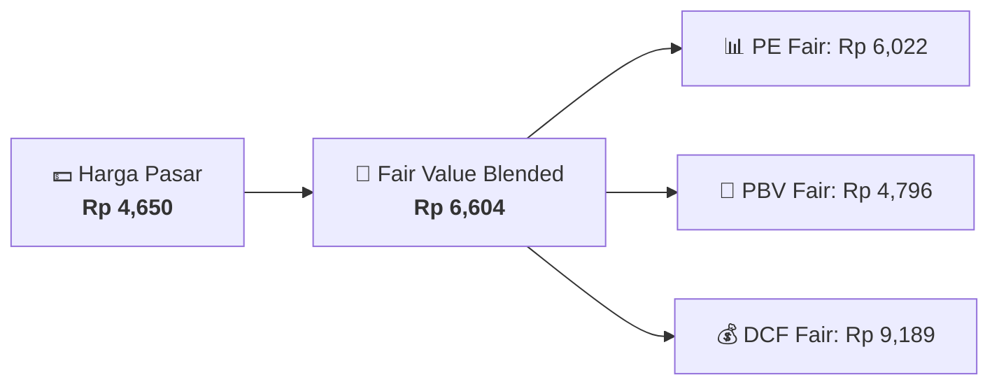

# 📈 Laporan Valuasi & Harga Wajar: [[BBRI]]

⬅️ [[knowledge-base/daily-digests/Daily_Digest_20260804|Kembali ke Daily Digest]] | 📅 **2026-08-04** | 🎛️ [[Dashboard|Ke Dashboard Utama]]

> [!IMPORTANT]
> Laporan ini disusun secara otomatis oleh **Valuation Engine Agent** menggunakan metode 3-Stage DCF, Relative PE/PBV Multiples, dan Margin of Safety (MOS).

---

## 📌 1. Ringkasan Rating & Harga Wajar (Fair Value Summary)
| Metrik Valuasi | Nilai | Catatan & Target |
| :--- | :--- | :--- |
| **Harga Pasar Saat Ini** | `Rp 4,650` | Harga Penutupan Terakhir |
| 🎯 **Harga Wajar Blended (Fair Value)** | `Rp 6,604` | Bobot 40% PE + 30% PBV + 30% DCF |
| **Margin of Safety (MOS)** | `+42.0%` | Potensi Diskon Diskon / Premium |
| **Rating Valuasi** | 🟢 **UNDERVALUED** (Diskon 42.0%) | Sinyal Otomatis Engine |
| **Rekomendasi Aksi** | 🔥 **STRONG BUY / ACCUMULATE**. Harga pasar saat ini berada jauh di bawah nilai wajar historis & DCF. | Panduan Investor |

---

## 📊 2. Rincian Perhitungan Berdasarkan Metode
### A. Relative Multiples (P/E & P/BV Ratio)
- **Earnings Per Share (EPS)**: `Rp 401.50` | Fair PE (15.0x) ➔ **Fair Value PE: Rp 6,022**
- **Book Value Per Share (BVPS)**: `Rp 2,180.00` | Fair PBV (2.2x) ➔ **Fair Value PBV: Rp 4,796**
- **Return on Equity (ROE)**: `18.30%` (Indikator Efisiensi Ekuitas)

### B. 3-Stage Discounted Cash Flow (DCF)
- **Free Cash Flow / Share**: `Rp 450.00`
- **Asumsi Growth / WACC**: `Growth 9.0%` | `WACC 9.5%` | `Terminal Growth 3.0%`
- 🎯 **Fair Value DCF**: `Rp 9,189`

---

## 📈 3. Visualisasi Perbandingan Harga vs Fair Value

---

## 🔗 Hubungan Note Terkait (Knowledge Graph)
- [[knowledge-base/entities/BBRI|🏬 Profil Emiten [[BBRI]]]]
- [[knowledge-base/daily-digests/Daily_Digest_20260804|📄 Daily Digest 2026-08-04]]
- [[Dashboard|🎛️ Kembali ke Dashboard]]