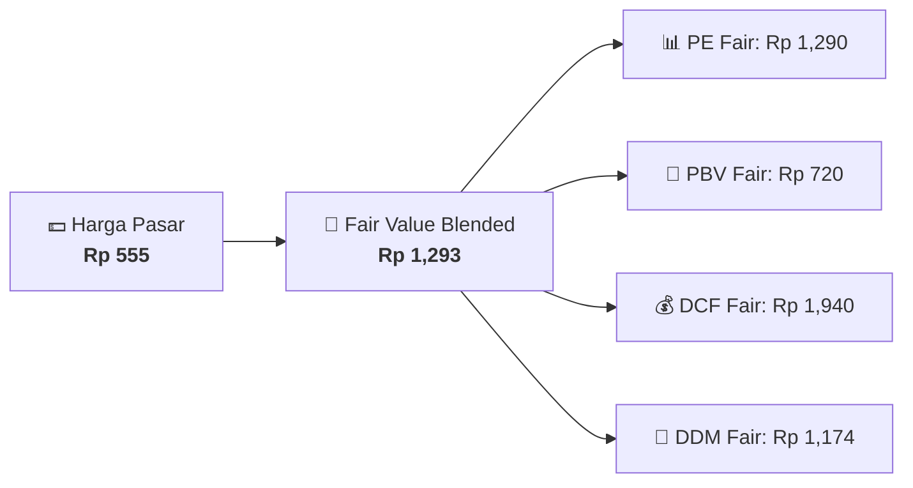

# 📈 Laporan Valuasi & Rating Nilai Wajar: [[IKBI]]

⬅️ [[knowledge-base/daily-digests/Daily_Digest_20260811|Kembali ke Daily Digest]] | 📅 **2026-08-11** | 🎛️ [[Dashboard|Ke Dashboard Utama]]

> [!IMPORTANT]
> Laporan ini disusun secara otomatis oleh **Valuation Engine Agent** menggunakan 4 Kombinasi Metode: 3-Stage DCF, PE/PBV Relative Multiples, Dividend Discount Model (DDM), dan Margin of Safety (MOS).

---

## 📌 1. Ringkasan Rating & Harga Wajar (Fair Value Summary)
| Metrik Valuasi | Nilai Resmi / Hasil Engine | Catatan & Target |
| :--- | :--- | :--- |
| **Harga Pasar Saat Ini** | `Rp 555` | Harga Penutupan Terakhir |
| 🎯 **Harga Wajar Blended (Fair Value)** | `Rp 1,293` | Multimodel (PE + PBV + DCF + DDM) |
| **Margin of Safety (MOS)** | `+132.9%` | Potensi Diskon / Premium |
| **Rating Valuasi Saham** | 🟢 **UNDERVALUED** (Diskon 132.9%) | Sinyal Otomatis Engine |
| **Rekomendasi Aksi** | 🔥 **STRONG BUY / ACCUMULATE**. Harga pasar saat ini berada jauh di bawah nilai wajar konsensus & DCF. | Panduan Investor |

---

## 📊 2. Rincian Perhitungan Berdasarkan Metodologi
### A. Relative Multiples (P/E & P/BV Ratio)
- **Earnings Per Share (EPS)**: `Rp 107.50` | Target Fair PE (12.0x) ➔ **Fair Value PE: Rp 1,290**
- **Book Value Per Share (BVPS)**: `Rp 480.00` | Target Fair PBV (1.5x) ➔ **Fair Value PBV: Rp 720**
- **Return on Equity (ROE)**: `22.83%` (Indikator Efisiensi Ekuitas)

### B. 3-Stage Discounted Cash Flow (DCF)
- **Free Cash Flow / Share**: `Rp 95.00`
- **Asumsi Growth / WACC**: `Growth 9.0%` | `WACC 9.5%` | `Terminal Growth 3.0%`
- 🎯 **Fair Value DCF**: `Rp 1,940`

### C. Dividend Discount Model (DDM / Gordon Growth)
- **Dividen Per Saham (DPS)**: `Rp 44.31` | Dividend Yield: `7.98%`
- **Asumsi Growth / Cost of Equity**: `Growth 6.0%` | `Cost of Equity 10.0%`
- 💸 **Fair Value DDM**: `Rp 1,174`

---

## 📈 3. Visualisasi Perbandingan Harga Pasar vs Nilai Wajar

---

## 🔗 Hubungan Note Terkait (Knowledge Graph)
- [[knowledge-base/entities/IKBI|🏬 Profil Emiten [[IKBI]]]]
- [[knowledge-base/daily-digests/Daily_Digest_20260811|📄 Daily Digest 2026-08-11]]
- [[Dashboard|🎛️ Kembali ke Dashboard Utama]]