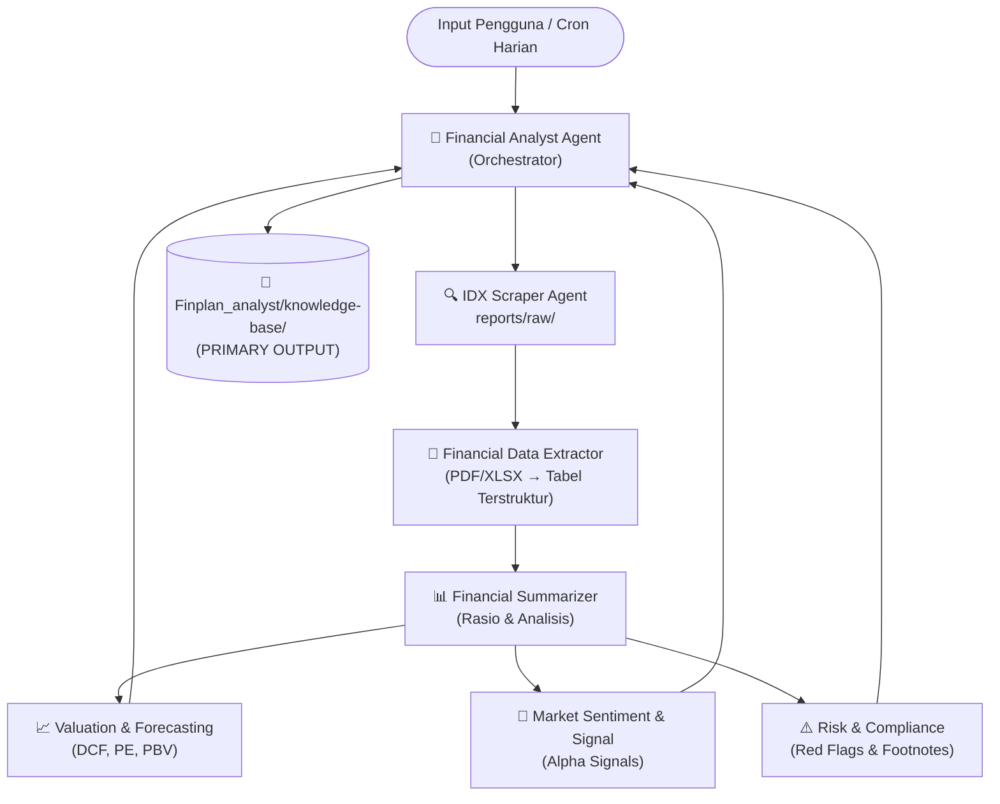

# Swarm Intelijen Pasar Modal Indonesia (BEI)

> Sistem multi-agen berbasis LLM untuk analisis otomatis laporan keuangan, aksi korporasi, valuasi saham, dan pemantauan harian Bursa Efek Indonesia (IDX).

---

## 🏗️ Arsitektur Sistem



---

## 👥 Tim Agen (8 Persona)

| # | Agen | Peran | Skill |
|---|---|---|---|
| 1 | **Financial Analyst Agent** | Orchestrator & QC | — |
| 2 | **IDX Scraper Agent** | Download PDF dari BEI | `idx-scraper` |
| 3 | **Financial Data Extractor** | Ekstrak tabel mentah PDF/XLSX | `financial-data-extractor` |
| 4 | **Financial Summarizer** | Hitung rasio & analisis keuangan | `financial-summarizer` |
| 5 | **Corporate Action Summarizer** | Laporan Dividen/MTO/Rights Issue/RUPS | `corporate-action-summarizer` |
| 6 | **Valuation & Forecasting Agent** | DCF, PE/PBV, Fair Value, MOS | — |
| 7 | **Market Sentiment & Signal Agent** | Sinyal trading & Action Calendar | — |
| 8 | **Risk & Compliance Agent** | Red flags & opini auditor | `risk-compliance` |

Lihat [`AGENTS.md`](.agents/AGENTS.md) untuk deskripsi lengkap setiap persona.

---

## 📁 Struktur Direktori

```
Model2/
├── .agents/                        # Konfigurasi sistem agen
│   ├── AGENTS.md                   # Definisi 8 persona & prinsip kerja
│   ├── llm_client.py               # Client LLM (multi-endpoint, health check)
│   ├── env_loader.py               # Auto-loader .env (multi-path)
│   ├── sector_map.json             # Mapping kode emiten → sektor (115+ emiten)
│   ├── sector_prompts.json         # KPI fokus & prompt addendum per sektor
│   ├── rules/
│   │   ├── general-rules.md        # Standar berlaku untuk SEMUA agen
│   │   ├── swarm-rules.md          # Koordinasi multi-agen & pipeline 5 tahap
│   │   └── daily-reporting-rules.md # Standar laporan harian & format Markdown
│   └── skills/
│       ├── idx-scraper/            # Skill: crawl & download PDF dari IDX
│       ├── financial-data-extractor/ # Skill: ekstrak tabel dari PDF/XLSX
│       ├── financial-summarizer/   # Skill: hitung rasio + script pendukung
│       │   └── scripts/
│       │       ├── valuation_engine.py      # DCF, PE, PBV calculator
│       │       ├── sector_kpi_parser.py     # KPI spesifik per sektor
│       │       └── public_expose_builder.py # Parser Q&A Public Expose
│       ├── corporate-action-summarizer/ # Skill: laporan aksi korporasi
│       │   └── scripts/
│       │       └── corporate_action_builder.py # Builder 8-tipe aksi korporasi
│       ├── daily-monitoring/       # Skill: pipeline monitoring harian
│       └── risk-compliance/        # Skill: red flags & risk assessment
│
├── reports/                        # Storage output (BACKUP/EXPORT)
│   ├── raw/                        # PDF mentah per emiten (859+ direktori)
│   │   └── today_manifest.json     # Manifest harian (update otomatis)
│   ├── summaries/                  # Output analisis (BACKUP dari knowledge-base)
│   │   ├── daily-digests/          # Daily Digest per tanggal
│   │   ├── financial-summaries/    # Ringkasan keuangan per emiten
│   │   ├── corporate-actions/      # Laporan aksi korporasi
│   │   ├── public-exposes/         # Laporan Public Expose
│   │   ├── valuations/             # Laporan valuasi
│   │   ├── trading-signals/        # Sinyal trading harian
│   │   ├── Action_Calendar.md      # Kalender aksi korporasi aktif
│   │   └── Tomorrow_Action_Plan.md # Rencana kerja besok
│   ├── cache/                      # Cache scraping
│   └── daily_scheduler.log         # Log eksekusi harian
│
├── Finplan_analyst/                # Obsidian Vault (PRIMARY STORAGE)
│   ├── Dashboard.md                # Pusat navigasi utama
│   ├── knowledge-base/             # Database intelijen pasar modal
│   │   ├── daily-digests/          # ← PRIMARY: Daily Digest harian
│   │   ├── financial-summaries/    # ← PRIMARY: Ringkasan keuangan
│   │   ├── corporate-actions/      # ← PRIMARY: Laporan aksi korporasi
│   │   ├── public-exposes/         # ← PRIMARY: Laporan Public Expose
│   │   ├── valuations/             # ← PRIMARY: Laporan valuasi
│   │   ├── trading-signals/        # ← PRIMARY: Sinyal trading
│   │   ├── rups-notices/           # ← PRIMARY: Notice RUPS & RUPSLB
│   │   ├── calendars/              # Kalender corporate action
│   │   ├── entities/               # Profil entitas/perusahaan
│   │   ├── plans/                  # Rencana kerja agen
│   │   ├── rules/                  # Salinan rules untuk referensi Obsidian
│   │   └── topics/                 # Topik & tema analisis
│   └── [Nama_Aksi_Korporasi].md    # Template index per kategori aksi korporasi
│
├── templates/                      # Template dokumen standar
│   ├── daily_digest_template.md
│   └── financial_summary_template.md
│
├── CashFactsDaily-Pipeline/        # Sub-project: AI video content pipeline (INDEPENDEN)
│   └── ...                         # Tidak terhubung ke sistem Swarm keuangan
│
├── market_intelligence.db          # SQLite database (data manifest & sinyal)
├── emitens.txt                     # Watchlist emiten prioritas (6 emiten)
└── .env                            # API keys & konfigurasi (jangan di-commit!)
```

---

## ⚙️ Konfigurasi

### 1. Setup API Keys (`.env`)
```bash
# Copy dari .agents/.env dan isi:
CUSTOM_LLM_URL=https://api.your-llm-provider.com/v1
CUSTOM_LLM_FALLBACK_URL=https://fallback.your-llm-provider.com/v1
CUSTOM_LLM_KEY=your_api_key_here
CUSTOM_LLM_MODEL=your_model_name
```

### 2. Tambah Emiten ke Watchlist
- **Watchlist harian** (`emitens.txt`): tambah kode emiten 4 huruf, satu per baris
- **Pemetaan sektor** (`.agents/sector_map.json`): tambah entry `"KODE": "Nama Sektor"` sesuai kategori yang ada

### 3. Dependensi Python
```bash
pip install curl_cffi pymupdf pypdf openpyxl pyyaml requests
```

---

## 🔑 Aturan Source of Truth

> **PENTING**: `Finplan_analyst/knowledge-base/` adalah **PRIMARY STORAGE** semua dokumen intelijen.
> `reports/summaries/` hanya berfungsi sebagai **export/backup** — jangan jadikan referensi utama.

---

## 📊 Status Sistem (per September 2026)

| Metrik | Nilai |
|---|---|
| Agen aktif | 8 persona, 6 skills |
| Emiten di sector_map | ~120 unik |
| Folder emiten di reports/raw | 859 direktori |
| Daily Digests yang sudah dibuat | 3 bulan (Jul–Sep 2026) |
| Database size | 8.4 MB (SQLite) |
| Watchlist emiten | ASII, BBCA, BBRI, DSSA, IRSX, TLKM |

---

## 📚 Dokumen Referensi Utama

| Dokumen | Deskripsi |
|---|---|
| [`.agents/AGENTS.md`](.agents/AGENTS.md) | Definisi 8 persona & 10 sektor adaptif |
| [`.agents/rules/swarm-rules.md`](.agents/rules/swarm-rules.md) | Pipeline 5-tahap & koordinasi antar agen |
| [`.agents/rules/daily-reporting-rules.md`](.agents/rules/daily-reporting-rules.md) | Standar format laporan harian |
| [`.agents/rules/general-rules.md`](.agents/rules/general-rules.md) | Zero-hallucination & coding standards |
| [`Finplan_analyst/Dashboard.md`](Finplan_analyst/Dashboard.md) | Pusat navigasi Obsidian vault |
