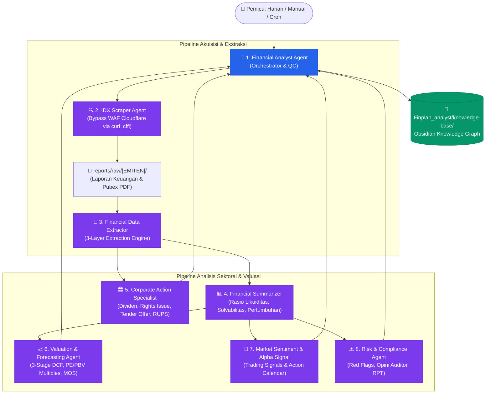

<div align="center">

# 🦅 AlphaDigest — Autonomous IDX Financial Intelligence Swarm

**Sistem Intelijen Multi-Agen Berbasis LLM untuk Analisis Otomatis Pasar Modal Indonesia (Bursa Efek Indonesia / BEI)**

[](https://www.python.org/)
[](#-arsitektur-multi-agen)
[-E02424.svg?style=flat)](https://www.idx.co.id)
[](#-adaptivitas-10-sektor-bisnis)
[](LICENSE)
[](#-obsidian-second-brain-integration)

<p align="center">
  <a href="#-fitur-utama">Fitur Utama</a> •
  <a href="#-arsitektur-multi-agen">Arsitektur Agen</a> •
  <a href="#-framework-ekstraksi-3-layer">3-Layer Framework</a> •
  <a href="#-adaptivitas-10-sektor-bisnis">Matriks Sektoral</a> •
  <a href="#-panduan-instalasi--quickstart">Quickstart</a> •
  <a href="#-lisensi">Lisensi</a>
</p>

</div>

---

## 💡 Apa Itu AlphaDigest?

**AlphaDigest** adalah orkestrasi 8 agen AI cerdas (*Autonomous Swarm*) yang memantau, mengunduh, mengekstrak, menganalisis, dan memprediksi nilai wajar emiten di **Bursa Efek Indonesia (IDX)** secara *end-to-end*. 

Berbeda dengan analisis keuangan konvensional yang kaku (*one-template-fits-all*) atau hanya membaca deretan angka, AlphaDigest menerapkan **Non-Rigid Intelligence**:
1. **Ekstraksi Adaptif Sektoral**: Otomatis menyesuaikan metrik kunci sesuai industri emiten (NIM & NPL untuk Bank, Stripping Ratio & Cash Cost untuk Tambang, Presales & Landbank untuk Properti).
2. **Paket Data 3-Layer**: Menggabungkan angka Neraca/Laba Rugi standar dengan KPI operasional dan intelegensi kualitatif (Catatan Kaki, Opini Auditor, Q&A Public Expose, serta Guidance Manajemen).
3. **Obsidian Second Brain Native**: Seluruh laporan terbit otomatis ke dalam vault *Obsidian* siap pakai dengan *bidirectional linking* (`[[TICKER]]`), *dataview*, dan dashboard terintegrasi.

---

## 🏗️ Arsitektur Multi-Agen



---

## 👥 Tim 8 Persona Agen Spesialis

| # | Persona Agen | Peran & Tanggung Jawab | Output & Otoritas Eksklusif |
|:---:|---|---|---|
| **1** | **Financial Analyst (Orchestrator)** | Memimpin tim Swarm, rencana kerja, Quality Control akhir. | Menandatangani Laporan Investasi Final |
| **2** | **IDX Scraper Agent** | Crawling laporan keuangan & keterbukaan informasi via `curl_cffi`. | Unduh aman ke `reports/raw/` tanpa blokir |
| **3** | **Financial Data Extractor** | Membaca PDF/XLSX, ekstraksi tabel Neraca, L/R, Arus Kas & KPI. | Paket Data 3-Layer Bersih |
| **4** | **Financial Summarizer** | Menghitung rasio likuiditas, profitabilitas, EBITDA, tren YoY/QoQ. | Analisis Kinerja Bisnis & Margin |
| **5** | **Corporate Action Summarizer** | Spesialis Dividen, MTO, Rights Issue (HMETD), Buyback, Stock Split. | Diagram Timeline Mermaid & Rasio HMETD |
| **6** | **Valuation Specialist** | Menghitung Nilai Wajar (Fair Value) dan Margin of Safety (MOS). | `Fair_Value_Estimate`, DCF 3-Stage, Rating |
| **7** | **Alpha Signal Specialist** | Deteksi peluang Capital Gain, Dividend Yield, dan Arbitrase. | `Trading_Signals_YYYYMMDD.md` |
| **8** | **Risk & Compliance Agent** | Deteksi red flags catatan kaki, kepatuhan, transaksi afiliasi (RPT). | `Auditor_Opinion`, `Footnote_Red_Flags` |

---

## 📐 Framework Ekstraksi 3-Layer

Agen tidak hanya membaca deretan angka mati. Ekstraksi dilakukan secara berlapis:

```
┌────────────────────────────────────────────────────────────────────────┐
│ 📋 LAYER 1: Core Financials (Universal untuk Seluruh Sektor)          │
│ • Neraca: Kas, Total Aset, Liabilitas Jk. Pendek/Panjang, Total Ekuitas │
│ • Laba Rugi: Pendapatan, Beban Pokok, Laba Usaha, Laba Bersih, EPS     │
│ • Arus Kas: Kas Operasi, Investasi, Pendanaan, Free Cash Flow          │
├────────────────────────────────────────────────────────────────────────┤
│ 🏭 LAYER 2: Sector KPIs (Adaptif Sesuai Sektor di sector_map.json)     │
│ • Bank: NIM, NPL Gross/Net, CAR, CASA, LDR, BOPO, Cost of Funds       │
│ • Tambang: Volume Produksi, ASP, Cash Cost/ton, Strip Ratio, Reserves │
│ • Properti: Marketing Sales/Presales, Landbank (Ha), Backlog Revenue   │
│ • Energi: Kapasitas (MW), Capacity Factor (%), Tarif PPA (USD/kWh)     │
├────────────────────────────────────────────────────────────────────────┤
│ 📝 LAYER 3: Qualitative Intelligence (Bukan Angka, Tapi Kritis!)      │
│ • Opini Auditor (WTP / WDP / Penekanan Suatu Hal / KAP)                │
│ • Management Discussion & Analysis (MD&A) & Guidance Target Manajemen │
│ • Catatan Kaki Red Flags: Perkara Hukum Kontinjensi, Covenant Utang    │
│ • Transaksi Pihak Berelasi (RPT) & Potensi Conflict of Interest        │
└────────────────────────────────────────────────────────────────────────┘
```

---

## ⚡ Adaptivitas 10 Sektor Bisnis

Sistem secara dinamis mengenali profil bisnis emiten melalui `sector_map.json` (versi 2.0):

| Sektor | Emiten Contoh | Metrik Kunci yang Diekstrak Otomatis |
|---|---|---|
| 💳 **Perbankan & Multifinance** | `BBCA`, `BBRI`, `BMRI`, `WOMF` | NPL Gross/Net, NIM, CAR, CASA Ratio, Cost of Funds, CKPN (PSAK 71) |
| ⛏️ **Pertambangan & Logam** | `ANTM`, `PTBA`, `BYAN`, `AMMN` | Volume Produksi, ASP (USD/unit), Cash Cost/ton, Strip Ratio, Ore Reserves |
| 🏢 **Properti & Konstruksi** | `PANI`, `BSDE`, `CTRA`, `ADHI` | Presales / Marketing Sales, Landbank (Ha), Backlog, Take-Up Rate |
| ⚡ **Energi & Utilitas** | `PGEO`, `MEDC`, `ESSA`, `ELSA` | Kapasitas Terpasang (MW), Capacity Factor (%), Availability, Tarif PPA |
| 📡 **Telekomunikasi & Teknologi**| `TLKM`, `ISAT`, `EXCL`, `TOWR` | ARPU, Total Pelanggan Aktif, Tenancy Ratio Menara, Jangkauan Fiber |
| 🛒 **Konsumer & Ritel** | `ASII`, `ICBP`, `UNTR`, `AMRT` | Same-Store Sales Growth (SSSG), Inventory Turnover, Volume per Segmen |
| 🌿 **Agrikultur & Kelapa Sawit**| `AALI`, `LSIP`, `SGRO`, `TAPG` | Produksi TBS & CPO (ton), Yield/Ha, Oil Extraction Rate (OER), ASP CPO |
| 🏥 **Kesehatan & Farmasi** | `SILO`, `HEAL`, `KLBF`, `PRDA` | Bed Occupancy Rate (BOR), Revenue per Inpatient, Pipeline Obat BPOM |
| 🚧 **Infrastruktur & Transportasi**| `JSMR`, `GIAA`, `BIRD`, `TRUK`| Traffic Volume (SMP/hari), Load Factor, Utilisasi Armada, Tarif Tol |
| 🏭 **Manufaktur** | `BAJA`, `UNTD` | Kapasitas Terpasang, Utilization Rate, Raw Material Cost, Porsi Ekspor |

---

## 🧠 Obsidian Second Brain Integration

Semua dokumen hasil analisis disimpan ke dalam folder `Finplan_analyst/` yang siap dibuka langsung dengan aplikasi **[Obsidian](https://obsidian.md/)**:

- 🔗 **Interconnected Wikilinks**: Otomatis terhubung dengan format `[[BBCA]]`, `[[Daily_Digest_20261012]]`, dan `[[Dashboard]]`.
- 📊 **Mermaid Timeline Diagrams**: Visualisasi alur merger, rights issue, dan jadwal pembagian dividen.
- 🗂️ **Navigasi Dashboard Interaktif**: Satu klik untuk melompat dari kalender aksi korporasi ke analisis fundamental emiten terkait.

---

## 🚀 Panduan Instalasi & Quickstart

### 1. Kloning Repositori
```bash
git clone https://github.com/anYoneo/alphadigest-idx.git
cd alphadigest-idx
```

### 2. Pasang Dependensi
```bash
pip install -r requirements.txt
```

### 3. Konfigurasi Lingkungan (`.env`)
Salin file template `.env.example`:
```bash
cp .env.example .env
```
Lalu isi variabel sesuai kredensial LLM Anda:
```env
CUSTOM_LLM_URL=https://api.your-llm-provider.com/v1
CUSTOM_LLM_KEY=your_api_key_here
CUSTOM_LLM_MODEL=gemini-2.5-flash
```

### 4. Tambah Emiten Pantauan
Cukup tambahkan kode ticker saham di `emitens.txt`:
```text
BBCA
BBRI
TLKM
ASII
PANI
```

---

## 📁 Struktur Berkas Repositori

```text
alphadigest-idx/
├── .agents/                       # Konfigurasi Swarm Agen
│   ├── AGENTS.md                  # Definisi standar kerja 8 persona & 10 sektor
│   ├── sector_map.json            # Database pemetaan 130+ emiten & skema sektoral v2.0
│   ├── rules/                     # Standar Zero-Hallucination & Swarm Protocol
│   └── skills/                    # Modul kemampuan spesialis (Scraper, DCF, Q&A)
├── templates/                     # Format dokumen standar (Digest, Summary)
├── Finplan_analyst/               # Obsidian Vault (Knowledge Base & Intelligence Graph)
├── CashFactsDaily-Pipeline/       # Sub-pipeline otomasi konten analitik
├── emitens.txt                    # Daftar ticker pantauan aktif
├── requirements.txt               # Daftar pustaka Python utama
├── .env.example                   # Contoh konfigurasi environment aman
└── LICENSE                        # Lisensi Open Source (MIT)
```

---

## 📄 Lisensi & Disclaimer

- **Lisensi**: Dirilis di bawah lisensi terbuka [MIT License](LICENSE).
- **Disclaimer**: *Sistem ini dirancang murni untuk tujuan riset, edukasi, dan otomasi intelijen data publik pasar modal. Segala analisis atau sinyal rating tidak mewakili rekomendasi beli/jual finansial langsung. Selalu lakukan Due Diligence mandiri.*
